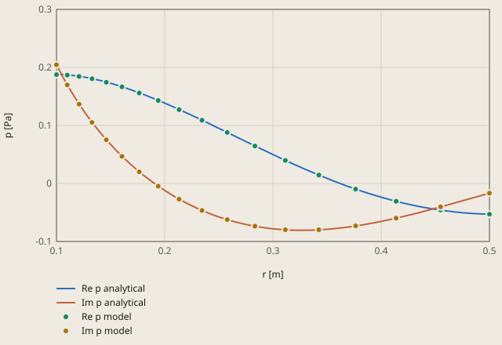
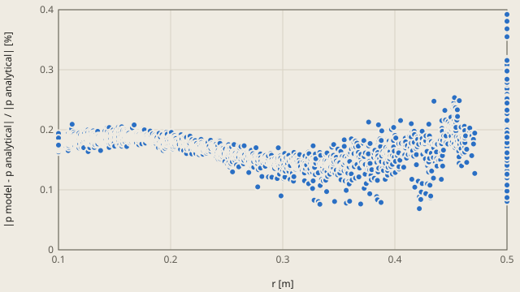

# acoustics-pulsating-sphere derivation

## Conclusion

The GetDP model gives the analytical spherical wave of the pulsating sphere: at each node of the mesh, p is within 0.39 % of the analytical p. The radiation impedance z is within 0.11 %, and p at the check point (r = 0.3 m) is within 0.32 %. The tolerance is 1 %.

**Sound pressure against the distance from the centre of the sphere, 500 Hz**



Re p model: GetDP, the 18 nodes on the x axis

Im p model: GetDP, the 18 nodes on the x axis

Analytical: p(r) = rho c U z (a / r) exp(-j k (r - a)), Kinsler et al. (2000), section 7.1. At r = a, p is rho c U z.

<details><summary>Values of the plot</summary>

Original values. — means no sample.

| r [m] | Re p analytical (p [Pa]) | Im p analytical (p [Pa]) | Re p model (p [Pa]) | Im p model (p [Pa]) |
| ---: | ---: | ---: | ---: | ---: |
| 0.1 | 0.187771 | 0.205009 | — | — |
| 0.1 | — | — | 0.187558 | 0.204584 |
| 0.104 | 0.187648 | 0.190378 | — | — |
| 0.108 | 0.187292 | 0.176586 | — | — |
| 0.10993 | — | — | 0.186817 | 0.169811 |
| 0.112 | 0.186719 | 0.163549 | — | — |
| 0.116 | 0.185943 | 0.1512 | — | — |
| 0.12 | 0.184978 | 0.139479 | — | — |
| 0.12085 | — | — | 0.184514 | 0.136733 |
| 0.124 | 0.183835 | 0.128332 | — | — |
| 0.128 | 0.182524 | 0.117715 | — | — |
| 0.132 | 0.181056 | 0.107588 | — | — |
| 0.13285 | — | — | 0.180481 | 0.105204 |
| 0.136 | 0.179437 | 0.097917 | — | — |
| 0.14 | 0.177678 | 0.0886708 | — | — |
| 0.144 | 0.175784 | 0.0798226 | — | — |
| 0.14604 | — | — | 0.174521 | 0.0752083 |
| 0.148 | 0.173763 | 0.0713484 | — | — |
| 0.152 | 0.171621 | 0.063227 | — | — |
| 0.156 | 0.169365 | 0.0554394 | — | — |
| 0.16 | 0.167 | 0.0479687 | — | — |
| 0.16054 | — | — | 0.166424 | 0.0467762 |
| 0.164 | 0.164532 | 0.0407995 | — | — |
| 0.168 | 0.161965 | 0.0339183 | — | — |
| 0.172 | 0.159306 | 0.0273127 | — | — |
| 0.176 | 0.156559 | 0.0209716 | — | — |
| 0.17648 | — | — | 0.155978 | 0.0200641 |
| 0.18 | 0.153728 | 0.0148847 | — | — |
| 0.184 | 0.150819 | 0.00904294 | — | — |
| 0.188 | 0.147835 | 0.00343788 | — | — |
| 0.192 | 0.144781 | -0.00193814 | — | — |
| 0.194 | — | — | 0.142991 | -0.00465995 |
| 0.196 | 0.141662 | -0.00709219 | — | — |
| 0.2 | 0.138481 | -0.0120308 | — | — |
| 0.204 | 0.135242 | -0.0167598 | — | — |
| 0.208 | 0.13195 | -0.0212849 | — | — |
| 0.212 | 0.128609 | -0.0256113 | — | — |
| 0.21327 | — | — | 0.127318 | -0.0270145 |
| 0.216 | 0.125222 | -0.0297436 | — | — |
| 0.22 | 0.121793 | -0.0336865 | — | — |
| 0.224 | 0.118326 | -0.0374442 | — | — |
| 0.228 | 0.114825 | -0.0410206 | — | — |
| 0.232 | 0.111292 | -0.0444197 | — | — |
| 0.23445 | — | — | 0.108916 | -0.0464419 |
| 0.236 | 0.107733 | -0.0476449 | — | — |
| 0.24 | 0.104151 | -0.0506997 | — | — |
| 0.244 | 0.100548 | -0.0535874 | — | — |
| 0.248 | 0.0969285 | -0.0563112 | — | — |
| 0.252 | 0.0932961 | -0.0588742 | — | — |
| 0.256 | 0.0896539 | -0.0612793 | — | — |
| 0.25773 | — | — | 0.0879098 | -0.062254 |
| 0.26 | 0.0860054 | -0.0635294 | — | — |
| 0.264 | 0.0823537 | -0.0656274 | — | — |
| 0.268 | 0.0787022 | -0.0675759 | — | — |
| 0.272 | 0.0750539 | -0.0693778 | — | — |
| 0.276 | 0.0714122 | -0.0710358 | — | — |
| 0.28 | 0.06778 | -0.0725523 | — | — |
| 0.28332 | — | — | 0.064638 | -0.0736514 |
| 0.284 | 0.0641605 | -0.0739302 | — | — |
| 0.288 | 0.0605566 | -0.0751719 | — | — |
| 0.292 | 0.0569712 | -0.0762801 | — | — |
| 0.296 | 0.0534074 | -0.0772574 | — | — |
| 0.3 | 0.0498678 | -0.0781063 | — | — |
| 0.304 | 0.0463554 | -0.0788294 | — | — |
| 0.308 | 0.0428728 | -0.0794293 | — | — |
| 0.31145 | — | — | 0.0397921 | -0.0797712 |
| 0.312 | 0.0394226 | -0.0799086 | — | — |
| 0.316 | 0.0360076 | -0.0802698 | — | — |
| 0.32 | 0.0326303 | -0.0805157 | — | — |
| 0.324 | 0.029293 | -0.0806487 | — | — |
| 0.328 | 0.0259984 | -0.0806716 | — | — |
| 0.332 | 0.0227486 | -0.080587 | — | — |
| 0.336 | 0.0195461 | -0.0803975 | — | — |
| 0.34 | 0.016393 | -0.0801059 | — | — |
| 0.34238 | — | — | 0.0144821 | -0.079786 |
| 0.344 | 0.0132915 | -0.0797148 | — | — |
| 0.348 | 0.0102436 | -0.0792269 | — | — |
| 0.352 | 0.00725141 | -0.0786449 | — | — |
| 0.356 | 0.00431685 | -0.0779717 | — | — |
| 0.36 | 0.00144177 | -0.07721 | — | — |
| 0.364 | -0.00137204 | -0.0763625 | — | — |
| 0.368 | -0.00412285 | -0.0754321 | — | — |
| 0.372 | -0.00680904 | -0.0744215 | — | — |
| 0.376 | -0.00942903 | -0.0733337 | — | — |
| 0.37638 | — | — | -0.0096959 | -0.0731134 |
| 0.38 | -0.0119813 | -0.0721713 | — | — |
| 0.384 | -0.0144646 | -0.0709373 | — | — |
| 0.388 | -0.0168774 | -0.0696345 | — | — |
| 0.392 | -0.0192185 | -0.0682658 | — | — |
| 0.396 | -0.0214868 | -0.0668341 | — | — |
| 0.4 | -0.0236813 | -0.0653422 | — | — |
| 0.404 | -0.0258007 | -0.063793 | — | — |
| 0.408 | -0.0278444 | -0.0621894 | — | — |
| 0.412 | -0.0298113 | -0.0605343 | — | — |
| 0.41375 | — | — | -0.0306172 | -0.0596873 |
| 0.416 | -0.0317008 | -0.0588306 | — | — |
| 0.42 | -0.0335122 | -0.0570811 | — | — |
| 0.424 | -0.0352448 | -0.0552887 | — | — |
| 0.428 | -0.0368982 | -0.0534564 | — | — |
| 0.432 | -0.0384719 | -0.0515869 | — | — |
| 0.436 | -0.0399656 | -0.049683 | — | — |
| 0.44 | -0.041379 | -0.0477478 | — | — |
| 0.444 | -0.0427119 | -0.0457839 | — | — |
| 0.448 | -0.0439641 | -0.0437941 | — | — |
| 0.452 | -0.0451357 | -0.0417814 | — | — |
| 0.45484 | — | — | -0.0458571 | -0.0402475 |
| 0.456 | -0.0462267 | -0.0397483 | — | — |
| 0.46 | -0.0472373 | -0.0376977 | — | — |
| 0.464 | -0.0481675 | -0.0356324 | — | — |
| 0.468 | -0.0490178 | -0.0335549 | — | — |
| 0.472 | -0.0497884 | -0.031468 | — | — |
| 0.476 | -0.0504799 | -0.0293742 | — | — |
| 0.48 | -0.0510926 | -0.0272763 | — | — |
| 0.484 | -0.0516271 | -0.0251768 | — | — |
| 0.488 | -0.0520842 | -0.0230781 | — | — |
| 0.492 | -0.0524646 | -0.0209829 | — | — |
| 0.496 | -0.0527689 | -0.0188935 | — | — |
| 0.5 | -0.0529981 | -0.0168124 | — | — |
| 0.5 | — | — | -0.0529314 | -0.0167289 |

</details>

The dots of the model lie on the lines of the analytical p. At r = a, p is the pressure on the sphere, rho c U z = 0.188 + j 0.205 Pa. Away from the sphere, |p| decreases as a / r, and the phase decreases by k (r - a), with the wavelength 0.686 m.

**Difference of the model p from the analytical p at each node**



model: GetDP, all the 2253 nodes of the mesh

The largest difference is 0.39 %. rel_tol of check.toml is 1 %. It applies to the 4 checks.

<details><summary>Values of the plot</summary>

Original values. — means no sample.

| r [m] | model (\|p model - p analytical\| / \|p analytical\| [%]) |
| ---: | ---: |
| 0.1 | 0.1783 |
| 0.1 | 0.1719 |
| 0.1 | 0.1747 |
| 0.1 | 0.1709 |
| 0.1 | 0.1734 |
| 0.1 | 0.1726 |
| 0.1 | 0.1725 |
| 0.1 | 0.1749 |
| 0.1 | 0.1767 |
| 0.1 | 0.1736 |
| 0.1 | 0.1709 |
| 0.1 | 0.1711 |
| 0.1 | 0.1713 |
| 0.1 | 0.1724 |
| 0.1 | 0.1725 |
| 0.1 | 0.1728 |
| 0.1 | 0.1716 |
| 0.1 | 0.1743 |
| 0.1 | 0.1745 |
| 0.1 | 0.1724 |
| 0.1 | 0.179 |
| 0.1 | 0.1709 |
| 0.1 | 0.1743 |
| 0.1 | 0.1701 |
| 0.1 | 0.173 |
| 0.1 | 0.1749 |
| 0.1 | 0.1753 |
| 0.1 | 0.1726 |
| 0.1 | 0.1698 |
| 0.1 | 0.1748 |
| 0.1 | 0.1769 |
| 0.1 | 0.1761 |
| 0.1 | 0.1721 |
| 0.1 | 0.1725 |
| 0.1 | 0.1678 |
| 0.1 | 0.1686 |
| 0.1 | 0.1926 |
| 0.1 | 0.1696 |
| 0.1 | 0.1697 |
| 0.1 | 0.1705 |
| 0.1 | 0.1724 |
| 0.1 | 0.1727 |
| 0.1 | 0.1736 |
| 0.1 | 0.1768 |
| 0.1 | 0.1717 |
| 0.1 | 0.1743 |
| 0.1 | 0.1709 |
| 0.1 | 0.1699 |
| 0.1 | 0.17 |
| 0.1 | 0.1711 |
| 0.1 | 0.1714 |
| 0.1 | 0.1718 |
| 0.1 | 0.1745 |
| 0.1 | 0.1728 |
| 0.1 | 0.1725 |
| 0.1 | 0.1864 |
| 0.1 | 0.1764 |
| 0.1 | 0.1716 |
| 0.1 | 0.1725 |
| 0.1 | 0.1697 |
| 0.1 | 0.1744 |
| 0.1 | 0.1741 |
| 0.1 | 0.1729 |
| 0.1 | 0.1757 |
| 0.1 | 0.1721 |
| 0.1 | 0.1742 |
| 0.1 | 0.1756 |
| 0.1 | 0.1771 |
| 0.1 | 0.1762 |
| 0.1 | 0.1878 |
| 0.1 | 0.1745 |
| 0.1 | 0.1751 |
| 0.1 | 0.1703 |
| 0.1 | 0.1705 |
| 0.1 | 0.1707 |
| 0.1 | 0.1708 |
| 0.1 | 0.1736 |
| 0.1 | 0.1736 |
| 0.1 | 0.1632 |
| 0.1 | 0.1728 |
| 0.1 | 0.1746 |
| 0.1 | 0.1715 |
| 0.1 | 0.1702 |
| 0.1 | 0.1798 |
| 0.1 | 0.1732 |
| 0.1 | 0.1715 |
| 0.1 | 0.1726 |
| 0.1 | 0.1733 |
| 0.1 | 0.173 |
| 0.1 | 0.1731 |
| 0.1 | 0.1754 |
| 0.1 | 0.1755 |
| 0.1 | 0.178 |
| 0.1 | 0.1741 |
| 0.1 | 0.1801 |
| 0.1 | 0.1744 |
| 0.1 | 0.1724 |
| 0.1 | 0.1692 |
| 0.1 | 0.1714 |
| 0.1 | 0.1711 |
| 0.1 | 0.1764 |
| 0.1 | 0.176 |
| 0.1 | 0.1729 |
| 0.1 | 0.1718 |
| 0.1 | 0.1746 |
| 0.1 | 0.1763 |
| 0.1 | 0.1704 |
| 0.1 | 0.1767 |
| 0.1 | 0.1852 |
| 0.1 | 0.1705 |
| 0.1 | 0.1692 |
| 0.1 | 0.1703 |
| 0.1 | 0.1706 |
| 0.1 | 0.1713 |
| 0.1 | 0.1727 |
| 0.1 | 0.1729 |
| 0.1 | 0.1723 |
| 0.1 | 0.1939 |
| 0.1 | 0.1713 |
| 0.1 | 0.1751 |
| 0.1 | 0.1716 |
| 0.1 | 0.1765 |
| 0.1 | 0.1725 |
| 0.1 | 0.1748 |
| 0.1 | 0.1718 |
| 0.1 | 0.1714 |
| 0.1 | 0.1698 |
| 0.1 | 0.1709 |
| 0.1 | 0.1723 |
| 0.1 | 0.1726 |
| 0.1 | 0.1766 |
| 0.1 | 0.1752 |
| 0.1 | 0.1724 |
| 0.1 | 0.1698 |
| 0.1 | 0.1734 |
| 0.1 | 0.1768 |
| 0.1 | 0.1702 |
| 0.1 | 0.1696 |
| 0.1 | 0.1774 |
| 0.1 | 0.1748 |
| 0.1 | 0.1746 |
| 0.1 | 0.1783 |
| 0.1 | 0.1733 |
| 0.1 | 0.1776 |
| 0.1 | 0.1738 |
| 0.1 | 0.1714 |
| 0.1 | 0.1729 |
| 0.1 | 0.1725 |
| 0.1 | 0.1756 |
| 0.1 | 0.1719 |
| 0.1 | 0.1712 |
| 0.1 | 0.1763 |
| 0.1 | 0.1725 |
| 0.1 | 0.1718 |
| 0.1 | 0.173 |
| 0.1 | 0.1728 |
| 0.1 | 0.1766 |
| 0.1 | 0.1787 |
| 0.1 | 0.1819 |
| 0.1 | 0.1746 |
| 0.1 | 0.175 |
| 0.1 | 0.174 |
| 0.1 | 0.173 |
| 0.1 | 0.1751 |
| 0.1 | 0.1757 |
| 0.1 | 0.173 |
| 0.1 | 0.1731 |
| 0.1 | 0.1744 |
| 0.1 | 0.1729 |
| 0.1 | 0.1728 |
| 0.1 | 0.1753 |
| 0.1 | 0.1769 |
| 0.1 | 0.1748 |
| 0.1 | 0.1706 |
| 0.1 | 0.1752 |
| 0.1 | 0.1755 |
| 0.1 | 0.1706 |
| 0.1 | 0.173 |
| 0.1 | 0.1768 |
| 0.1 | 0.1738 |
| 0.1 | 0.174 |
| 0.1 | 0.1709 |
| 0.1 | 0.1733 |
| 0.1 | 0.1721 |
| 0.1 | 0.1725 |
| 0.1 | 0.1726 |
| 0.1 | 0.1768 |
| 0.1 | 0.1737 |
| 0.1 | 0.1755 |
| 0.1 | 0.1698 |
| 0.1 | 0.1755 |
| 0.1 | 0.1694 |
| 0.1 | 0.1747 |
| 0.1 | 0.1729 |
| 0.1 | 0.1755 |
| 0.1 | 0.1706 |
| 0.1 | 0.1734 |
| 0.1 | 0.1674 |
| 0.1 | 0.1677 |
| 0.1 | 0.1686 |
| 0.1 | 0.1694 |
| 0.1 | 0.1709 |
| 0.1 | 0.1712 |
| 0.1 | 0.1747 |
| 0.1 | 0.1727 |
| 0.1 | 0.1743 |
| 0.1 | 0.1775 |
| 0.1 | 0.1771 |
| 0.1 | 0.1732 |
| 0.1 | 0.1719 |
| 0.1 | 0.1863 |
| 0.1 | 0.1767 |
| 0.1 | 0.1765 |
| 0.1 | 0.1683 |
| 0.1 | 0.1741 |
| 0.1 | 0.1745 |
| 0.1 | 0.1718 |
| 0.1 | 0.167 |
| 0.1 | 0.1687 |
| 0.1 | 0.1698 |
| 0.1 | 0.17 |
| 0.1 | 0.1708 |
| 0.1 | 0.1732 |
| 0.1 | 0.1719 |
| 0.1 | 0.1763 |
| 0.1 | 0.1721 |
| 0.1 | 0.1745 |
| 0.10661 | 0.1733 |
| 0.10661 | 0.1814 |
| 0.10699 | 0.1833 |
| 0.10699 | 0.1839 |
| 0.10765 | 0.1751 |
| 0.10765 | 0.1756 |
| 0.10765 | 0.1764 |
| 0.10765 | 0.1771 |
| 0.10765 | 0.1788 |
| 0.10765 | 0.1804 |
| 0.10782 | 0.1811 |
| 0.10789 | 0.1773 |
| 0.10789 | 0.182 |
| 0.10806 | 0.1802 |
| 0.10821 | 0.1828 |
| 0.10825 | 0.1833 |
| 0.10827 | 0.184 |
| 0.10831 | 0.174 |
| 0.10831 | 0.1842 |
| 0.10838 | 0.1793 |
| 0.10838 | 0.1798 |
| 0.10838 | 0.1885 |
| 0.10838 | 0.1887 |
| 0.10838 | 0.1785 |
| 0.10841 | 0.1837 |
| 0.10842 | 0.178 |
| 0.10847 | 0.1793 |
| 0.10847 | 0.1863 |
| 0.10848 | 0.1835 |
| 0.10848 | 0.1849 |
| 0.10853 | 0.1667 |
| 0.10862 | 0.1653 |
| 0.10862 | 0.1823 |
| 0.1087 | 0.1911 |
| 0.10872 | 0.1812 |
| 0.10872 | 0.1852 |
| 0.10876 | 0.185 |
| 0.10877 | 0.1804 |
| 0.10878 | 0.1803 |
| 0.10878 | 0.185 |
| 0.1088 | 0.1874 |
| 0.10881 | 0.1855 |
| 0.10884 | 0.1926 |
| 0.10885 | 0.1894 |
| 0.10889 | 0.1941 |
| 0.10895 | 0.1869 |
| 0.10896 | 0.182 |
| 0.10907 | 0.1872 |
| 0.10911 | 0.1705 |
| 0.10911 | 0.1738 |
| 0.10915 | 0.1884 |
| 0.10917 | 0.1838 |
| 0.10919 | 0.1866 |
| 0.10922 | 0.187 |
| 0.10933 | 0.188 |
| 0.10939 | 0.186 |
| 0.10952 | 0.1842 |
| 0.1096 | 0.1873 |
| 0.10965 | 0.1812 |
| 0.10966 | 0.1839 |
| 0.10973 | 0.1841 |
| 0.10977 | 0.1771 |
| 0.10977 | 0.1773 |
| 0.10993 | 0.1796 |
| 0.10993 | 0.1807 |
| 0.10993 | 0.1816 |
| 0.10994 | 0.1778 |
| 0.10997 | 0.185 |
| 0.11005 | 0.1839 |
| 0.11005 | 0.184 |
| 0.1101 | 0.1794 |
| 0.11015 | 0.1872 |
| 0.11023 | 0.1804 |
| 0.11023 | 0.1811 |
| 0.11039 | 0.1892 |
| 0.11044 | 0.1862 |
| 0.11047 | 0.1918 |
| 0.11048 | 0.1907 |
| 0.11062 | 0.1883 |
| 0.11066 | 0.1912 |
| 0.11075 | 0.1805 |
| 0.11077 | 0.1849 |
| 0.11086 | 0.1925 |
| 0.11094 | 0.187 |
| 0.11095 | 0.1882 |
| 0.11095 | 0.1812 |
| 0.11098 | 0.197 |
| 0.11103 | 0.1851 |
| 0.11109 | 0.1857 |
| 0.11111 | 0.1895 |
| 0.11113 | 0.1835 |
| 0.11116 | 0.195 |
| 0.11118 | 0.1947 |
| 0.11124 | 0.1839 |
| 0.11139 | 0.1919 |
| 0.11141 | 0.1806 |
| 0.11158 | 0.1888 |
| 0.11174 | 0.2016 |
| 0.11202 | 0.1901 |
| 0.11215 | 0.1828 |
| 0.11218 | 0.2092 |
| 0.1122 | 0.1817 |
| 0.11237 | 0.1913 |
| 0.11246 | 0.1938 |
| 0.11247 | 0.1842 |
| 0.11249 | 0.1916 |
| 0.11252 | 0.1828 |
| 0.11257 | 0.1892 |
| 0.11266 | 0.1915 |
| 0.11269 | 0.1864 |
| 0.1127 | 0.1839 |
| 0.11289 | 0.1791 |
| 0.11305 | 0.183 |
| 0.11307 | 0.1866 |
| 0.11324 | 0.1808 |
| 0.11327 | 0.188 |
| 0.11329 | 0.183 |
| 0.11359 | 0.1852 |
| 0.1137 | 0.1959 |
| 0.11391 | 0.1842 |
| 0.11405 | 0.1774 |
| 0.11417 | 0.18 |
| 0.11422 | 0.1927 |
| 0.11426 | 0.1744 |
| 0.11428 | 0.1819 |
| 0.1144 | 0.1839 |
| 0.1146 | 0.1796 |
| 0.11472 | 0.1861 |
| 0.1148 | 0.1812 |
| 0.1148 | 0.173 |
| 0.11498 | 0.1797 |
| 0.11508 | 0.1893 |
| 0.11508 | 0.1865 |
| 0.11511 | 0.1826 |
| 0.11519 | 0.1874 |
| 0.11528 | 0.1853 |
| 0.11535 | 0.1831 |
| 0.11559 | 0.1791 |
| 0.11571 | 0.18 |
| 0.11583 | 0.1676 |
| 0.11593 | 0.178 |
| 0.11603 | 0.1816 |
| 0.11603 | 0.1822 |
| 0.11616 | 0.1773 |
| 0.11616 | 0.1782 |
| 0.1163 | 0.1751 |
| 0.1163 | 0.1788 |
| 0.11636 | 0.1774 |
| 0.11641 | 0.1686 |
| 0.11641 | 0.1856 |
| 0.11646 | 0.1796 |
| 0.11663 | 0.174 |
| 0.11663 | 0.182 |
| 0.11667 | 0.1676 |
| 0.11668 | 0.1725 |
| 0.11673 | 0.1846 |
| 0.11684 | 0.1752 |
| 0.11684 | 0.1863 |
| 0.11713 | 0.1762 |
| 0.11718 | 0.1698 |
| 0.11718 | 0.1718 |
| 0.11728 | 0.1772 |
| 0.11744 | 0.1745 |
| 0.11757 | 0.1749 |
| 0.11758 | 0.1721 |
| 0.11758 | 0.1747 |
| 0.11759 | 0.1716 |
| 0.1176 | 0.187 |
| 0.11763 | 0.1769 |
| 0.11766 | 0.1684 |
| 0.11767 | 0.1805 |
| 0.11771 | 0.1915 |
| 0.1178 | 0.1774 |
| 0.1178 | 0.182 |
| 0.11787 | 0.1727 |
| 0.11792 | 0.1858 |
| 0.11792 | 0.1862 |
| 0.11796 | 0.1777 |
| 0.11803 | 0.1844 |
| 0.11807 | 0.176 |
| 0.1182 | 0.1761 |
| 0.11824 | 0.1798 |
| 0.11824 | 0.1942 |
| 0.11832 | 0.1697 |
| 0.11842 | 0.1844 |
| 0.11843 | 0.1859 |
| 0.11854 | 0.1758 |
| 0.11854 | 0.1853 |
| 0.11901 | 0.1765 |
| 0.11937 | 0.188 |
| 0.11979 | 0.191 |
| 0.11979 | 0.1917 |
| 0.12 | 0.1822 |
| 0.12006 | 0.1824 |
| 0.12028 | 0.1711 |
| 0.12078 | 0.1861 |
| 0.12085 | 0.181 |
| 0.12085 | 0.1842 |
| 0.12085 | 0.1844 |
| 0.12104 | 0.178 |
| 0.12112 | 0.1844 |
| 0.1216 | 0.1808 |
| 0.12162 | 0.1825 |
| 0.12162 | 0.1884 |
| 0.12165 | 0.1898 |
| 0.12165 | 0.1912 |
| 0.12175 | 0.1782 |
| 0.12179 | 0.1909 |
| 0.1218 | 0.1721 |
| 0.12256 | 0.1702 |
| 0.12258 | 0.1863 |
| 0.12258 | 0.1986 |
| 0.12264 | 0.1949 |
| 0.12284 | 0.1826 |
| 0.12287 | 0.1909 |
| 0.12287 | 0.1985 |
| 0.12335 | 0.1952 |
| 0.12359 | 0.1854 |
| 0.12362 | 0.1882 |
| 0.124 | 0.1856 |
| 0.12442 | 0.1879 |
| 0.12443 | 0.1998 |
| 0.12457 | 0.185 |
| 0.12476 | 0.1814 |
| 0.12492 | 0.1884 |
| 0.12492 | 0.198 |
| 0.125 | 0.1831 |
| 0.12506 | 0.1881 |
| 0.12522 | 0.1904 |
| 0.12537 | 0.1891 |
| 0.12567 | 0.1887 |
| 0.12568 | 0.1925 |
| 0.12599 | 0.1872 |
| 0.12599 | 0.1924 |
| 0.12603 | 0.1862 |
| 0.12616 | 0.1878 |
| 0.12616 | 0.1889 |
| 0.12622 | 0.1997 |
| 0.12631 | 0.1955 |
| 0.12645 | 0.1637 |
| 0.12651 | 0.1758 |
| 0.12683 | 0.1787 |
| 0.12696 | 0.1844 |
| 0.12696 | 0.1852 |
| 0.12697 | 0.1782 |
| 0.12707 | 0.1903 |
| 0.12719 | 0.176 |
| 0.1272 | 0.1885 |
| 0.12731 | 0.1885 |
| 0.12745 | 0.1784 |
| 0.12752 | 0.1868 |
| 0.12758 | 0.1867 |
| 0.12758 | 0.1824 |
| 0.12768 | 0.187 |
| 0.12771 | 0.182 |
| 0.12791 | 0.1845 |
| 0.12795 | 0.1701 |
| 0.12797 | 0.1882 |
| 0.12803 | 0.1811 |
| 0.12803 | 0.1839 |
| 0.12818 | 0.1833 |
| 0.12818 | 0.1871 |
| 0.1283 | 0.186 |
| 0.12841 | 0.1945 |
| 0.12846 | 0.1802 |
| 0.12849 | 0.1771 |
| 0.12849 | 0.1964 |
| 0.12849 | 0.1983 |
| 0.12862 | 0.1876 |
| 0.12867 | 0.1827 |
| 0.12873 | 0.1812 |
| 0.129 | 0.1782 |
| 0.12913 | 0.1858 |
| 0.12917 | 0.1915 |
| 0.12923 | 0.1908 |
| 0.12923 | 0.1788 |
| 0.12923 | 0.1882 |
| 0.12925 | 0.1798 |
| 0.12925 | 0.1919 |
| 0.12933 | 0.1923 |
| 0.12938 | 0.1877 |
| 0.12938 | 0.1966 |
| 0.1294 | 0.1809 |
| 0.12959 | 0.1796 |
| 0.12959 | 0.1814 |
| 0.1297 | 0.1786 |
| 0.12972 | 0.1853 |
| 0.12986 | 0.1787 |
| 0.12994 | 0.1911 |
| 0.12999 | 0.1862 |
| 0.13018 | 0.1896 |
| 0.13018 | 0.1912 |
| 0.13081 | 0.182 |
| 0.13092 | 0.1835 |
| 0.13093 | 0.1981 |
| 0.13101 | 0.1939 |
| 0.13128 | 0.1923 |
| 0.1316 | 0.1863 |
| 0.13166 | 0.1939 |
| 0.13166 | 0.1806 |
| 0.13173 | 0.188 |
| 0.13178 | 0.1792 |
| 0.1318 | 0.1836 |
| 0.13196 | 0.1835 |
| 0.13196 | 0.1838 |
| 0.13197 | 0.1705 |
| 0.13199 | 0.1816 |
| 0.13213 | 0.1772 |
| 0.13213 | 0.1908 |
| 0.13221 | 0.1845 |
| 0.13267 | 0.1752 |
| 0.13285 | 0.186 |
| 0.13285 | 0.1863 |
| 0.13285 | 0.1871 |
| 0.13295 | 0.1931 |
| 0.13343 | 0.1846 |
| 0.13347 | 0.1922 |
| 0.13407 | 0.186 |
| 0.13412 | 0.1774 |
| 0.13412 | 0.1893 |
| 0.13418 | 0.1864 |
| 0.1344 | 0.1837 |
| 0.13452 | 0.1861 |
| 0.13484 | 0.1858 |
| 0.13493 | 0.1974 |
| 0.13508 | 0.186 |
| 0.13514 | 0.1748 |
| 0.13514 | 0.1765 |
| 0.13518 | 0.1836 |
| 0.13518 | 0.1897 |
| 0.13522 | 0.188 |
| 0.13538 | 0.1875 |
| 0.13538 | 0.19 |
| 0.13577 | 0.1889 |
| 0.1358 | 0.183 |
| 0.13635 | 0.1854 |
| 0.13707 | 0.1794 |
| 0.13716 | 0.1796 |
| 0.13716 | 0.1875 |
| 0.13733 | 0.1812 |
| 0.13733 | 0.1818 |
| 0.13751 | 0.1654 |
| 0.13751 | 0.1804 |
| 0.13796 | 0.1862 |
| 0.13804 | 0.1892 |
| 0.13811 | 0.184 |
| 0.13825 | 0.1884 |
| 0.1383 | 0.1876 |
| 0.13864 | 0.1817 |
| 0.13878 | 0.1777 |
| 0.13886 | 0.1801 |
| 0.13887 | 0.1856 |
| 0.13896 | 0.1856 |
| 0.13896 | 0.1879 |
| 0.1394 | 0.1814 |
| 0.1395 | 0.1837 |
| 0.13959 | 0.1928 |
| 0.13968 | 0.1924 |
| 0.13975 | 0.1804 |
| 0.13975 | 0.1873 |
| 0.13979 | 0.1881 |
| 0.13996 | 0.1798 |
| 0.14004 | 0.1915 |
| 0.14027 | 0.1891 |
| 0.14027 | 0.1905 |
| 0.14051 | 0.1884 |
| 0.14053 | 0.1862 |
| 0.14063 | 0.1858 |
| 0.14074 | 0.188 |
| 0.1409 | 0.1856 |
| 0.14115 | 0.1829 |
| 0.1412 | 0.1801 |
| 0.14134 | 0.1783 |
| 0.14145 | 0.1895 |
| 0.14146 | 0.1849 |
| 0.14149 | 0.1983 |
| 0.14151 | 0.1753 |
| 0.14151 | 0.1877 |
| 0.14169 | 0.1846 |
| 0.14197 | 0.1768 |
| 0.14197 | 0.1897 |
| 0.142 | 0.1763 |
| 0.14203 | 0.18 |
| 0.14236 | 0.1828 |
| 0.14236 | 0.1874 |
| 0.14245 | 0.1839 |
| 0.143 | 0.1901 |
| 0.14319 | 0.1757 |
| 0.14335 | 0.1947 |
| 0.14341 | 0.188 |
| 0.14347 | 0.193 |
| 0.14349 | 0.1938 |
| 0.1436 | 0.1783 |
| 0.1436 | 0.2038 |
| 0.14368 | 0.1931 |
| 0.14376 | 0.1914 |
| 0.14376 | 0.1989 |
| 0.14379 | 0.1976 |
| 0.14412 | 0.1825 |
| 0.14437 | 0.1874 |
| 0.1446 | 0.1831 |
| 0.14468 | 0.1744 |
| 0.14471 | 0.1855 |
| 0.14471 | 0.1884 |
| 0.14488 | 0.184 |
| 0.14501 | 0.176 |
| 0.14504 | 0.1908 |
| 0.14521 | 0.1705 |
| 0.14521 | 0.2038 |
| 0.14537 | 0.1891 |
| 0.14554 | 0.1951 |
| 0.14565 | 0.1866 |
| 0.14604 | 0.1867 |
| 0.14604 | 0.1877 |
| 0.14604 | 0.1889 |
| 0.14613 | 0.1907 |
| 0.14616 | 0.1855 |
| 0.14626 | 0.1861 |
| 0.14634 | 0.1911 |
| 0.14649 | 0.1806 |
| 0.1465 | 0.1787 |
| 0.1465 | 0.1933 |
| 0.14656 | 0.1856 |
| 0.14681 | 0.1765 |
| 0.14772 | 0.1893 |
| 0.14817 | 0.1822 |
| 0.14817 | 0.1894 |
| 0.14842 | 0.1782 |
| 0.14843 | 0.1942 |
| 0.14844 | 0.1934 |
| 0.14844 | 0.1936 |
| 0.14856 | 0.1811 |
| 0.14886 | 0.1999 |
| 0.14907 | 0.1855 |
| 0.14907 | 0.1919 |
| 0.14932 | 0.1952 |
| 0.1495 | 0.1925 |
| 0.14966 | 0.1775 |
| 0.14989 | 0.1954 |
| 0.14994 | 0.191 |
| 0.14998 | 0.1888 |
| 0.15008 | 0.1869 |
| 0.15012 | 0.1727 |
| 0.15012 | 0.1952 |
| 0.15021 | 0.1872 |
| 0.15134 | 0.1926 |
| 0.15177 | 0.1865 |
| 0.15177 | 0.1829 |
| 0.15185 | 0.2019 |
| 0.15206 | 0.1866 |
| 0.15219 | 0.1851 |
| 0.15236 | 0.1825 |
| 0.15241 | 0.1942 |
| 0.15242 | 0.1864 |
| 0.15262 | 0.1896 |
| 0.15262 | 0.1825 |
| 0.15262 | 0.1841 |
| 0.15304 | 0.1865 |
| 0.15305 | 0.1803 |
| 0.15319 | 0.2058 |
| 0.15337 | 0.1987 |
| 0.15337 | 0.2043 |
| 0.15344 | 0.1755 |
| 0.15351 | 0.1892 |
| 0.15355 | 0.1979 |
| 0.1537 | 0.1938 |
| 0.1537 | 0.1958 |
| 0.15379 | 0.1813 |
| 0.15385 | 0.1954 |
| 0.15386 | 0.1877 |
| 0.15386 | 0.1879 |
| 0.15387 | 0.1819 |
| 0.15394 | 0.188 |
| 0.15473 | 0.1756 |
| 0.15522 | 0.1939 |
| 0.15536 | 0.1821 |
| 0.15536 | 0.2039 |
| 0.15545 | 0.1984 |
| 0.15545 | 0.2025 |
| 0.15553 | 0.1942 |
| 0.15561 | 0.1852 |
| 0.15561 | 0.1857 |
| 0.15582 | 0.1867 |
| 0.15606 | 0.1898 |
| 0.15606 | 0.1906 |
| 0.15623 | 0.1878 |
| 0.15641 | 0.1905 |
| 0.15641 | 0.205 |
| 0.15644 | 0.1727 |
| 0.15708 | 0.2003 |
| 0.1573 | 0.1848 |
| 0.15739 | 0.1765 |
| 0.15745 | 0.1987 |
| 0.15755 | 0.177 |
| 0.15784 | 0.1905 |
| 0.15804 | 0.189 |
| 0.15858 | 0.1862 |
| 0.1588 | 0.1907 |
| 0.15891 | 0.186 |
| 0.15891 | 0.1883 |
| 0.15922 | 0.1938 |
| 0.15923 | 0.1784 |
| 0.15923 | 0.1983 |
| 0.15955 | 0.1923 |
| 0.15964 | 0.1797 |
| 0.15997 | 0.1949 |
| 0.16054 | 0.1882 |
| 0.16054 | 0.1884 |
| 0.16054 | 0.1895 |
| 0.16055 | 0.2 |
| 0.16057 | 0.1837 |
| 0.16089 | 0.1722 |
| 0.16089 | 0.1974 |
| 0.161 | 0.1872 |
| 0.161 | 0.1878 |
| 0.16101 | 0.1944 |
| 0.16104 | 0.1826 |
| 0.16126 | 0.1853 |
| 0.16171 | 0.1907 |
| 0.16181 | 0.1876 |
| 0.16218 | 0.1884 |
| 0.16225 | 0.1848 |
| 0.16225 | 0.1877 |
| 0.16233 | 0.1952 |
| 0.16235 | 0.186 |
| 0.16259 | 0.1872 |
| 0.16259 | 0.1962 |
| 0.16262 | 0.1941 |
| 0.16315 | 0.1846 |
| 0.16327 | 0.1842 |
| 0.16328 | 0.1903 |
| 0.16371 | 0.1785 |
| 0.16387 | 0.1864 |
| 0.16388 | 0.1888 |
| 0.164 | 0.1815 |
| 0.16425 | 0.1894 |
| 0.16483 | 0.1866 |
| 0.16511 | 0.1813 |
| 0.16511 | 0.1923 |
| 0.16524 | 0.1897 |
| 0.1653 | 0.1885 |
| 0.16538 | 0.18 |
| 0.1654 | 0.1871 |
| 0.16543 | 0.1901 |
| 0.16593 | 0.2031 |
| 0.1663 | 0.1908 |
| 0.1664 | 0.1876 |
| 0.16659 | 0.1816 |
| 0.16666 | 0.1906 |
| 0.16699 | 0.1826 |
| 0.16738 | 0.1917 |
| 0.16738 | 0.1908 |
| 0.16739 | 0.1869 |
| 0.16747 | 0.1847 |
| 0.16747 | 0.2081 |
| 0.16765 | 0.1853 |
| 0.16772 | 0.1795 |
| 0.16796 | 0.1807 |
| 0.16819 | 0.184 |
| 0.16855 | 0.1794 |
| 0.16855 | 0.1942 |
| 0.16856 | 0.1857 |
| 0.16861 | 0.1875 |
| 0.16863 | 0.1926 |
| 0.16871 | 0.1796 |
| 0.16876 | 0.1876 |
| 0.16876 | 0.1909 |
| 0.16881 | 0.1882 |
| 0.16881 | 0.1907 |
| 0.16902 | 0.1878 |
| 0.16902 | 0.1874 |
| 0.16902 | 0.1885 |
| 0.16912 | 0.1845 |
| 0.1695 | 0.1817 |
| 0.16964 | 0.1782 |
| 0.16964 | 0.1927 |
| 0.16978 | 0.1893 |
| 0.16993 | 0.1933 |
| 0.17015 | 0.1872 |
| 0.17078 | 0.1849 |
| 0.17085 | 0.1834 |
| 0.17085 | 0.1857 |
| 0.17113 | 0.193 |
| 0.17116 | 0.191 |
| 0.17129 | 0.1834 |
| 0.17129 | 0.1888 |
| 0.17151 | 0.1813 |
| 0.17168 | 0.1751 |
| 0.17168 | 0.1871 |
| 0.17202 | 0.181 |
| 0.17206 | 0.1893 |
| 0.17206 | 0.1924 |
| 0.17248 | 0.1847 |
| 0.17286 | 0.1894 |
| 0.17315 | 0.1833 |
| 0.17338 | 0.1899 |
| 0.1735 | 0.1914 |
| 0.17355 | 0.184 |
| 0.17358 | 0.1868 |
| 0.17436 | 0.1766 |
| 0.17439 | 0.1866 |
| 0.17454 | 0.1931 |
| 0.17464 | 0.1965 |
| 0.1749 | 0.1948 |
| 0.1752 | 0.1877 |
| 0.17562 | 0.1868 |
| 0.17562 | 0.1873 |
| 0.17567 | 0.1903 |
| 0.17596 | 0.1962 |
| 0.17596 | 0.2017 |
| 0.17617 | 0.1879 |
| 0.17633 | 0.1879 |
| 0.17633 | 0.1901 |
| 0.17634 | 0.1868 |
| 0.17648 | 0.1875 |
| 0.17648 | 0.1875 |
| 0.17648 | 0.1882 |
| 0.1766 | 0.1999 |
| 0.17678 | 0.1894 |
| 0.17721 | 0.1812 |
| 0.1775 | 0.1856 |
| 0.17767 | 0.1813 |
| 0.17768 | 0.1779 |
| 0.17779 | 0.1857 |
| 0.17779 | 0.1916 |
| 0.17792 | 0.1872 |
| 0.17833 | 0.1894 |
| 0.17872 | 0.1912 |
| 0.17891 | 0.186 |
| 0.17929 | 0.1877 |
| 0.17945 | 0.1846 |
| 0.17947 | 0.1826 |
| 0.1796 | 0.1889 |
| 0.18 | 0.1829 |
| 0.18 | 0.184 |
| 0.18079 | 0.1837 |
| 0.18079 | 0.1875 |
| 0.18112 | 0.1885 |
| 0.18122 | 0.1843 |
| 0.18125 | 0.1868 |
| 0.18125 | 0.1908 |
| 0.18137 | 0.1853 |
| 0.18165 | 0.1856 |
| 0.18178 | 0.1978 |
| 0.18191 | 0.1871 |
| 0.18191 | 0.1816 |
| 0.18191 | 0.1822 |
| 0.18193 | 0.177 |
| 0.18223 | 0.1888 |
| 0.18254 | 0.1772 |
| 0.18254 | 0.1782 |
| 0.1828 | 0.1889 |
| 0.1828 | 0.1898 |
| 0.18281 | 0.191 |
| 0.18314 | 0.1822 |
| 0.18351 | 0.1806 |
| 0.18386 | 0.1837 |
| 0.18386 | 0.1931 |
| 0.18398 | 0.1802 |
| 0.18398 | 0.1841 |
| 0.18435 | 0.18 |
| 0.18435 | 0.1739 |
| 0.18436 | 0.1754 |
| 0.18482 | 0.176 |
| 0.18487 | 0.186 |
| 0.1853 | 0.1863 |
| 0.18536 | 0.1793 |
| 0.18539 | 0.1801 |
| 0.18551 | 0.1839 |
| 0.18579 | 0.1844 |
| 0.18587 | 0.1831 |
| 0.18587 | 0.191 |
| 0.18594 | 0.1822 |
| 0.18594 | 0.1787 |
| 0.18594 | 0.1824 |
| 0.18605 | 0.1818 |
| 0.18639 | 0.1744 |
| 0.18661 | 0.176 |
| 0.18661 | 0.1808 |
| 0.18666 | 0.1882 |
| 0.18685 | 0.1793 |
| 0.18685 | 0.1834 |
| 0.18694 | 0.1746 |
| 0.18694 | 0.1771 |
| 0.18702 | 0.1812 |
| 0.18733 | 0.184 |
| 0.18748 | 0.1889 |
| 0.18787 | 0.1862 |
| 0.18795 | 0.1873 |
| 0.18895 | 0.1798 |
| 0.18919 | 0.1702 |
| 0.18936 | 0.1817 |
| 0.18966 | 0.1826 |
| 0.18971 | 0.1829 |
| 0.18972 | 0.1846 |
| 0.18972 | 0.1941 |
| 0.1899 | 0.1832 |
| 0.18991 | 0.1802 |
| 0.19004 | 0.1809 |
| 0.19059 | 0.1851 |
| 0.19091 | 0.1879 |
| 0.19126 | 0.1756 |
| 0.19151 | 0.1736 |
| 0.19151 | 0.176 |
| 0.19158 | 0.1763 |
| 0.19176 | 0.1694 |
| 0.19227 | 0.1753 |
| 0.19247 | 0.1745 |
| 0.1925 | 0.1918 |
| 0.19275 | 0.1734 |
| 0.19286 | 0.1736 |
| 0.19335 | 0.1655 |
| 0.19335 | 0.1752 |
| 0.19338 | 0.1806 |
| 0.1937 | 0.1757 |
| 0.194 | 0.1819 |
| 0.194 | 0.1828 |
| 0.194 | 0.184 |
| 0.19407 | 0.1878 |
| 0.19441 | 0.1853 |
| 0.19485 | 0.1839 |
| 0.19487 | 0.1705 |
| 0.19502 | 0.1682 |
| 0.19502 | 0.1692 |
| 0.19551 | 0.1738 |
| 0.19551 | 0.1778 |
| 0.1958 | 0.1822 |
| 0.19596 | 0.1905 |
| 0.19596 | 0.1948 |
| 0.1962 | 0.1892 |
| 0.19628 | 0.1721 |
| 0.19628 | 0.1898 |
| 0.19629 | 0.1842 |
| 0.19631 | 0.1847 |
| 0.19631 | 0.196 |
| 0.19639 | 0.178 |
| 0.19659 | 0.1847 |
| 0.19676 | 0.1762 |
| 0.19677 | 0.1754 |
| 0.19698 | 0.1927 |
| 0.19702 | 0.1768 |
| 0.19709 | 0.181 |
| 0.19831 | 0.1857 |
| 0.19841 | 0.178 |
| 0.19879 | 0.1755 |
| 0.19929 | 0.1881 |
| 0.19931 | 0.1807 |
| 0.20011 | 0.1722 |
| 0.20022 | 0.1741 |
| 0.2006 | 0.1776 |
| 0.2006 | 0.178 |
| 0.20063 | 0.1894 |
| 0.20063 | 0.1957 |
| 0.20106 | 0.1751 |
| 0.2012 | 0.1769 |
| 0.20129 | 0.182 |
| 0.20129 | 0.1849 |
| 0.20136 | 0.1824 |
| 0.20136 | 0.1876 |
| 0.20146 | 0.1829 |
| 0.20183 | 0.1684 |
| 0.2021 | 0.1713 |
| 0.20229 | 0.1794 |
| 0.20249 | 0.1866 |
| 0.20295 | 0.1881 |
| 0.20309 | 0.178 |
| 0.20333 | 0.1759 |
| 0.20334 | 0.1841 |
| 0.20334 | 0.188 |
| 0.2035 | 0.1903 |
| 0.20359 | 0.1726 |
| 0.20368 | 0.176 |
| 0.20395 | 0.1851 |
| 0.20426 | 0.1846 |
| 0.20426 | 0.1869 |
| 0.20444 | 0.1821 |
| 0.20465 | 0.181 |
| 0.20465 | 0.1854 |
| 0.20469 | 0.1791 |
| 0.20476 | 0.1787 |
| 0.2051 | 0.1809 |
| 0.2051 | 0.1811 |
| 0.20555 | 0.1779 |
| 0.20579 | 0.1758 |
| 0.20594 | 0.1785 |
| 0.20711 | 0.1794 |
| 0.20719 | 0.1802 |
| 0.2072 | 0.1768 |
| 0.20726 | 0.1788 |
| 0.20736 | 0.1825 |
| 0.20774 | 0.1756 |
| 0.20882 | 0.1674 |
| 0.20882 | 0.1856 |
| 0.20885 | 0.1864 |
| 0.20938 | 0.1917 |
| 0.20952 | 0.1857 |
| 0.20994 | 0.1764 |
| 0.20994 | 0.1817 |
| 0.21005 | 0.1804 |
| 0.21018 | 0.1844 |
| 0.21031 | 0.1746 |
| 0.2114 | 0.1778 |
| 0.21144 | 0.1747 |
| 0.21157 | 0.1654 |
| 0.21197 | 0.1808 |
| 0.212 | 0.1764 |
| 0.21232 | 0.1877 |
| 0.21232 | 0.1887 |
| 0.2126 | 0.1877 |
| 0.21327 | 0.1784 |
| 0.21327 | 0.1789 |
| 0.21327 | 0.179 |
| 0.21359 | 0.1814 |
| 0.21359 | 0.1849 |
| 0.21367 | 0.1724 |
| 0.21387 | 0.1758 |
| 0.21388 | 0.1827 |
| 0.21388 | 0.1836 |
| 0.21396 | 0.177 |
| 0.21411 | 0.1873 |
| 0.21421 | 0.1604 |
| 0.21459 | 0.1679 |
| 0.21517 | 0.1754 |
| 0.21534 | 0.1773 |
| 0.21594 | 0.1746 |
| 0.21626 | 0.1789 |
| 0.21627 | 0.1705 |
| 0.21636 | 0.1698 |
| 0.21672 | 0.1751 |
| 0.21672 | 0.1815 |
| 0.21698 | 0.1802 |
| 0.21708 | 0.185 |
| 0.21709 | 0.1669 |
| 0.21709 | 0.1786 |
| 0.21711 | 0.1732 |
| 0.21711 | 0.1774 |
| 0.21735 | 0.1894 |
| 0.2178 | 0.1668 |
| 0.21799 | 0.1817 |
| 0.21828 | 0.1661 |
| 0.2189 | 0.1598 |
| 0.21914 | 0.1835 |
| 0.21969 | 0.1751 |
| 0.21994 | 0.1762 |
| 0.22006 | 0.1761 |
| 0.22023 | 0.1774 |
| 0.22029 | 0.172 |
| 0.22029 | 0.1742 |
| 0.22032 | 0.1794 |
| 0.2205 | 0.1702 |
| 0.2205 | 0.1707 |
| 0.22061 | 0.1674 |
| 0.22139 | 0.1709 |
| 0.22146 | 0.1765 |
| 0.22169 | 0.176 |
| 0.2218 | 0.1734 |
| 0.22188 | 0.1703 |
| 0.22188 | 0.1784 |
| 0.22195 | 0.1752 |
| 0.22195 | 0.182 |
| 0.22205 | 0.1646 |
| 0.22206 | 0.1747 |
| 0.2221 | 0.1687 |
| 0.22233 | 0.1762 |
| 0.22245 | 0.177 |
| 0.22253 | 0.1606 |
| 0.22287 | 0.1682 |
| 0.22329 | 0.1704 |
| 0.22329 | 0.1773 |
| 0.22345 | 0.1702 |
| 0.22359 | 0.1718 |
| 0.2242 | 0.1677 |
| 0.22449 | 0.1686 |
| 0.22471 | 0.1712 |
| 0.22473 | 0.1654 |
| 0.2248 | 0.1733 |
| 0.22507 | 0.1691 |
| 0.22507 | 0.1734 |
| 0.22509 | 0.1748 |
| 0.22534 | 0.1586 |
| 0.22587 | 0.1725 |
| 0.22605 | 0.1687 |
| 0.22605 | 0.1721 |
| 0.22607 | 0.1628 |
| 0.22607 | 0.1718 |
| 0.22692 | 0.1636 |
| 0.22716 | 0.1841 |
| 0.2274 | 0.1687 |
| 0.2275 | 0.1694 |
| 0.22753 | 0.1608 |
| 0.22753 | 0.1788 |
| 0.22764 | 0.1683 |
| 0.22799 | 0.1754 |
| 0.22865 | 0.1709 |
| 0.22872 | 0.1651 |
| 0.22879 | 0.1692 |
| 0.22892 | 0.1628 |
| 0.22893 | 0.1592 |
| 0.22894 | 0.1654 |
| 0.22895 | 0.1653 |
| 0.22918 | 0.1707 |
| 0.22937 | 0.1748 |
| 0.22947 | 0.165 |
| 0.23046 | 0.1685 |
| 0.23046 | 0.1748 |
| 0.23084 | 0.1693 |
| 0.23115 | 0.166 |
| 0.23115 | 0.1776 |
| 0.23126 | 0.1654 |
| 0.23151 | 0.175 |
| 0.2321 | 0.161 |
| 0.23223 | 0.1677 |
| 0.23238 | 0.1732 |
| 0.23259 | 0.1715 |
| 0.23298 | 0.1639 |
| 0.233 | 0.169 |
| 0.233 | 0.1693 |
| 0.23306 | 0.1677 |
| 0.23306 | 0.1801 |
| 0.23329 | 0.1696 |
| 0.23332 | 0.1788 |
| 0.2336 | 0.1666 |
| 0.23445 | 0.1684 |
| 0.23445 | 0.1724 |
| 0.23445 | 0.1727 |
| 0.23567 | 0.1826 |
| 0.23595 | 0.164 |
| 0.23595 | 0.1687 |
| 0.23701 | 0.1767 |
| 0.23753 | 0.1713 |
| 0.23753 | 0.174 |
| 0.23832 | 0.1692 |
| 0.23832 | 0.1718 |
| 0.23853 | 0.1731 |
| 0.23908 | 0.1685 |
| 0.2391 | 0.1676 |
| 0.2391 | 0.1682 |
| 0.23918 | 0.163 |
| 0.23918 | 0.1682 |
| 0.23958 | 0.1743 |
| 0.24045 | 0.1646 |
| 0.24049 | 0.1642 |
| 0.24059 | 0.1711 |
| 0.2406 | 0.1701 |
| 0.2406 | 0.1787 |
| 0.24061 | 0.173 |
| 0.24065 | 0.1626 |
| 0.24078 | 0.1763 |
| 0.24092 | 0.1553 |
| 0.24151 | 0.1592 |
| 0.24154 | 0.163 |
| 0.24154 | 0.1722 |
| 0.24219 | 0.1733 |
| 0.24251 | 0.1661 |
| 0.24252 | 0.1509 |
| 0.24321 | 0.1611 |
| 0.24321 | 0.1827 |
| 0.24333 | 0.1593 |
| 0.24393 | 0.1809 |
| 0.24399 | 0.1578 |
| 0.24399 | 0.1774 |
| 0.24404 | 0.1521 |
| 0.24446 | 0.1661 |
| 0.2445 | 0.1553 |
| 0.2452 | 0.1661 |
| 0.24531 | 0.1563 |
| 0.24531 | 0.1626 |
| 0.2455 | 0.1627 |
| 0.2456 | 0.1643 |
| 0.24601 | 0.1709 |
| 0.24615 | 0.1625 |
| 0.24629 | 0.161 |
| 0.24636 | 0.1616 |
| 0.24658 | 0.1548 |
| 0.24671 | 0.1637 |
| 0.24671 | 0.1656 |
| 0.24678 | 0.169 |
| 0.24682 | 0.1649 |
| 0.24725 | 0.1612 |
| 0.24751 | 0.1642 |
| 0.24756 | 0.1573 |
| 0.24776 | 0.1598 |
| 0.24843 | 0.1471 |
| 0.24893 | 0.1681 |
| 0.24975 | 0.1575 |
| 0.24975 | 0.1596 |
| 0.25036 | 0.1609 |
| 0.25057 | 0.1436 |
| 0.251 | 0.1551 |
| 0.25126 | 0.1541 |
| 0.25129 | 0.1641 |
| 0.25129 | 0.1656 |
| 0.25167 | 0.1617 |
| 0.25167 | 0.1636 |
| 0.25168 | 0.1751 |
| 0.25176 | 0.1607 |
| 0.25176 | 0.1589 |
| 0.25199 | 0.1672 |
| 0.25199 | 0.1697 |
| 0.25204 | 0.1662 |
| 0.25205 | 0.1456 |
| 0.25207 | 0.1706 |
| 0.25283 | 0.1603 |
| 0.25283 | 0.1688 |
| 0.25285 | 0.1379 |
| 0.25327 | 0.1417 |
| 0.25372 | 0.1529 |
| 0.25374 | 0.1637 |
| 0.25381 | 0.1439 |
| 0.25391 | 0.1643 |
| 0.25434 | 0.1598 |
| 0.25437 | 0.1658 |
| 0.2545 | 0.1712 |
| 0.25505 | 0.15 |
| 0.25507 | 0.1467 |
| 0.25525 | 0.1298 |
| 0.25553 | 0.1553 |
| 0.25604 | 0.1578 |
| 0.25604 | 0.163 |
| 0.25656 | 0.1754 |
| 0.25705 | 0.1649 |
| 0.25713 | 0.1594 |
| 0.25713 | 0.1634 |
| 0.25716 | 0.1521 |
| 0.25733 | 0.1628 |
| 0.25754 | 0.1488 |
| 0.25773 | 0.1583 |
| 0.25773 | 0.1605 |
| 0.25773 | 0.1608 |
| 0.25782 | 0.1553 |
| 0.25841 | 0.1529 |
| 0.25841 | 0.1561 |
| 0.25875 | 0.1413 |
| 0.25936 | 0.1589 |
| 0.25986 | 0.1568 |
| 0.26066 | 0.1548 |
| 0.26066 | 0.163 |
| 0.26071 | 0.1541 |
| 0.26081 | 0.1382 |
| 0.26082 | 0.1662 |
| 0.2612 | 0.173 |
| 0.26136 | 0.1614 |
| 0.26176 | 0.1696 |
| 0.26267 | 0.1508 |
| 0.26272 | 0.172 |
| 0.26295 | 0.1551 |
| 0.26305 | 0.1594 |
| 0.26305 | 0.1596 |
| 0.26423 | 0.1574 |
| 0.26423 | 0.1585 |
| 0.26477 | 0.1589 |
| 0.26477 | 0.1619 |
| 0.26489 | 0.1469 |
| 0.26489 | 0.1594 |
| 0.26508 | 0.1434 |
| 0.26508 | 0.1528 |
| 0.26553 | 0.1489 |
| 0.26555 | 0.1734 |
| 0.26568 | 0.1586 |
| 0.26598 | 0.1582 |
| 0.26707 | 0.1539 |
| 0.2674 | 0.1517 |
| 0.2676 | 0.1514 |
| 0.26862 | 0.1632 |
| 0.26863 | 0.1458 |
| 0.26872 | 0.1586 |
| 0.26889 | 0.1551 |
| 0.26945 | 0.1488 |
| 0.26968 | 0.1288 |
| 0.26974 | 0.1467 |
| 0.27029 | 0.1647 |
| 0.27061 | 0.1632 |
| 0.27065 | 0.1546 |
| 0.27073 | 0.1423 |
| 0.27073 | 0.1549 |
| 0.27093 | 0.1612 |
| 0.27106 | 0.161 |
| 0.27106 | 0.1624 |
| 0.27167 | 0.143 |
| 0.2717 | 0.1496 |
| 0.27174 | 0.1398 |
| 0.27183 | 0.1551 |
| 0.27193 | 0.1581 |
| 0.27197 | 0.1658 |
| 0.27203 | 0.1576 |
| 0.27234 | 0.1392 |
| 0.27251 | 0.1597 |
| 0.27314 | 0.1425 |
| 0.27314 | 0.1471 |
| 0.27317 | 0.1454 |
| 0.27329 | 0.1534 |
| 0.27339 | 0.1601 |
| 0.27415 | 0.1377 |
| 0.27415 | 0.1469 |
| 0.2744 | 0.1543 |
| 0.27476 | 0.1565 |
| 0.27577 | 0.1541 |
| 0.27613 | 0.1701 |
| 0.27629 | 0.1484 |
| 0.27681 | 0.151 |
| 0.27746 | 0.1415 |
| 0.27746 | 0.1561 |
| 0.27751 | 0.1437 |
| 0.27765 | 0.1048 |
| 0.27776 | 0.1484 |
| 0.27776 | 0.1549 |
| 0.27832 | 0.1335 |
| 0.27882 | 0.1543 |
| 0.27882 | 0.155 |
| 0.27998 | 0.1485 |
| 0.28017 | 0.145 |
| 0.28017 | 0.1597 |
| 0.28024 | 0.1363 |
| 0.28037 | 0.1534 |
| 0.28067 | 0.1481 |
| 0.28145 | 0.1221 |
| 0.28245 | 0.1449 |
| 0.28284 | 0.1511 |
| 0.28284 | 0.152 |
| 0.28332 | 0.1511 |
| 0.28332 | 0.1529 |
| 0.28332 | 0.1547 |
| 0.28339 | 0.1483 |
| 0.28398 | 0.1571 |
| 0.28411 | 0.1505 |
| 0.28449 | 0.1392 |
| 0.28449 | 0.1572 |
| 0.28537 | 0.1495 |
| 0.286 | 0.1517 |
| 0.286 | 0.1543 |
| 0.28607 | 0.1541 |
| 0.28611 | 0.1457 |
| 0.28647 | 0.1451 |
| 0.28647 | 0.151 |
| 0.2872 | 0.152 |
| 0.28722 | 0.1214 |
| 0.28722 | 0.1564 |
| 0.28833 | 0.1434 |
| 0.28899 | 0.1434 |
| 0.28899 | 0.1466 |
| 0.28937 | 0.1606 |
| 0.28982 | 0.15 |
| 0.28984 | 0.1398 |
| 0.28994 | 0.1576 |
| 0.29027 | 0.121 |
| 0.29039 | 0.1445 |
| 0.29047 | 0.1474 |
| 0.29047 | 0.1506 |
| 0.29117 | 0.1463 |
| 0.29132 | 0.1397 |
| 0.29204 | 0.145 |
| 0.29211 | 0.1416 |
| 0.29282 | 0.1356 |
| 0.29282 | 0.1507 |
| 0.29286 | 0.1454 |
| 0.29292 | 0.1518 |
| 0.29387 | 0.1482 |
| 0.29412 | 0.1486 |
| 0.29441 | 0.1426 |
| 0.29442 | 0.1406 |
| 0.29467 | 0.1389 |
| 0.29482 | 0.1388 |
| 0.29493 | 0.1516 |
| 0.29506 | 0.1188 |
| 0.29523 | 0.1481 |
| 0.29523 | 0.1497 |
| 0.29568 | 0.1527 |
| 0.29576 | 0.1415 |
| 0.29598 | 0.17 |
| 0.29602 | 0.1381 |
| 0.29631 | 0.138 |
| 0.29678 | 0.1396 |
| 0.29716 | 0.1262 |
| 0.29735 | 0.1522 |
| 0.29782 | 0.1564 |
| 0.29784 | 0.1435 |
| 0.29784 | 0.1513 |
| 0.29786 | 0.1346 |
| 0.29816 | 0.1428 |
| 0.29816 | 0.1522 |
| 0.29825 | 0.1478 |
| 0.29829 | 0.1502 |
| 0.29829 | 0.153 |
| 0.2985 | 0.0898 |
| 0.29953 | 0.1468 |
| 0.29982 | 0.1312 |
| 0.29983 | 0.15 |
| 0.30029 | 0.1388 |
| 0.30095 | 0.1187 |
| 0.30112 | 0.1414 |
| 0.30133 | 0.1562 |
| 0.30133 | 0.1565 |
| 0.30155 | 0.1286 |
| 0.30167 | 0.123 |
| 0.30173 | 0.1605 |
| 0.30185 | 0.1212 |
| 0.30226 | 0.1486 |
| 0.30233 | 0.1311 |
| 0.30259 | 0.1383 |
| 0.30259 | 0.1528 |
| 0.30314 | 0.1534 |
| 0.30386 | 0.1358 |
| 0.30387 | 0.1445 |
| 0.30436 | 0.1436 |
| 0.30532 | 0.153 |
| 0.30544 | 0.1574 |
| 0.30552 | 0.1495 |
| 0.30555 | 0.1308 |
| 0.30583 | 0.1373 |
| 0.30583 | 0.148 |
| 0.30661 | 0.1175 |
| 0.30671 | 0.1373 |
| 0.3068 | 0.1404 |
| 0.30752 | 0.1499 |
| 0.30808 | 0.1523 |
| 0.30833 | 0.1484 |
| 0.30833 | 0.1519 |
| 0.30862 | 0.1279 |
| 0.30954 | 0.1145 |
| 0.3096 | 0.1453 |
| 0.3096 | 0.1467 |
| 0.30977 | 0.1449 |
| 0.3099 | 0.1219 |
| 0.30997 | 0.1445 |
| 0.30997 | 0.1539 |
| 0.31002 | 0.1451 |
| 0.31003 | 0.1623 |
| 0.31092 | 0.1342 |
| 0.31093 | 0.1404 |
| 0.31105 | 0.1418 |
| 0.31105 | 0.1498 |
| 0.31145 | 0.1389 |
| 0.31145 | 0.1439 |
| 0.31145 | 0.1462 |
| 0.3117 | 0.1342 |
| 0.31175 | 0.1423 |
| 0.31175 | 0.147 |
| 0.31181 | 0.1489 |
| 0.31199 | 0.1575 |
| 0.3121 | 0.1411 |
| 0.31215 | 0.1472 |
| 0.31259 | 0.1367 |
| 0.31269 | 0.1427 |
| 0.31269 | 0.1492 |
| 0.31287 | 0.1536 |
| 0.31289 | 0.1388 |
| 0.31305 | 0.1404 |
| 0.31352 | 0.1539 |
| 0.3139 | 0.1383 |
| 0.3139 | 0.1388 |
| 0.31405 | 0.1437 |
| 0.31455 | 0.1514 |
| 0.31493 | 0.1504 |
| 0.31512 | 0.139 |
| 0.31512 | 0.1586 |
| 0.31532 | 0.1409 |
| 0.31543 | 0.1452 |
| 0.31587 | 0.1385 |
| 0.31745 | 0.133 |
| 0.31831 | 0.1465 |
| 0.31876 | 0.142 |
| 0.31896 | 0.1407 |
| 0.31916 | 0.1349 |
| 0.31925 | 0.1351 |
| 0.31925 | 0.1539 |
| 0.3194 | 0.1281 |
| 0.31944 | 0.115 |
| 0.31985 | 0.1563 |
| 0.32009 | 0.1443 |
| 0.32039 | 0.1349 |
| 0.32096 | 0.1412 |
| 0.32129 | 0.1414 |
| 0.32256 | 0.149 |
| 0.32256 | 0.1534 |
| 0.32274 | 0.1627 |
| 0.32283 | 0.1323 |
| 0.32312 | 0.1101 |
| 0.32348 | 0.1601 |
| 0.32419 | 0.1291 |
| 0.32428 | 0.1349 |
| 0.32428 | 0.1488 |
| 0.32491 | 0.1441 |
| 0.32518 | 0.1508 |
| 0.32634 | 0.1397 |
| 0.32656 | 0.1383 |
| 0.32656 | 0.1535 |
| 0.3266 | 0.1021 |
| 0.32663 | 0.1292 |
| 0.32676 | 0.1529 |
| 0.32701 | 0.1455 |
| 0.32709 | 0.1148 |
| 0.32712 | 0.1446 |
| 0.32712 | 0.1732 |
| 0.32741 | 0.1497 |
| 0.32743 | 0.1472 |
| 0.32747 | 0.1471 |
| 0.32774 | 0.1365 |
| 0.32778 | 0.1433 |
| 0.32778 | 0.1467 |
| 0.32799 | 0.1333 |
| 0.32799 | 0.0827 |
| 0.32818 | 0.136 |
| 0.32838 | 0.1373 |
| 0.32859 | 0.1485 |
| 0.32907 | 0.1254 |
| 0.32914 | 0.1525 |
| 0.32914 | 0.1596 |
| 0.32949 | 0.1445 |
| 0.32949 | 0.1517 |
| 0.33166 | 0.1282 |
| 0.33175 | 0.0804 |
| 0.33302 | 0.1435 |
| 0.33302 | 0.1621 |
| 0.33308 | 0.076 |
| 0.3334 | 0.1071 |
| 0.33381 | 0.1573 |
| 0.33458 | 0.1434 |
| 0.33458 | 0.1467 |
| 0.33467 | 0.1173 |
| 0.33474 | 0.1409 |
| 0.33568 | 0.1377 |
| 0.33568 | 0.1441 |
| 0.33591 | 0.131 |
| 0.33624 | 0.1149 |
| 0.33656 | 0.1469 |
| 0.33669 | 0.1436 |
| 0.33748 | 0.1432 |
| 0.33765 | 0.1329 |
| 0.33765 | 0.144 |
| 0.33786 | 0.1489 |
| 0.33821 | 0.1595 |
| 0.33844 | 0.1159 |
| 0.33912 | 0.097 |
| 0.33923 | 0.1409 |
| 0.33946 | 0.1304 |
| 0.33951 | 0.1479 |
| 0.33951 | 0.1613 |
| 0.33996 | 0.1416 |
| 0.34009 | 0.1224 |
| 0.3402 | 0.1377 |
| 0.34073 | 0.1402 |
| 0.34073 | 0.1433 |
| 0.34134 | 0.1429 |
| 0.34134 | 0.1456 |
| 0.342 | 0.1261 |
| 0.34238 | 0.1351 |
| 0.34238 | 0.1429 |
| 0.34238 | 0.1453 |
| 0.3424 | 0.1393 |
| 0.3424 | 0.151 |
| 0.34272 | 0.1454 |
| 0.34284 | 0.1554 |
| 0.34289 | 0.1373 |
| 0.34294 | 0.1378 |
| 0.34376 | 0.1467 |
| 0.34383 | 0.1711 |
| 0.34429 | 0.1306 |
| 0.3447 | 0.1533 |
| 0.3448 | 0.1477 |
| 0.34489 | 0.1375 |
| 0.34507 | 0.1526 |
| 0.3451 | 0.1347 |
| 0.34519 | 0.136 |
| 0.34527 | 0.1574 |
| 0.34532 | 0.1438 |
| 0.34541 | 0.1754 |
| 0.34586 | 0.1467 |
| 0.34623 | 0.0806 |
| 0.34638 | 0.1296 |
| 0.34672 | 0.1274 |
| 0.34694 | 0.1532 |
| 0.34777 | 0.1327 |
| 0.34777 | 0.154 |
| 0.34781 | 0.1479 |
| 0.34902 | 0.125 |
| 0.3492 | 0.1679 |
| 0.34955 | 0.1452 |
| 0.35081 | 0.1332 |
| 0.35094 | 0.1279 |
| 0.35094 | 0.1452 |
| 0.35183 | 0.1639 |
| 0.35193 | 0.1168 |
| 0.35204 | 0.1342 |
| 0.35224 | 0.1387 |
| 0.35267 | 0.1558 |
| 0.35297 | 0.1412 |
| 0.35318 | 0.1557 |
| 0.35427 | 0.1416 |
| 0.35468 | 0.1513 |
| 0.35472 | 0.1318 |
| 0.35482 | 0.1833 |
| 0.35484 | 0.1725 |
| 0.35515 | 0.1466 |
| 0.35547 | 0.1551 |
| 0.35568 | 0.1451 |
| 0.35571 | 0.1147 |
| 0.35663 | 0.099 |
| 0.35676 | 0.0778 |
| 0.35687 | 0.1336 |
| 0.35687 | 0.1487 |
| 0.35725 | 0.1325 |
| 0.35767 | 0.1503 |
| 0.35767 | 0.1533 |
| 0.35809 | 0.1279 |
| 0.35836 | 0.1369 |
| 0.35849 | 0.1469 |
| 0.35854 | 0.1418 |
| 0.35854 | 0.148 |
| 0.35862 | 0.1147 |
| 0.35897 | 0.1139 |
| 0.3592 | 0.1381 |
| 0.3592 | 0.1589 |
| 0.3593 | 0.1097 |
| 0.3593 | 0.1456 |
| 0.3593 | 0.1594 |
| 0.35962 | 0.0809 |
| 0.35972 | 0.1471 |
| 0.36048 | 0.1618 |
| 0.36063 | 0.1848 |
| 0.36115 | 0.1264 |
| 0.36123 | 0.1848 |
| 0.36134 | 0.1677 |
| 0.3619 | 0.1165 |
| 0.36209 | 0.1389 |
| 0.36275 | 0.1584 |
| 0.36352 | 0.1703 |
| 0.36352 | 0.1792 |
| 0.36353 | 0.1619 |
| 0.36358 | 0.1414 |
| 0.36358 | 0.1601 |
| 0.36383 | 0.1383 |
| 0.36383 | 0.1387 |
| 0.36491 | 0.1196 |
| 0.36491 | 0.1812 |
| 0.36511 | 0.1715 |
| 0.36621 | 0.1421 |
| 0.36621 | 0.1777 |
| 0.3666 | 0.161 |
| 0.36661 | 0.1553 |
| 0.36738 | 0.1727 |
| 0.36743 | 0.1621 |
| 0.36789 | 0.1215 |
| 0.36794 | 0.1546 |
| 0.36853 | 0.1364 |
| 0.36947 | 0.0764 |
| 0.36972 | 0.1478 |
| 0.36972 | 0.1527 |
| 0.36975 | 0.159 |
| 0.37021 | 0.1454 |
| 0.37192 | 0.1431 |
| 0.37192 | 0.1774 |
| 0.37233 | 0.182 |
| 0.37233 | 0.1406 |
| 0.37233 | 0.1427 |
| 0.37261 | 0.1024 |
| 0.3727 | 0.1425 |
| 0.3727 | 0.1555 |
| 0.3735 | 0.1261 |
| 0.37365 | 0.1422 |
| 0.3737 | 0.1613 |
| 0.37451 | 0.1104 |
| 0.37532 | 0.1732 |
| 0.3759 | 0.1345 |
| 0.37638 | 0.1578 |
| 0.37638 | 0.1583 |
| 0.37638 | 0.1598 |
| 0.37659 | 0.2129 |
| 0.37667 | 0.1733 |
| 0.37671 | 0.1396 |
| 0.37685 | 0.1433 |
| 0.37696 | 0.139 |
| 0.37702 | 0.1388 |
| 0.37736 | 0.1476 |
| 0.37752 | 0.1333 |
| 0.3776 | 0.0934 |
| 0.37766 | 0.117 |
| 0.3779 | 0.1439 |
| 0.3779 | 0.1772 |
| 0.37833 | 0.1238 |
| 0.37866 | 0.124 |
| 0.37897 | 0.1168 |
| 0.37942 | 0.1335 |
| 0.38116 | 0.154 |
| 0.3816 | 0.1607 |
| 0.38169 | 0.1192 |
| 0.38222 | 0.1658 |
| 0.38376 | 0.0887 |
| 0.3839 | 0.1573 |
| 0.384 | 0.1536 |
| 0.384 | 0.1585 |
| 0.38402 | 0.1457 |
| 0.3844 | 0.1157 |
| 0.38448 | 0.1337 |
| 0.38452 | 0.0834 |
| 0.38476 | 0.1622 |
| 0.38486 | 0.1563 |
| 0.38504 | 0.1771 |
| 0.38509 | 0.1299 |
| 0.38523 | 0.1825 |
| 0.38535 | 0.1767 |
| 0.38535 | 0.2083 |
| 0.38535 | 0.1759 |
| 0.38541 | 0.1366 |
| 0.38553 | 0.1834 |
| 0.38557 | 0.136 |
| 0.38643 | 0.1484 |
| 0.38643 | 0.152 |
| 0.38677 | 0.1743 |
| 0.38677 | 0.185 |
| 0.38716 | 0.172 |
| 0.38768 | 0.0789 |
| 0.3879 | 0.1821 |
| 0.38796 | 0.147 |
| 0.38836 | 0.1564 |
| 0.38836 | 0.1983 |
| 0.38884 | 0.1355 |
| 0.38941 | 0.1638 |
| 0.38983 | 0.1321 |
| 0.39064 | 0.1593 |
| 0.39127 | 0.1405 |
| 0.39129 | 0.1456 |
| 0.3913 | 0.1473 |
| 0.39141 | 0.1175 |
| 0.39145 | 0.1626 |
| 0.39151 | 0.1443 |
| 0.39206 | 0.1606 |
| 0.39206 | 0.1704 |
| 0.3931 | 0.159 |
| 0.39333 | 0.1531 |
| 0.39337 | 0.1251 |
| 0.39353 | 0.1246 |
| 0.39357 | 0.1837 |
| 0.39359 | 0.132 |
| 0.39387 | 0.1519 |
| 0.39396 | 0.1375 |
| 0.39402 | 0.1684 |
| 0.39447 | 0.145 |
| 0.39447 | 0.146 |
| 0.39466 | 0.1596 |
| 0.39466 | 0.1641 |
| 0.39476 | 0.1827 |
| 0.39488 | 0.1546 |
| 0.39488 | 0.1812 |
| 0.39545 | 0.1668 |
| 0.39548 | 0.1516 |
| 0.39568 | 0.1637 |
| 0.39611 | 0.1565 |
| 0.39611 | 0.1754 |
| 0.39654 | 0.1388 |
| 0.39695 | 0.2006 |
| 0.39711 | 0.1719 |
| 0.39711 | 0.1769 |
| 0.39744 | 0.1757 |
| 0.3976 | 0.1547 |
| 0.3976 | 0.1728 |
| 0.39776 | 0.1742 |
| 0.39776 | 0.1817 |
| 0.39779 | 0.1264 |
| 0.39784 | 0.1569 |
| 0.39792 | 0.1425 |
| 0.39824 | 0.1734 |
| 0.39874 | 0.1822 |
| 0.39891 | 0.2039 |
| 0.39891 | 0.1677 |
| 0.39891 | 0.1714 |
| 0.39952 | 0.1544 |
| 0.39952 | 0.1644 |
| 0.40007 | 0.1906 |
| 0.40033 | 0.1288 |
| 0.40059 | 0.1475 |
| 0.40087 | 0.1863 |
| 0.4023 | 0.1569 |
| 0.4032 | 0.1663 |
| 0.40337 | 0.1643 |
| 0.40341 | 0.1616 |
| 0.40352 | 0.1769 |
| 0.40369 | 0.1346 |
| 0.40369 | 0.1385 |
| 0.40411 | 0.2159 |
| 0.40451 | 0.1493 |
| 0.40508 | 0.2154 |
| 0.40575 | 0.1773 |
| 0.40582 | 0.1774 |
| 0.40765 | 0.1571 |
| 0.40788 | 0.1376 |
| 0.40844 | 0.1777 |
| 0.40886 | 0.1581 |
| 0.40925 | 0.1857 |
| 0.40925 | 0.1859 |
| 0.40959 | 0.1699 |
| 0.40959 | 0.1743 |
| 0.4096 | 0.1799 |
| 0.41046 | 0.1528 |
| 0.41116 | 0.1736 |
| 0.41188 | 0.1586 |
| 0.41305 | 0.1886 |
| 0.41375 | 0.1661 |
| 0.41375 | 0.1666 |
| 0.41375 | 0.1703 |
| 0.41447 | 0.1767 |
| 0.41456 | 0.1879 |
| 0.41459 | 0.1591 |
| 0.41466 | 0.1778 |
| 0.41466 | 0.2102 |
| 0.41511 | 0.1176 |
| 0.41513 | 0.1655 |
| 0.41533 | 0.1629 |
| 0.41562 | 0.1973 |
| 0.4159 | 0.165 |
| 0.41682 | 0.1561 |
| 0.41707 | 0.1781 |
| 0.41728 | 0.1976 |
| 0.41732 | 0.1789 |
| 0.41746 | 0.192 |
| 0.41773 | 0.1043 |
| 0.41902 | 0.1686 |
| 0.41921 | 0.1417 |
| 0.41921 | 0.1587 |
| 0.42008 | 0.1717 |
| 0.42008 | 0.1876 |
| 0.42037 | 0.184 |
| 0.42084 | 0.1143 |
| 0.42121 | 0.176 |
| 0.42181 | 0.0687 |
| 0.42182 | 0.0881 |
| 0.4231 | 0.0839 |
| 0.42358 | 0.0963 |
| 0.42392 | 0.1818 |
| 0.42392 | 0.1896 |
| 0.42429 | 0.1777 |
| 0.42434 | 0.1855 |
| 0.42434 | 0.1975 |
| 0.42437 | 0.1104 |
| 0.42495 | 0.1566 |
| 0.42495 | 0.1591 |
| 0.42675 | 0.1767 |
| 0.42675 | 0.1806 |
| 0.42725 | 0.1487 |
| 0.42725 | 0.1515 |
| 0.42756 | 0.1635 |
| 0.42756 | 0.164 |
| 0.42759 | 0.1817 |
| 0.42762 | 0.0937 |
| 0.42774 | 0.1899 |
| 0.42869 | 0.164 |
| 0.42904 | 0.1099 |
| 0.42929 | 0.1398 |
| 0.42935 | 0.1305 |
| 0.43011 | 0.1296 |
| 0.43027 | 0.1452 |
| 0.43027 | 0.1465 |
| 0.43027 | 0.2093 |
| 0.4309 | 0.1772 |
| 0.4309 | 0.1897 |
| 0.43097 | 0.1524 |
| 0.43134 | 0.1077 |
| 0.43136 | 0.1778 |
| 0.43136 | 0.1824 |
| 0.43179 | 0.0866 |
| 0.43198 | 0.0896 |
| 0.43228 | 0.1336 |
| 0.43253 | 0.1611 |
| 0.43253 | 0.1803 |
| 0.43286 | 0.1313 |
| 0.43354 | 0.1746 |
| 0.43406 | 0.1172 |
| 0.43432 | 0.1538 |
| 0.43439 | 0.1195 |
| 0.43466 | 0.1698 |
| 0.43486 | 0.1776 |
| 0.43486 | 0.2476 |
| 0.43562 | 0.1774 |
| 0.4361 | 0.145 |
| 0.43669 | 0.1391 |
| 0.43688 | 0.1602 |
| 0.43711 | 0.163 |
| 0.43711 | 0.1763 |
| 0.43733 | 0.1521 |
| 0.43743 | 0.1753 |
| 0.43759 | 0.1396 |
| 0.43794 | 0.1759 |
| 0.43898 | 0.1496 |
| 0.44049 | 0.182 |
| 0.44061 | 0.1537 |
| 0.44079 | 0.15 |
| 0.44088 | 0.176 |
| 0.44148 | 0.1174 |
| 0.44172 | 0.1768 |
| 0.44174 | 0.1626 |
| 0.44186 | 0.1412 |
| 0.44188 | 0.2153 |
| 0.44199 | 0.2023 |
| 0.44232 | 0.1974 |
| 0.4424 | 0.1569 |
| 0.44264 | 0.1396 |
| 0.44267 | 0.1823 |
| 0.44336 | 0.1661 |
| 0.44363 | 0.1902 |
| 0.44455 | 0.2323 |
| 0.44524 | 0.2162 |
| 0.44528 | 0.1802 |
| 0.44566 | 0.1782 |
| 0.44568 | 0.1898 |
| 0.44712 | 0.2002 |
| 0.44722 | 0.1764 |
| 0.44735 | 0.1995 |
| 0.44754 | 0.2135 |
| 0.44799 | 0.2021 |
| 0.44908 | 0.1957 |
| 0.44915 | 0.2101 |
| 0.44923 | 0.2013 |
| 0.44991 | 0.2056 |
| 0.44998 | 0.221 |
| 0.4502 | 0.1894 |
| 0.45026 | 0.1998 |
| 0.45057 | 0.2011 |
| 0.45079 | 0.1765 |
| 0.45101 | 0.2085 |
| 0.45133 | 0.18 |
| 0.45165 | 0.2035 |
| 0.45177 | 0.2369 |
| 0.45204 | 0.2131 |
| 0.45243 | 0.2081 |
| 0.45262 | 0.2449 |
| 0.45286 | 0.2391 |
| 0.4529 | 0.1851 |
| 0.4529 | 0.2019 |
| 0.45291 | 0.1936 |
| 0.45296 | 0.1766 |
| 0.45298 | 0.2148 |
| 0.45301 | 0.2387 |
| 0.45316 | 0.2535 |
| 0.45316 | 0.1985 |
| 0.45337 | 0.2074 |
| 0.45371 | 0.1702 |
| 0.45405 | 0.2229 |
| 0.45414 | 0.2367 |
| 0.45425 | 0.1843 |
| 0.45426 | 0.212 |
| 0.45436 | 0.2019 |
| 0.45445 | 0.1982 |
| 0.45448 | 0.2111 |
| 0.45451 | 0.2039 |
| 0.45484 | 0.1837 |
| 0.45484 | 0.1853 |
| 0.45484 | 0.1884 |
| 0.45487 | 0.1729 |
| 0.45517 | 0.2193 |
| 0.4553 | 0.2161 |
| 0.45564 | 0.2236 |
| 0.4557 | 0.1768 |
| 0.4557 | 0.1777 |
| 0.45572 | 0.2333 |
| 0.45584 | 0.179 |
| 0.45586 | 0.2222 |
| 0.45591 | 0.1806 |
| 0.4569 | 0.1873 |
| 0.4569 | 0.1744 |
| 0.45702 | 0.1642 |
| 0.45722 | 0.1547 |
| 0.45722 | 0.1727 |
| 0.45731 | 0.144 |
| 0.45731 | 0.1773 |
| 0.45748 | 0.2485 |
| 0.458 | 0.1756 |
| 0.458 | 0.1834 |
| 0.45903 | 0.1686 |
| 0.45905 | 0.2045 |
| 0.45946 | 0.14 |
| 0.45946 | 0.1888 |
| 0.46012 | 0.1779 |
| 0.46036 | 0.1867 |
| 0.46073 | 0.1608 |
| 0.46204 | 0.1867 |
| 0.46204 | 0.2058 |
| 0.46233 | 0.1478 |
| 0.46233 | 0.1629 |
| 0.46238 | 0.1895 |
| 0.4624 | 0.1845 |
| 0.4624 | 0.1987 |
| 0.4625 | 0.1714 |
| 0.4625 | 0.1787 |
| 0.4625 | 0.1863 |
| 0.46307 | 0.1898 |
| 0.46344 | 0.1473 |
| 0.46408 | 0.1457 |
| 0.46408 | 0.1676 |
| 0.4668 | 0.1979 |
| 0.4668 | 0.2029 |
| 0.46845 | 0.1879 |
| 0.46852 | 0.1569 |
| 0.46852 | 0.1935 |
| 0.46875 | 0.1896 |
| 0.46875 | 0.19 |
| 0.47007 | 0.1789 |
| 0.47007 | 0.1841 |
| 0.47012 | 0.1764 |
| 0.47122 | 0.1273 |
| 0.47122 | 0.1944 |
| 0.5 | 0.2169 |
| 0.5 | 0.2164 |
| 0.5 | 0.2607 |
| 0.5 | 0.1829 |
| 0.5 | 0.1368 |
| 0.5 | 0.1555 |
| 0.5 | 0.2341 |
| 0.5 | 0.3922 |
| 0.5 | 0.1287 |
| 0.5 | 0.2196 |
| 0.5 | 0.1686 |
| 0.5 | 0.224 |
| 0.5 | 0.2456 |
| 0.5 | 0.1777 |
| 0.5 | 0.1978 |
| 0.5 | 0.265 |
| 0.5 | 0.2025 |
| 0.5 | 0.2715 |
| 0.5 | 0.2409 |
| 0.5 | 0.2165 |
| 0.5 | 0.1639 |
| 0.5 | 0.1142 |
| 0.5 | 0.1927 |
| 0.5 | 0.2293 |
| 0.5 | 0.0979 |
| 0.5 | 0.2582 |
| 0.5 | 0.1423 |
| 0.5 | 0.1447 |
| 0.5 | 0.1347 |
| 0.5 | 0.1453 |
| 0.5 | 0.1623 |
| 0.5 | 0.1633 |
| 0.5 | 0.165 |
| 0.5 | 0.1706 |
| 0.5 | 0.186 |
| 0.5 | 0.1941 |
| 0.5 | 0.1331 |
| 0.5 | 0.1433 |
| 0.5 | 0.1436 |
| 0.5 | 0.147 |
| 0.5 | 0.1599 |
| 0.5 | 0.1853 |
| 0.5 | 0.2348 |
| 0.5 | 0.1334 |
| 0.5 | 0.1878 |
| 0.5 | 0.2034 |
| 0.5 | 0.2139 |
| 0.5 | 0.2376 |
| 0.5 | 0.1737 |
| 0.5 | 0.2322 |
| 0.5 | 0.1301 |
| 0.5 | 0.1413 |
| 0.5 | 0.1503 |
| 0.5 | 0.1532 |
| 0.5 | 0.1533 |
| 0.5 | 0.2021 |
| 0.5 | 0.2101 |
| 0.5 | 0.1811 |
| 0.5 | 0.1538 |
| 0.5 | 0.251 |
| 0.5 | 0.2041 |
| 0.5 | 0.1992 |
| 0.5 | 0.2168 |
| 0.5 | 0.1716 |
| 0.5 | 0.2278 |
| 0.5 | 0.1977 |
| 0.5 | 0.1263 |
| 0.5 | 0.2018 |
| 0.5 | 0.1525 |
| 0.5 | 0.28 |
| 0.5 | 0.1242 |
| 0.5 | 0.1544 |
| 0.5 | 0.1561 |
| 0.5 | 0.1574 |
| 0.5 | 0.1979 |
| 0.5 | 0.1984 |
| 0.5 | 0.1475 |
| 0.5 | 0.1382 |
| 0.5 | 0.3027 |
| 0.5 | 0.3179 |
| 0.5 | 0.2364 |
| 0.5 | 0.2248 |
| 0.5 | 0.2093 |
| 0.5 | 0.1919 |
| 0.5 | 0.1401 |
| 0.5 | 0.1504 |
| 0.5 | 0.2334 |
| 0.5 | 0.1444 |
| 0.5 | 0.2435 |
| 0.5 | 0.1987 |
| 0.5 | 0.157 |
| 0.5 | 0.2353 |
| 0.5 | 0.1843 |
| 0.5 | 0.1881 |
| 0.5 | 0.2484 |
| 0.5 | 0.1422 |
| 0.5 | 0.1151 |
| 0.5 | 0.2633 |
| 0.5 | 0.2183 |
| 0.5 | 0.2974 |
| 0.5 | 0.2049 |
| 0.5 | 0.1691 |
| 0.5 | 0.2841 |
| 0.5 | 0.2684 |
| 0.5 | 0.1986 |
| 0.5 | 0.2218 |
| 0.5 | 0.1409 |
| 0.5 | 0.1935 |
| 0.5 | 0.2374 |
| 0.5 | 0.1305 |
| 0.5 | 0.218 |
| 0.5 | 0.1899 |
| 0.5 | 0.1922 |
| 0.5 | 0.1949 |
| 0.5 | 0.137 |
| 0.5 | 0.1095 |
| 0.5 | 0.1298 |
| 0.5 | 0.1676 |
| 0.5 | 0.206 |
| 0.5 | 0.1815 |
| 0.5 | 0.3083 |
| 0.5 | 0.141 |
| 0.5 | 0.1313 |
| 0.5 | 0.1684 |
| 0.5 | 0.1783 |
| 0.5 | 0.2235 |
| 0.5 | 0.1885 |
| 0.5 | 0.2057 |
| 0.5 | 0.1698 |
| 0.5 | 0.1459 |
| 0.5 | 0.1773 |
| 0.5 | 0.3808 |
| 0.5 | 0.232 |
| 0.5 | 0.1912 |
| 0.5 | 0.2134 |
| 0.5 | 0.217 |
| 0.5 | 0.235 |
| 0.5 | 0.2587 |
| 0.5 | 0.2827 |
| 0.5 | 0.1451 |
| 0.5 | 0.2009 |
| 0.5 | 0.2019 |
| 0.5 | 0.2001 |
| 0.5 | 0.161 |
| 0.5 | 0.1402 |
| 0.5 | 0.1406 |
| 0.5 | 0.144 |
| 0.5 | 0.1465 |
| 0.5 | 0.1565 |
| 0.5 | 0.1605 |
| 0.5 | 0.276 |
| 0.5 | 0.1515 |
| 0.5 | 0.1876 |
| 0.5 | 0.1182 |
| 0.5 | 0.2488 |
| 0.5 | 0.1921 |
| 0.5 | 0.241 |
| 0.5 | 0.1311 |
| 0.5 | 0.1487 |
| 0.5 | 0.1496 |
| 0.5 | 0.1504 |
| 0.5 | 0.1505 |
| 0.5 | 0.1565 |
| 0.5 | 0.2074 |
| 0.5 | 0.2024 |
| 0.5 | 0.2417 |
| 0.5 | 0.2795 |
| 0.5 | 0.1136 |
| 0.5 | 0.2363 |
| 0.5 | 0.1178 |
| 0.5 | 0.1478 |
| 0.5 | 0.1497 |
| 0.5 | 0.1529 |
| 0.5 | 0.1593 |
| 0.5 | 0.1599 |
| 0.5 | 0.1529 |
| 0.5 | 0.1998 |
| 0.5 | 0.1883 |
| 0.5 | 0.2152 |
| 0.5 | 0.126 |
| 0.5 | 0.2336 |
| 0.5 | 0.1559 |
| 0.5 | 0.2246 |
| 0.5 | 0.2563 |
| 0.5 | 0.1078 |
| 0.5 | 0.1198 |
| 0.5 | 0.1439 |
| 0.5 | 0.1347 |
| 0.5 | 0.1426 |
| 0.5 | 0.355 |
| 0.5 | 0.2341 |
| 0.5 | 0.2997 |
| 0.5 | 0.3682 |
| 0.5 | 0.1811 |
| 0.5 | 0.1946 |
| 0.5 | 0.1714 |
| 0.5 | 0.0861 |
| 0.5 | 0.2788 |
| 0.5 | 0.2152 |
| 0.5 | 0.1628 |
| 0.5 | 0.1315 |
| 0.5 | 0.0807 |
| 0.5 | 0.2142 |
| 0.5 | 0.1847 |
| 0.5 | 0.1441 |
| 0.5 | 0.1782 |
| 0.5 | 0.1502 |
| 0.5 | 0.1785 |
| 0.5 | 0.259 |
| 0.5 | 0.1252 |
| 0.5 | 0.2542 |
| 0.5 | 0.3155 |
| 0.5 | 0.2156 |
| 0.5 | 0.2269 |
| 0.5 | 0.1587 |
| 0.5 | 0.087 |
| 0.5 | 0.2979 |
| 0.5 | 0.126 |
| 0.5 | 0.1874 |
| 0.5 | 0.2516 |
| 0.5 | 0.1408 |
| 0.5 | 0.1489 |
| 0.5 | 0.1539 |
| 0.5 | 0.2445 |
| 0.5 | 0.2842 |
| 0.5 | 0.2327 |
| 0.5 | 0.1616 |

</details>

The difference is largest on the outer sphere r = 0.5 m, where the mesh is coarsest: 0.39 %. At the other nodes it is 0.25 % or less.

gmsh of another version can make another mesh of the same sizes. Thus the values of this run can differ a little from the tables below, which come from the check mesh of derivation.md. The section "Tolerance" expects up to 0.68 % from another mesh.

The octant model holds the air between the sphere r = a and the outer sphere r = 0.5 m. The amplitude |p| is constant on each sphere about the centre. It falls from 0.27 Pa at the sphere to 0.056 Pa at the outer sphere. The check point is at r = 0.3 m.

## Result

**Pass.** A check passes when |computed - reference| ≤ rel_tol · |reference| + abs_tol, with rel_tol = 0.01 and abs_tol = 0 (`check.toml`). `fh validate` gives the computed values.

| Check | Unit | Computed | Reference | Difference | Tolerance | Margin |
| --- | ---: | ---: | ---: | ---: | ---: | ---: |
| `z_re` | Not specified | 0.455697 | 0.456197 | -0.0004997 (-0.109536 %) | 0.004562 | 0.004062 |
| `z_im` | Not specified | 0.49802 | 0.498078 | -5.8e-05 (-0.0116448 %) | 0.004981 | 0.004923 |
| `p_re` | Not specified | 0.0497068 | 0.0498678 | -0.00016101 (-0.322874 %) | 0.0004987 | 0.0003377 |
| `p_im` | Not specified | -0.0779842 | -0.0781063 | +0.00012207 (+0.156287 %) | 0.0007811 | 0.000659 |

Made by `scripts/validation-reports.py` on 2026-10-28, femahoy 9c54611.

This case checks the acoustic path: the sound that a pulsating sphere radiates into air at 500 Hz.
The reference is the analytical solution. Thus the tolerance comes only from the mesh error of the model.

## Why this case

No other case of the suite has any of these items:

- Acoustics: the Helmholtz equation for the sound pressure, solved with GetDP.
- Radiation into an unbounded region, with an absorbing condition on the outer face.
- Second-order node functions (`BF_Node_2E`) on a first-order mesh.
- A check of a mean over a surface (the radiation impedance) and of a complex value at a point.

## Sources

- L. E. Kinsler, A. R. Frey, A. B. Coppens and J. V. Sanders, "Fundamentals of Acoustics", 4th edition, Wiley, 2000, ISBN 0-471-84789-5, section 7.1, "Radiation from a pulsating sphere".
  It gives the outgoing spherical wave of a sphere with a uniform normal velocity, and its radiation impedance.

The derivation below gives the same result, so that a reader can check it without the book.
With the time factor exp(j omega t), the outgoing spherical wave is p = A exp(-j k r) / r, with k = omega / c.
The linear Euler equation gives the radial velocity: j omega rho u = -dp/dr.
On the sphere r = a, u = U. Thus:

```
p(r) = rho c U z (a / r) exp(-j k (r - a))
z = j ka / (1 + j ka) = (ka)^2 / (1 + (ka)^2) + j ka / (1 + (ka)^2)
```

z is the specific radiation impedance of the sphere: p on the sphere divided by rho c U.
The same wave also gives dp/dr = -(j k + 1 / r) p at each r. This is the condition on the outer face of the model.

| Item | Value |
|---|---|
| Sphere | radius a = 0.1 m, normal velocity U = 1e-3 m/s, uniform |
| Air | c = 343 m/s, rho = 1.2 kg/m3 |
| Frequency | 500 Hz: k = 9.159162 1/m, ka = 0.915916, wavelength 0.686 m |
| rho c U | 0.4116 Pa |

| Check | Quantity | Value |
|---|---|---:|
| `z_re` | Re(z), the radiation resistance | 0.456197 |
| `z_im` | Im(z), the radiation reactance | 0.498078 |
| `p_re` | Re(p) in Pa at (0.2, 0.2, 0.1), r = 0.3 m | 4.98678e-2 |
| `p_im` | Im(p) in Pa at the same point | -7.81063e-2 |

At r = 0.3 m, the wave has gone 0.2 m from the sphere: 0.29 wavelength. The phase of p there is -1.003 rad, thus both parts are large.

## Model

The GetDP case is the folder `500hz`: `case.geo` for gmsh and `case.pro` for GetDP. The units are SI, with lengths in m.

| Item | Value |
|---|---|
| Region | the air between the sphere r = a and the outer sphere r = R = 0.5 m, in the octant x, y, z >= 0 |
| Equation | div grad p + k^2 p = 0 in the air |
| Symmetry planes | dn p = 0, the natural condition. It is a rigid wall, and the solution is symmetric about each plane |
| Sphere | dn p = j omega rho U, with the normal n into the sphere |
| Outer sphere | dn p = -(j k + 1 / R) p. It is exact for the outgoing spherical wave, thus it reflects no part of the wave |
| Elements | first-order tetrahedra. The pressure has second-order node functions: `BF_Node` on the nodes and `BF_Node_2E` on the edges. Gauss rules of 15 points (tetrahedra) and 7 points (triangles) |
| Mesh | size 10 mm at the sphere and 50 mm at the outer sphere: 13.7 elements in a wavelength. 2248 nodes, 9527 tetrahedra, 15356 unknowns |
| Output | `z.txt`: 1 row with the 4 values of the check. z is the integral of p on the sphere, divided by the area of the meshed sphere and by rho c U. `p.pos` and `p_abs.pos`: p and \|p\| in the air, for the viewer |

The .pos files have first-order elements, because the mesh is first-order. Thus `fh run` reads them, and the page shows them.

## Mesh study

These commands, in the repository root, solve the case on another mesh in a scratch folder. `-setnumber` sets the mesh sizes of `case.geo` in m:

```
mkdir /tmp/sphere && cp validation/cases/acoustics-pulsating-sphere/500hz/case.* /tmp/sphere && cd /tmp/sphere
gmsh case.geo -3 -o case.msh -setnumber ha 0.007 -setnumber hR 0.035
getdp case.pro -msh case.msh -solve '#1' -pos '#1'
```

The values are in `/tmp/sphere/z.txt`. The 5 meshes use the sizes of the case times 2, 1.5, 1, 0.7 and 0.5.

| Mesh | Unknowns | Time | z_re | z_im | p_re | p_im |
|---|---:|---:|---:|---:|---:|---:|
| x 2 | 3041 | 0.1 s | 0.454279 | 0.497545 | 4.93831e-2 | -7.77939e-2 |
| x 1.5 | 5822 | 0.2 s | 0.455130 | 0.497872 | 4.95266e-2 | -7.78776e-2 |
| x 1, the check | 15356 | 0.6 s | 0.455698 | 0.498019 | 4.97726e-2 | -7.80087e-2 |
| x 0.7 | 38027 | 2.1 s | 0.455953 | 0.498056 | 4.98037e-2 | -7.80739e-2 |
| x 0.5 | 98252 | 8.0 s | 0.456070 | 0.498070 | 4.98382e-2 | -7.80862e-2 |
| Analytical | | | 0.456197 | 0.498078 | 4.98678e-2 | -7.81063e-2 |

The times are the times of GetDP 4.0.0 on a Mac with 10 cores.

| Mesh | Error of z_re | Error of z_im | Error of p_re | Error of p_im |
|---|---:|---:|---:|---:|
| x 2 | -0.42 % | -0.11 % | -0.97 % | -0.40 % |
| x 1.5 | -0.24 % | -0.04 % | -0.68 % | -0.29 % |
| x 1, the check | -0.11 % | -0.01 % | -0.19 % | -0.13 % |
| x 0.7 | -0.06 % | 0.00 % | -0.13 % | -0.04 % |
| x 0.5 | -0.03 % | 0.00 % | -0.06 % | -0.03 % |

Each value goes to the analytical value as the mesh becomes finer. The error of z_re falls by a factor of about 2 for each step: the meshed sphere is a polyhedron, and its error falls as h^2.
The meshed sphere of the check mesh has 0.19 % less area than the octant of the sphere. z uses the area of the meshed sphere.

## Tolerance

The tolerance is `rel_tol = 0.01` and `abs_tol = 0`.

| Cause | Basis | Effect |
|---|---|---:|
| The reference | exact | 0 |
| Mesh error of the check mesh | the largest error of the table above, `p_re` | 0.19 % |
| Another mesh of the same sizes | gmsh of another version can make another mesh. Its error is near the error of the check mesh. The coarser mesh x 1.5 has 0.68 % | 0.68 % or less |

`rel_tol` = 1 % covers both. No check value is near 0, thus `abs_tol` is 0.

| Check | Model | Analytical | Difference | Tolerance | Part of the tolerance |
|---|---:|---:|---:|---:|---:|
| `z_re` | 0.455698 | 0.456197 | -4.99e-4 | 4.56e-3 | 11 % |
| `z_im` | 0.498019 | 0.498078 | -5.9e-5 | 4.98e-3 | 1 % |
| `p_re` | 4.97726e-2 | 4.98678e-2 | -9.52e-5 | 4.99e-4 | 19 % |
| `p_im` | -7.80087e-2 | -7.81063e-2 | 9.76e-5 | 7.81e-4 | 12 % |

The tolerance stops these errors. Each line is a change of `case.pro` on the check mesh:

| Wrong model | z_re | z_im | p_re | p_im | Largest error |
|---|---:|---:|---:|---:|---:|
| Outer condition dn p = -j k p, without 1 / R | 0.497653 | 0.402873 | 5.43568e-2 | -8.84014e-2 | 19 % |
| Outer condition for the time factor exp(-j omega t) | -0.455698 | 0.498019 | -4.97726e-2 | -7.80087e-2 | 200 % |
| Rigid outer sphere (no outer condition) | 0 | 5.19191 | 0 | 0.434733 | 940 % |
| First-order node functions only | 0.445171 | 0.495703 | 4.97326e-2 | -7.55207e-2 | 3.3 % |
| Sign of the velocity on the sphere | -0.455698 | -0.498019 | -4.97726e-2 | 7.80087e-2 | 200 % |
| c = 340 m/s, not 343 m/s | 0.460047 | 0.498394 | 4.79655e-2 | -7.86958e-2 | 3.8 % |

## Not in the check

- Other frequencies: the solution is the same function of ka at each frequency. 1 frequency with ka near 1 checks the resistance and the reactance with the same weight.
- Structural modes or a structure that vibrates in air: CalculiX solves the modes of the structure. A coupled case needs the velocity of the structure on the surface, which this case gives as U.

On a Mac with 10 cores, `fh run` of the case took 1.7 s. gmsh took 0.1 s of it.
