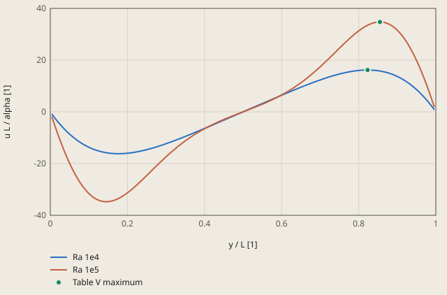
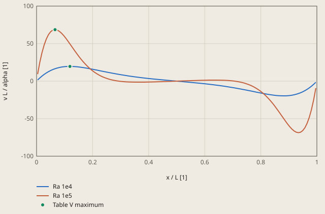

# cavity-devahldavis derivation

## Conclusion

The model agrees with the bench mark solution of de Vahl Davis (1983) at Ra = 1e4 and Ra = 1e5. The 6 checked values are 0.01 % to 0.26 % above Table V, and the tolerance is 0.6 %. The largest difference is the average Nusselt number at Ra = 1e5: 4.5309 against 4.519. The mesh error of the 129 x 129 mesh is +0.205 % for this value (see "Mesh study"), thus the mesh causes most of the difference.

Each velocity maximum of the model is at the position of Table V, within 0.003. The cell size is 0.0078.

**The horizontal velocity on the vertical centre line x = 0.5**



Table V maximum: de Vahl Davis (1983), Table V

The model has no units: L, Th - Tc and alpha are 1. The velocity is in units of alpha / L.

<details><summary>Values of the plot</summary>

Original values. — means no sample.

| y / L [1] | Ra 1e4 (u L / alpha [1]) | Ra 1e5 (u L / alpha [1]) | Table V maximum (u L / alpha [1]) |
| ---: | ---: | ---: | ---: |
| 0.00388 | -0.81781 | — | — |
| 0.01163 | -2.3564 | — | — |
| 0.01938 | -3.7998 | — | — |
| 0.02713 | -5.1502 | — | — |
| 0.03488 | -6.4094 | — | — |
| 0.04264 | -7.5796 | — | — |
| 0.05039 | -8.6629 | — | — |
| 0.05814 | -9.6615 | — | — |
| 0.06589 | -10.578 | — | — |
| 0.07364 | -11.414 | — | — |
| 0.0814 | -12.172 | — | — |
| 0.08915 | -12.855 | — | — |
| 0.0969 | -13.466 | — | — |
| 0.10465 | -14.007 | — | — |
| 0.1124 | -14.481 | — | — |
| 0.12015 | -14.89 | — | — |
| 0.12791 | -15.238 | — | — |
| 0.13566 | -15.526 | — | — |
| 0.14341 | -15.758 | — | — |
| 0.15116 | -15.937 | — | — |
| 0.15892 | -16.066 | — | — |
| 0.16667 | -16.146 | — | — |
| 0.17442 | -16.18 | — | — |
| 0.18217 | -16.172 | — | — |
| 0.18992 | -16.123 | — | — |
| 0.19767 | -16.037 | — | — |
| 0.20543 | -15.914 | — | — |
| 0.21318 | -15.759 | — | — |
| 0.22093 | -15.572 | — | — |
| 0.22868 | -15.356 | — | — |
| 0.23643 | -15.114 | — | — |
| 0.24419 | -14.846 | — | — |
| 0.25194 | -14.555 | — | — |
| 0.25969 | -14.242 | — | — |
| 0.26744 | -13.91 | — | — |
| 0.27519 | -13.559 | — | — |
| 0.28295 | -13.192 | — | — |
| 0.2907 | -12.809 | — | — |
| 0.29845 | -12.413 | — | — |
| 0.3062 | -12.004 | — | — |
| 0.31395 | -11.583 | — | — |
| 0.32171 | -11.152 | — | — |
| 0.32946 | -10.711 | — | — |
| 0.33721 | -10.262 | — | — |
| 0.34496 | -9.8062 | — | — |
| 0.35271 | -9.3433 | — | — |
| 0.36047 | -8.8746 | — | — |
| 0.36822 | -8.4007 | — | — |
| 0.37597 | -7.9224 | — | — |
| 0.38372 | -7.4403 | — | — |
| 0.39147 | -6.9548 | — | — |
| 0.39922 | -6.4665 | — | — |
| 0.40698 | -5.9757 | — | — |
| 0.41473 | -5.483 | — | — |
| 0.42248 | -4.9885 | — | — |
| 0.43023 | -4.4927 | — | — |
| 0.43798 | -3.9957 | — | — |
| 0.44574 | -3.4979 | — | — |
| 0.45349 | -2.9993 | — | — |
| 0.46124 | -2.5001 | — | — |
| 0.46899 | -2.0006 | — | — |
| 0.47674 | -1.5007 | — | — |
| 0.4845 | -1.0006 | — | — |
| 0.49225 | -0.50032 | — | — |
| 0.5 | -0.0000018203 | — | — |
| 0.50775 | 0.50032 | — | — |
| 0.5155 | 1.0006 | — | — |
| 0.52326 | 1.5007 | — | — |
| 0.53101 | 2.0006 | — | — |
| 0.53876 | 2.5001 | — | — |
| 0.54651 | 2.9993 | — | — |
| 0.55426 | 3.4979 | — | — |
| 0.56202 | 3.9957 | — | — |
| 0.56977 | 4.4927 | — | — |
| 0.57752 | 4.9885 | — | — |
| 0.58527 | 5.4829 | — | — |
| 0.59302 | 5.9757 | — | — |
| 0.60078 | 6.4665 | — | — |
| 0.60853 | 6.9548 | — | — |
| 0.61628 | 7.4403 | — | — |
| 0.62403 | 7.9224 | — | — |
| 0.63178 | 8.4007 | — | — |
| 0.63953 | 8.8746 | — | — |
| 0.64729 | 9.3433 | — | — |
| 0.65504 | 9.8062 | — | — |
| 0.66279 | 10.262 | — | — |
| 0.67054 | 10.711 | — | — |
| 0.67829 | 11.152 | — | — |
| 0.68605 | 11.583 | — | — |
| 0.6938 | 12.004 | — | — |
| 0.70155 | 12.413 | — | — |
| 0.7093 | 12.809 | — | — |
| 0.71705 | 13.192 | — | — |
| 0.72481 | 13.559 | — | — |
| 0.73256 | 13.91 | — | — |
| 0.74031 | 14.242 | — | — |
| 0.74806 | 14.555 | — | — |
| 0.75581 | 14.846 | — | — |
| 0.76357 | 15.114 | — | — |
| 0.77132 | 15.356 | — | — |
| 0.77907 | 15.572 | — | — |
| 0.78682 | 15.759 | — | — |
| 0.79457 | 15.914 | — | — |
| 0.80233 | 16.037 | — | — |
| 0.81008 | 16.123 | — | — |
| 0.81783 | 16.172 | — | — |
| 0.82558 | 16.18 | — | — |
| 0.83333 | 16.146 | — | — |
| 0.84108 | 16.066 | — | — |
| 0.84884 | 15.937 | — | — |
| 0.85659 | 15.758 | — | — |
| 0.86434 | 15.526 | — | — |
| 0.87209 | 15.238 | — | — |
| 0.87984 | 14.89 | — | — |
| 0.8876 | 14.481 | — | — |
| 0.89535 | 14.007 | — | — |
| 0.9031 | 13.466 | — | — |
| 0.91085 | 12.855 | — | — |
| 0.91861 | 12.172 | — | — |
| 0.92636 | 11.414 | — | — |
| 0.93411 | 10.578 | — | — |
| 0.94186 | 9.6615 | — | — |
| 0.94961 | 8.6629 | — | — |
| 0.95736 | 7.5796 | — | — |
| 0.96512 | 6.4094 | — | — |
| 0.97287 | 5.1502 | — | — |
| 0.98062 | 3.7998 | — | — |
| 0.98837 | 2.3564 | — | — |
| 0.99612 | 0.81781 | — | — |
| 0.00388 | — | -1.8089 | — |
| 0.01163 | — | -5.2689 | — |
| 0.01938 | — | -8.5662 | — |
| 0.02713 | — | -11.694 | — |
| 0.03488 | — | -14.645 | — |
| 0.04264 | — | -17.412 | — |
| 0.05039 | — | -19.988 | — |
| 0.05814 | — | -22.366 | — |
| 0.06589 | — | -24.539 | — |
| 0.07364 | — | -26.503 | — |
| 0.0814 | — | -28.255 | — |
| 0.08915 | — | -29.792 | — |
| 0.0969 | — | -31.114 | — |
| 0.10465 | — | -32.223 | — |
| 0.1124 | — | -33.123 | — |
| 0.12015 | — | -33.818 | — |
| 0.12791 | — | -34.315 | — |
| 0.13566 | — | -34.623 | — |
| 0.14341 | — | -34.75 | — |
| 0.15116 | — | -34.708 | — |
| 0.15892 | — | -34.508 | — |
| 0.16667 | — | -34.162 | — |
| 0.17442 | — | -33.683 | — |
| 0.18217 | — | -33.084 | — |
| 0.18992 | — | -32.377 | — |
| 0.19767 | — | -31.576 | — |
| 0.20543 | — | -30.693 | — |
| 0.21318 | — | -29.741 | — |
| 0.22093 | — | -28.732 | — |
| 0.22868 | — | -27.677 | — |
| 0.23643 | — | -26.586 | — |
| 0.24419 | — | -25.47 | — |
| 0.25194 | — | -24.338 | — |
| 0.25969 | — | -23.198 | — |
| 0.26744 | — | -22.059 | — |
| 0.27519 | — | -20.926 | — |
| 0.28295 | — | -19.806 | — |
| 0.2907 | — | -18.705 | — |
| 0.29845 | — | -17.627 | — |
| 0.3062 | — | -16.575 | — |
| 0.31395 | — | -15.553 | — |
| 0.32171 | — | -14.563 | — |
| 0.32946 | — | -13.607 | — |
| 0.33721 | — | -12.686 | — |
| 0.34496 | — | -11.801 | — |
| 0.35271 | — | -10.952 | — |
| 0.36047 | — | -10.139 | — |
| 0.36822 | — | -9.362 | — |
| 0.37597 | — | -8.6191 | — |
| 0.38372 | — | -7.9096 | — |
| 0.39147 | — | -7.2319 | — |
| 0.39922 | — | -6.5846 | — |
| 0.40698 | — | -5.9658 | — |
| 0.41473 | — | -5.3736 | — |
| 0.42248 | — | -4.8059 | — |
| 0.43023 | — | -4.2608 | — |
| 0.43798 | — | -3.7359 | — |
| 0.44574 | — | -3.2292 | — |
| 0.45349 | — | -2.7384 | — |
| 0.46124 | — | -2.2611 | — |
| 0.46899 | — | -1.7953 | — |
| 0.47674 | — | -1.3385 | — |
| 0.4845 | — | -0.88855 | — |
| 0.49225 | — | -0.44314 | — |
| 0.5 | — | 0.0000015793 | — |
| 0.50775 | — | 0.44314 | — |
| 0.5155 | — | 0.88855 | — |
| 0.52326 | — | 1.3385 | — |
| 0.53101 | — | 1.7953 | — |
| 0.53876 | — | 2.2611 | — |
| 0.54651 | — | 2.7384 | — |
| 0.55426 | — | 3.2292 | — |
| 0.56202 | — | 3.7359 | — |
| 0.56977 | — | 4.2608 | — |
| 0.57752 | — | 4.8059 | — |
| 0.58527 | — | 5.3736 | — |
| 0.59302 | — | 5.9658 | — |
| 0.60078 | — | 6.5846 | — |
| 0.60853 | — | 7.232 | — |
| 0.61628 | — | 7.9096 | — |
| 0.62403 | — | 8.6191 | — |
| 0.63178 | — | 9.362 | — |
| 0.63953 | — | 10.139 | — |
| 0.64729 | — | 10.952 | — |
| 0.65504 | — | 11.801 | — |
| 0.66279 | — | 12.686 | — |
| 0.67054 | — | 13.607 | — |
| 0.67829 | — | 14.563 | — |
| 0.68605 | — | 15.553 | — |
| 0.6938 | — | 16.575 | — |
| 0.70155 | — | 17.627 | — |
| 0.7093 | — | 18.705 | — |
| 0.71705 | — | 19.806 | — |
| 0.72481 | — | 20.926 | — |
| 0.73256 | — | 22.059 | — |
| 0.74031 | — | 23.198 | — |
| 0.74806 | — | 24.338 | — |
| 0.75581 | — | 25.47 | — |
| 0.76357 | — | 26.586 | — |
| 0.77132 | — | 27.677 | — |
| 0.77907 | — | 28.732 | — |
| 0.78682 | — | 29.741 | — |
| 0.79457 | — | 30.693 | — |
| 0.80233 | — | 31.576 | — |
| 0.81008 | — | 32.377 | — |
| 0.81783 | — | 33.084 | — |
| 0.82558 | — | 33.683 | — |
| 0.83333 | — | 34.162 | — |
| 0.84108 | — | 34.508 | — |
| 0.84884 | — | 34.708 | — |
| 0.85659 | — | 34.75 | — |
| 0.86434 | — | 34.623 | — |
| 0.87209 | — | 34.315 | — |
| 0.87984 | — | 33.818 | — |
| 0.8876 | — | 33.123 | — |
| 0.89535 | — | 32.223 | — |
| 0.9031 | — | 31.114 | — |
| 0.91085 | — | 29.792 | — |
| 0.91861 | — | 28.255 | — |
| 0.92636 | — | 26.503 | — |
| 0.93411 | — | 24.539 | — |
| 0.94186 | — | 22.366 | — |
| 0.94961 | — | 19.988 | — |
| 0.95736 | — | 17.412 | — |
| 0.96512 | — | 14.645 | — |
| 0.97287 | — | 11.694 | — |
| 0.98062 | — | 8.5662 | — |
| 0.98837 | — | 5.2689 | — |
| 0.99612 | — | 1.8089 | — |
| 0.823 | — | — | 16.178 |
| 0.855 | — | — | 34.73 |

</details>

**The vertical velocity on the horizontal centre line y = 0.5**



Table V maximum: de Vahl Davis (1983), Table V

The model has no units: L, Th - Tc and alpha are 1. The velocity is in units of alpha / L.

<details><summary>Values of the plot</summary>

Original values. — means no sample.

| x / L [1] | Ra 1e4 (v L / alpha [1]) | Ra 1e5 (v L / alpha [1]) | Table V maximum (v L / alpha [1]) |
| ---: | ---: | ---: | ---: |
| 0.00388 | 1.521 | — | — |
| 0.01163 | 4.2744 | — | — |
| 0.01938 | 6.753 | — | — |
| 0.02713 | 8.9696 | — | — |
| 0.03488 | 10.937 | — | — |
| 0.04264 | 12.667 | — | — |
| 0.05039 | 14.173 | — | — |
| 0.05814 | 15.465 | — | — |
| 0.06589 | 16.558 | — | — |
| 0.07364 | 17.462 | — | — |
| 0.0814 | 18.19 | — | — |
| 0.08915 | 18.755 | — | — |
| 0.0969 | 19.169 | — | — |
| 0.10465 | 19.444 | — | — |
| 0.1124 | 19.593 | — | — |
| 0.12015 | 19.628 | — | — |
| 0.12791 | 19.559 | — | — |
| 0.13566 | 19.399 | — | — |
| 0.14341 | 19.157 | — | — |
| 0.15116 | 18.845 | — | — |
| 0.15892 | 18.472 | — | — |
| 0.16667 | 18.047 | — | — |
| 0.17442 | 17.578 | — | — |
| 0.18217 | 17.074 | — | — |
| 0.18992 | 16.541 | — | — |
| 0.19767 | 15.986 | — | — |
| 0.20543 | 15.415 | — | — |
| 0.21318 | 14.833 | — | — |
| 0.22093 | 14.245 | — | — |
| 0.22868 | 13.655 | — | — |
| 0.23643 | 13.067 | — | — |
| 0.24419 | 12.483 | — | — |
| 0.25194 | 11.907 | — | — |
| 0.25969 | 11.339 | — | — |
| 0.26744 | 10.784 | — | — |
| 0.27519 | 10.241 | — | — |
| 0.28295 | 9.7112 | — | — |
| 0.2907 | 9.1964 | — | — |
| 0.29845 | 8.6968 | — | — |
| 0.3062 | 8.2127 | — | — |
| 0.31395 | 7.7443 | — | — |
| 0.32171 | 7.2916 | — | — |
| 0.32946 | 6.8544 | — | — |
| 0.33721 | 6.4323 | — | — |
| 0.34496 | 6.0252 | — | — |
| 0.35271 | 5.6324 | — | — |
| 0.36047 | 5.2535 | — | — |
| 0.36822 | 4.8877 | — | — |
| 0.37597 | 4.5346 | — | — |
| 0.38372 | 4.1934 | — | — |
| 0.39147 | 3.8634 | — | — |
| 0.39922 | 3.5438 | — | — |
| 0.40698 | 3.234 | — | — |
| 0.41473 | 2.9331 | — | — |
| 0.42248 | 2.6405 | — | — |
| 0.43023 | 2.3553 | — | — |
| 0.43798 | 2.0768 | — | — |
| 0.44574 | 1.8043 | — | — |
| 0.45349 | 1.5369 | — | — |
| 0.46124 | 1.274 | — | — |
| 0.46899 | 1.0148 | — | — |
| 0.47674 | 0.75852 | — | — |
| 0.4845 | 0.50445 | — | — |
| 0.49225 | 0.25186 | — | — |
| 0.5 | -0.000001076 | — | — |
| 0.50775 | -0.25186 | — | — |
| 0.5155 | -0.50446 | — | — |
| 0.52326 | -0.75852 | — | — |
| 0.53101 | -1.0148 | — | — |
| 0.53876 | -1.274 | — | — |
| 0.54651 | -1.5369 | — | — |
| 0.55426 | -1.8043 | — | — |
| 0.56202 | -2.0768 | — | — |
| 0.56977 | -2.3553 | — | — |
| 0.57752 | -2.6405 | — | — |
| 0.58527 | -2.9331 | — | — |
| 0.59302 | -3.234 | — | — |
| 0.60078 | -3.5438 | — | — |
| 0.60853 | -3.8634 | — | — |
| 0.61628 | -4.1934 | — | — |
| 0.62403 | -4.5346 | — | — |
| 0.63178 | -4.8877 | — | — |
| 0.63953 | -5.2535 | — | — |
| 0.64729 | -5.6324 | — | — |
| 0.65504 | -6.0252 | — | — |
| 0.66279 | -6.4323 | — | — |
| 0.67054 | -6.8544 | — | — |
| 0.67829 | -7.2916 | — | — |
| 0.68605 | -7.7443 | — | — |
| 0.6938 | -8.2127 | — | — |
| 0.70155 | -8.6968 | — | — |
| 0.7093 | -9.1964 | — | — |
| 0.71705 | -9.7112 | — | — |
| 0.72481 | -10.241 | — | — |
| 0.73256 | -10.784 | — | — |
| 0.74031 | -11.339 | — | — |
| 0.74806 | -11.907 | — | — |
| 0.75581 | -12.483 | — | — |
| 0.76357 | -13.067 | — | — |
| 0.77132 | -13.655 | — | — |
| 0.77907 | -14.245 | — | — |
| 0.78682 | -14.833 | — | — |
| 0.79457 | -15.415 | — | — |
| 0.80233 | -15.986 | — | — |
| 0.81008 | -16.541 | — | — |
| 0.81783 | -17.074 | — | — |
| 0.82558 | -17.578 | — | — |
| 0.83333 | -18.047 | — | — |
| 0.84108 | -18.472 | — | — |
| 0.84884 | -18.845 | — | — |
| 0.85659 | -19.157 | — | — |
| 0.86434 | -19.399 | — | — |
| 0.87209 | -19.559 | — | — |
| 0.87984 | -19.628 | — | — |
| 0.8876 | -19.593 | — | — |
| 0.89535 | -19.444 | — | — |
| 0.9031 | -19.169 | — | — |
| 0.91085 | -18.755 | — | — |
| 0.91861 | -18.19 | — | — |
| 0.92636 | -17.462 | — | — |
| 0.93411 | -16.558 | — | — |
| 0.94186 | -15.465 | — | — |
| 0.94961 | -14.173 | — | — |
| 0.95736 | -12.667 | — | — |
| 0.96512 | -10.937 | — | — |
| 0.97287 | -8.9696 | — | — |
| 0.98062 | -6.753 | — | — |
| 0.98837 | -4.2744 | — | — |
| 0.99612 | -1.521 | — | — |
| 0.00388 | — | 9.3404 | — |
| 0.01163 | — | 25.038 | — |
| 0.01938 | — | 37.958 | — |
| 0.02713 | — | 48.299 | — |
| 0.03488 | — | 56.264 | — |
| 0.04264 | — | 62.06 | — |
| 0.05039 | — | 65.908 | — |
| 0.05814 | — | 68.032 | — |
| 0.06589 | — | 68.662 | — |
| 0.07364 | — | 68.025 | — |
| 0.0814 | — | 66.344 | — |
| 0.08915 | — | 63.828 | — |
| 0.0969 | — | 60.672 | — |
| 0.10465 | — | 57.051 | — |
| 0.1124 | — | 53.12 | — |
| 0.12015 | — | 49.015 | — |
| 0.12791 | — | 44.847 | — |
| 0.13566 | — | 40.709 | — |
| 0.14341 | — | 36.674 | — |
| 0.15116 | — | 32.799 | — |
| 0.15892 | — | 29.125 | — |
| 0.16667 | — | 25.68 | — |
| 0.17442 | — | 22.481 | — |
| 0.18217 | — | 19.537 | — |
| 0.18992 | — | 16.849 | — |
| 0.19767 | — | 14.412 | — |
| 0.20543 | — | 12.219 | — |
| 0.21318 | — | 10.257 | — |
| 0.22093 | — | 8.5139 | — |
| 0.22868 | — | 6.9735 | — |
| 0.23643 | — | 5.6205 | — |
| 0.24419 | — | 4.4393 | — |
| 0.25194 | — | 3.4142 | — |
| 0.25969 | — | 2.5304 | — |
| 0.26744 | — | 1.7734 | — |
| 0.27519 | — | 1.1299 | — |
| 0.28295 | — | 0.58727 | — |
| 0.2907 | — | 0.13392 | — |
| 0.29845 | — | -0.24073 | — |
| 0.3062 | — | -0.54629 | — |
| 0.31395 | — | -0.79145 | — |
| 0.32171 | — | -0.98403 | — |
| 0.32946 | — | -1.131 | — |
| 0.33721 | — | -1.2385 | — |
| 0.34496 | — | -1.312 | — |
| 0.35271 | — | -1.3564 | — |
| 0.36047 | — | -1.3759 | — |
| 0.36822 | — | -1.3741 | — |
| 0.37597 | — | -1.3543 | — |
| 0.38372 | — | -1.3192 | — |
| 0.39147 | — | -1.2712 | — |
| 0.39922 | — | -1.2124 | — |
| 0.40698 | — | -1.1445 | — |
| 0.41473 | — | -1.069 | — |
| 0.42248 | — | -0.98724 | — |
| 0.43023 | — | -0.9003 | — |
| 0.43798 | — | -0.80909 | — |
| 0.44574 | — | -0.71441 | — |
| 0.45349 | — | -0.61691 | — |
| 0.46124 | — | -0.51717 | — |
| 0.46899 | — | -0.41568 | — |
| 0.47674 | — | -0.31286 | — |
| 0.4845 | — | -0.20908 | — |
| 0.49225 | — | -0.10469 | — |
| 0.5 | — | 0.000000088326 | — |
| 0.50775 | — | 0.10469 | — |
| 0.5155 | — | 0.20908 | — |
| 0.52326 | — | 0.31286 | — |
| 0.53101 | — | 0.41568 | — |
| 0.53876 | — | 0.51717 | — |
| 0.54651 | — | 0.61691 | — |
| 0.55426 | — | 0.71441 | — |
| 0.56202 | — | 0.80909 | — |
| 0.56977 | — | 0.9003 | — |
| 0.57752 | — | 0.98724 | — |
| 0.58527 | — | 1.069 | — |
| 0.59302 | — | 1.1445 | — |
| 0.60078 | — | 1.2124 | — |
| 0.60853 | — | 1.2712 | — |
| 0.61628 | — | 1.3192 | — |
| 0.62403 | — | 1.3543 | — |
| 0.63178 | — | 1.3741 | — |
| 0.63953 | — | 1.3759 | — |
| 0.64729 | — | 1.3564 | — |
| 0.65504 | — | 1.312 | — |
| 0.66279 | — | 1.2385 | — |
| 0.67054 | — | 1.131 | — |
| 0.67829 | — | 0.98403 | — |
| 0.68605 | — | 0.79145 | — |
| 0.6938 | — | 0.54629 | — |
| 0.70155 | — | 0.24073 | — |
| 0.7093 | — | -0.13392 | — |
| 0.71705 | — | -0.58727 | — |
| 0.72481 | — | -1.1299 | — |
| 0.73256 | — | -1.7734 | — |
| 0.74031 | — | -2.5304 | — |
| 0.74806 | — | -3.4142 | — |
| 0.75581 | — | -4.4393 | — |
| 0.76357 | — | -5.6205 | — |
| 0.77132 | — | -6.9735 | — |
| 0.77907 | — | -8.5139 | — |
| 0.78682 | — | -10.257 | — |
| 0.79457 | — | -12.219 | — |
| 0.80233 | — | -14.412 | — |
| 0.81008 | — | -16.849 | — |
| 0.81783 | — | -19.537 | — |
| 0.82558 | — | -22.481 | — |
| 0.83333 | — | -25.68 | — |
| 0.84108 | — | -29.125 | — |
| 0.84884 | — | -32.799 | — |
| 0.85659 | — | -36.674 | — |
| 0.86434 | — | -40.709 | — |
| 0.87209 | — | -44.847 | — |
| 0.87984 | — | -49.015 | — |
| 0.8876 | — | -53.12 | — |
| 0.89535 | — | -57.051 | — |
| 0.9031 | — | -60.672 | — |
| 0.91085 | — | -63.828 | — |
| 0.91861 | — | -66.344 | — |
| 0.92636 | — | -68.025 | — |
| 0.93411 | — | -68.662 | — |
| 0.94186 | — | -68.032 | — |
| 0.94961 | — | -65.908 | — |
| 0.95736 | — | -62.06 | — |
| 0.96512 | — | -56.264 | — |
| 0.97287 | — | -48.299 | — |
| 0.98062 | — | -37.958 | — |
| 0.98837 | — | -25.038 | — |
| 0.99612 | — | -9.3404 | — |
| 0.119 | — | — | 19.617 |
| 0.066 | — | — | 68.59 |

</details>

The hot wall heats the air, and the air turns clockwise in the cavity. At Ra = 1e5 the buoyancy is 10 times larger. The average Nusselt number is 2.0 times larger. The largest vertical velocity is 3.5 times larger and nearer to the hot wall. The results have the temperature `T` for the Nusselt number, and `U1` and `U2` for the 2 velocity checks. The largest u on x = 0.5 and the largest v on y = 0.5 are:

| Ra | Largest u on x = 0.5 | Largest v on y = 0.5 |
|---|---|---|
| 1e4 | 16.18 at y = 0.8256 | 19.63 at x = 0.1202 |
| 1e5 | 34.75 at y = 0.8566 | 68.66 at x = 0.0659 |

## Result

**Pass.** A check passes when |computed - reference| ≤ rel_tol · |reference| + abs_tol, with rel_tol = 0.006 and abs_tol = 0 (`check.toml`). `fh validate` gives the computed values.

| Check | Unit | Computed | Reference | Difference | Tolerance | Margin |
| --- | ---: | ---: | ---: | ---: | ---: | ---: |
| `nu_ra1e4` | Not specified | 2.24604 | 2.243 | +0.00303765 (+0.135428 %) | 0.01346 | 0.01042 |
| `umax_ra1e4` | Not specified | 16.1802 | 16.178 | +0.00218196 (+0.0134872 %) | 0.09707 | 0.09489 |
| `vmax_ra1e4` | Not specified | 19.6276 | 19.617 | +0.0106059 (+0.0540648 %) | 0.1177 | 0.1071 |
| `nu_ra1e5` | Not specified | 4.53088 | 4.519 | +0.0118762 (+0.262807 %) | 0.02711 | 0.01524 |
| `umax_ra1e5` | Not specified | 34.7501 | 34.73 | +0.0200793 (+0.0578153 %) | 0.2084 | 0.1883 |
| `vmax_ra1e5` | Not specified | 68.6618 | 68.59 | +0.0717973 (+0.104676 %) | 0.4115 | 0.3397 |

Made by `scripts/validation-reports.py` on 2026-10-28, femahoy 9c54611.

This case checks heat transfer and buoyancy in the CFD path: laminar natural convection of air in a square cavity, at 2 Rayleigh numbers.
The reference is a numerical bench mark with a known accuracy. Thus the tolerance comes from that accuracy and from the mesh study of the model, not from the difference between the model and the reference.

## Sources

- G. de Vahl Davis, "Natural convection of air in a square cavity: a bench mark numerical solution", International Journal for Numerical Methods in Fluids 3 (1983) 249-264, https://doi.org/10.1002/fld.1650030305.
  The left wall is hot, the right wall is cold, and the top and the bottom are adiabatic. Pr = 0.71.
- The check values come from Table V, the bench mark solution. The velocities are in units of alpha/L, with alpha the thermal diffusivity.
- Table VII gives the estimated error of the bench mark: 0.2 % at Ra = 1e4 and 0.3 % at Ra = 1e5.
- Table V gives 2 average Nusselt numbers for the hot wall: Nu_0 from a one-sided difference at the wall, and Nu-bar, the average over the cavity. In a steady state, the same heat goes through each vertical line. The paper tells that Nu_0 is the less accurate value. The finite volume method of the model conserves heat, thus its heat flow through the hot wall is the same as its Nu-bar. Thus the check uses Nu-bar.
- M. Hortmann, M. Peric and G. Scheuerer, "Finite volume multigrid prediction of laminar natural convection: bench-mark solutions", International Journal for Numerical Methods in Fluids 11 (1990) 189-207, https://doi.org/10.1002/fld.1650110206. It gives Nu-bar = 2.24475 at Ra = 1e4 and 4.52164 at Ra = 1e5, from meshes of up to 640 x 640 control volumes. Table 1 of T. Gjesdal, C. E. Wasberg and O. Andreassen, "Spectral element simulations of buoyancy-driven flow", https://arxiv.org/abs/physics/0305049, also gives these values. The case uses them only as a cross-check.

| Ra | Nu-bar | u_max on x = 0.5 (at y) | v_max on y = 0.5 (at x) | Error of the bench mark | Checks |
|---:|---:|---|---|---:|---|
| 1e4 | 2.243 | 16.178 (0.823) | 19.617 (0.119) | 0.2 % | `nu_ra1e4`, `umax_ra1e4`, `vmax_ra1e4` |
| 1e5 | 4.519 | 34.73 (0.855) | 68.59 (0.066) | 0.3 % | `nu_ra1e5`, `umax_ra1e5`, `vmax_ra1e5` |

The paper uses z for the vertical axis and w for the vertical velocity. The model uses y and v.

## Model

The 2 OpenFOAM cases `ra1e4` and `ra1e5` differ only in `constant/g`.
The model has no units. The side L, the temperature difference Th - Tc and the thermal diffusivity alpha are 1. Thus the velocities of the model are in units of alpha/L, as in Table V.

| Item | Value |
|---|---|
| Cavity | the square 0 <= x, y <= 1, with 1 cell of depth 0.1 in z and an `empty` patch on the front and the back |
| Walls | no slip on each wall. `hot` (x = 0): T = 1. `cold` (x = 1): T = 0. `adiabatic` (y = 0 and y = 1): zero gradient of T |
| Fluid | nu = 0.71 and Pr = 0.71, thus alpha = nu / Pr = 1. beta = 1 and TRef = 0.5 |
| Gravity | Ra = g beta (Th - Tc) L^3 / (nu alpha), thus g = Ra Pr in -y: 7100 for `ra1e4` and 71000 for `ra1e5` |
| Solver | `buoyantBoussinesqSimpleFoam`, laminar and steady |
| Schemes | `bounded Gauss linear` for the convection of U and T, `Gauss linear` for the gradients, `Gauss linear corrected` for the Laplacians |
| Relaxation | 0.2 for `p_rgh`, 0.8 for `U` and 0.95 for `T` |
| Mesh | uniform, 129 x 129 cells |
| Iterations | 2000 |

The function objects of `system/controlDict` write the 3 values of each case:

- Nusselt number: the `areaNormalAverage` of `grad(T)` on the patch `hot`. The normal points out of the fluid, thus the value is the average of -dT/dx on the hot wall.
- Velocities: the largest `Ux` in the row of cells that the plane x = 0.5 cuts, and the largest `Uy` in the row of cells that the plane y = 0.5 cuts. The mesh has an odd number of cells, thus each plane goes through a row of cell centres.

With the relaxation factors 0.7, 0.3 and 0.5, the Nusselt number at Ra = 1e4 on 129 x 129 changed between 1.5 and 2.34 for 8000 iterations. The relaxation factors of the case get a residual of 1e-7 after about 2000 iterations.

## Mesh study

These commands, in the repository root, solve the case `ra1e5` on a mesh of 257 x 257 cells in a scratch folder:

```
cp -R validation/cases/cavity-devahldavis/ra1e5 /tmp/cavity-257
# In /tmp/cavity-257/system/blockMeshDict, change (129 129 1) to (257 257 1).
# In /tmp/cavity-257/system/controlDict, change endTime and writeInterval to 10000.
openfoam blockMesh -case /tmp/cavity-257
openfoam buoyantBoussinesqSimpleFoam -case /tmp/cavity-257
```

The values are in the last rows of the tables in `/tmp/cavity-257/postProcessing`.
At 257 x 257, the study stopped Ra = 1e4 at 10000 iterations and Ra = 1e5 at 7520 iterations. There the residual of each equation was below 1e-10.

| Mesh | Iterations | Nu, 1e4 | u_max, 1e4 | v_max, 1e4 | Nu, 1e5 | u_max, 1e5 | v_max, 1e5 |
|---:|---:|---:|---:|---:|---:|---:|---:|
| 33 x 33 | 2000 | 2.26332 | 16.1298 | 19.5352 | 4.65992 | 34.8516 | 67.3526 |
| 65 x 65 | 2000 | 2.24962 | 16.1782 | 19.6247 | 4.55791 | 34.7948 | 68.5601 |
| 129 x 129 | 3000 | 2.24604 | 16.1801 | 19.6276 | 4.53088 | 34.7501 | 68.6618 |
| 257 x 257 | 10000, 7520 | 2.24512 | 16.1830 | 19.6285 | 4.52397 | 34.7439 | 68.6147 |
| Extrapolated | | 2.24481 | | | 4.52159 | | |
| 129 x 129, the check | 2000 | 2.24604 | 16.1802 | 19.6276 | 4.53088 | 34.7501 | 68.6618 |

The Nusselt number converges monotonically. The extrapolation from the meshes 65, 129 and 257 uses the observed order p, which is 1.97 at each Rayleigh number. The extrapolated values agree with Hortmann et al. to 0.003 % or less.
Thus the mesh error of 129 x 129 is +0.055 % in Nu at Ra = 1e4 and +0.205 % at Ra = 1e5.

A velocity check reads the largest cell value, not the maximum between the cell centres. Thus a velocity changes less smoothly with the mesh. A `sets` function object on the centre lines and a parabola through the 3 largest cell values give the maximum between the cell centres. At 129 x 129, the largest cell value is 0 % to 0.016 % below this maximum.
The velocities at 129 x 129 are within 0.03 % of the maxima of the parabolas at 257 x 257.

The iteration error at 2000 iterations is 0.0003 % or less: on 129 x 129, the values at 2000 and 3000 iterations differ by 0.0003 % or less.

The 2 cases of the check run at the same time. On a Mac with 10 cores, `fh validate` took 47 s and 88 s for this case, while other programs used 3 to 5 cores.

## Tolerance

The tolerance is `rel_tol = 0.006` and `abs_tol = 0`.

| Cause | Ra = 1e4 | Ra = 1e5 |
|---|---:|---:|
| Error of the bench mark (Table VII) | 0.2 % | 0.3 % |
| Mesh error of 129 x 129 in Nu, times 1.25 (the factor of safety of the grid convergence index) | 0.07 % | 0.26 % |
| Mesh error of 129 x 129 in the velocities, times 1.25 | 0.04 % | 0.04 % |
| The largest cell value against the maximum between the cell centres | 0.02 % | 0.02 % |
| Iterations | 0.0003 % | 0.0001 % |

The sum for a Nusselt number is 0.27 % at Ra = 1e4 and 0.56 % at Ra = 1e5. The sum for a velocity is 0.26 % and 0.36 %.
`rel_tol` is the largest sum, 0.56 % for `nu_ra1e5`, rounded up to 0.6 %.
The model is 0.01 % to 0.27 % above the bench mark. The largest part of the tolerance that a check uses is 44 % (`nu_ra1e5`).
The tolerance does not let a mesh of 65 x 65 pass: there `nu_ra1e5` is 0.86 % above the bench mark.
