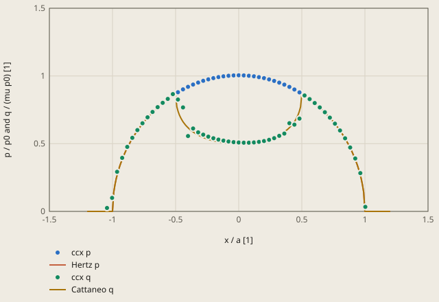

# contact-cattaneo derivation

## Conclusion

The CalculiX model of the cylindrical steel pad (R = 20 mm) on the steel block gives the partial slip of Cattaneo (1938). The centre of the contact sticks, and its 2 edges slip. The shear traction at the centre is q(0) = 433.064 MPa, 0.43 % above the reference 431.203 MPa. The largest contact pressure is 2888.39 MPa, 0.48 % above the Hertz pressure p0 = 2874.69 MPa. The tolerance is 2 %.

The pad gets the normal force P = 4500 N and then the tangential force Q = 0.75 μP = 1012.5 N, each for 1 mm of length. The theory then gives a contact of half-width a = 0.997 mm with a stick zone |x| < c = 0.5 a. The plot shows the contact pressure p and the shear traction q at the nodes of the pad, with the curves of Hertz and Cattaneo:

### Contact tractions at the end of step 3

ccx p: this case, CPRESS at the nodes of the pad, ccx/job.frd of the run

ccx q: this case, CSHEAR1 at the nodes of the pad, ccx/job.frd of the run

The centre |x| < c = 0.50 a sticks: q is less than mu p. The edges slip: q = mu p.

Original values. n/a means no sample.

| x / a [1] | ccx p (p / p0 and q / (mu p0) [1]) | Hertz p (p / p0 and q / (mu p0) [1]) | ccx q (p / p0 and q / (mu p0) [1]) | Cattaneo q (p / p0 and q / (mu p0) [1]) |
| ---: | ---: | ---: | ---: | ---: |
| -1.2 | n/a | 0 | n/a | 0 |
| -1.19 | n/a | 0 | n/a | 0 |
| -1.18 | n/a | 0 | n/a | 0 |
| -1.17 | n/a | 0 | n/a | 0 |
| -1.16 | n/a | 0 | n/a | 0 |
| -1.15 | n/a | 0 | n/a | 0 |
| -1.14 | n/a | 0 | n/a | 0 |
| -1.13 | n/a | 0 | n/a | 0 |
| -1.12 | n/a | 0 | n/a | 0 |
| -1.11 | n/a | 0 | n/a | 0 |
| -1.1 | n/a | 0 | n/a | 0 |
| -1.09 | n/a | 0 | n/a | 0 |
| -1.08 | n/a | 0 | n/a | 0 |
| -1.07 | n/a | 0 | n/a | 0 |
| -1.06 | n/a | 0 | n/a | 0 |
| -1.05 | n/a | 0 | n/a | 0 |
| -1.04359 | 0.02558 | n/a | 0.02558 | n/a |
| -1.04 | n/a | 0 | n/a | 0 |
| -1.03 | n/a | 0 | n/a | 0 |
| -1.02 | n/a | 0 | n/a | 0 |
| -1.01 | n/a | 0 | n/a | 0 |
| -1.00345 | 0.09959 | n/a | 0.09959 | n/a |
| -1 | n/a | 0 | n/a | 0 |
| -0.99 | n/a | 0.14107 | n/a | 0.14107 |
| -0.98 | n/a | 0.199 | n/a | 0.199 |
| -0.97 | n/a | 0.2431 | n/a | 0.2431 |
| -0.96332 | 0.29223 | n/a | 0.29223 | n/a |
| -0.96 | n/a | 0.28 | n/a | 0.28 |
| -0.95 | n/a | 0.31225 | n/a | 0.31225 |
| -0.94 | n/a | 0.34117 | n/a | 0.34117 |
| -0.93 | n/a | 0.36756 | n/a | 0.36756 |
| -0.92318 | 0.3954 | n/a | 0.3954 | n/a |
| -0.92 | n/a | 0.39192 | n/a | 0.39192 |
| -0.91 | n/a | 0.41461 | n/a | 0.41461 |
| -0.9 | n/a | 0.43589 | n/a | 0.43589 |
| -0.89 | n/a | 0.45596 | n/a | 0.45596 |
| -0.88304 | 0.4765 | n/a | 0.4765 | n/a |
| -0.88 | n/a | 0.47497 | n/a | 0.47497 |
| -0.87 | n/a | 0.49305 | n/a | 0.49305 |
| -0.86 | n/a | 0.51029 | n/a | 0.51029 |
| -0.85 | n/a | 0.52678 | n/a | 0.52678 |
| -0.8429 | 0.54347 | n/a | 0.54347 | n/a |
| -0.84 | n/a | 0.54259 | n/a | 0.54259 |
| -0.83 | n/a | 0.55776 | n/a | 0.55776 |
| -0.82 | n/a | 0.57236 | n/a | 0.57236 |
| -0.81 | n/a | 0.58643 | n/a | 0.58643 |
| -0.80276 | 0.60074 | n/a | 0.60074 | n/a |
| -0.8 | n/a | 0.6 | n/a | 0.6 |
| -0.79 | n/a | 0.61311 | n/a | 0.61311 |
| -0.78 | n/a | 0.62578 | n/a | 0.62578 |
| -0.77 | n/a | 0.63804 | n/a | 0.63804 |
| -0.76263 | 0.65074 | n/a | 0.65073 | n/a |
| -0.76 | n/a | 0.64992 | n/a | 0.64992 |
| -0.75 | n/a | 0.66144 | n/a | 0.66144 |
| -0.74 | n/a | 0.67261 | n/a | 0.67261 |
| -0.73 | n/a | 0.68345 | n/a | 0.68345 |
| -0.72249 | 0.69495 | n/a | 0.69494 | n/a |
| -0.72 | n/a | 0.69397 | n/a | 0.69397 |
| -0.71 | n/a | 0.7042 | n/a | 0.7042 |
| -0.7 | n/a | 0.71414 | n/a | 0.71414 |
| -0.69 | n/a | 0.72381 | n/a | 0.72381 |
| -0.68235 | 0.73439 | n/a | 0.73439 | n/a |
| -0.68 | n/a | 0.73321 | n/a | 0.73321 |
| -0.67 | n/a | 0.74236 | n/a | 0.74236 |
| -0.66 | n/a | 0.75127 | n/a | 0.75127 |
| -0.65 | n/a | 0.75993 | n/a | 0.75993 |
| -0.64221 | 0.76977 | n/a | 0.76977 | n/a |
| -0.64 | n/a | 0.76837 | n/a | 0.76837 |
| -0.63 | n/a | 0.7766 | n/a | 0.7766 |
| -0.62 | n/a | 0.7846 | n/a | 0.7846 |
| -0.61 | n/a | 0.7924 | n/a | 0.7924 |
| -0.60207 | 0.80164 | n/a | 0.80164 | n/a |
| -0.6 | n/a | 0.8 | n/a | 0.8 |
| -0.59 | n/a | 0.8074 | n/a | 0.8074 |
| -0.58 | n/a | 0.81462 | n/a | 0.81462 |
| -0.57 | n/a | 0.82164 | n/a | 0.82164 |
| -0.56193 | 0.83042 | n/a | 0.83042 | n/a |
| -0.56 | n/a | 0.82849 | n/a | 0.82849 |
| -0.55 | n/a | 0.83516 | n/a | 0.83516 |
| -0.54 | n/a | 0.84167 | n/a | 0.84167 |
| -0.53 | n/a | 0.848 | n/a | 0.848 |
| -0.5218 | 0.8564 | n/a | 0.86595 | n/a |
| -0.52 | n/a | 0.85417 | n/a | 0.85417 |
| -0.51 | n/a | 0.86017 | n/a | 0.86017 |
| -0.5 | n/a | 0.86603 | n/a | 0.86603 |
| -0.49 | n/a | 0.87172 | n/a | 0.77222 |
| -0.48166 | 0.8799 | n/a | 0.8259 | n/a |
| -0.48 | n/a | 0.87727 | n/a | 0.73727 |
| -0.47 | n/a | 0.88267 | n/a | 0.71208 |
| -0.46 | n/a | 0.88792 | n/a | 0.69196 |
| -0.45 | n/a | 0.89303 | n/a | 0.67508 |
| -0.44152 | 0.90101 | n/a | 0.76759 | n/a |
| -0.44 | n/a | 0.898 | n/a | 0.66051 |
| -0.43 | n/a | 0.90283 | n/a | 0.64768 |
| -0.42 | n/a | 0.90752 | n/a | 0.63623 |
| -0.41 | n/a | 0.91209 | n/a | 0.6259 |
| -0.40138 | 0.91989 | n/a | 0.55645 | n/a |
| -0.4 | n/a | 0.91652 | n/a | 0.61652 |
| -0.39 | n/a | 0.92081 | n/a | 0.60793 |
| -0.38 | n/a | 0.92499 | n/a | 0.60002 |
| -0.37 | n/a | 0.92903 | n/a | 0.59273 |
| -0.36124 | 0.93658 | n/a | 0.61223 | n/a |
| -0.36 | n/a | 0.93295 | n/a | 0.58597 |
| -0.35 | n/a | 0.93675 | n/a | 0.57968 |
| -0.34 | n/a | 0.94043 | n/a | 0.57382 |
| -0.33 | n/a | 0.94398 | n/a | 0.56835 |
| -0.32111 | 0.9513 | n/a | 0.58357 | n/a |
| -0.32 | n/a | 0.94742 | n/a | 0.56323 |
| -0.31 | n/a | 0.95074 | n/a | 0.55844 |
| -0.3 | n/a | 0.95394 | n/a | 0.55394 |
| -0.29 | n/a | 0.95703 | n/a | 0.54972 |
| -0.28097 | 0.96411 | n/a | 0.5665 | n/a |
| -0.28 | n/a | 0.96 | n/a | 0.54575 |
| -0.27 | n/a | 0.96286 | n/a | 0.54203 |
| -0.26 | n/a | 0.96561 | n/a | 0.53853 |
| -0.25 | n/a | 0.96825 | n/a | 0.53523 |
| -0.24083 | 0.97507 | n/a | 0.55194 | n/a |
| -0.24 | n/a | 0.97077 | n/a | 0.53214 |
| -0.23 | n/a | 0.97319 | n/a | 0.52923 |
| -0.22 | n/a | 0.9755 | n/a | 0.5265 |
| -0.21 | n/a | 0.9777 | n/a | 0.52394 |
| -0.20069 | 0.98425 | n/a | 0.53996 | n/a |
| -0.2 | n/a | 0.9798 | n/a | 0.52154 |
| -0.19 | n/a | 0.98178 | n/a | 0.51929 |
| -0.18 | n/a | 0.98367 | n/a | 0.51719 |
| -0.17 | n/a | 0.98544 | n/a | 0.51523 |
| -0.16055 | 0.99169 | n/a | 0.53016 | n/a |
| -0.16 | n/a | 0.98712 | n/a | 0.51341 |
| -0.15 | n/a | 0.98869 | n/a | 0.51172 |
| -0.14 | n/a | 0.99015 | n/a | 0.51015 |
| -0.13 | n/a | 0.99151 | n/a | 0.50871 |
| -0.12041 | 0.99743 | n/a | 0.52226 | n/a |
| -0.12 | n/a | 0.99277 | n/a | 0.50739 |
| -0.11 | n/a | 0.99393 | n/a | 0.50618 |
| -0.1 | n/a | 0.99499 | n/a | 0.50509 |
| -0.09 | n/a | 0.99594 | n/a | 0.50411 |
| -0.08028 | 1.00151 | n/a | 0.51609 | n/a |
| -0.08 | n/a | 0.99679 | n/a | 0.50324 |
| -0.07 | n/a | 0.99755 | n/a | 0.50247 |
| -0.06 | n/a | 0.9982 | n/a | 0.50181 |
| -0.05 | n/a | 0.99875 | n/a | 0.50126 |
| -0.04014 | 1.00393 | n/a | 0.51154 | n/a |
| -0.04 | n/a | 0.9992 | n/a | 0.5008 |
| -0.03 | n/a | 0.99955 | n/a | 0.50045 |
| -0.02 | n/a | 0.9998 | n/a | 0.5002 |
| -0.01 | n/a | 0.99995 | n/a | 0.50005 |
| 0 | 1.00471 | n/a | 0.50856 | n/a |
| 0 | n/a | 1 | n/a | 0.5 |
| 0.01 | n/a | 0.99995 | n/a | 0.50005 |
| 0.02 | n/a | 0.9998 | n/a | 0.5002 |
| 0.03 | n/a | 0.99955 | n/a | 0.50045 |
| 0.04 | n/a | 0.9992 | n/a | 0.5008 |
| 0.04014 | 1.00386 | n/a | 0.50716 | n/a |
| 0.05 | n/a | 0.99875 | n/a | 0.50126 |
| 0.06 | n/a | 0.9982 | n/a | 0.50181 |
| 0.07 | n/a | 0.99755 | n/a | 0.50247 |
| 0.08 | n/a | 0.99679 | n/a | 0.50324 |
| 0.08028 | 1.00137 | n/a | 0.5074 | n/a |
| 0.09 | n/a | 0.99594 | n/a | 0.50411 |
| 0.1 | n/a | 0.99499 | n/a | 0.50509 |
| 0.11 | n/a | 0.99393 | n/a | 0.50618 |
| 0.12 | n/a | 0.99277 | n/a | 0.50739 |
| 0.12041 | 0.99723 | n/a | 0.50941 | n/a |
| 0.13 | n/a | 0.99151 | n/a | 0.50871 |
| 0.14 | n/a | 0.99015 | n/a | 0.51015 |
| 0.15 | n/a | 0.98869 | n/a | 0.51172 |
| 0.16 | n/a | 0.98712 | n/a | 0.51341 |
| 0.16055 | 0.99141 | n/a | 0.5134 | n/a |
| 0.17 | n/a | 0.98544 | n/a | 0.51523 |
| 0.18 | n/a | 0.98367 | n/a | 0.51719 |
| 0.19 | n/a | 0.98178 | n/a | 0.51929 |
| 0.2 | n/a | 0.9798 | n/a | 0.52154 |
| 0.20069 | 0.98389 | n/a | 0.51958 | n/a |
| 0.21 | n/a | 0.9777 | n/a | 0.52394 |
| 0.22 | n/a | 0.9755 | n/a | 0.5265 |
| 0.23 | n/a | 0.97319 | n/a | 0.52923 |
| 0.24 | n/a | 0.97077 | n/a | 0.53214 |
| 0.24083 | 0.97463 | n/a | 0.52851 | n/a |
| 0.25 | n/a | 0.96825 | n/a | 0.53523 |
| 0.26 | n/a | 0.96561 | n/a | 0.53853 |
| 0.27 | n/a | 0.96286 | n/a | 0.54203 |
| 0.28 | n/a | 0.96 | n/a | 0.54575 |
| 0.28097 | 0.96359 | n/a | 0.54077 | n/a |
| 0.29 | n/a | 0.95703 | n/a | 0.54972 |
| 0.3 | n/a | 0.95394 | n/a | 0.55394 |
| 0.31 | n/a | 0.95074 | n/a | 0.55844 |
| 0.32 | n/a | 0.94742 | n/a | 0.56323 |
| 0.32111 | 0.95068 | n/a | 0.55805 | n/a |
| 0.33 | n/a | 0.94398 | n/a | 0.56835 |
| 0.34 | n/a | 0.94043 | n/a | 0.57382 |
| 0.35 | n/a | 0.93675 | n/a | 0.57968 |
| 0.36 | n/a | 0.93295 | n/a | 0.58597 |
| 0.36124 | 0.93586 | n/a | 0.57463 | n/a |
| 0.37 | n/a | 0.92903 | n/a | 0.59273 |
| 0.38 | n/a | 0.92499 | n/a | 0.60002 |
| 0.39 | n/a | 0.92081 | n/a | 0.60793 |
| 0.4 | n/a | 0.91652 | n/a | 0.61652 |
| 0.40138 | 0.91909 | n/a | 0.65135 | n/a |
| 0.41 | n/a | 0.91209 | n/a | 0.6259 |
| 0.42 | n/a | 0.90752 | n/a | 0.63623 |
| 0.43 | n/a | 0.90283 | n/a | 0.64768 |
| 0.44 | n/a | 0.898 | n/a | 0.66051 |
| 0.44152 | 0.90002 | n/a | 0.64041 | n/a |
| 0.45 | n/a | 0.89303 | n/a | 0.67508 |
| 0.46 | n/a | 0.88792 | n/a | 0.69196 |
| 0.47 | n/a | 0.88267 | n/a | 0.71208 |
| 0.48 | n/a | 0.87727 | n/a | 0.73727 |
| 0.48166 | 0.87889 | n/a | 0.68503 | n/a |
| 0.49 | n/a | 0.87172 | n/a | 0.77222 |
| 0.5 | n/a | 0.86603 | n/a | 0.86603 |
| 0.51 | n/a | 0.86017 | n/a | 0.86017 |
| 0.52 | n/a | 0.85417 | n/a | 0.85417 |
| 0.5218 | 0.85536 | n/a | 0.8559 | n/a |
| 0.53 | n/a | 0.848 | n/a | 0.848 |
| 0.54 | n/a | 0.84167 | n/a | 0.84167 |
| 0.55 | n/a | 0.83516 | n/a | 0.83516 |
| 0.56 | n/a | 0.82849 | n/a | 0.82849 |
| 0.56193 | 0.82903 | n/a | 0.82903 | n/a |
| 0.57 | n/a | 0.82164 | n/a | 0.82164 |
| 0.58 | n/a | 0.81462 | n/a | 0.81462 |
| 0.59 | n/a | 0.8074 | n/a | 0.8074 |
| 0.6 | n/a | 0.8 | n/a | 0.8 |
| 0.60207 | 0.8 | n/a | 0.8 | n/a |
| 0.61 | n/a | 0.7924 | n/a | 0.7924 |
| 0.62 | n/a | 0.7846 | n/a | 0.7846 |
| 0.63 | n/a | 0.7766 | n/a | 0.7766 |
| 0.64 | n/a | 0.76837 | n/a | 0.76837 |
| 0.64221 | 0.76786 | n/a | 0.76786 | n/a |
| 0.65 | n/a | 0.75993 | n/a | 0.75993 |
| 0.66 | n/a | 0.75127 | n/a | 0.75127 |
| 0.67 | n/a | 0.74236 | n/a | 0.74236 |
| 0.68 | n/a | 0.73321 | n/a | 0.73321 |
| 0.68235 | 0.73218 | n/a | 0.73218 | n/a |
| 0.69 | n/a | 0.72381 | n/a | 0.72381 |
| 0.7 | n/a | 0.71414 | n/a | 0.71414 |
| 0.71 | n/a | 0.7042 | n/a | 0.7042 |
| 0.72 | n/a | 0.69397 | n/a | 0.69397 |
| 0.72249 | 0.69241 | n/a | 0.69241 | n/a |
| 0.73 | n/a | 0.68345 | n/a | 0.68345 |
| 0.74 | n/a | 0.67261 | n/a | 0.67261 |
| 0.75 | n/a | 0.66144 | n/a | 0.66144 |
| 0.76 | n/a | 0.64992 | n/a | 0.64992 |
| 0.76263 | 0.6478 | n/a | 0.6478 | n/a |
| 0.77 | n/a | 0.63804 | n/a | 0.63804 |
| 0.78 | n/a | 0.62578 | n/a | 0.62578 |
| 0.79 | n/a | 0.61311 | n/a | 0.61311 |
| 0.8 | n/a | 0.6 | n/a | 0.6 |
| 0.80276 | 0.5973 | n/a | 0.5973 | n/a |
| 0.81 | n/a | 0.58643 | n/a | 0.58643 |
| 0.82 | n/a | 0.57236 | n/a | 0.57236 |
| 0.83 | n/a | 0.55776 | n/a | 0.55776 |
| 0.84 | n/a | 0.54259 | n/a | 0.54259 |
| 0.8429 | 0.53953 | n/a | 0.53953 | n/a |
| 0.85 | n/a | 0.52678 | n/a | 0.52678 |
| 0.86 | n/a | 0.51029 | n/a | 0.51029 |
| 0.87 | n/a | 0.49305 | n/a | 0.49305 |
| 0.88 | n/a | 0.47497 | n/a | 0.47497 |
| 0.88304 | 0.47193 | n/a | 0.47193 | n/a |
| 0.89 | n/a | 0.45596 | n/a | 0.45596 |
| 0.9 | n/a | 0.43589 | n/a | 0.43589 |
| 0.91 | n/a | 0.41461 | n/a | 0.41461 |
| 0.92 | n/a | 0.39192 | n/a | 0.39192 |
| 0.92318 | 0.39051 | n/a | 0.39051 | n/a |
| 0.93 | n/a | 0.36756 | n/a | 0.36756 |
| 0.94 | n/a | 0.34117 | n/a | 0.34117 |
| 0.95 | n/a | 0.31225 | n/a | 0.31225 |
| 0.96 | n/a | 0.28 | n/a | 0.28 |
| 0.96332 | 0.28263 | n/a | 0.28263 | n/a |
| 0.97 | n/a | 0.2431 | n/a | 0.2431 |
| 0.98 | n/a | 0.199 | n/a | 0.199 |
| 0.99 | n/a | 0.14107 | n/a | 0.14107 |
| 1 | n/a | 0 | n/a | 0 |
| 1.00345 | 0.03366 | n/a | 0.03366 | n/a |
| 1.01 | n/a | 0 | n/a | 0 |
| 1.02 | n/a | 0 | n/a | 0 |
| 1.03 | n/a | 0 | n/a | 0 |
| 1.04 | n/a | 0 | n/a | 0 |
| 1.05 | n/a | 0 | n/a | 0 |
| 1.06 | n/a | 0 | n/a | 0 |
| 1.07 | n/a | 0 | n/a | 0 |
| 1.08 | n/a | 0 | n/a | 0 |
| 1.09 | n/a | 0 | n/a | 0 |
| 1.1 | n/a | 0 | n/a | 0 |
| 1.11 | n/a | 0 | n/a | 0 |
| 1.12 | n/a | 0 | n/a | 0 |
| 1.13 | n/a | 0 | n/a | 0 |
| 1.14 | n/a | 0 | n/a | 0 |
| 1.15 | n/a | 0 | n/a | 0 |
| 1.16 | n/a | 0 | n/a | 0 |
| 1.17 | n/a | 0 | n/a | 0 |
| 1.18 | n/a | 0 | n/a | 0 |
| 1.19 | n/a | 0 | n/a | 0 |
| 1.2 | n/a | 0 | n/a | 0 |

At the nodes with |x| ≥ 0.52 a, q = μp: these nodes slip. At the nodes with |x| ≤ 0.48 a, q is less than μp: these nodes stick. A model with no slip (μ = 10) gives q(0) 24.83 % below the reference. Thus the check of q(0) finds a contact that does not slip (see "Tolerance").

The pad is above y = 0, and the block is below it. In the model, the ends of the stick zone are at x = ±c = ±0.498 mm. The edges of the contact are at x = ±a = ±0.997 mm. The 2 stresses near the contact are:

- Shear stress S12: Q goes from the pad into the block through the contact. On the top face of the block, S12 is the shear traction q. The check `q_centre` is the mean of S12 in the 2 block elements at x = 0.
- Normal stress S22: on the top face of the block, S22 is -p. Its magnitude is largest at x = 0 and goes to 0 at x = ±a.

## Result

**Pass.** A check passes when |computed - reference| ≤ rel_tol · |reference| + abs_tol, with rel_tol = 0.02 and abs_tol = 0.0 (`check.toml`). `fh validate` gives the computed values.

| Check | Unit | Computed | Reference | Difference | Tolerance | Margin |
| --- | ---: | ---: | ---: | ---: | ---: | ---: |
| `p0` | Not specified | 2888.39 | 2874.69 | +13.698 (+0.476504 %) | 57.49 | 43.8 |
| `q_centre` | Not specified | 433.064 | 431.203 | +1.861 (+0.431583 %) | 8.624 | 6.763 |

Made by `scripts/validation-reports.py` on 2026-10-28, femahoy 9c54611.

This case checks frictional contact with partial slip (stick-slip). A force pushes a steel cylinder down on a steel block. Then a force less than the slip force pulls it to the side (units SI-mm).
The centre of the contact sticks, and its 2 edges slip.
The checks are the largest contact pressure p0 and the shear traction q(0) at the centre of the contact.

## Source

- C. Cattaneo, "Sul contatto di due corpi elastici: distribuzione locale degli sforzi", *Rendiconti dell'Accademia Nazionale dei Lincei* 27 (1938), 342-348, 434-436 and 474-478.
- K. L. Johnson, *Contact Mechanics*, Cambridge University Press, 1985. Chapter 4 gives the Hertz contact of 2 cylinders. Chapter 7 gives tangential loading, the partial slip of Cattaneo and Mindlin.

2 long cylinders of the same material touch along a line, in plane strain.
P is the normal force and Q is the tangential force, each for 1 mm of length.
R is the relative radius (here a cylinder on a flat, thus R is the radius of the cylinder), and 1/E* = 2 (1 - nu²)/E.

- Hertz: the contact half-width is a = (4 P R / (π E*))^(1/2). The pressure is p(x) = p0 (1 - x²/a²)^(1/2), with p0 = 2 P / (π a).
- Cattaneo: Q increases from 0 to a value less than μ P. The zone |x| < c sticks, and the zones c < |x| < a slip.

The shear traction q is the sum of 2 elliptical distributions:

- In the slip zones c < |x| < a: q(x) = μ p(x).
- In the stick zone |x| < c: q(x) = μ p(x) - μ p0 (c/a) (1 - x²/c²)^(1/2).

On a half-plane, an elliptical traction b0 (1 - x²/b²)^(1/2) on |x| < b gives a surface strain that is linear in x, in |x| < b.
The 2 parts of q thus give strains of the same size and opposite signs in |x| < c. So the 2 bodies do not slip there.
The total of q is Q = μ P (1 - c²/a²). Thus c = a (1 - Q / (μ P))^(1/2) and q(0) = μ p0 (1 - c/a).

The 2 bodies have the same material. Thus the pressure causes no tangential slip, and the shear traction does not change the pressure.

This case has E = 210000 MPa, nu = 0.3, R = 20 mm, μ = 0.3, P = 4500 N and Q = 0.75 μ P = 1012.5 N.
These are the values of the formulas:

| Value | Reference |
|---|---:|
| E* | 115384.6 MPa |
| a | 0.99656 mm |
| p0 | 2874.69 MPa |
| c = a/2 | 0.49828 mm |
| q(0) | 431.203 MPa |
| q(0) with no slip, Q / (π a) | 323.40 MPa |

## Model

| Item | Value |
|---|---|
| Pad | the cylinder R = 20 mm, cut at x = -12 mm, x = 12 mm and y = 20 mm. Its lowest point is (0, 0) |
| Block | 40 x 20 mm, the top face at y = 0 |
| Steel | E = 210000 MPa, nu = 0.3 for both parts |
| Elements | CPE4, plane strain, 1 mm thick. `ccx` expands each CPE4 to a C3D8 |
| Mesh | `mesh.py`: squares of 0.04 mm (a/25) for -1.4 < x < 1.4 mm and to 0.6 mm deep in each part. Outside, each element is 1.3 times larger than the one before it. 7004 nodes |
| Support | `BOTTOM`, the bottom face of the block: x and y displacements are 0 |
| Top of the pad | equations: the top stays straight and keeps its length. It can turn. The loads are on its ends `LEFT` and `RIGHT` |
| Contact | `*CONTACT PAIR`, surface to surface. Slave `PADS` (the pad), master `BLOCKS` (the block). Linear penalty 1e7 MPa/mm |
| Friction | `*FRICTION`: μ = 0.3, stick slope 1e7 MPa/mm |

The steps:

1. Move the top of the pad down by 0.02 mm. This starts the contact.
2. Release the top in y and apply P = 4500 N at once: 2250 N on each end of the top.
3. Release the top in x and increase Q from 0 to 1012.5 N in increments of 0.05 of the step. P stays.

Q acts on the top of the pad, 20 mm above the contact. In step 3, a couple F = 20 Q / 24 = 843.75 N acts on the 2 ends of the top. It cancels the moment of Q about the centre of the contact.
The theory has no moment about the centre of the contact.
A first model had a top that could not turn. The pad then bent, and the contact moved to 1 side.
In that model, q(0) was +0.15 %, -0.29 % and -1.19 % from the reference for parts of 20, 40 and 80 mm.
With the couple, the contact is symmetric, and the size of the parts changes q(0) by 0.22 % or less (see the tolerance).

The checks are at the end of step 3:

- `p0`: the largest contact pressure (`CSTR`, component 1) of all contact points.
- `q_centre`: the mean of S12 at the 8 integration points of each of the 2 block elements at (0, 0) (set `CENTRE`). On the top face of the block, the traction is (S12, S22). Thus S12 = q at the contact.
  At (0, 0), dS12/dx = 0 and dS12/dy = 0. Thus the mean of the integration points is q(0), with an error of the second order in the element size.

| Check | Reference | Computed | Difference |
|---|---:|---:|---:|
| `p0` | 2874.69 MPa | 2888.39 MPa | +0.48 % |
| `q_centre` | 431.203 MPa | 433.064 MPa | +0.43 % |

The plot of the report shows p and q at the nodes of the pad, with the curves of Hertz and Cattaneo.
q = μ p at the nodes with |x| ≥ 0.52 a, and q < μ p at the nodes with |x| ≤ 0.48 a. The theory gives c = 0.5 a.

## Tolerance

The tolerance is 2 % (`rel_tol = 0.02`).
These runs changed 1 item of the model at a time:

| Run | p0 | q(0) |
|---|---:|---:|
| This case | +0.48 % | +0.43 % |
| Mesh 0.08 mm (a/12) | +0.58 % | +0.14 % |
| Mesh 0.02 mm (a/50) | +0.45 % | +0.54 % |
| Mesh 0.01 mm (a/100) | +0.44 % | +0.56 % |
| Stick slope 1e8 MPa/mm | +0.47 % | +0.09 % |
| Penalty and stick slope 1e8 MPa/mm | +0.82 % | +0.52 % |
| Parts of 40 mm (block 80 x 40, pad 32 wide and 40 high, F for that pad) | +0.44 % | +0.26 % |
| Parts of 80 mm (block 160 x 80, pad 36 wide and 80 high, F for that pad) | +0.43 % | +0.21 % |
| Increments of 0.02 in step 3 | +0.48 % | +0.43 % |

The budget of q(0) is 0.13 % for the mesh (a/25 to a/100) and 0.34 % for the stick slope. It is 0.43 % for the penalty and 0.22 % for the size of the parts.
p0 changes by 0.34 % from the penalty and by 0.04 % from the mesh (a/25 to a/100).
Hertz theory has 2 half-planes. The model has parts of finite size, and the penalty lets the surfaces go into each other a little.

The tolerance rejects these wrong models (real runs):

| Run | q(0) |
|---|---:|
| Stick slope 1e6 MPa/mm (the stick zone slips elastically) | +3.43 % |
| μ = 0.35 in place of 0.3 | -5.76 % |
| μ = 10: no slip | -24.83 % |

The runs with μ = 0.35 and μ = 10 are also within 0.4 % of their own theory (404.9 MPa and 323.4 MPa).

## Files

- `mesh.py` writes `mesh.inp`: `python3 mesh.py`. `--size` sets the element size at the contact, for the mesh study.
- `curves.py` writes the plot of the report from `job.frd` of the run. It stops when `check.toml` gives other values of p0 and q(0) than the formulas.
- `fh run` solves the case in about 25 s.
