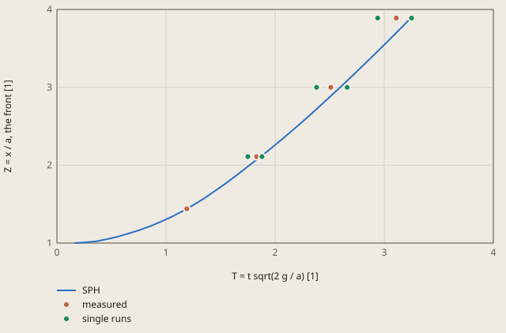

# dam-break-martin-moyce derivation

## Conclusion

The surge front of the SPH model is in the scatter of the fronts that Martin and Moyce (1952) measured, but it is slower than their mean. At Z = 2.11, 3.00 and 3.89, the front of the model arrives 2.0 %, 3.4 % and 4.3 % later than the mean. Each value is in the range of the single runs and less than 1 standard deviation from the mean. At Z = 3.89, the model (T = 3.244) is almost as late as the slowest single run (3.25).

**Dam break, the surge front (LAMMPS SPH, 40 particles across a)**



measured: Martin and Moyce (1952), Table 2, the mean of the runs with a = 2.25 in

single runs: Martin and Moyce (1952), Table 2, the smallest and the largest T of the runs with a = 2.25 in

The front is the largest x of the water plus dx / 2. T is 1.19 at Z = 1.44, as in the source.

<details><summary>Values of the plot</summary>

Original values. — means no sample.

| T = t sqrt(2 g / a) [1] | SPH (Z = x / a, the front [1]) | measured (Z = x / a, the front [1]) | single runs (Z = x / a, the front [1]) |
| ---: | ---: | ---: | ---: |
| 0.1624 | 1 | — | — |
| 0.2617 | 1.009 | — | — |
| 0.361 | 1.0225 | — | — |
| 0.4602 | 1.0502 | — | — |
| 0.5595 | 1.0836 | — | — |
| 0.6588 | 1.1237 | — | — |
| 0.7581 | 1.1668 | — | — |
| 0.8573 | 1.2184 | — | — |
| 0.9566 | 1.2764 | — | — |
| 1.0559 | 1.3392 | — | — |
| 1.1552 | 1.4125 | — | — |
| 1.19 | 1.4401 | — | — |
| 1.2544 | 1.4918 | — | — |
| 1.3537 | 1.5776 | — | — |
| 1.453 | 1.6737 | — | — |
| 1.5522 | 1.7713 | — | — |
| 1.6515 | 1.8757 | — | — |
| 1.7508 | 1.9839 | — | — |
| 1.8501 | 2.0913 | — | — |
| 1.8673 | 2.1101 | — | — |
| 1.9493 | 2.2012 | — | — |
| 2.0486 | 2.3165 | — | — |
| 2.1479 | 2.4346 | — | — |
| 2.2472 | 2.5542 | — | — |
| 2.3464 | 2.6787 | — | — |
| 2.4457 | 2.8057 | — | — |
| 2.545 | 2.9334 | — | — |
| 2.5961 | 3.0001 | — | — |
| 2.6442 | 3.0635 | — | — |
| 2.7435 | 3.1965 | — | — |
| 2.8428 | 3.3315 | — | — |
| 2.9421 | 3.4672 | — | — |
| 3.0413 | 3.6038 | — | — |
| 3.1406 | 3.7434 | — | — |
| 3.2399 | 3.8845 | — | — |
| 3.2437 | 3.8901 | — | — |
| 1.19 | — | 1.44 | — |
| 1.83 | — | 2.11 | — |
| 1.75 | — | — | 2.11 |
| 1.88 | — | — | 2.11 |
| 2.51 | — | 3 | — |
| 2.38 | — | — | 3 |
| 2.66 | — | — | 3 |
| 3.11 | — | 3.89 | — |
| 2.94 | — | — | 3.89 |
| 3.25 | — | — | 3.89 |

</details>

The difference increases along the floor. The checks use 29 %, 49 % and 61 % of the tolerance. The section "Studies" below gives a part of the cause: the resolution. With 80 particles across a, the front is earlier, and the values extrapolated to a fine resolution are 1.9 % above the mean.

The front is the largest x of the water plus dx / 2. T is the T of the plot. The front at each output of the run is:

| t [s] | T | Z |
|---|---|---|
| 0, the release | 0 | 1.00 |
| 0.021 | 0.56 | 1.08 |
| 0.043 | 0.96 | 1.28 |
| 0.064 | 1.35 | 1.58 |
| 0.086 | 1.75 | 1.98 |
| 0.107 | 2.15 | 2.43 |
| 0.129 | 2.55 | 2.93 |
| 0.150 | 2.94 | 3.47 |

The last output is at t = 0.150 s, Z = 3.47. The run stops at Z = 3.89, at t = 0.166 s, before the next output.

## Result

**Pass.** A check passes when |computed - reference| ≤ rel_tol · |reference| + abs_tol, with rel_tol = 0.07 and abs_tol = 0 (`check.toml`). `fh validate` gives the computed values.

| Check | Unit | Computed | Reference | Difference | Tolerance | Margin |
| --- | ---: | ---: | ---: | ---: | ---: | ---: |
| `T_211` | Not specified | 1.8673 | 1.83 | +0.0373 (+2.03825 %) | 0.1281 | 0.0908 |
| `T_300` | Not specified | 2.5961 | 2.51 | +0.0861 (+3.43028 %) | 0.1757 | 0.0896 |
| `T_389` | Not specified | 3.2437 | 3.11 | +0.1337 (+4.29904 %) | 0.2177 | 0.084 |

Made by `scripts/validation-reports.py` on 2026-10-28, femahoy 9c54611.

This case checks the particle path: a 2D dam break with smoothed particle hydrodynamics (SPH).
A water column falls on a dry floor, and the surge front moves along the floor. The reference is a measurement. Thus the tolerance comes from the scatter of the measurement and from the resolution study of the model.

## Why this case

No other case of the suite has any of these items:

- Particles: the solver is LAMMPS (SPH), not a mesh solver.
- A free surface with a large motion.
- Weakly compressible water: the Tait equation of state with an artificial speed of sound.
- An explicit transient that stops when a quantity (the front position) gets to a value.

## Source

J. C. Martin and W. J. Moyce, "Part IV. An experimental study of the collapse of liquid columns on a rigid horizontal plane", Phil. Trans. R. Soc. Lond. A 244 (1952) 312-324, https://doi.org/10.1098/rsta.1952.0006.

A column of water of width a and height n^2 a stands on a horizontal plane, against a wall at x = 0. At t = 0 the column is released. Table 2 (page 317) gives the times for n^2 = 2, a = 2.25 in, in the dimensionless form T = n t sqrt(g / a) = t sqrt(2 g / a) at the front positions Z = x / a.
The source sets T to 1.19 at Z = 1.44 in each run ("T normalized at this value of Z"), because the instant of the release is not known exactly. The model does the same: it adds a constant to its T so that T is 1.19 at Z = 1.44.

The checks use the column "mean" for a = 2.25 in:

| Check | Z | Measured T (mean) | Single runs | Standard deviation of the runs |
|---|---:|---:|---:|---:|
| `T_211` | 2.11 | 1.83 | 9, from 1.75 to 1.88 | 0.048 (2.6 %) |
| `T_300` | 3.00 | 2.51 | 9, from 2.38 to 2.66 | 0.099 (3.9 %) |
| `T_389` | 3.89 | 3.11 | 4, from 2.94 to 3.25 | 0.139 (4.5 %) |

The 3 points are near the start, the middle and the end of the data that the source gives for most runs of a = 2.25 in.

## Model

The LAMMPS case is the folder `sph`: `case.lmp`. The units are SI.

| Item | Value |
|---|---|
| Column | a = 0.05715 m, height 2a, water from x = 0 to a |
| Particles | a square grid with spacing dx = a / 40 = 1.43 mm. 3200 water particles |
| Walls | 3 layers of fixed particles: the wall at x <= 0 to a height of 2.5a, and the floor at y <= 0 to x = 6a. Their density follows the continuity equation (`fix sph/stationary`) |
| Water | rho0 = 1000 kg/m^3. The Tait equation p = B ((rho / rho0)^7 - 1), B = c0^2 rho0 / 7, c0 = 20 m/s. c0 is more than 10 times the largest speed, sqrt(2 g 2a) = 1.5 m/s |
| Kernel | the Lucy kernel of LAMMPS, radius h = 3 dx |
| Viscosity | the artificial viscosity of Monaghan, alpha = 0.05 (`pair_style sph/taitwater`) |
| Start | at rest, with the hydrostatic density of the Tait equation |
| Time step | dt = 0.025 h / c0 = 5.4e-6 s |
| Front | the largest x of the water plus dx / 2 |
| Output | `front.txt`: 1 row with the 3 values of the check. `particles.dump`: the water every 4000 steps, with the speed and the pressure, for the viewer |

The run stops at each Z with `fix halt`. The last stop is at Z = 3.89, at t = 0.17 s. The water does not get to the end of the floor.

Problems that the model solves:

- With dt = 0.1 h / c0 and alpha = 0.02, the density goes from 400 to 1350 kg/m^3 and particles leave the box. A smaller time step removes this.
- With dt = 0.05 h / c0 and alpha = 0.02, T is 6 % to 21 % too small at n = 80, and 1 % to 18 % too large at n = 40. With dt = 0.025 h / c0, the values change little from n = 40 to n = 80.

## Studies

These commands, in the repository root, solve the case with other values in a scratch folder. `-var` sets the variables `n`, `alpha` and `cfl` of `case.lmp`:

```
mkdir /tmp/dam && cp validation/cases/dam-break-martin-moyce/sph/case.lmp /tmp/dam && cd /tmp/dam
lmp -in case.lmp -log none -var n 80
```

The values are in `/tmp/dam/front.txt`.

Resolution, with alpha = 0.05 and dt = 0.025 h / c0:

| n (particles across a) | Water particles | T_211 | T_300 | T_389 |
|---:|---:|---:|---:|---:|
| 20 | 800 | 1.930 | 2.694 | 3.411 |
| 40, the check | 3200 | 1.867 | 2.596 | 3.244 |
| 80 | 12800 | 1.864 | 2.568 | 3.192 |
| Measured | | 1.83 | 2.51 | 3.11 |

The values decrease monotonically. For `T_389`, the observed order is 1.69 and the extrapolated value is 3.169. Thus the resolution error of n = 40 is 0.075, 2.4 % of the reference. For `T_300` it is 1.6 %, and for `T_211` 0.2 %.

Time step and viscosity, with n = 40:

| Change | T_211 | T_300 | T_389 |
|---|---:|---:|---:|
| The check: alpha = 0.05, dt = 0.025 h / c0 | 1.867 | 2.596 | 3.244 |
| dt = 0.0125 h / c0 | 1.866 | 2.587 | 3.232 |
| dt = 0.05 h / c0 | 1.899 | 2.629 | 3.311 |
| alpha = 0.02 | 1.866 | 2.607 | 3.255 |

Half the time step changes the values by 0.4 % or less. alpha = 0.02 changes them by 0.4 % or less.

## Tolerance

The tolerance is `rel_tol = 0.07` and `abs_tol = 0`.

| Cause | Basis | Effect |
|---|---|---:|
| The scatter of the measurement | The largest standard deviation of the single runs about the mean (at Z = 3.89, 4 runs) | 4.5 % |
| Resolution error of the model | The extrapolation of `T_389` from 3 resolutions | 2.4 % |

`rel_tol` is the sum, 6.9 %, rounded up to 7 %.
The front of the model is slower than the mean at all 3 points. The extrapolated values (1.864, 2.557, 3.169) are 1.9 % above the means, less than 1 standard deviation of the runs.

| Check | Model | Measured | Difference | Tolerance | Part of the tolerance |
|---|---:|---:|---:|---:|---:|
| `T_211` | 1.867 | 1.83 | 0.037 | 0.128 | 29 % |
| `T_300` | 2.596 | 2.51 | 0.086 | 0.176 | 49 % |
| `T_389` | 3.244 | 3.11 | 0.134 | 0.218 | 61 % |

The tolerance stops these errors:

- The coarse model (n = 20): `T_300` and `T_389` fail.
- A time step that is too large (dt = 0.05 h / c0 with alpha = 0.02): `T_300` is 18 % too large and fails.

## Not in the check

- The height of the column at x = 0, the second measurement of the source. It needs a second rule for the surface of the particles.
- Z larger than 4.11: only 3 of the 9 runs of a = 2.25 in have data there, and the run takes longer.
- The other column of the source, a = 1.125 in: it has the same n^2 and thus the same T(Z) in theory.

On a Mac with 10 cores, `fh validate` of the case took 24 s on 1 core with LAMMPS of 30 Sep 2026.
