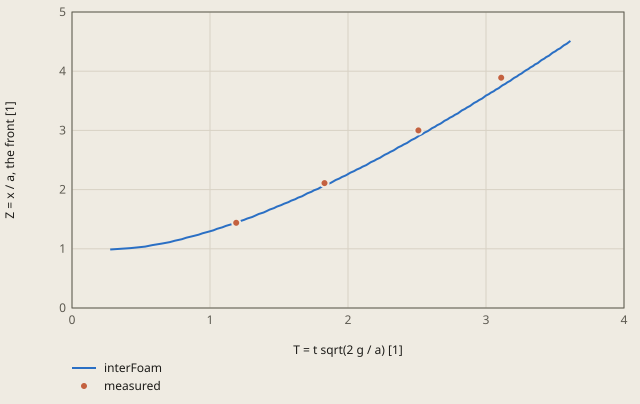
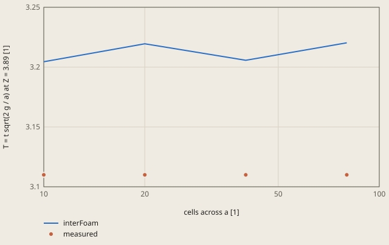

# dam-break-vof derivation

## Conclusion

The surge front of the interFoam model follows the front that Martin and Moyce (1952) measured. At the 3 checked positions Z = 2.11, 3.00 and 3.89, the front of the model is 2.3 % to 3.1 % slower than the mean of the measured runs. Each difference is less than 1 standard deviation of the single runs, thus the model is in the scatter of the measurement.

**Dam break, the surge front (interFoam, 40 cells across a)**



measured: Martin and Moyce (1952), Table 2, the mean of the runs with a = 2.25 in

The front is the largest x of a cell centre with alpha.water > 0.5. T is 1.19 at Z = 1.44, as in the source.

<details><summary>Values of the plot</summary>

Original values. — means no sample.

| T = t sqrt(2 g / a) [1] | interFoam (Z = x / a, the front [1]) | measured (Z = x / a, the front [1]) |
| ---: | ---: | ---: |
| 0.277 | 0.9875 | — |
| 0.4255 | 1.0125 | — |
| 0.5304 | 1.0375 | — |
| 0.5824 | 1.0625 | — |
| 0.6502 | 1.0875 | — |
| 0.7095 | 1.1125 | — |
| 0.7457 | 1.1375 | — |
| 0.7964 | 1.1625 | — |
| 0.828 | 1.1875 | — |
| 0.8738 | 1.2125 | — |
| 0.9171 | 1.2375 | — |
| 0.9453 | 1.2625 | — |
| 0.9859 | 1.2875 | — |
| 1.0257 | 1.3125 | — |
| 1.0516 | 1.3375 | — |
| 1.09 | 1.3625 | — |
| 1.1149 | 1.3875 | — |
| 1.1522 | 1.4125 | — |
| 1.1876 | 1.4375 | — |
| 1.2113 | 1.4625 | — |
| 1.2467 | 1.4875 | — |
| 1.2703 | 1.5125 | — |
| 1.3058 | 1.5375 | — |
| 1.3294 | 1.5625 | — |
| 1.3531 | 1.5875 | — |
| 1.3885 | 1.6125 | — |
| 1.4102 | 1.6375 | — |
| 1.4319 | 1.6625 | — |
| 1.4639 | 1.6875 | — |
| 1.485 | 1.7125 | — |
| 1.5163 | 1.7375 | — |
| 1.537 | 1.7625 | — |
| 1.5675 | 1.7875 | — |
| 1.5877 | 1.8125 | — |
| 1.6178 | 1.8375 | — |
| 1.6376 | 1.8625 | — |
| 1.667 | 1.8875 | — |
| 1.6864 | 1.9125 | — |
| 1.7058 | 1.9375 | — |
| 1.7345 | 1.9625 | — |
| 1.7535 | 1.9875 | — |
| 1.7819 | 2.0125 | — |
| 1.8005 | 2.0375 | — |
| 1.8285 | 2.0625 | — |
| 1.8469 | 2.0875 | — |
| 1.8745 | 2.1125 | — |
| 1.8926 | 2.1375 | — |
| 1.9108 | 2.1625 | — |
| 1.9378 | 2.1875 | — |
| 1.9557 | 2.2125 | — |
| 1.9825 | 2.2375 | — |
| 2.0003 | 2.2625 | — |
| 2.0182 | 2.2875 | — |
| 2.0445 | 2.3125 | — |
| 2.062 | 2.3375 | — |
| 2.0881 | 2.3625 | — |
| 2.1053 | 2.3875 | — |
| 2.131 | 2.4125 | — |
| 2.1482 | 2.4375 | — |
| 2.1652 | 2.4625 | — |
| 2.1903 | 2.4875 | — |
| 2.2071 | 2.5125 | — |
| 2.2322 | 2.5375 | — |
| 2.2489 | 2.5625 | — |
| 2.2657 | 2.5875 | — |
| 2.2902 | 2.6125 | — |
| 2.3064 | 2.6375 | — |
| 2.3306 | 2.6625 | — |
| 2.3468 | 2.6875 | — |
| 2.3629 | 2.7125 | — |
| 2.3871 | 2.7375 | — |
| 2.4033 | 2.7625 | — |
| 2.4275 | 2.7875 | — |
| 2.4437 | 2.8125 | — |
| 2.4598 | 2.8375 | — |
| 2.4841 | 2.8625 | — |
| 2.5002 | 2.8875 | — |
| 2.5159 | 2.9125 | — |
| 2.5392 | 2.9375 | — |
| 2.5548 | 2.9625 | — |
| 2.578 | 2.9875 | — |
| 2.5933 | 3.0125 | — |
| 2.6086 | 3.0375 | — |
| 2.6314 | 3.0625 | — |
| 2.6467 | 3.0875 | — |
| 2.6694 | 3.1125 | — |
| 2.6845 | 3.1375 | — |
| 2.6996 | 3.1625 | — |
| 2.722 | 3.1875 | — |
| 2.7369 | 3.2125 | — |
| 2.7593 | 3.2375 | — |
| 2.7741 | 3.2625 | — |
| 2.7963 | 3.2875 | — |
| 2.811 | 3.3125 | — |
| 2.8257 | 3.3375 | — |
| 2.8477 | 3.3625 | — |
| 2.8623 | 3.3875 | — |
| 2.8842 | 3.4125 | — |
| 2.8987 | 3.4375 | — |
| 2.9133 | 3.4625 | — |
| 2.9349 | 3.4875 | — |
| 2.9493 | 3.5125 | — |
| 2.9709 | 3.5375 | — |
| 2.9852 | 3.5625 | — |
| 2.9995 | 3.5875 | — |
| 3.0209 | 3.6125 | — |
| 3.0351 | 3.6375 | — |
| 3.0564 | 3.6625 | — |
| 3.0706 | 3.6875 | — |
| 3.0917 | 3.7125 | — |
| 3.1057 | 3.7375 | — |
| 3.1198 | 3.7625 | — |
| 3.1409 | 3.7875 | — |
| 3.1549 | 3.8125 | — |
| 3.1759 | 3.8375 | — |
| 3.1898 | 3.8625 | — |
| 3.2036 | 3.8875 | — |
| 3.2244 | 3.9125 | — |
| 3.2382 | 3.9375 | — |
| 3.259 | 3.9625 | — |
| 3.2728 | 3.9875 | — |
| 3.2866 | 4.0125 | — |
| 3.3071 | 4.0375 | — |
| 3.3208 | 4.0625 | — |
| 3.3411 | 4.0875 | — |
| 3.3547 | 4.1125 | — |
| 3.375 | 4.1375 | — |
| 3.3885 | 4.1625 | — |
| 3.4021 | 4.1875 | — |
| 3.4224 | 4.2125 | — |
| 3.4359 | 4.2375 | — |
| 3.4562 | 4.2625 | — |
| 3.4698 | 4.2875 | — |
| 3.4833 | 4.3125 | — |
| 3.5036 | 4.3375 | — |
| 3.5172 | 4.3625 | — |
| 3.5375 | 4.3875 | — |
| 3.551 | 4.4125 | — |
| 3.5645 | 4.4375 | — |
| 3.5848 | 4.4625 | — |
| 3.5984 | 4.4875 | — |
| 3.6119 | 4.5125 | — |
| 1.19 | — | 1.44 |
| 1.83 | — | 2.11 |
| 2.51 | — | 3 |
| 3.11 | — | 3.89 |

</details>

`alpha.water` is 1 in the water and 0 in the air. The front is the largest x of a cell centre with alpha.water above 0.5, and Z = x / a with a = 2.25 in. The front at each time of the run is:

| t [s] | Z |
|---|---|
| 0, the release | 0.99 |
| 0.06 | 1.61 |
| 0.12 | 2.89 |
| 0.18 | 4.51 |

## Result

**Pass.** A check passes when |computed - reference| ≤ rel_tol · |reference| + abs_tol, with rel_tol = 0.055 and abs_tol = 0 (`check.toml`). `fh validate` gives the computed values.

| Check | Unit | Computed | Reference | Difference | Tolerance | Margin |
| --- | ---: | ---: | ---: | ---: | ---: | ---: |
| `T_211` | Not specified | 1.8717 | 1.83 | +0.0417 (+2.27869 %) | 0.1007 | 0.05895 |
| `T_300` | Not specified | 2.5856 | 2.51 | +0.0756 (+3.01195 %) | 0.138 | 0.06245 |
| `T_389` | Not specified | 3.2057 | 3.11 | +0.0957 (+3.07717 %) | 0.1711 | 0.07535 |

Made by `scripts/validation-reports.py` on 2026-10-28, femahoy 9c54611.

This case checks the free surface path: a 2D dam break with the volume of fluid (VOF) method of OpenFOAM (`interFoam`).
A water column falls on a dry floor in air, and the surge front moves along the floor. The reference is a measurement. Thus the tolerance comes from the scatter of the measurement and from the mesh and time step studies of the model.

## Why this case

No other case of the suite has any of these items:

- 2 fluids, water and air, with a sharp interface between them: the VOF method with MULES and interface compression.
- A free surface with a large motion under gravity.
- A start field from `setFields`.
- A time step that changes with the Courant number of the flow and of the interface.
- A transient with a value from the time history: the time at which the front gets to a position.

## Source

J. C. Martin and W. J. Moyce, "Part IV. An experimental study of the collapse of liquid columns on a rigid horizontal plane", Phil. Trans. R. Soc. Lond. A 244 (1952) 312-324, https://doi.org/10.1098/rsta.1952.0006.

A column of water of width a and height n^2 a stands on a horizontal plane, against a wall at x = 0. At t = 0 the column is released. Table 2 (page 317) gives the times for n^2 = 2, a = 2.25 in, in the dimensionless form T = n t sqrt(g / a) = t sqrt(2 g / a) at the front positions Z = x / a.
The source sets T to 1.19 at Z = 1.44 in each run ("T normalized at this value of Z"), because the instant of the release is not known exactly. The model does the same: it adds a constant to its T so that T is 1.19 at Z = 1.44.

The checks use the column "mean" for a = 2.25 in. The single runs and their standard deviation come from the same table:

| Check | Z | Measured T (mean) | Single runs | Standard deviation of the runs |
|---|---:|---:|---:|---:|
| `T_211` | 2.11 | 1.83 | 9, from 1.75 to 1.88 | 0.048 (2.6 %) |
| `T_300` | 3.00 | 2.51 | 9, from 2.38 to 2.66 | 0.099 (3.9 %) |
| `T_389` | 3.89 | 3.11 | 4, from 2.94 to 3.25 | 0.139 (4.5 %) |

The 3 points are near the start, the middle and the end of the data that the source gives for most runs of a = 2.25 in.

## Model

The OpenFOAM case is the folder `n40`. The units are SI.

| Item | Value |
|---|---|
| Column | a = 0.05715 m, height 2a, water from x = 0 to a |
| Tank | 5a long and 2.5a high: walls at x = 0, at x = 5a and at y = 0, an open top. 1 cell in z |
| Mesh | uniform square cells, dx = a / 40 = 1.43 mm. 200 x 100 = 20000 cells. `n` in `system/blockMeshDict` sets the cells across a |
| Fluids | water: rho = 998 kg/m^3, nu = 1e-6 m^2/s. Air: rho = 1.2 kg/m^3, nu = 1.5e-5 m^2/s. Surface tension 0.073 N/m. Laminar |
| Solver | `interFoam` with PIMPLE: 1 outer corrector, 3 pressure correctors, no momentum predictor |
| Interface | MULES with interface compression `cAlpha 1`, `MULESCorr yes`, 2 corrections. `Gauss vanLeer` for `div(phi,alpha)` |
| Momentum | `Gauss linearUpwind grad(U)` for `div(rhoPhi,U)`, Euler in time |
| Time step | adjustable, with `maxCo` and `maxAlphaCo` 0.5. 369 steps to t = 0.18 s |
| Walls | `noSlip`, `fixedFluxPressure`, and `zeroGradient` for `alpha.water` (a contact angle of 90 degrees) |
| Top | `totalPressure` 0 for `p_rgh`, `pressureInletOutletVelocity` for `U`, `inletOutlet` for `alpha.water` |
| Start | at rest. `setFields` puts alpha.water = 1 in the cells of the column (`boxToCell`) |
| Front | the largest x of a cell centre with alpha.water > 0.5. The function object `front` (`fieldExtents`) writes it after each time step |
| Output | at the end, the function object `frontTimes` (`systemCall`) starts `awk -f system/front.awk`. It writes `front.txt`: 1 row with the 3 values of the check. It also writes the curve `front.csv` for `fh report --curve`: the front at each step and the measured points |

The run stops at t = 0.18 s. Then the front is at Z = 4.5, before the wall at x = 5a.

The front moves 1 cell at a time. Thus `front.awk` interpolates linearly between the 2 steps of the front on each side of x = Z a.
The largest cell centre is up to 1 cell behind the surface alpha.water = 0.5. This offset is almost the same at Z = 1.44 and at the 3 points of the check, thus the normalization removes most of it. The mesh study includes the remainder.

The front of the model gets to Z = 1.44 at T = 0.91: the release of the model is instantaneous. The constant that sets T to 1.19 is thus 0.28.

## Studies

These commands, in the repository root, solve the case with other values in a scratch folder. On Linux, use `openfoam2512` in place of `openfoam`:

```
cp -R validation/cases/dam-break-vof/n40 /tmp/dam && cd /tmp/dam
sed -i.orig 's/^n       40;/n       80;/' system/blockMeshDict
openfoam blockMesh && openfoam setFields && openfoam interFoam
```

The values are in `/tmp/dam/front.txt`.

Mesh, with `maxCo` and `maxAlphaCo` 0.5:

| n (cells across a) | Cells | T_211 | T_300 | T_389 |
|---:|---:|---:|---:|---:|
| 10 | 1250 | 1.8174 | 2.5479 | 3.2045 |
| 20 | 5000 | 1.8787 | 2.5897 | 3.2195 |
| 40, the check | 20000 | 1.8717 | 2.5856 | 3.2057 |
| 80 | 80000 | 1.8756 | 2.5926 | 3.2203 |
| Measured | | 1.83 | 2.51 | 3.11 |

From n = 20 to n = 80, the values change by 0.5 % or less, with no monotonic trend. `mesh.csv` holds the values of `T_389` as a curve for `fh report --curve`. Thus an extrapolation is not possible. The mesh error of n = 40 is the difference to n = 80: 0.0146 for `T_389` (0.47 % of the reference), 0.0070 for `T_300` (0.28 %) and 0.0039 for `T_211` (0.21 %).

Time step and walls, with n = 40. For these rows, edit `maxCo` and `maxAlphaCo` in `system/controlDict`, or the type of `walls` in `0/U`:

| Change | T_211 | T_300 | T_389 |
|---|---:|---:|---:|
| The check: `maxCo` and `maxAlphaCo` 0.5, `noSlip` | 1.8717 | 2.5856 | 3.2057 |
| `maxCo` and `maxAlphaCo` 0.25 (989 steps) | 1.8747 | 2.5883 | 3.2118 |
| `slip` walls | 1.8766 | 2.5883 | 3.2104 |

Half the Courant number changes the values by 0.2 % or less. The wall condition changes them by 0.3 % or less: the boundary layer of the floor is thin and has a small effect on the front.

## Tolerance

The tolerance is `rel_tol = 0.055` and `abs_tol = 0`.

| Cause | Basis | Effect |
|---|---|---:|
| The scatter of the measurement | The largest standard deviation of the single runs about the mean (at Z = 3.89, 4 runs) | 4.5 % |
| Mesh error of the model | The largest difference between n = 40 and n = 80 (`T_389`) | 0.5 % |
| Time step error of the model | The largest difference between the Courant numbers 0.5 and 0.25 (`T_389`) | 0.2 % |

`rel_tol` is the sum, 5.2 %, rounded up to 5.5 %.
The front of the model is slower than the mean at all 3 points, by 2.3 % to 3.1 %. Each difference is less than 1 standard deviation of the runs.

| Check | Model | Measured | Difference | Tolerance | Part of the tolerance |
|---|---:|---:|---:|---:|---:|
| `T_211` | 1.8717 | 1.83 | 0.0417 | 0.101 | 41 % |
| `T_300` | 2.5856 | 2.51 | 0.0756 | 0.138 | 55 % |
| `T_389` | 3.2057 | 3.11 | 0.0957 | 0.171 | 56 % |

The tolerance stops this error:

- A column of height a in place of 2a (a wrong box in `system/setFieldsDict`): T is 1.924, 2.730 and 3.482. `T_300` (8.8 % too large) and `T_389` (12 %) fail.

The tolerance does not stop a coarse mesh: n = 10 passes, because the time of the front changes little with the mesh.

## Not in the check

- The height of the column at x = 0 (Table 6 of the source). The table of the function object `front` has it: the largest y of the water.
- Z larger than 4.11: only 3 of the 9 runs of a = 2.25 in have data there, and the run takes longer.
- The other column of the source, a = 1.125 in: it has the same n^2 and thus the same T(Z) in theory.

On a Mac with 10 cores and other jobs, `fh validate` of the case took 85 s (34 s of CPU time) on 1 core with OpenFOAM v2512.

**Dam break, the mesh study of T at Z = 3.89 (interFoam)**



measured: Martin and Moyce (1952), Table 2, the mean of 4 runs with a = 2.25 in, at each mesh

The values are from derivation.md, "Studies". The check uses 40 cells across a.

<details><summary>Values of the plot</summary>

Original values. — means no sample.

| cells across a [1] | interFoam (T = t sqrt(2 g / a) at Z = 3.89 [1]) | measured (T = t sqrt(2 g / a) at Z = 3.89 [1]) |
| ---: | ---: | ---: |
| 10 | 3.2045 | 3.11 |
| 20 | 3.2195 | 3.11 |
| 40 | 3.2057 | 3.11 |
| 80 | 3.2203 | 3.11 |

</details>
