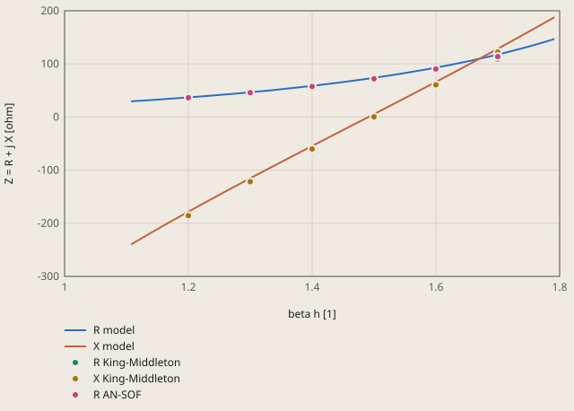

# dipole-king-middleton derivation

## Conclusion

The openEMS model gives the input impedance of King and Middleton at the 2 checked points within 4.0 %, and the tolerance is 6 %. At beta h = 1.2, X is -178.2 ohm against -185.7 ohm. At beta h = 1.5, R is 73.8 ohm against 71.02 ohm. These 2 checks use 67 % and 65 % of the tolerance.

**Input impedance of the dipole near the first resonance, Omega = 12.5**



R King-Middleton: R. W. P. King (1956), The Theory of Linear Antennas, Tables 30.6 to 30.10

X King-Middleton: R. W. P. King (1956), The Theory of Linear Antennas, Tables 30.6 to 30.10

R AN-SOF: the method-of-moments solution of the same dipole, AN-SOF_vs_King-Middleton_2nd_Order_Impedances.xlsx

The model is a strip of width 1.2 mm, 4 cells across its width (openEMS). beta h = 2 pi h / wavelength, with the half length h = 77.70 mm.

The X of AN-SOF is within 1.2 ohm of King-Middleton. The plot does not show it.

<details><summary>Values of the plot</summary>

Original values. — means no sample.

| beta h [1] | R model (Z = R + j X [ohm]) | X model (Z = R + j X [ohm]) | R King-Middleton (Z = R + j X [ohm]) | X King-Middleton (Z = R + j X [ohm]) | R AN-SOF (Z = R + j X [ohm]) |
| ---: | ---: | ---: | ---: | ---: | ---: |
| 1.1074 | 29.522 | -239.892 | — | — | — |
| 1.1237 | 30.717 | -228.715 | — | — | — |
| 1.14 | 31.968 | -217.691 | — | — | — |
| 1.1562 | 33.264 | -206.818 | — | — | — |
| 1.1725 | 34.594 | -196.083 | — | — | — |
| 1.1888 | 35.955 | -185.465 | — | — | — |
| 1.2051 | 37.351 | -174.945 | — | — | — |
| 1.2214 | 38.795 | -164.511 | — | — | — |
| 1.2377 | 40.299 | -154.159 | — | — | — |
| 1.2539 | 41.867 | -143.89 | — | — | — |
| 1.2702 | 43.498 | -133.703 | — | — | — |
| 1.2865 | 45.188 | -123.596 | — | — | — |
| 1.3028 | 46.931 | -113.558 | — | — | — |
| 1.3191 | 48.729 | -103.576 | — | — | — |
| 1.3354 | 50.585 | -93.638 | — | — | — |
| 1.3517 | 52.508 | -83.736 | — | — | — |
| 1.3679 | 54.505 | -73.864 | — | — | — |
| 1.3842 | 56.583 | -64.02 | — | — | — |
| 1.4005 | 58.744 | -54.205 | — | — | — |
| 1.4168 | 60.987 | -44.413 | — | — | — |
| 1.4331 | 63.313 | -34.639 | — | — | — |
| 1.4494 | 65.722 | -24.875 | — | — | — |
| 1.4657 | 68.218 | -15.112 | — | — | — |
| 1.482 | 70.808 | -5.34 | — | — | — |
| 1.4982 | 73.5 | 4.446 | — | — | — |
| 1.5145 | 76.302 | 14.25 | — | — | — |
| 1.5308 | 79.222 | 24.075 | — | — | — |
| 1.5471 | 82.263 | 33.919 | — | — | — |
| 1.5634 | 85.427 | 43.788 | — | — | — |
| 1.5797 | 88.716 | 53.686 | — | — | — |
| 1.5959 | 92.134 | 63.623 | — | — | — |
| 1.6122 | 95.687 | 73.609 | — | — | — |
| 1.6285 | 99.389 | 83.652 | — | — | — |
| 1.6448 | 103.254 | 93.757 | — | — | — |
| 1.6611 | 107.292 | 103.922 | — | — | — |
| 1.6774 | 111.512 | 114.147 | — | — | — |
| 1.6937 | 115.918 | 124.43 | — | — | — |
| 1.7099 | 120.512 | 134.779 | — | — | — |
| 1.7262 | 125.301 | 145.204 | — | — | — |
| 1.7425 | 130.297 | 155.717 | — | — | — |
| 1.7588 | 135.52 | 166.327 | — | — | — |
| 1.7751 | 140.992 | 177.036 | — | — | — |
| 1.7914 | 146.731 | 187.839 | — | — | — |
| 1.2 | — | — | 37.13 | -185.7 | 36.4 |
| 1.3 | — | — | 46.27 | -121.6 | 45.82 |
| 1.4 | — | — | 57.39 | -60.07 | 57.48 |
| 1.5 | — | — | 71.02 | 0.27 | 72.02 |
| 1.6 | — | — | 87.9 | 60.62 | 90.37 |
| 1.7 | — | — | 109.2 | 122.2 | 113.7 |

</details>

The X curve of the model is 5.2 to 7.5 ohm above the reference from beta h = 1.2 to 1.7. Thus the first resonance (X = 0) of the model is at beta h = 1.491, 0.6 % below the resonance of the reference, 1.4996. The model is a flat strip, and the reference is a round tube. The section "Tolerance" below gives the strip as the largest cause, up to 3.8 % in X at beta h = 1.2. The mesh error is 0.3 % or less.

Above the resonance, the difference of R increases: +5.8 % at beta h = 1.6 and +7.8 % at beta h = 1.7. These 2 points are not checks. There the 2 references also differ: the R of AN-SOF, a method-of-moments solution of the same dipole, is 2.8 % and 4.1 % above King-Middleton.

The far field agrees with the far field of a half-wave dipole. At beta h = pi / 2, the directivity is 1.652 against 1.641 for a sinusoidal current (+0.7 %), and the radiated power is 0.9994 of the power into the port.

The pattern D(theta, phi) at beta h = pi / 2: the dipole is on the z axis. D is near 0 on the axis. In the plane z = 0, D is 1.651 to 1.652 in all directions. The largest value is D = 1.652.

## Result

**Pass.** A check passes when |computed - reference| ≤ rel_tol · |reference| + abs_tol, with rel_tol = 0.06 and abs_tol = 0 (`check.toml`). `fh validate` gives the computed values.

| Check | Unit | Computed | Reference | Difference | Tolerance | Margin |
| --- | ---: | ---: | ---: | ---: | ---: | ---: |
| `X12` | Not specified | -178.225 | -185.7 | +7.475 (+4.02531 %) | 11.14 | 3.667 |
| `R15` | Not specified | 73.8 | 71.02 | +2.78 (+3.91439 %) | 4.261 | 1.481 |
| `D` | Not specified | 1.65178 | 1.641 | +0.01078 (+0.656917 %) | 0.09846 | 0.08768 |
| `eff` | Not specified | 0.999353 | 1 | -0.000647 (-0.0647 %) | 0.06 | 0.05935 |

Made by `scripts/validation-reports.py` on 2026-10-28, femahoy 9c54611.

This case checks the antenna path: the input impedance and the far field of a centre-fed dipole, solved with openEMS (FDTD).
The impedance reference is the published second-order theory of King and Middleton. The directivity reference is analytical.
The tolerance comes from the mesh error and from the difference between the strip of the model and the round dipole of the reference.

## Why this case

No other case of the suite has any of these items:

- High-frequency electromagnetics in the time domain: the FDTD solver of openEMS.
- Radiation into free space, with a perfectly matched layer (PML) on the 6 faces.
- A lumped port, and 1 pulse that gives the input impedance and S11 over a broad band (0.4 to 2.8 GHz, a ratio of 7).
- A near-field to far-field transformation: the directivity and the radiated power.

The dipole is the simplest antenna with a published impedance, and its far field has an analytical form.

## Reference

- R. W. P. King, "The Theory of Linear Antennas", Harvard University Press, 1956, Tables 30.6 to 30.10 (pages 172 to 176).
  The tables give the second-order impedance of King and Middleton for a centre-fed tube of radius a and half length h, with a delta-gap feed.
  The values are a function of beta h = 2 pi h / wavelength and of the thickness parameter Omega = 2 ln(2h / a).
  The values below are copied from the comparison of AN-SOF with these tables, <https://www.antennasimulator.com/download/AN-SOF_vs_King-Middleton_2nd_Order_Impedances.xlsx>.
  The same file gives the solution of AN-SOF, a method-of-moments program, for the same dipoles. This case uses it only to estimate the error of the second-order theory.
- C. A. Balanis, "Antenna Theory: Analysis and Design", 4th edition, Wiley, 2016, section 4.6, "Half-wavelength dipole".
  A sinusoidal current on a dipole of length lambda / 2 gives the directivity D0 = 4 / Cin(2 pi) = 1.641, with Cin(2 pi) = 2.4377.

This case uses Omega = 12.5, thus 2h / a = 518. For this Omega, the theory of King and Middleton and the method of moments agree to 2 % or better at beta h = 1.2 to 1.5:

| beta h | R, King-Middleton (ohm) | X, King-Middleton (ohm) | R, AN-SOF (ohm) | X, AN-SOF (ohm) |
|---|---:|---:|---:|---:|
| 1.2 | 37.13 | -185.7 | 36.40 | -185.5 |
| 1.3 | 46.27 | -121.6 | 45.82 | -121.7 |
| 1.4 | 57.39 | -60.07 | 57.48 | -60.29 |
| 1.5 | 71.02 | 0.27 | 72.02 | 0.21 |
| 1.6 | 87.9 | 60.62 | 90.37 | 61.06 |
| 1.7 | 109.2 | 122.2 | 113.7 | 123.4 |

For Omega = 10, the 2 sources differ by up to 6 % at beta h = 1.6. Thus this case does not use Omega = 10.

| Check | Quantity | Value |
|---|---|---:|
| `X12` | X at beta h = 1.2, in ohm | -185.7 |
| `R15` | R at beta h = 1.5, in ohm. The first resonance (X = 0) is at beta h = 1.4996 | 71.02 |
| `D` | directivity at beta h = pi / 2 | 1.641 |
| `eff` | radiated power / power into the port, at beta h = pi / 2 | 1 |

X12 is large, and it changes fast with the thickness and the length of the dipole. R15 is the resistance near the resonance.

## Model

The openEMS case is the folder `omega12.5`: `openems.py` for the Python modules of openEMS 0.37.0. The lengths are in mm.

| Item | Value |
|---|---|
| Dipole | a strip of metal with no thickness, width w = 1.2 mm, along z in the plane y = 0. Half length h = 77.70 mm, thus Omega = 2 ln(2h / a) = 12.5 with a = w / 4 = 0.3 mm |
| Equivalent radius | a strip of width w acts as a round wire of radius w / 4 (C. M. Butler, "The equivalent radius of a narrow conducting strip", IEEE Transactions on Antennas and Propagation 30(4), 1982, pages 755 to 758) |
| Feed | a gap of 0.6 mm at the centre, with a lumped port of 50 ohm across the full width |
| Pulse | Gaussian, 1.5 GHz +/- 1.3 GHz. The run stops when the energy is 60 dB below its peak |
| Free space | 100 mm of air on each side of the dipole (a quarter wavelength at beta h = 1.2), then a PML of 8 cells |
| Mesh | 4 cells across the strip (d = 0.3 mm), with a line d/3 in the metal and the next line 2d/3 out of the metal at each edge and each end. The cells grow by 1.3 times or less, to a twentieth of the wavelength at 2.8 GHz. 405130 cells |
| Far field | a box of near-field to far-field transformation at the frequency of beta h = pi / 2, then the far field on the full sphere in steps of 2 degrees (theta) and 5 degrees (phi) |
| Output | `dipole.txt`: 1 row with the checks and with R12, X17, the resonance bh_res and R_res. `impedance.txt`: R, X and S11 for 50 ohm from 0.4 to 2.8 GHz. `pattern.pos`: the far-field pattern at beta h = pi / 2, a surface at the distance D(theta, phi) from the centre, for the viewer |

The impedance is a function of beta h and Omega only. Thus the band of the pulse gives the values at each beta h of the table with 1 dipole.

Problems that the model solves:

- A sheet edge on a mesh line acts as an edge about d/3 out of the metal. Thus a strip with 4 cells across its width acts as a wider strip, and X12 has an error of 5 %. The 1/3 rule of the openEMS documentation puts the effective edge at the true edge.
- With the end at 50 dB below the peak, R has a ripple of +/- 10 ohm below 0.6 GHz: the run stops before the current at low frequency is small. At 60 dB, R is smooth from 0.4 GHz. The checks change by 0.5 % or less.
- `Run` changes the working folder of Python to the simulation folder. The script changes it back before it reads the results.

## Mesh study

These commands, in the repository root, solve the case with 8 cells across the strip in a scratch folder. Set `FH_OPENEMS` to the Python of openEMS first (README.md):

```
mkdir /tmp/dipole && cp validation/cases/dipole-king-middleton/omega12.5/openems.py /tmp/dipole && cd /tmp/dipole
sed -i.bak 's/^N = 4 /N = 8 /' openems.py && "$FH_OPENEMS" openems.py && cat dipole.txt
```

| Cells across the strip | Cells | Time | X12 | R15 | D | eff | bh_res | R_res |
|---|---:|---:|---:|---:|---:|---:|---:|---:|
| 2 | 310845 | 137 s | -177.31 | 73.92 | 1.6524 | 0.9994 | 1.4895 | 72.16 |
| 4, the check | 405130 | 159 s | -178.12 | 73.79 | 1.6522 | 0.9994 | 1.4904 | 72.18 |
| 8 | 609756 | 443 s | -178.66 | 73.66 | 1.6527 | 0.9999 | 1.4910 | 72.16 |
| Reference | | | -185.7 | 71.02 | 1.641 | 1 | 1.4996 | 71.0 |

The times are the times of openEMS 0.37.0 with 4 threads on a Mac with 10 cores and other loads.
The resonance of the reference is the zero of X between the rows 1.4 and 1.5 of the table, by linear interpolation. R_res of the reference is R at the same point.

From 4 to 8 cells, X12 changes by 0.3 %, R15 by 0.2 %, and D and eff by 0.05 % or less. The resonance changes by 0.04 %.

These changes of the model change X12 and R15 by 0.2 % or less. They were tested with 4 cells across the strip and the end at 50 dB:

| Change | X12 | R15 |
|---|---:|---:|
| 200 mm of air in place of 100 mm | -0.04 % | 0.0 % |
| Gap of 0.3 mm in place of 0.6 mm | -0.2 % | 0.0 % |

## Tolerance

The tolerance is `rel_tol = 0.06` and `abs_tol = 0`.

| Cause | Basis | Effect |
|---|---|---:|
| Mesh error of the check mesh | 4 against 8 cells across the strip | 0.3 % |
| The second-order theory | King-Middleton against AN-SOF for the checked values | 0.1 % (X12), 1.4 % (R15) |
| A strip in place of a round wire | the model with 8 cells against both references | up to 3.8 % (X12) |
| The directivity of a sinusoidal current | the current of a dipole with Omega = 12.5 is almost sinusoidal | 0.7 % |
| openEMS of another version or platform | FDTD has no iteration and no random part | small |

The strip with 8 cells has its resonance 0.6 % lower than the round dipole. X12 is 3.8 % less negative, and R15 is 3.7 % higher. The cause is not known exactly. The equivalent radius w / 4 is exact for the logarithm of the kernel, but not for the field near the feed and the ends. A 6 % tolerance covers the measured difference with a margin of 1.9 %.

| Check | Model | Reference | Difference | Tolerance | Part of the tolerance |
|---|---:|---:|---:|---:|---:|
| `X12` | -178.12 | -185.7 | 7.58 | 11.14 | 68 % |
| `R15` | 73.79 | 71.02 | 2.77 | 4.26 | 65 % |
| `D` | 1.6522 | 1.641 | 0.0112 | 0.0985 | 11 % |
| `eff` | 0.9994 | 1 | -0.0006 | 0.06 | 1 % |

The tolerance stops these errors:

| Wrong model | X12 | R15 | D | eff | Largest error |
|---|---:|---:|---:|---:|---:|
| No 1/3 rule at the edges of the strip (lines on the edges and the ends) | -168.91 | 74.74 | 1.6530 | 0.9993 | 9.0 % |
| A strip of width 2a in place of 4a (the width taken as the diameter) | -211.36 | 72.00 | 1.6508 | 1.0004 | 13.8 % |
| A dipole 3.5 times thicker, Omega = 10 (values of the King-Middleton table) | -127.1 | 73.65 | | | 32 % |
| A dipole 3.5 times thinner, Omega = 15 (values of the King-Middleton table) | -244.4 | 69.46 | | | 32 % |
| A short dipole (D = 1.5) | | | 1.5 | | 8.6 % |

## Not in the check

- S11: it is a function of Z and of the port resistance, (Z - 50) / (Z + 50). `impedance.txt` gives it for the page.
- The second resonance and the antiresonance near beta h = 2.7 are in `impedance.txt`. The reference table stops at beta h = 1.7.
- A ground plane, a dielectric or a patch antenna: openEMS solves them with the same port and far-field tools. A published measurement with a clear geometry is the next case for these.
