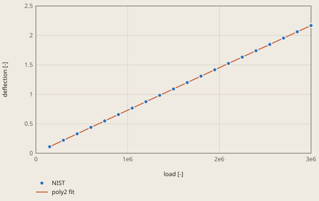

# fit-nist-pontius derivation

## Conclusion

`fh fit` gives the certified values of NIST for the data set Pontius. The fit of y = c0 + c1 x + c2 x^2 to the 40 observations gives c0, c1, c2 and R-squared within 6.4e-13 of the certified values, relative. The largest difference is in c0, 0.6 % of the tolerance of 1e-10 (see "Tolerance").

**Load cell calibration of NIST (Pontius), the deflection at each load**

NIST: NIST StRD, data set Pontius (P. Pontius, NIST, load cell calibration), 40 observations

The source gives no units.

poly2 fit of NIST: c0 = 6.735658e-4 [-], c1 = 7.320592e-7 [-], c2 = -3.160819e-15 [-], R^2 = 0.99999990, largest residual 4.4684e-4 at x = 300000, valid for x from 150000 to 3e6.

Values of the plot

Original values. — means no sample.

| load [-] | NIST (deflection [-]) | poly2 fit (deflection [-]) |
| ---: | ---: | ---: |
| 150000 | 0.11019 | — |
| 300000 | 0.21956 | — |
| 450000 | 0.32949 | — |
| 600000 | 0.43899 | — |
| 750000 | 0.54803 | — |
| 900000 | 0.65694 | — |
| 1050000 | 0.76562 | — |
| 1200000 | 0.87487 | — |
| 1350000 | 0.98292 | — |
| 1500000 | 1.09146 | — |
| 1650000 | 1.20001 | — |
| 1800000 | 1.30822 | — |
| 1950000 | 1.41599 | — |
| 2100000 | 1.52399 | — |
| 2250000 | 1.63194 | — |
| 2400000 | 1.73947 | — |
| 2550000 | 1.84646 | — |
| 2700000 | 1.95392 | — |
| 2850000 | 2.06128 | — |
| 3000000 | 2.16844 | — |
| 150000 | 0.11052 | — |
| 300000 | 0.22018 | — |
| 450000 | 0.32939 | — |
| 600000 | 0.43886 | — |
| 750000 | 0.54798 | — |
| 900000 | 0.65739 | — |
| 1050000 | 0.76596 | — |
| 1200000 | 0.87474 | — |
| 1350000 | 0.983 | — |
| 1500000 | 1.0915 | — |
| 1650000 | 1.20004 | — |
| 1800000 | 1.30818 | — |
| 1950000 | 1.41613 | — |
| 2100000 | 1.52408 | — |
| 2250000 | 1.63159 | — |
| 2400000 | 1.73965 | — |
| 2550000 | 1.84696 | — |
| 2700000 | 1.95445 | — |
| 2850000 | 2.06177 | — |
| 3000000 | 2.16829 | — |
| 150000 | — | 0.11041132142857107 |
| 178500 | — | 0.13124541512499965 |
| 207000 | — | 0.15207437407142824 |
| 235500 | — | 0.17289819826785682 |
| 264000 | — | 0.19371688771428539 |
| 292500 | — | 0.214530442410714 |
| 321000 | — | 0.23533886235714258 |
| 349500 | — | 0.2561421475535711 |
| 378000 | — | 0.2769402979999997 |
| 406500 | — | 0.2977333136964283 |
| 435000 | — | 0.31852119464285694 |
| 463500 | — | 0.3393039408392855 |
| 492000 | — | 0.3600815522857141 |
| 520500 | — | 0.38085402898214266 |
| 549000 | — | 0.4016213709285712 |
| 577500 | — | 0.42238357812499977 |
| 606000 | — | 0.4431406505714284 |
| 634500 | — | 0.463892588267857 |
| 663000 | — | 0.48463939121428556 |
| 691500 | — | 0.5053810594107141 |
| 720000 | — | 0.5261175928571428 |
| 748500 | — | 0.5468489915535714 |
| 777000 | — | 0.5675752554999999 |
| 805500 | — | 0.5882963846964285 |
| 834000 | — | 0.6090123791428571 |
| 862500 | — | 0.6297232388392857 |
| 891000 | — | 0.6504289637857142 |
| 919500 | — | 0.6711295539821428 |
| 948000.0000000001 | — | 0.6918250094285715 |
| 976500 | — | 0.712515330125 |
| 1005000 | — | 0.7332005160714286 |
| 1033500 | — | 0.7538805672678571 |
| 1062000 | — | 0.7745554837142857 |
| 1090500 | — | 0.7952252654107143 |
| 1119000 | — | 0.8158899123571429 |
| 1147500 | — | 0.8365494245535715 |
| 1176000 | — | 0.857203802 |
| 1204500 | — | 0.8778530446964287 |
| 1233000 | — | 0.8984971526428571 |
| 1261500 | — | 0.9191361258392857 |
| 1290000 | — | 0.9397699642857142 |
| 1318500 | — | 0.9603986679821429 |
| 1347000 | — | 0.9810222369285715 |
| 1375500 | — | 1.0016406711249999 |
| 1404000 | — | 1.0222539705714286 |
| 1432500 | — | 1.042862135267857 |
| 1461000 | — | 1.0634651652142857 |
| 1489500 | — | 1.0840630604107142 |
| 1518000 | — | 1.1046558208571429 |
| 1546500 | — | 1.1252434465535714 |
| 1575000 | — | 1.1458259375000002 |
| 1603500 | — | 1.1664032936964284 |
| 1632000 | — | 1.1869755151428572 |
| 1660500 | — | 1.2075426018392856 |
| 1689000 | — | 1.2281045537857143 |
| 1717500.0000000002 | — | 1.248661370982143 |
| 1746000.0000000002 | — | 1.2692130534285715 |
| 1774499.9999999998 | — | 1.2897596011249997 |
| 1803000 | — | 1.3103010140714286 |
| 1831500 | — | 1.3308372922678573 |
| 1860000 | — | 1.3513684357142857 |
| 1888500 | — | 1.3718944444107142 |
| 1917000 | — | 1.3924153183571428 |
| 1945500 | — | 1.4129310575535714 |
| 1974000 | — | 1.4334416620000001 |
| 2002500 | — | 1.4539471316964285 |
| 2031000 | — | 1.474447466642857 |
| 2059500 | — | 1.4949426668392858 |
| 2088000.0000000002 | — | 1.5154327322857144 |
| 2116500 | — | 1.5359176629821427 |
| 2145000 | — | 1.5563974589285714 |
| 2173500 | — | 1.576872120125 |
| 2202000 | — | 1.5973416465714285 |
| 2230500 | — | 1.6178060382678572 |
| 2259000 | — | 1.6382652952142855 |
| 2287500 | — | 1.6587194174107143 |
| 2316000 | — | 1.679168404857143 |
| 2344500 | — | 1.6996122575535715 |
| 2373000 | — | 1.7200509755 |
| 2401500 | — | 1.7404845586964284 |
| 2430000 | — | 1.7609130071428571 |
| 2458500 | — | 1.7813363208392856 |
| 2487000 | — | 1.8017544997857142 |
| 2515500 | — | 1.8221675439821428 |
| 2544000 | — | 1.8425754534285712 |
| 2572500 | — | 1.862978228125 |
| 2601000 | — | 1.8833758680714285 |
| 2629500 | — | 1.9037683732678572 |
| 2658000 | — | 1.9241557437142855 |
| 2686500 | — | 1.9445379794107143 |
| 2715000 | — | 1.9649150803571427 |
| 2743500 | — | 1.9852870465535715 |
| 2772000 | — | 2.0056538780000004 |
| 2800500 | — | 2.026015574696429 |
| 2829000 | — | 2.0463721366428573 |
| 2857500 | — | 2.066723563839286 |
| 2886000 | — | 2.0870698562857144 |
| 2914500 | — | 2.107411013982143 |
| 2943000 | — | 2.1277470369285716 |
| 2971500 | — | 2.1480779251250004 |
| 3000000 | — | 2.1684036785714285 |

The plot shows the 40 observations of NIST and the fit of `fh fit poly2`. The largest residual is 4.4684e-4, at x = 300000. c0 has the largest relative difference because it is small: the other 2 terms of y are up to 3000 times larger.

The raw columns 1, x and x^2 differ in size by 10^13. Thus the solver first scales each column to the norm 1. This lowers the condition number of the matrix from 1.4e13 to 18.4. On the raw columns, `numpy.linalg.lstsq` gives c0 7.8e-8 from the reference, and the tolerance stops this error.

## Result

**Pass.** A check passes when |computed - reference| ≤ rel_tol · |reference| + abs_tol, with rel_tol = 1e-10 and abs_tol = 0 (`check.toml`). `fh validate` gives the computed values.

| Check | Unit | Computed | Reference | Difference | Tolerance | Margin |
| --- | ---: | ---: | ---: | ---: | ---: | ---: |
| `c0` | Not specified | 0.000673566 | 0.000673566 | +0 (+0 %) | 6.736e-14 | 6.693e-14 |
| `c1` | Not specified | 7.32059e-07 | 7.32059e-07 | +0 (+0 %) | 7.321e-17 | 7.321e-17 |
| `c2` | Not specified | -3.16082e-15 | -3.16082e-15 | +0 (+0 %) | 3.161e-25 | 3.16e-25 |
| `r2` | Not specified | 1 | 1 | +0 (+0 %) | 1e-10 | 1e-10 |

Made by `scripts/validation-reports.py` on 2026-10-28, femahoy 9c54611.

This case checks `fh fit`: the least squares fit of a model to a curve. The reference is a published fit with certified values. Thus the tolerance comes only from the rounding of the reference and from the round-off of the fit.

## Why this case

No other case of the suite checks a fit. `fh fit` gives the parameters that the agent puts in a model, for example the constants of `*HYPERELASTIC`. A wrong fit gives a wrong model with no warning.

Each model of `fh fit` is linear in its parameters, or in ln x and ln y (`power`). Thus all models use the same least squares solver, and this case checks that solver. The rows of the models are in `crates/fh/src/fit.rs`. Its unit tests check that each model gives its parameters back from exact points, and that `mooney-rivlin` gives the nominal stress of a C3D8 element of ccx 2.23 with the same constants.

## Source

NIST, Statistical Reference Datasets (StRD), linear least squares regression, data set Pontius: P. Pontius, NIST, load cell calibration. https://www.itl.nist.gov/div898/strd/lls/data/Pontius.shtml. The data and the certified values are in the file `Pontius.dat` of that page. Works of NIST are not under copyright in the United States.

The data are 40 observations: the deflection y of a load cell at the loads x = 150000 to 3000000, 2 at each load. The source gives no units. The model of the source is y = B0 + B1 x + B2 x^2. NIST computed the certified values in 500-digit arithmetic and gives them to 15 significant digits. NIST rates the data set "lower level of difficulty".

| Check | Parameter | Certified value |
|---|---|---:|
| `c0` | B0 | 0.673565789473684E-03 |
| `c1` | B1 | 0.732059160401003E-06 |
| `c2` | B2 | -0.316081871345029E-14 |
| `r2` | R-squared | 0.999999900178537 |

## Model

The folder `pontius` holds `pontius.csv`, the curve with the 40 observations as the series `NIST`, and `fit.toml`, which names the curve and the model `poly2`. `fh validate` fits the curve and writes the table `fit.txt` with the columns `c0`, `c1`, `c2` and `r2`. The command `fh fit poly2 pontius/pontius.csv` prints the same fit.

The solver is Householder QR on the columns 1, x and x^2, each first scaled to the norm 1. The raw columns differ in size by 10^13, and the condition number of the matrix is 1.4e13. After the scaling it is 18.4.

## Tolerance

The tolerance is `rel_tol = 1e-10` and `abs_tol = 0`.

| Cause | Basis | Effect |
|---|---|---:|
| Rounding of the reference | 15 significant digits | 5e-15 |
| Round-off of the fit | The largest relative difference of the 4 checks on this machine (`c0`), times 100 for another processor or compiler | 6.4e-11 |

`rel_tol` is the sum, 6.4e-11, rounded up to 1e-10.
The fit gives these relative differences to the certified values on a Mac (Apple Silicon) with Rust 1.97:

| Check | Relative difference | Part of the tolerance |
|---|---:|---:|
| `c0` | 6.4e-13 | 0.6 % |
| `c1` | less than 1e-15 | 0 % |
| `c2` | 4.1e-14 | 0.04 % |
| `r2` | 1e-16 | 0 % |

`c0` has the largest difference because it is small: the other 2 terms of y are up to 3000 times larger.

The tolerance stops these errors. The values come from NumPy 2.5 on the same data:

- No scaling of the columns: `numpy.linalg.lstsq` on the raw columns gives `c0` 7.8e-8 from the reference.
- 32-bit numbers: `c0` 1.8e-5 from the reference.
- 1 observation less (the first): `c0` 9 % from the reference.

The tolerance does not stop the normal equations in 64-bit numbers: they give `c0` 3.5e-12 from the reference. The data set has a low difficulty, so the normal equations are not wrong for it.

## Not in the check

- The other models of `fh fit`. They use the same solver, and the unit tests check their rows.
- The data sets of StRD with a higher difficulty, for example Filip (degree 10). They need more than 64-bit numbers.
