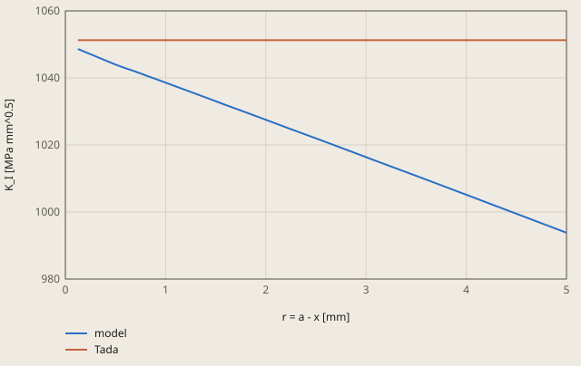

# fracture-centre-crack derivation

## Conclusion

The CalculiX model gives the stress intensity factor K_I of the centre crack 0.19 % above the formula of Tada (1971). The model gives K_I = 1053.28 MPa mm^0.5, and the formula gives 1051.27 MPa mm^0.5. The tolerance is 0.5 %.

CalculiX has no output of K for a crack in the mesh. Thus the model gets K_I from the opening v of the crack face at the nodes B and C of the element at the tip. B is at r = L/4 = 0.125 mm from the tip, and C is at r = L = 0.5 mm. K_I = c (4 v_B - v_C), with c = 204513.9 MPa mm^-0.5 (see "K_I from the displacements").

The model is 1/4 of the plate. The crack is on y = 0 from x = 0 to 25 mm, with the crack tip at x = 25 mm. The ligament from x = 25 to 50 mm has uy = 0.

- The quarter plate: the crack face opens, and the ligament stays on y = 0.
- The crack tip: the opening at the node B is v = 0.00256369 mm, and at the node C it is v = 0.00510462 mm. Then K_I = 204513.9 × (4 × 0.00256369 - 0.00510462) = 1053.28 MPa mm^0.5.

The opening of each node near the tip gives a value of K_I too. At the node nearest the tip, r = 0.125 mm, it is 0.25 % below the formula. Farther from the tip, the higher terms of the field make it smaller.

**K_I from the opening of the crack face near the tip**

model is K_I = (E' / 4) v sqrt(2 pi / r) at each node of the crack face, from v = (4 K_I / E') sqrt(r / 2 pi). This formula is the first term of the field at the tip. It is exact only as r goes to 0.

Tada is the formula of Tada (1971) in check.toml. The check gets K_I of the model from the 2 nodes at r = L/4 and L (derivation.md).

Values of the plot

Original values. — means no sample.

| r = a - x [mm] | model (K_I [MPa mm^0.5]) | Tada (K_I [MPa mm^0.5]) |
| ---: | ---: | ---: |
| 0.125 | 1048.62 | 1051.27 |
| 0.5 | 1043.97 | 1051.27 |
| 0.5974 | 1042.91 | 1051.27 |
| 0.6947 | 1041.94 | 1051.27 |
| 0.83 | 1040.44 | 1051.27 |
| 0.9653 | 1038.96 | 1051.27 |
| 1.1533 | 1036.88 | 1051.27 |
| 1.3413 | 1034.82 | 1051.27 |
| 1.6026 | 1031.9 | 1051.27 |
| 1.8638 | 1029.02 | 1051.27 |
| 2.2268 | 1024.98 | 1051.27 |
| 2.5897 | 1020.97 | 1051.27 |
| 3.0941 | 1015.31 | 1051.27 |
| 3.5984 | 1009.67 | 1051.27 |
| 4.2992 | 1001.75 | 1051.27 |
| 5 | 993.8 | 1051.27 |

The finer meshes of the mesh study give K_I 0.10 % to 0.16 % above the formula. An error of the method gives a larger difference. For example, E in place of E' gives -9 %.

## Result

**Pass.** A check passes when |computed - reference| ≤ rel_tol · |reference| + abs_tol, with rel_tol = 0.005 and abs_tol = 0.0 (`check.toml`). `fh validate` gives the computed values.

| Check | Unit | Computed | Reference | Difference | Tolerance | Margin |
| --- | ---: | ---: | ---: | ---: | ---: | ---: |
| `k_i` | Not specified | 1053.28 | 1051.27 | +2.007 (+0.190912 %) | 5.256 | 3.249 |

Made by `scripts/validation-reports.py` on 2026-10-28, femahoy 9c54611.

This case checks the stress intensity factor K_I of a centre crack in a steel plate in tension (units SI-mm).
CalculiX has no output of K for a crack in the mesh. Thus the case gets K_I from the displacements of the crack face, as the chat does.

## Source

H. Tada, P. C. Paris and G. R. Irwin, *The Stress Analysis of Cracks Handbook*, 3rd ed., ASME Press, 2000: a centre crack in a strip in tension.
The formula is from H. Tada, "A note on the finite width corrections to the stress intensity factor", Engineering Fracture Mechanics 3 (1971) 345-347:

K_I = σ sqrt(π a) F(a/b), F = [1 - 0.025 (a/b)^2 + 0.06 (a/b)^4] sqrt(sec(π a / 2b))

Here 2a is the length of the crack, 2b is the width of the strip, and the strip has no end. Sources give the error of this formula as 0.1 % to 0.2 % for all a/b.

| Item | Value |
|---|---|
| σ, the tension at the ends | 100 MPa |
| a, the half length of the crack | 25 mm |
| b, the half width of the plate | 50 mm |
| F(0.5) | 1.18623 |
| K_I | 1051.27 MPa mm^0.5 (33.24 MPa m^0.5) |

In a 2D elastic body with loads only on the edges, the stress does not change with E and nu. Thus K_I is the same in plane strain and in plane stress.

## Model

| Item | Value |
|---|---|
| Part | 1/4 of the plate, 0 <= x <= 50 mm, 0 <= y <= 150 mm. The plate is 300 mm high (h/b = 3). |
| Elements | `CPE6` and `CPE8` (plane strain), 1 mm thick, 801 nodes |
| Steel | E = 210000 MPa, nu = 0.3 |
| `LEFT`, x = 0 | ux = 0 (symmetry) |
| `LIGAMENT`, y = 0, x >= 25 mm | uy = 0 (symmetry). The crack face y = 0, x < 25 mm is free. |
| `TOP`, y = 150 mm | pressure -100 MPa on face 2 of the elements (`P2`) |

`mesh.py` writes a spider web mesh. 16 rays go from the tip to the edges of the plate.
8 rings go from L = 0.5 mm (a/50) to 5 mm, with a constant ratio. 8 more rings go from 5 mm to the edges.
Ring 1 has 6-node triangles. The mid-side nodes of the 2 edges from the tip are at L/4 from the tip.
This puts the singularity 1/sqrt(r) of the stress in the elements at the tip (R. S. Barsoum, International Journal for Numerical Methods in Engineering 10 (1976) 25-37).

## K_I from the displacements

On the face of the crack, near the tip, the opening of 1 face is v = (4 K_I / E') sqrt(r / 2π), with E' = E / (1 - nu^2) in plane strain.
On the edge of a quarter-point element, v(r) = v_T + (-3 v_T + 4 v_B - v_C) sqrt(r/L) + 2 (v_T - 2 v_B + v_C) r/L.
T is the tip, B is the node at L/4 and C is the node at L. Here v_T = 0. The terms in sqrt(r) give:

K_I = c (4 v_B - v_C), c = (E' / 4) sqrt(2π / L)

This is the displacement method of C. F. Shih, H. G. de Lorenzi and M. D. German, International Journal of Fracture 12 (1976) 647-651.
For L = 0.5 mm, c = 204513.9 MPa mm^-0.5.

The `*EQUATION` at the end of `mesh.inp` makes U2 of node 802 equal to c (4 v_B - v_C). Node 802 has no element.
Thus `*NODE PRINT` of the set `KI` writes K_I in `job.dat`, and the check reads U2 of this set.
The result is K_I = 1053.28 MPa mm^0.5, 0.19 % above the reference.
The sum of the reactions on `LIGAMENT` is 5000 N = 100 MPa x 50 mm x 1 mm.

The keyword `*CRACK PROPAGATION` of ccx does not model the crack. It takes K from the stress of the part without the crack, with fixed shape factors. Thus this case does not use it.

## Mesh study

The mesh has the size L at the tip and grows to the edges. Each finer mesh has more rays and rings and a smaller L.

| Rays | Rings | L (mm) | K_I (MPa mm^0.5) | Difference |
|---:|---:|---:|---:|---:|
| 12 | 6 + 6 | 1.0 | 1054.02 | +0.26 % |
| 16 | 8 + 8 | 0.5 | 1053.28 (this case) | +0.19 % |
| 24 | 12 + 12 | 0.25 | 1052.92 | +0.16 % |
| 32 | 16 + 16 | 0.125 | 1052.36 | +0.10 % |

L has the largest effect. With 16 rays and 8 + 8 rings, L = 2.0, 1.0 and 0.25 mm give +1.02 %, +0.46 % and +0.07 %.

The source has a strip with no end. With 48 rays, 16 + 24 rings and L = 0.25 mm, K_I changes by -0.09 % from h = 100 mm to 150 mm, and by -0.01 % from 150 mm to 200 mm.

The same mesh rules (L = a/50) at other crack lengths give these differences from the formula:

| a/b | 0.1 | 0.2 | 0.3 | 0.4 | 0.5 | 0.6 | 0.7 | 0.8 |
|---|---:|---:|---:|---:|---:|---:|---:|---:|
| Difference | -2.1 % | -0.24 % | +0.11 % | +0.22 % | +0.19 % | +0.02 % | -0.42 % | -1.15 % |

At a/b = 0.1, the elements between the tip and the top edge are long. 32 rays and 12 + 24 rings make the difference -0.38 %.

## Tolerance

The tolerance is 0.5 % (`rel_tol = 0.005`). It is the sum of the error of the formula (0.2 %), the error of the mesh (0.2 %) and the height of the plate (0.02 %), with a small margin.
An error of the method is larger: E in place of E' gives -9 %, and L/2 in place of L gives +41 %.

## Files

`mesh.inp` comes from `python3 mesh.py`. The mesh study uses the options of `mesh.py`, for example `python3 mesh.py --sectors 32 --rings 16 16 --tip 0.125`.
