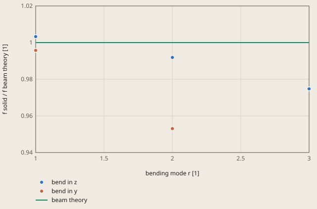

# frequency-cantilever derivation

## Conclusion

The solid model gives the first natural frequency of the cantilever 0.33 % above the beam theory of Blevins (1979). The model gives 419.12 Hz, and the beam theory gives 417.758 Hz. The tolerance is 1 %.

The former C3D10 mesh study of derivation.md goes from +0.47 % at the size 5 mm to +0.27 % at 1.25 mm. The values go to about +0.2 %, the difference between the solid and the beam theory.

The check uses only mode 1, but the run gives 6 modes. The effective modal mass of each mode in `job.dat` gives its direction. The modes 1, 3 and 6 bend the beam in z, and the modes 2 and 4 bend it in y. Mode 5, at 6013.0 Hz, has almost no effective mass in x, y or z, only a rotation about x: it twists the beam. The plot compares the bending modes r = 1, 2, 3 of each direction with the beam theory.

**Bending frequencies of the solid against the beam theory**

bend in z: the solid modes 1, 3 and 6, ccx/job.dat of the run

bend in y: the solid modes 2 and 4, ccx/job.dat of the run

The direction of a mode is the direction of its largest effective modal mass in ccx/job.dat.

The beam theory is f_r = f1 (λ_r / λ_1)^2 with f1 = 417.758 Hz of check.toml and λ_r of Blevins (1979), Table 8-1. For a bend in y, the beam is 10 mm deep in place of 5 mm, thus f_r is 2 times larger.

Values of the plot

Original values. — means no sample.

| bending mode r [1] | bend in z (f solid / f beam theory [1]) | bend in y (f solid / f beam theory [1]) | beam theory (f solid / f beam theory [1]) |
| ---: | ---: | ---: | ---: |
| 1 | 1.003268 | 0.995718 | 1 |
| 2 | 0.991881 | 0.953056 | 1 |
| 3 | 0.974764 | — | 1 |

Mode 1 is the only mode above the beam theory. The other bending modes are below it, and the difference increases with r. In z, r = 2 is 0.81 % lower and r = 3 is 2.5 % lower. In y, the beam is 10 mm deep in place of 5 mm. There the solid is 0.43 % lower at r = 1 and 4.7 % lower at r = 2. derivation.md names the effects that the beam theory does not have: shear deformation, rotary inertia and the Poisson effect across the width.

## Result

**Pass.** A check passes when |computed - reference| ≤ rel_tol · |reference| + abs_tol, with rel_tol = 0.01 and abs_tol = 0.0 (`check.toml`). `fh validate` gives the computed values.

| Check | Unit | Computed | Reference | Difference | Tolerance | Margin |
| --- | ---: | ---: | ---: | ---: | ---: | ---: |
| `f1` | Not specified | 419.123 | 417.758 | +1.3654 (+0.32684 %) | 4.178 | 2.812 |

Made by `scripts/validation-reports.py` on 2026-10-28, femahoy 9c54611.

This case checks the first natural frequency of a clamped steel beam (units SI-mm).

## Source

R. D. Blevins, *Formulas for Natural Frequency and Mode Shape*, Van Nostrand Reinhold, New York, 1979, Table 8-1 (single-span beams), the clamped-free beam.
For mode 1 the table gives λ1 = 1.87510407 and f1 = λ1² / (2π L²) · sqrt(E I / m), with m the mass per length.

## Model

| Item | Value |
|---|---|
| Beam | 100 mm in x, 10 mm in y, 5 mm in z |
| Steel | E = 210000 MPa, nu = 0.3, rho = 7.85e-9 t/mm3 |
| Support | `FIXED`, the face x = 0: all 3 displacements are 0 |
| Step | `*FREQUENCY`, 6 modes |

Mode 1 bends the beam in z, about the weaker axis: I = 10 · 5³ / 12 = 104.17 mm4. The mass per length is m = 7.85e-9 · 50 = 3.925e-7 t/mm.
Thus f1 = 1.87510407² / (2π · 100²) · sqrt(210000 · 104.17 / 3.925e-7) = 417.758 Hz.

## Tolerance

The tolerance is 1 % (`rel_tol = 0.01`).
The beam theory has no shear deformation, no rotary inertia and no Poisson effect across the width. The solid has all 3.
The result of the solid against the mesh size:

| Size (mm) | f1 (Hz) | Difference |
|---:|---:|---:|
| 5 | 419.73 | +0.47 % |
| 3.3 (former case) | 419.32 | +0.37 % |
| 2.5 | 419.20 | +0.34 % |
| 1.25 (chat run) | 418.90 | +0.27 % |

The values go to about +0.2 %, the difference between the solid and the beam theory. 1 % holds both differences.

## Chat run

The request asked for the first natural frequency of this beam in plain words.
The chat wrote a `*FREQUENCY` input with a mesh of size 1.25 mm (22303 nodes). It gave 418.90 Hz (+0.27 %).
The run took 38 s and cost 0.42 USD. The chat had no failure. This case uses the input of the chat with a coarser mesh.

## Files

Run `python3 mesh.py` to write `mesh.inp` from `mesh.geo` with gmsh.
The mapped mesh has 40 x 4 x 2 C3D20R elements, 320 elements and 2117 nodes.
`Transfinite Curve`, `Transfinite Surface`, `Recombine` and an extrusion with 2 layers define the grid.
`Mesh.ElementOrder=2` and `Mesh.SecondOrderIncomplete=1` produce 20-node hexahedra.
The mesh retains the 100 x 10 x 5 mm box and the `FIXED` face at x = 0.
`job.inp` includes the mesh. The material, frequency step, check and 1 % tolerance stay the same.

Reason: The audit mesh gives 419.1234 Hz, against 419.3186 Hz for the former mesh, with fewer nodes.
`fh validate` on the Mac gives 419.1234 Hz, a difference of +0.327 % from the reference.
