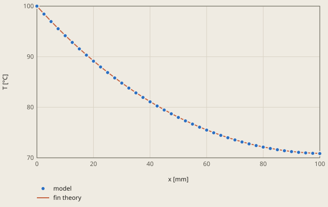

# heat-fin derivation

## Conclusion

The solid model of the pin fin gives the tip temperature of the fin theory of Incropera et al. (2007). The mean of the tip face is 70.8776 °C, and the fin theory gives 70.8757 °C. The difference is +0.002 °C, and the tolerance is 0.1 °C. Along the full length of the fin, the model also follows the fin theory. On the edge y = 0, z = 0, the largest difference is -0.061 °C.

**The temperature along the fin**

model: the nodes of the edge y = 0, z = 0 of the solid, the coldest line of each section

The fin theory is Incropera et al. (2007), Table 3.4, case A, with 1 temperature in each section.

The largest difference of the model from the fin theory is -0.061 °C, at x = 7.5 mm.

The model view shows the temperature NT in the fin. The base x = 0 is at 100 °C. The 4 sides and the tip give heat to the air at 20 °C. The marks show the checked tip face and the point of the largest difference on the edge of the plot.

The fin theory has 1 temperature in each section. On the tip face of the model, the temperature is 70.841 °C at the corners and 70.905 °C at the centre: only 0.064 °C more. Thus the check uses the mean of the face.

## Result

**Pass.** A check passes when |computed - reference| ≤ rel_tol · |reference| + abs_tol, with rel_tol = 0.0 and abs_tol = 0.1 (`check.toml`). `fh validate` gives the computed values.

| Check | Unit | Computed | Reference | Difference | Tolerance | Margin |
| --- | ---: | ---: | ---: | ---: | ---: | ---: |
| `t_tip` | Not specified | 70.8776 | 70.8757 | +0.00192108 (+0.00271049 %) | 0.1 | 0.09808 |

Made by `scripts/validation-reports.py` on 2026-10-28, femahoy 5ac0a46.

This case checks the steady tip temperature of an aluminium pin fin (units SI-mm).

## Source

F. P. Incropera, D. P. DeWitt, T. L. Bergman and A. S. Lavine, *Fundamentals of Heat and Mass Transfer*, 6th ed., Wiley, 2007, Table 3.4, case A (convection heat transfer at the tip).
At the tip, θ(L) / θb = 1 / (cosh mL + (h / mk) sinh mL), with θ = T - T∞ and m = sqrt(h P / (k A)).

## Model

| Item | Value |
|---|---|
| Fin | 100 mm in x, 10 x 10 mm section |
| Aluminium | k = 200 W/(m K), which is 200 mW/(mm K) in SI-mm |
| Base | `BASE`, the face x = 0: T = 100 °C |
| Convection | the 4 sides and the tip: h = 50 W/(m2 K) = 0.05 mW/(mm2 K), T∞ = 20 °C |
| Step | `*HEAT TRANSFER, STEADY STATE` |

P = 0.04 m and A = 1e-4 m2. Thus m = sqrt(50 · 0.04 / (200 · 1e-4)) = 10 1/m, mL = 1 and h / mk = 0.025.
T_tip = 20 + 80 / (cosh 1 + 0.025 sinh 1) = 70.8757 °C.

`*FILM` in ccx 2.23 refuses a surface name. Thus `job.inp` has 1 line `E, Fn, 20.0, 0.05` for each element face of the surfaces `TIP`, `Y0`, `Y1`, `Z0` and `Z1`.

## Mesh study

Each mesh comes from the command of "Files" with another `--size`. The model is the same as in `job.inp`, with 1 `*FILM` line for each element face of the new mesh.

| Size (mm) | Nodes of `TIP` | Mean of the nodes, the check (°C) | Mean of the area (°C) |
|---:|---:|---:|---:|
| 10 | 13 | 70.8706 | 70.8837 |
| 5 (this case) | 37 | 70.8776 | 70.8837 |
| 2.5 | 101 | 70.8789 | 70.8837 |
| 1.25 | 353 | 70.8810 | 70.8837 |

The mean of the area is the integral of the order-2 temperature on the tip face, divided by the area. It changes by less than 0.0001 °C from size 10 to size 1.25. Thus the mesh error of the temperature is less than 0.0001 °C.
The check gives the same weight to each node of `TIP`. The nodes on the edges of the face are colder than the centre, and a finer mesh has a smaller fraction of them. Thus the mean of the nodes increases to the mean of the area. With size 5 it is 0.006 °C lower.
The mean of the area is 0.008 °C higher than the fin theory. This is the difference between the solid and the fin theory.

## Tolerance

The tolerance is 0.1 °C (`abs_tol = 0.1`), 0.2 % of the 50.9 °C difference between the tip and the air.
The fin theory has 1 temperature in each section. In the solid, the tip face changes from 70.84 °C at the corners to 70.90 °C at the centre: the Biot number h (t/2) / k is 0.00125.
Thus the check is the mean of the tip face. The mean is 70.8776 °C (+0.002 °C) with a mesh of size 5 mm.
It is the sum of 3 parts ("Mesh study"): the solid against the fin theory +0.008 °C, the mean of the nodes -0.006 °C and the mesh less than 0.0001 °C.

## Chat run

The request asked for the temperature at the centre of the tip face in plain words.
The chat used a mesh of size 2.5 mm (6695 nodes). It gave 70.904 °C (+0.029 °C) at the nodes near the centre of the tip.
The run took 111 s and cost 0.50 USD.

The chat run found 2 gaps:

1. The first solve stopped: ccx refused `*FILM` with the surface name (`TIP, F, 20.0, 0.05`). The chat wrote a script that lists the element faces. `crates/fh/src/daemon/agent.md` now has this fact.
2. The 3D view showed no temperature, because the reader of the `.frd` file kept the name `NDTEMP`. The reader now gives `NT`, and the view shows `NT` first when the step has no stress and no displacement.

## Files

The mesh in `job.inp` comes from `fh mesh part.step --size 5 --face BASE=x:0 --face TIP=x:100 --face Y0=y:0 --face Y1=y:10 --face Z0=z:0 --face Z1=z:10`.
`part.step` is a box of 100 x 10 x 10 mm with a corner at the origin.
