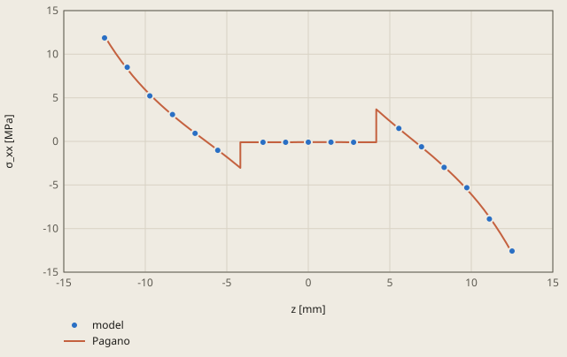
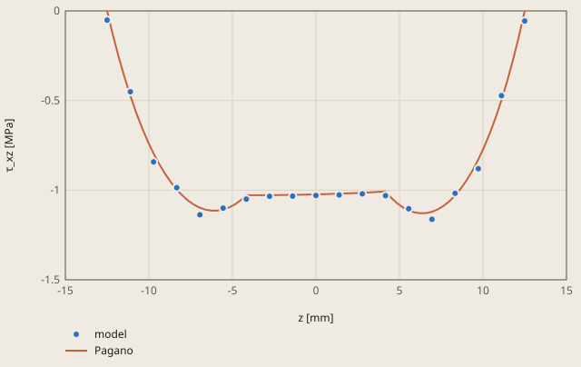

# laminate-pagano derivation

## Conclusion

Both CalculiX models of the square [0/90/0] plate agree with the exact 3D solution of Pagano (1970) within 0.17 %. The tolerance is 0.5 %. The thin plate (a/h = 100) uses composite shells. The thick plate (a/h = 4) uses 3D layers with 3 elements in each ply.

The thick plate is the hard test. At a/h = 4, the classical laminate theory gives a deflection 78 % too small, and σ_xx is not symmetric about the mid-plane. The 3D layers follow the exact σ_xx through the thickness, with the jumps at the 2 ply interfaces:

**The thick plate (a/h = 4): σ_xx through the thickness at the centre**

model: the nodes of the line x = a/2, y = a/2 in the run

Pagano is the exact 3D solution of Pagano (1970) from pagano.py. The plies are 0, 90 and 0 degrees from the bottom.

The model leaves out the 2 nodes on the ply interfaces z = -4.17 and 4.17 mm. There the result file of ccx gives the mean of the 2 plies.

The largest difference of the model from Pagano is +0.233 MPa, at z = 12.50 mm.

Values of the plot

Original values. — means no sample.

| z [mm] | model (σ_xx [MPa]) | Pagano (σ_xx [MPa]) |
| ---: | ---: | ---: |
| -12.5 | 11.8667 | — |
| -11.1111 | 8.5003 | — |
| -9.7222 | 5.2226 | — |
| -8.3333 | 3.0819 | — |
| -6.9444 | 0.9202 | — |
| -5.5556 | -1.0199 | — |
| -2.7778 | -0.0996 | — |
| -1.3889 | -0.0977 | — |
| 0 | -0.096 | — |
| 1.3889 | -0.0942 | — |
| 2.7778 | -0.0993 | — |
| 5.5556 | 1.4915 | — |
| 6.9444 | -0.6156 | — |
| 8.3333 | -2.9751 | — |
| 9.7222 | -5.3114 | — |
| 11.1111 | -8.8976 | — |
| 12.5 | -12.5808 | — |
| -12.5 | — | 12.0763 |
| -12.1528 | — | 11.0369 |
| -11.8056 | — | 10.0664 |
| -11.4583 | — | 9.159 |
| -11.1111 | — | 8.309 |
| -10.7639 | — | 7.5113 |
| -10.4167 | — | 6.7609 |
| -10.0694 | — | 6.0533 |
| -9.7222 | — | 5.384 |
| -9.375 | — | 4.7489 |
| -9.0278 | — | 4.1441 |
| -8.6806 | — | 3.5659 |
| -8.3333 | — | 3.0106 |
| -7.9861 | — | 2.4748 |
| -7.6389 | — | 1.9552 |
| -7.2917 | — | 1.4485 |
| -6.9444 | — | 0.9516 |
| -6.5972 | — | 0.4614 |
| -6.25 | — | -0.0253 |
| -5.9028 | — | -0.5113 |
| -5.5556 | — | -0.9998 |
| -5.2083 | — | -1.4938 |
| -4.8611 | — | -1.9964 |
| -4.5139 | — | -2.5106 |
| -4.1667 | — | -3.0398 |
| -4.1667 | — | -0.0998 |
| -3.8194 | — | -0.0999 |
| -3.4722 | — | -0.0999 |
| -3.125 | — | -0.0996 |
| -2.7778 | — | -0.0993 |
| -2.4306 | — | -0.0988 |
| -2.0833 | — | -0.0983 |
| -1.7361 | — | -0.0977 |
| -1.3889 | — | -0.0971 |
| -1.0417 | — | -0.0965 |
| -0.6944 | — | -0.096 |
| -0.3472 | — | -0.0955 |
| 0 | — | -0.0951 |
| 0.3472 | — | -0.0948 |
| 0.6944 | — | -0.0946 |
| 1.0417 | — | -0.0946 |
| 1.3889 | — | -0.0948 |
| 1.7361 | — | -0.0951 |
| 2.0833 | — | -0.0957 |
| 2.4306 | — | -0.0966 |
| 2.7778 | — | -0.0977 |
| 3.125 | — | -0.0992 |
| 3.4722 | — | -0.101 |
| 3.8194 | — | -0.1033 |
| 4.1667 | — | -0.1059 |
| 4.1667 | — | 3.6808 |
| 4.5139 | — | 3.1074 |
| 4.8611 | — | 2.5498 |
| 5.2083 | — | 2.0046 |
| 5.5556 | — | 1.4682 |
| 5.9028 | — | 0.9375 |
| 6.25 | — | 0.4091 |
| 6.5972 | — | -0.1204 |
| 6.9444 | — | -0.6541 |
| 7.2917 | — | -1.1954 |
| 7.6389 | — | -1.7476 |
| 7.9861 | — | -2.3143 |
| 8.3333 | — | -2.8989 |
| 8.6806 | — | -3.5051 |
| 9.0278 | — | -4.1366 |
| 9.375 | — | -4.7973 |
| 9.7222 | — | -5.4914 |
| 10.0694 | — | -6.2231 |
| 10.4167 | — | -6.9969 |
| 10.7639 | — | -7.8177 |
| 11.1111 | — | -8.6904 |
| 11.4583 | — | -9.6204 |
| 11.8056 | — | -10.6135 |
| 12.1528 | — | -11.6756 |
| 12.5 | — | -12.8134 |

The plots show the stress at the nodes of the result file. Their largest difference from the exact σ_xx is 0.23 MPa at the top face, 1.8 % of the largest σ_xx. The checks use the stress at the integration points (see "Reference values").

The model has 2 quarter plates. The thin plate is at x = 0 to 50 mm, and the thick plate is at x = 60 to 110 mm.

- σ_xx in the thick plate: the face x = 110 mm is the symmetry plane x = a/2. On this face, |σ_xx| at the nodes is up to 12.6 MPa in the 2 plies at 0 degrees. In the ply at 90 degrees in the core, it is less than 0.1 MPa. The σ_xx plot is on the line x = y = a/2 of this face.
- Deflection w of the 2 plates, at the centre of each plate (the checks `w_thin` and `w_thick`): the thin plate gives w = -0.06200 mm, exact -0.06210 mm. The thick plate gives w = -0.018338 mm, exact -0.018340 mm.

The transverse shear stress τ_xz is continuous through the plies. At the supported edge x = 0, the 3D layers follow the exact τ_xz within 0.056 MPa:

**The thick plate (a/h = 4): τ_xz through the thickness at the edge x = 0, y = a/2**

model: the nodes of the line x = 0, y = a/2 in the run

Pagano is the exact 3D solution of Pagano (1970) from pagano.py. τ_xz is continuous at the ply interfaces.

The largest difference of the model from Pagano is -0.056 MPa, at z = 12.50 mm.

Values of the plot

Original values. — means no sample.

| z [mm] | model (τ_xz [MPa]) | Pagano (τ_xz [MPa]) |
| ---: | ---: | ---: |
| -12.5 | -0.051 | — |
| -11.1111 | -0.4508 | — |
| -9.7222 | -0.842 | — |
| -8.3333 | -0.9861 | — |
| -6.9444 | -1.137 | — |
| -5.5556 | -1.1001 | — |
| -4.1667 | -1.05 | — |
| -2.7778 | -1.0341 | — |
| -1.3889 | -1.0332 | — |
| 0 | -1.0298 | — |
| 1.3889 | -1.0266 | — |
| 2.7778 | -1.0205 | — |
| 4.1667 | -1.0305 | — |
| 5.5556 | -1.1038 | — |
| 6.9444 | -1.1627 | — |
| 8.3333 | -1.0177 | — |
| 9.7222 | -0.8802 | — |
| 11.1111 | -0.4728 | — |
| 12.5 | -0.056 | — |
| -12.5 | — | 0 |
| -12.1528 | — | -0.1346 |
| -11.8056 | — | -0.2578 |
| -11.4583 | — | -0.3703 |
| -11.1111 | — | -0.4728 |
| -10.7639 | — | -0.566 |
| -10.4167 | — | -0.6504 |
| -10.0694 | — | -0.7265 |
| -9.7222 | — | -0.7947 |
| -9.375 | — | -0.8555 |
| -9.0278 | — | -0.9092 |
| -8.6806 | — | -0.9561 |
| -8.3333 | — | -0.9966 |
| -7.9861 | — | -1.0308 |
| -7.6389 | — | -1.059 |
| -7.2917 | — | -1.0813 |
| -6.9444 | — | -1.0979 |
| -6.5972 | — | -1.1089 |
| -6.25 | — | -1.1142 |
| -5.9028 | — | -1.114 |
| -5.5556 | — | -1.1082 |
| -5.2083 | — | -1.0968 |
| -4.8611 | — | -1.0798 |
| -4.5139 | — | -1.0569 |
| -4.1667 | — | -1.0281 |
| -4.1667 | — | -1.0281 |
| -3.8194 | — | -1.0282 |
| -3.4722 | — | -1.0282 |
| -3.125 | — | -1.0281 |
| -2.7778 | — | -1.0279 |
| -2.4306 | — | -1.0277 |
| -2.0833 | — | -1.0273 |
| -1.7361 | — | -1.0269 |
| -1.3889 | — | -1.0264 |
| -1.0417 | — | -1.0258 |
| -0.6944 | — | -1.0251 |
| -0.3472 | — | -1.0244 |
| 0 | — | -1.0236 |
| 0.3472 | — | -1.0228 |
| 0.6944 | — | -1.0218 |
| 1.0417 | — | -1.0208 |
| 1.3889 | — | -1.0197 |
| 1.7361 | — | -1.0186 |
| 2.0833 | — | -1.0173 |
| 2.4306 | — | -1.016 |
| 2.7778 | — | -1.0145 |
| 3.125 | — | -1.0129 |
| 3.4722 | — | -1.0112 |
| 3.8194 | — | -1.0094 |
| 4.1667 | — | -1.0073 |
| 4.1667 | — | -1.0073 |
| 4.5139 | — | -1.0433 |
| 4.8611 | — | -1.0728 |
| 5.2083 | — | -1.096 |
| 5.5556 | — | -1.1131 |
| 5.9028 | — | -1.1241 |
| 6.25 | — | -1.129 |
| 6.5972 | — | -1.1279 |
| 6.9444 | — | -1.1208 |
| 7.2917 | — | -1.1075 |
| 7.6389 | — | -1.088 |
| 7.9861 | — | -1.062 |
| 8.3333 | — | -1.0296 |
| 8.6806 | — | -0.9903 |
| 9.0278 | — | -0.9439 |
| 9.375 | — | -0.8902 |
| 9.7222 | — | -0.8287 |
| 10.0694 | — | -0.7592 |
| 10.4167 | — | -0.681 |
| 10.7639 | — | -0.5938 |
| 11.1111 | — | -0.497 |
| 11.4583 | — | -0.3899 |
| 11.8056 | — | -0.2718 |
| 12.1528 | — | -0.1422 |
| 12.5 | — | 0 |

Use composite shells of this material only for a/h of 50 or more. At a/h = 4, the 8 x 8 composite shells give a deflection 26 % too small (see "Composite shell and the span ratio").

## Result

**Pass.** A check passes when |computed - reference| ≤ rel_tol · |reference| + abs_tol, with rel_tol = 0.005 and abs_tol = 0.0 (`check.toml`). `fh validate` gives the computed values.

| Check | Unit | Computed | Reference | Difference | Tolerance | Margin |
| --- | ---: | ---: | ---: | ---: | ---: | ---: |
| `w_thin` | Not specified | -0.0619972 | -0.0621031 | +0.00010593 (+0.170571 %) | 0.0003105 | 0.0002046 |
| `sx_thin` | Not specified | 4.62407 | 4.62032 | +0.003753 (+0.0812281 %) | 0.0231 | 0.01935 |
| `w_thick` | Not specified | -0.018338 | -0.0183398 | +1.76e-06 (+0.00959662 %) | 9.17e-05 | 8.994e-05 |
| `sx_thick` | Not specified | 10.3599 | 10.3419 | +0.01801 (+0.174146 %) | 0.05171 | 0.0337 |
| `txz_thick` | Not specified | -1.01018 | -1.01034 | +0.00015515 (+0.0153562 %) | 0.005052 | 0.004897 |

Made by `scripts/validation-reports.py` on 2026-10-28, femahoy 9c54611.

This case checks the 2 CalculiX models of a composite laminate against the exact 3D elasticity solution of Pagano (units SI-mm):

- `THIN`: composite shells (`*SHELL SECTION, COMPOSITE`, `S8R`), a/h = 100.
- `THICK`: 3D layers (`C3D20R`, 3 elements in each ply, 1 `*ORIENTATION` for each ply angle), a/h = 4.

Both plates use the ply material `*ELASTIC, TYPE=ENGINEERING CONSTANTS`, and the checks read the stresses with `*EL PRINT, GLOBAL=YES`.

## Source

N. J. Pagano, "Exact solutions for rectangular bidirectional composites and sandwich plates", Journal of Composite Materials 4 (1970) 20-34.
The problem is a square plate of side a and thickness h, simply supported on the 4 edges, with the load q = q0 sin(πx/a) sin(πy/a) on the top face.
The plate has 3 plies of h/3 at 0, 90 and 0 degrees. The ply has E_L/E_T = 25, G_LT/E_T = 0.5, G_TT/E_T = 0.2 and ν_LT = ν_TT = 0.25 (L is the fibre).

For this load, each field is 1 sine or cosine term in x and y, times a function of z. In each ply, the 3D equations of elasticity then become 6 linear equations in z with constant coefficients.
`pagano.py` solves them exactly: the state (U, V, W, τ_xz, τ_yz, σ_z) goes from the bottom face to the top face through the matrix exponential of each ply.
The displacements and the transverse stresses are continuous at each interface. The top and bottom faces have τ_xz = τ_yz = 0, and σ_z = -q0 on the top and 0 on the bottom.
This is the solution of Pagano. `pagano.py` has no other approximation than the round-off and the truncation of the series of the exponential (below 1e-12).

`python3 pagano.py --table` prints the normalized values: w̄ = 100 E_T h^3 w / (q0 a^4), σ̄ = σ / (q0 S^2) and τ̄_xz = τ_xz / (q0 S), S = a/h.
K. Bhaskar, T. Varadan and J. Ali, "Thermoelastic solutions for orthotropic and anisotropic composite laminates", Composites Part B 27 (1996) 415-420, give the same exact solution.
Table 3 of A. Venkatachari et al., arXiv:1407.7171 (2014), gives their values. `pagano.py` agrees with them:

| a/h | w̄(a/2, a/2, 0) published | pagano.py | σ̄_xx(a/2, a/2, -h/2) published | pagano.py | τ̄_xz(0, a/2, 0) published | pagano.py |
|---:|---:|---:|---:|---:|---:|---:|
| 4 | 2.006 | 2.0059 | 0.755 | 0.7548 | 0.256 | 0.2559 |
| 10 | 0.753 | 0.7530 | 0.590 | 0.5898 | 0.357 | 0.3573 |
| 20 | 0.516 | 0.5164 | 0.553 | 0.5525 | 0.383 | 0.3846 |
| 50 | 0.445 | 0.4451 | 0.541 | 0.5410 | 0.393 | 0.3934 |

The only difference is τ̄_xz at a/h = 20 (0.4 %). This case does not use a/h = 20.
The table gives these values at z = h/2. They agree with `pagano.py` at the mid-plane for w and at the face without load for σ_xx.
At a/h = 100, `pagano.py` gives w̄ = 0.4347 and σ̄_xx = 0.5393. The classical laminate theory (CLT) gives w̄ = 0.4312 and σ̄_xx = 0.5387 at all a/h.
At a/h = 4, the CLT deflection is 78 % too small, and σ_xx is not symmetric about the mid-plane (0.8008 on the top, 0.7548 on the bottom).

## Data

| Item | THIN | THICK |
|---|---|---|
| a | 100 mm | 100 mm |
| h | 1 mm (a/h = 100) | 25 mm (a/h = 4) |
| q0 | 0.001 MPa | 1 MPa |
| Model | 0 <= x, y <= 50 mm | 60 <= x <= 110 mm, 0 <= y <= 50 mm |

E_T = 7000 MPa, thus E_L = 175000 MPa, G_LT = 3500 MPa and G_TT = 1400 MPa. These are close to the values of Pagano in psi (E_T = 1E6 psi = 6895 MPa).
The normalized results do not change with E_T, a or q0. The loads give a deflection of about 1/16 of h (THIN) and 1/1400 of h (THICK).

## Model

Each plate is 1/4 of the plate, with symmetry on x = a/2 and y = a/2. In local x (x - 60 for THICK):

| Set | Where | Condition |
|---|---|---|
| `*_SSX` | x = 0 | v = w = 0 (simple support) |
| `*_SSY` | y = 0 | u = w = 0 (simple support) |
| `*_SYMX` | x = a/2 | u = 0, and for the shell the rotation about y (DOF 5) |
| `*_SYMY` | y = a/2 | v = 0, and for the shell the rotation about x (DOF 4) |

The simple support of `THICK` is the support of Pagano: v = w = 0 on the full face x = 0, and σ_xx = 0 there.
Without DOF 5 and 4 on the symmetry edges, the shell is free to turn there, and w of `THIN` was 15 times too large.

- `THIN`: 8 x 8 `S8R`. `*SHELL SECTION, COMPOSITE` has 1 line for each layer: the thickness, an empty field, the material and the orientation. The normal of the elements is +z, thus the first layer is at the bottom.
- `THICK`: 8 x 8 x 9 `C3D20R`. The element sets `THICK_0` and `THICK_90` have their own `*SOLID SECTION` and orientation.
- `OR0` puts the fibre (axis 1) on x, `OR90` puts it on y.
- Load: `pagano.py` writes the nodal forces of q0 sin sin, from the shape functions of the 8-node faces with 4 x 4 Gauss points (`load.inp`). For `THIN` they are on the nodes of the shells, thus on the mid-surface. For `THICK` they are on the top face.

## Reference values

CalculiX writes the stress only at the integration points (`*EL PRINT`), not at the faces of the plate.
Thus each stress check compares with the exact stress at the integration points of its element set.
`pagano.py` computes them from the positions of the 2 x 2 x 2 Gauss points (±1/√3) of each element. A composite shell has 2 points across each layer.

| Check | Set | op | What |
|---|---|---|---|
| `w_thin` | `THIN_CENTRE` | value | w at (a/2, a/2, 0) |
| `sx_thin` | `THIN_BOTTOM` | max | σ_xx at the point nearest (a/2, a/2, -h/2): z = -0.4296 h |
| `w_thick` | `THICK_CENTRE` | value | w at (a/2, a/2, 0) |
| `sx_thick` | `THICK_BOTTOM` | max | σ_xx at the point nearest (a/2, a/2, -h/2): z = -0.4765 h |
| `txz_thick` | `THICK_EDGE` | mean | τ_xz, mean of the 8 points of the core element at x = 0, y = a/2 - 3.125 mm, centre on z = 0 |

τ_xz is negative at x = 0, thus the check takes the mean, not the maximum.
`GLOBAL=YES` gives the stresses in x, y, z. Without it, `ccx` gives them in the axes of the ply, and it adds the name of the orientation at the end of each line.

## Result

| Check | ccx | Exact | Difference |
|---|---:|---:|---:|
| `w_thin` | -0.0619972 mm | -0.0621031 mm | -0.17 % |
| `sx_thin` | 4.62407 MPa | 4.62032 MPa | +0.08 % |
| `w_thick` | -0.0183380 mm | -0.0183398 mm | -0.010 % |
| `sx_thick` | 10.3599 MPa | 10.3419 MPa | +0.17 % |
| `txz_thick` | -1.01018 MPa | -1.01034 MPa | -0.015 % |

The run takes less than 1 s. A wrong layup fails the case: with the 2 orientations swapped ([90/0/90]), w does not change (the plate is square), but `sx_thin` is -78 % and `sx_thick` is -89 %.
With G_TT = G_LT, `w_thick` is -27 %.

## Mesh study

The exact values change with the mesh, because the integration points move. `pagano.py --shell N --solid N NZ` prints them for each mesh.

| THIN | w_thin | sx_thin |
|---|---:|---:|
| 4 x 4 | -0.16 % | +0.08 % |
| 8 x 8 (this case) | -0.17 % | +0.08 % |
| 16 x 16 | -0.17 % | +0.08 % |
| 32 x 32 | -0.17 % | +0.08 % |

| THICK: N x N in x and y, NZ in each ply | w_thick | sx_thick | txz_thick |
|---|---:|---:|---:|
| 4 x 4, 1 | -0.85 % | +3.6 % | -1.5 % |
| 4 x 4, 2 | -0.05 % | +0.52 % | -0.08 % |
| 8 x 8, 2 | -0.05 % | +0.53 % | -0.08 % |
| 8 x 8, 3 (this case) | -0.010 % | +0.17 % | -0.015 % |
| 16 x 16, 3 | -0.009 % | +0.18 % | -0.016 % |
| 8 x 8, 4 | -0.003 % | +0.08 % | -0.005 % |
| 32 x 32, 4 | -0.003 % | +0.08 % | -0.005 % |

The number of elements in each ply has the largest effect. 8 x 8 in the plane is sufficient.
The error of `THIN` does not change with the mesh. It comes from the model: `ccx` expands each composite shell into 1 brick across the full thickness, and the load is on the mid-surface.

## Composite shell and the span ratio

`python3 pagano.py --thin-h H` makes `THIN` H mm thick. Then the 3 layer thicknesses in `job.inp` must be H/3. With 8 x 8 `S8R`:

| a/h | w, shell / exact | σ_xx at the bottom point, shell / exact |
|---:|---:|---:|
| 4 | -26 % | -16 % |
| 10 | -16 % | -3.5 % |
| 20 | -6.0 % | -0.63 % |
| 50 | -0.97 % | +0.06 % |
| 100 | -0.17 % | +0.08 % |

The composite shell is too stiff in transverse shear, because 1 brick cannot follow the zigzag of the displacement across the plies.
Thus use composite shells only for a/h of 50 or more with this material (E_L/G_TT = 125). Use 3D layers for a thicker laminate.
The transverse shear stress of a composite shell comes from the strain of the brick, not from the equilibrium. At a/h = 100, τ_xz at the bottom points of the shell is 3 times the exact value, and in the core it is 1/3 of the exact value.
A test with `S6` (each `S8R` cut into 2 `S6`) gave w of `THIN` -0.42 %.

## Tolerance

The tolerance is 0.5 % (`rel_tol = 0.005`) for each check. The largest errors are the model error of the shell (0.17 %) and the mesh error of `sx_thick` (0.17 %).
The exact values have an error below 0.001 %. The remaining margin is for a change of the solver version.
A wrong layup or a wrong ply constant gives an error of 10 % or more (see Result).

## Files

`mesh.inp` and `load.inp` come from `python3 pagano.py` in this folder. The script also prints the 5 reference values of `check.toml`.
