# naca23012-flap derivation

## Conclusion

The model gives the effect of the flap with the correct sign and about the correct size. Each 10 degrees of flap down adds 0.56 to the lift coefficient of the model. In the test of Abbott and Greenberg (1939), it adds 0.44 to 0.50. The lift of the model is 7 % to 22 % above Table I of the test. The moment of the airfoil with the flap up or down is 20 % to 28 % larger. The section "Tolerance" below gives the causes. The lift slope of the model is 0.106 to 0.111 per degree, and the lift slope of the test is 0.094 to 0.100. The boundary layer on the flap of the test was thicker.

The field and the plots use the same solved flap angle. Each plot has its own vertical scale.

Pressure means p/rho in m²/s². Speed uses m/s. The colour limits cover all 3 final fields.

**Lift against the flap angle**

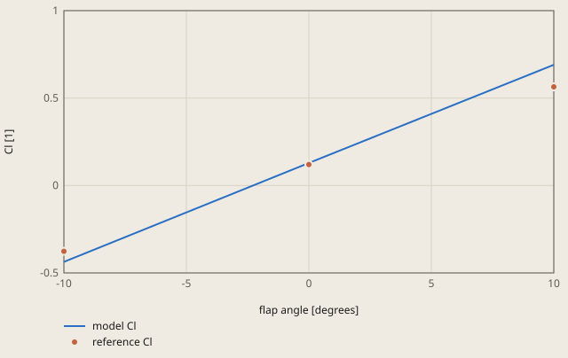

reference Cl: Abbott and Greenberg (1939), NACA Report 661, Table I

Only the 3 marked angles have solved results. Positive flap angle is down.

**Moment against the flap angle**

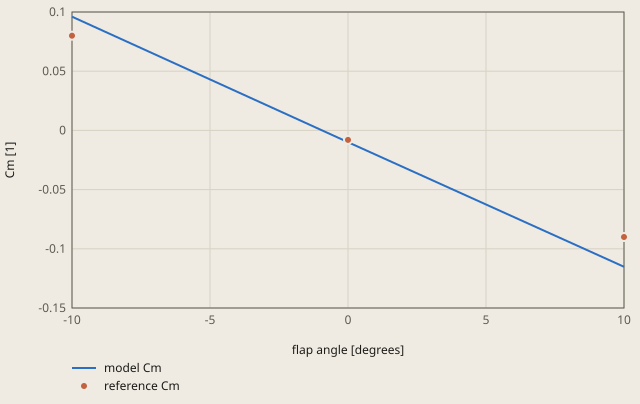

reference Cm: Abbott and Greenberg (1939), NACA Report 661, Table I

Moment center: (0.238, 0.07, 0). Positive Cm is nose up.

### Pressure on each surface

Solid traces show the upper surface. Dashed traces show the lower surface. The heavier traces show the selected flap angle.

The long dashed mark shows the hinge at x/c = 0.8. The short dashed mark shows the selected chord station.

**Pressure on the upper and lower surfaces**

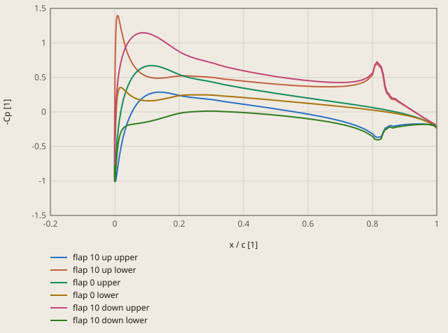

Solid: upper surface. Dashed: lower surface. Hinge: x / c = 0.8. Cp = 2p for this case.

### Force history and initial residuals

**Lift history, flap 10 up**

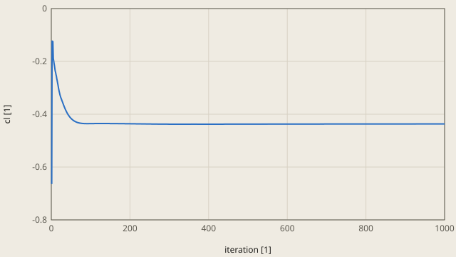

foam/postProcessing/forceCoeffs/0/coefficient.dat

**Moment history, flap 10 up**

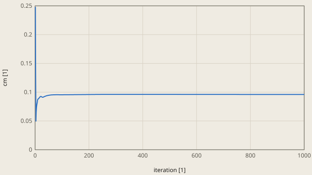

foam/postProcessing/forceCoeffs/0/coefficient.dat

**Initial residuals, flap 10 up**

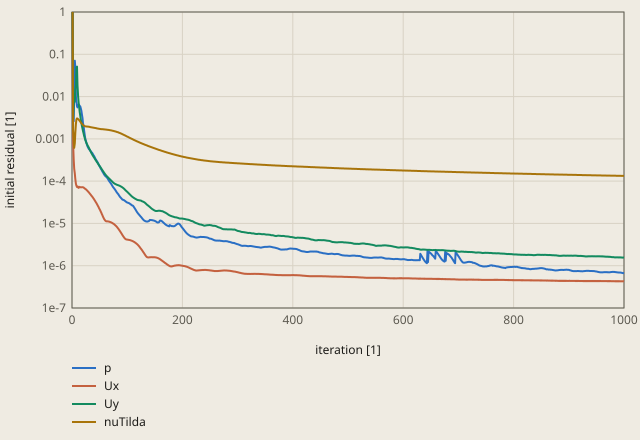

foam/log.simpleFoam (initial residuals)

**Lift history, flap 0**

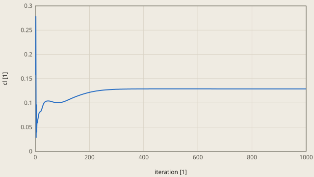

foam/postProcessing/forceCoeffs/0/coefficient.dat

**Moment history, flap 0**

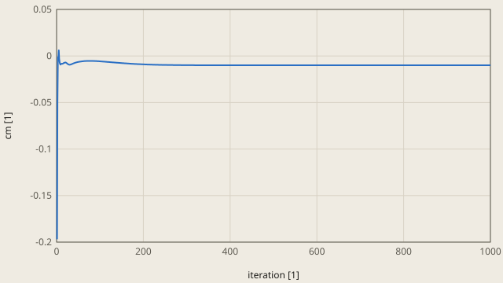

foam/postProcessing/forceCoeffs/0/coefficient.dat

**Initial residuals, flap 0**

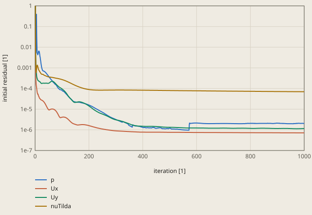

foam/log.simpleFoam (initial residuals)

**Lift history, flap 10 down**

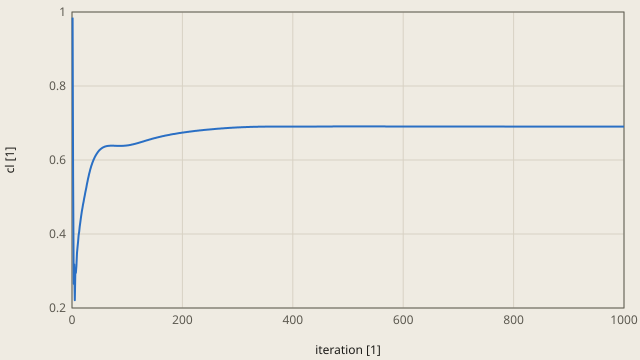

foam/postProcessing/forceCoeffs/0/coefficient.dat

**Moment history, flap 10 down**

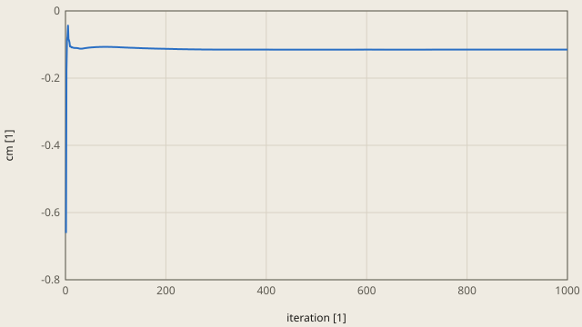

foam/postProcessing/forceCoeffs/0/coefficient.dat

**Initial residuals, flap 10 down**

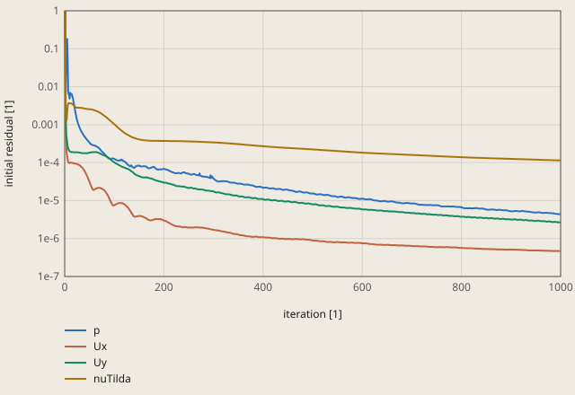

foam/log.simpleFoam (initial residuals)

Force convergence concerns the selected iteration interval. Mesh convergence requires a separate mesh study.

## Result

**Pass.** A check passes when |computed - reference| ≤ rel_tol · |reference| + abs_tol, with rel_tol = 0.3 and abs_tol = 0.005 (`check.toml`). `fh validate` gives the computed values.

| Check | Unit | Computed | Reference | Difference | Tolerance | Margin |
| --- | ---: | ---: | ---: | ---: | ---: | ---: |
| `cl_up10` | Not specified | -0.436799 | -0.3762 | -0.060599 (-16.1082 %) | 0.1179 | 0.05726 |
| `cm_up10` | Not specified | 0.096011 | 0.08 | +0.016011 (+20.0138 %) | 0.029 | 0.01299 |
| `cl_0` | Not specified | 0.128882 | 0.12 | +0.00888201 (+7.40167 %) | 0.041 | 0.03212 |
| `cm_0` | Not specified | -0.00994995 | -0.008 | -0.00194995 (-24.3743 %) | 0.0074 | 0.00545 |
| `cl_down10` | Not specified | 0.69022 | 0.564 | +0.12622 (+22.3795 %) | 0.1742 | 0.04798 |
| `cm_down10` | Not specified | -0.115192 | -0.09 | -0.0251919 (-27.991 %) | 0.032 | 0.006808 |

Made by `scripts/validation-reports.py` on 2026-10-28, femahoy 5ac0a46.

This case checks a control surface in the CFD path: the NACA 23012 airfoil with a plain flap of 20 % chord, at 3 flap angles.
It uses the setup of `naca0012-ladson`, and it adds the pitching moment (the column `CmPitch`) to the lift.

## Sources

- I. H. Abbott and H. Greenberg, "Tests in the Variable-Density Wind Tunnel of the N.A.C.A. 23012 Airfoil with Plain and Split Flaps", NACA Report No. 661, 1939, https://ntrs.nasa.gov/citations/19930091736. A scan is also at https://archive.org/details/NASA_NTRS_Archive_19930091736.
  The test was in the NACA variable-density tunnel, on a rectangular wing of aspect ratio 6. The section data come from the wing data, with corrections for the tip effects and for the turbulence of the tunnel ("effective Reynolds number").
  The brass flap of 0.20c had its hinge at 80 % of the chord, midway between the upper and the lower surface. For each flap angle, plaster filled the gap and gave a smooth and fair surface.
- The check values come from Table I on page 381. Table I gives the angle of zero lift alpha_l0 and the lift slope a0. Thus the lift at 0 degrees is -a0 alpha_l0.
- The pitching moments of Table I are about the aerodynamic center (a.c.) of the airfoil without flap: 1.2 % c ahead of c/4 and 7 % c above it. Page 380 tells that these moments are average values, and that the moment at a given lift can be considerably different.

| Flap (down is positive) | Effective Re (millions) | alpha_l0 (degrees) | a0 (per degree) | cl at 0 degrees | cm about the a.c. | Checks |
|---:|---:|---:|---:|---:|---:|---|
| -10 | 8.5 | 3.8 | 0.099 | -0.3762 | 0.08 | `cl_up10`, `cm_up10` |
| 0 | 8.4 | -1.2 | 0.100 | 0.1200 | -0.008 | `cl_0`, `cm_0` |
| 10 | 8.3 | -6.0 | 0.094 | 0.5640 | -0.09 | `cl_down10`, `cm_down10` |

A positive cm is nose up. The checks use the angle of attack 0, because there the flow is attached for each flap angle.
With the flap 20 degrees down at 2 degrees, the flow separates on the flap of the model, and `simpleFoam` does not get a steady lift. Thus the case stops at 10 degrees.

## Model

`python3 validation/airfoil.py naca23012-flap` writes the 3 OpenFOAM cases `d-10`, `d0` and `d10`. They differ only in the flap angle.
The model is the model of `naca0012-ladson`, with these differences:

| Item | Value |
|---|---|
| Airfoil | the NACA 230 mean line (m = 0.2025, k1 = 15.957), with the thickness of the TMR NACA 0012 (11.9 %) normal to the mean line |
| Flap | the hinge is on the mean line at x = 0.8. Each point at the station x turns about the hinge by the flap angle times S((x - 0.8) / 0.05), with S a smooth step from 0 to 1. Thus the flap aft of x = 0.85 turns as a rigid body, and the gap is sealed and fair, as the plaster of the test |
| Reference lengths | the chord of the airfoil without flap, 1 |
| Speed and viscosity | \|U\| = 1, nu = 1/8.4e6, thus Re = 8.4 million |
| Angle of attack | 0 degrees |
| Moment | `CofR` (0.238 0.07 0), the a.c. of Table I. `CmPitch` is about the axis `liftDir` x `dragDir`, thus it is positive nose up |

## Mesh

The mesh is the C-grid of `naca0012-ladson`. The wake cut goes straight downstream from the trailing edge, because the trailing edge of a flapped airfoil is not at y = 0.

| Level | Cells | Cells on the wall | First cell height | y+ on the wall (mean, max) | Largest non-orthogonality |
|---:|---:|---:|---:|---|---:|
| 1 | 9216 | 128 | 8e-6 | 1.2, 2.9 | 79.5 degrees |
| 2 (the check) | 36864 | 256 | 4e-6 | 0.6, 1.24 | 74.5 degrees |
| 3 | 147456 | 512 | 2e-6 | about 0.3, 0.6 (half of level 2) | 65.0 degrees |

The y+ values are for the 3 flap angles. `checkMesh` reports the same cells with a high aspect ratio in the wake as for `naca0012-ladson`.

## Mesh study

These commands, in the repository root, write level 3 in a scratch folder and solve it with the flap 10 degrees down. Solve the other flap angles in the same way.

```
python3 validation/airfoil.py naca23012-flap 3 6000 /tmp/flap-l3
openfoam blockMesh -case /tmp/flap-l3/d10
openfoam simpleFoam -case /tmp/flap-l3/d10
```

### cl [1], flap -10 degrees, 3000 iterations

**Mesh trend: cl [1], flap -10 degrees, 3000 iterations**

![Mesh trend: cl [1], flap -10 degrees, 3000 iterations](naca23012-flap/mesh--10-cl.svg)

The 1000-iteration check is a separate series. No extrapolation appears in this plot.

| Cells | cl [1] | Change from previous mesh |
|---|---|---|
| 9216 | -0.42082 | First mesh |
| 36864 | -0.43618 | -0.01536 (-3.65 %) |
| 147456 | -0.43793 | -0.00175 (-0.40 %) |

### cm [1], flap -10 degrees, 3000 iterations

**Mesh trend: cm [1], flap -10 degrees, 3000 iterations**

![Mesh trend: cm [1], flap -10 degrees, 3000 iterations](naca23012-flap/mesh--10-cm.svg)

The 1000-iteration check is a separate series. No extrapolation appears in this plot.

| Cells | cm [1] | Change from previous mesh |
|---|---|---|
| 9216 | 0.09208 | First mesh |
| 36864 | 0.09587 | +0.00379 (+4.12 %) |
| 147456 | 0.09639 | +0.00052 (+0.54 %) |

### cl [1], flap 0 degrees, 3000 iterations

**Mesh trend: cl [1], flap 0 degrees, 3000 iterations**

![Mesh trend: cl [1], flap 0 degrees, 3000 iterations](naca23012-flap/mesh-0-cl.svg)

The 1000-iteration check is a separate series. No extrapolation appears in this plot.

| Cells | cl [1] | Change from previous mesh |
|---|---|---|
| 9216 | 0.12846 | First mesh |
| 36864 | 0.12871 | +0.00025 (+0.19 %) |
| 147456 | 0.12980 | +0.00109 (+0.85 %) |

No extrapolation: the change grows between the last 2 meshes.

### cm [1], flap 0 degrees, 3000 iterations

**Mesh trend: cm [1], flap 0 degrees, 3000 iterations**

![Mesh trend: cm [1], flap 0 degrees, 3000 iterations](naca23012-flap/mesh-0-cm.svg)

The 1000-iteration check is a separate series. No extrapolation appears in this plot.

| Cells | cm [1] | Change from previous mesh |
|---|---|---|
| 9216 | -0.00987 | First mesh |
| 36864 | -0.00991 | -0.00004 (-0.41 %) |
| 147456 | -0.01011 | -0.00020 (-2.02 %) |

No extrapolation: the change grows between the last 2 meshes.

### cl [1], flap 10 degrees, 3000 iterations

**Mesh trend: cl [1], flap 10 degrees, 3000 iterations**

![Mesh trend: cl [1], flap 10 degrees, 3000 iterations](naca23012-flap/mesh-10-cl.svg)

The 1000-iteration check is a separate series. No extrapolation appears in this plot.

| Cells | cl [1] | Change from previous mesh |
|---|---|---|
| 9216 | 0.67931 | First mesh |
| 36864 | 0.68957 | +0.01026 (+1.51 %) |
| 147456 | 0.69325 | +0.00368 (+0.53 %) |

### cm [1], flap 10 degrees, 3000 iterations

**Mesh trend: cm [1], flap 10 degrees, 3000 iterations**

![Mesh trend: cm [1], flap 10 degrees, 3000 iterations](naca23012-flap/mesh-10-cm.svg)

The 1000-iteration check is a separate series. No extrapolation appears in this plot.

| Cells | cm [1] | Change from previous mesh |
|---|---|---|
| 9216 | -0.11227 | First mesh |
| 36864 | -0.11505 | -0.00278 (-2.48 %) |
| 147456 | -0.11591 | -0.00086 (-0.75 %) |

<details><summary>Full mesh table</summary>

| Level | Iterations | cl, flap -10 | cm, flap -10 | cl, flap 0 | cm, flap 0 | cl, flap 10 | cm, flap 10 |
|---:|---:|---:|---:|---:|---:|---:|---:|
| 1 | 3000 | -0.42082 | 0.09208 | 0.12846 | -0.00987 | 0.67931 | -0.11227 |
| 2 | 3000 | -0.43618 | 0.09587 | 0.12871 | -0.00991 | 0.68957 | -0.11505 |
| 3 | 3000 | -0.43793 | 0.09639 | 0.12980 | -0.01011 | 0.69325 | -0.11591 |
| Extrapolated | | -0.43816 | 0.09647 | | | 0.69532 | -0.11630 |
| 2, the check | 1000 | -0.43680 | 0.09601 | 0.12888 | -0.00995 | 0.69022 | -0.11519 |

</details>

The extrapolation is the same as for `naca0012-ladson`. The value p is 1.5 to 3.1 for the flap at -10 and 10 degrees.
Thus the mesh error of level 2 is -0.5 % to -0.8 % in lift and -0.6 % to -1.1 % in moment.
With the flap at 0, the change from level 2 to level 3 is larger than the change from level 1 to level 2. Thus the extrapolation is not applicable. Level 2 is 0.8 % below level 3 in lift and 2 % below it in moment.
Level 3 stopped at 3000 iterations. There it still changed by about 0.1 % for each 500 iterations.

At 1000 iterations, level 2 is within 0.14 % of its lift at 3000 iterations, and within 0.4 % of its moment.
The 3 cases of the check run at the same time. On a Mac with 10 cores, `fh validate` took 103 s for this case, while other programs used about 3 cores.

The lift slope of the model comes from level 2 at 0 and 2 degrees: 0.109 per degree with the flap at -10, 0.111 at 0, and 0.106 at 10.
Thus the angle of zero lift of the model is 4.0, -1.16 and -6.49 degrees.

## Tolerance

The tolerance is `rel_tol = 0.3` and `abs_tol = 0.005`.
Thus a lift passes within 31 % to 34 % of the test, and a moment within 0.007 to 0.032.
The tolerance holds these differences between the model and the test:

| Cause | Lift | Moment |
|---|---|---|
| Lift slope: Table I gives 0.094 to 0.100 per degree, the model 0.106 to 0.111, thin-airfoil theory 0.110 | +10 % to +13 % | none, because the moment is about the a.c. |
| Flap effect on the angle of zero lift: Table I gives 0.48 to 0.50 degrees for each degree of flap, the model 0.52 to 0.53, thin-airfoil theory 0.55 | -3 % at 0, +5 % at -10, +8 % at 10 | |
| Flap effect on the moment: Table I gives -0.0082 to -0.0088 for each degree of flap, the model -0.0105 to -0.0106, thin-airfoil theory -0.0119 about the same point | | +20 % at -10, +28 % at 10 |
| Precision of Table I: alpha_l0 to 0.1 degree, a0 to 0.001, the moment of a flapped airfoil to 0.01 and as an average over the lift range | up to 0.007 | up to 0.005, and the spread about the average |
| Hinge model: a blend over 0.025 and 0.1 of the chord against 0.05 (level 2, flap 10, 1500 iterations) | -0.2 % to +0.9 % | -0.5 % to +2.1 % |
| Mesh error of level 2 (section "Mesh study") | -0.8 % to -0.5 % | -2 % to -0.6 % |
| Iterations: 1000 against 3000 | 0.14 % | 0.4 % |
| Effective Re: 8.3 and 8.5 million against 8.4 million | small | small |

Table I gives a0 for the section from the tests of a wing of aspect ratio 6, with a correction for the tip effects. An error of this correction goes directly into a0 and into the lift of the check.
The effective Reynolds number includes a factor for the turbulence of the tunnel. Thus the Reynolds number of the test was lower than 8.4 million, and the boundary layer on the flap was thicker than in the model. This is a probable cause of the lower flap effect of the test.

Level 2 at 1000 iterations is 7 % to 22 % larger than the test in lift, and 20 % to 28 % larger in the moment of a flapped airfoil.
The largest part of the tolerance that a check uses is 79 % (`cm_down10`).
The tolerance does not let these faults pass: a flap with no effect, a flap that turns the wrong way, and a moment with the wrong sign.
