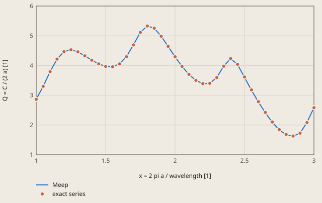
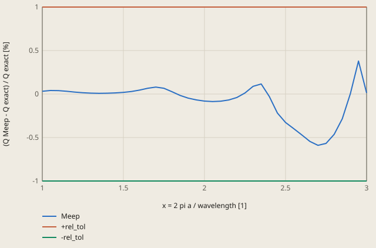

# optics-mie-cylinder derivation

## Conclusion

The scattering efficiency Q of the Meep model agrees with the exact series solution at all 41 size parameters x from 1 to 3, within 0.59 %. The 4 checks are within 0.33 %, and the tolerance is 1 %. The peaks of Q of the model are at the same size parameters as the peaks of the exact Q: x = 1.25, 1.80 and 2.40.

**Scattering efficiency of the cylinder against the size parameter**



exact series: Bohren and Huffman (1983), chapter 8, the series solution (reference.py)

Meep: 1 pulse, 40 grid points per a. The dots are the exact Q at the same size parameters, so the Meep line shows between them.

<details><summary>Values of the plot</summary>

Original values. — means no sample.

| x = 2 pi a / wavelength [1] | Meep (Q = C / (2 a) [1]) | exact series (Q = C / (2 a) [1]) |
| ---: | ---: | ---: |
| 1 | 2.863836 | 2.86293 |
| 1.05 | 3.30065 | 3.299311 |
| 1.1 | 3.79395 | 3.792469 |
| 1.15 | 4.217398 | 4.216066 |
| 1.2 | 4.466969 | 4.46597 |
| 1.25 | 4.529142 | 4.528474 |
| 1.3 | 4.459685 | 4.459244 |
| 1.35 | 4.326483 | 4.326121 |
| 1.4 | 4.180214 | 4.179811 |
| 1.45 | 4.053758 | 4.053235 |
| 1.5 | 3.971716 | 3.970961 |
| 1.55 | 3.96056 | 3.9594 |
| 1.6 | 4.056326 | 4.054483 |
| 1.65 | 4.300462 | 4.297625 |
| 1.7 | 4.69579 | 4.692059 |
| 1.75 | 5.115804 | 5.112409 |
| 1.8 | 5.331479 | 5.33007 |
| 1.85 | 5.253187 | 5.254028 |
| 1.9 | 4.983141 | 4.985483 |
| 1.95 | 4.640055 | 4.643206 |
| 2 | 4.289743 | 4.293232 |
| 2.05 | 3.96804 | 3.971476 |
| 2.1 | 3.699015 | 3.702071 |
| 2.15 | 3.499855 | 3.502251 |
| 2.2 | 3.388808 | 3.390165 |
| 2.25 | 3.401025 | 3.400614 |
| 2.3 | 3.597969 | 3.594777 |
| 2.35 | 3.980472 | 3.97587 |
| 2.4 | 4.231712 | 4.232902 |
| 2.45 | 4.031586 | 4.040425 |
| 2.5 | 3.601924 | 3.613747 |
| 2.55 | 3.169133 | 3.18177 |
| 2.6 | 2.774369 | 2.787467 |
| 2.65 | 2.411584 | 2.424783 |
| 2.7 | 2.089639 | 2.102037 |
| 2.75 | 1.835238 | 1.845712 |
| 2.8 | 1.674302 | 1.682099 |
| 2.85 | 1.624854 | 1.629485 |
| 2.9 | 1.726852 | 1.726768 |
| 2.95 | 2.090403 | 2.082513 |
| 3 | 2.58328 | 2.582972 |

</details>

The largest difference is -0.59 % at x = 2.70. There Q falls fast after the resonance at x = 2.405. The waves on the grid are a little slower than c, thus the resonances of the model are at a little smaller x (see "Spectrum" below). The differences at the 4 checks are +0.03 % at x = 1, -0.08 % at x = 2, -0.33 % at x = 2.5 and +0.01 % at x = 3.

**Difference of the Meep Q from the exact Q**



rel_tol of check.toml is 1 %. It applies to the 4 checks at x = 1, 2, 2.5 and 3.

<details><summary>Values of the plot</summary>

Original values. — means no sample.

| x = 2 pi a / wavelength [1] | Meep ((Q Meep - Q exact) / Q exact [%]) | +rel_tol ((Q Meep - Q exact) / Q exact [%]) | -rel_tol ((Q Meep - Q exact) / Q exact [%]) |
| ---: | ---: | ---: | ---: |
| 1 | 0.0316 | 1 | -1 |
| 1.05 | 0.0406 | 1 | -1 |
| 1.1 | 0.0391 | 1 | -1 |
| 1.15 | 0.0316 | 1 | -1 |
| 1.2 | 0.0224 | 1 | -1 |
| 1.25 | 0.0148 | 1 | -1 |
| 1.3 | 0.0099 | 1 | -1 |
| 1.35 | 0.0084 | 1 | -1 |
| 1.4 | 0.0096 | 1 | -1 |
| 1.45 | 0.0129 | 1 | -1 |
| 1.5 | 0.019 | 1 | -1 |
| 1.55 | 0.0293 | 1 | -1 |
| 1.6 | 0.0455 | 1 | -1 |
| 1.65 | 0.066 | 1 | -1 |
| 1.7 | 0.0795 | 1 | -1 |
| 1.75 | 0.0664 | 1 | -1 |
| 1.8 | 0.0264 | 1 | -1 |
| 1.85 | -0.016 | 1 | -1 |
| 1.9 | -0.047 | 1 | -1 |
| 1.95 | -0.0679 | 1 | -1 |
| 2 | -0.0813 | 1 | -1 |
| 2.05 | -0.0865 | 1 | -1 |
| 2.1 | -0.0825 | 1 | -1 |
| 2.15 | -0.0684 | 1 | -1 |
| 2.2 | -0.04 | 1 | -1 |
| 2.25 | 0.0121 | 1 | -1 |
| 2.3 | 0.0888 | 1 | -1 |
| 2.35 | 0.1157 | 1 | -1 |
| 2.4 | -0.0281 | 1 | -1 |
| 2.45 | -0.2188 | 1 | -1 |
| 2.5 | -0.3272 | 1 | -1 |
| 2.55 | -0.3972 | 1 | -1 |
| 2.6 | -0.4699 | 1 | -1 |
| 2.65 | -0.5443 | 1 | -1 |
| 2.7 | -0.5898 | 1 | -1 |
| 2.75 | -0.5675 | 1 | -1 |
| 2.8 | -0.4635 | 1 | -1 |
| 2.85 | -0.2842 | 1 | -1 |
| 2.9 | 0.0049 | 1 | -1 |
| 2.95 | 0.3789 | 1 | -1 |
| 3 | 0.0119 | 1 | -1 |

</details>

The result is the total field Ez at x = 2.5. The plane wave comes from the left. The cylinder is the circle of radius a = 1 at the centre, and in it the wavelength is half the wavelength in air. The period is T = 2 pi / x = 2.51 a / c. The crests move to the right. |Ez| is largest at the back surface of the cylinder, at the phases 90° and 270°.

## Result

**Pass.** A check passes when |computed - reference| ≤ rel_tol · |reference| + abs_tol, with rel_tol = 0.01 and abs_tol = 0 (`check.toml`). `fh validate` gives the computed values.

| Check | Unit | Computed | Reference | Difference | Tolerance | Margin |
| --- | ---: | ---: | ---: | ---: | ---: | ---: |
| `q_x1` | Not specified | 2.86384 | 2.86293 | +0.000906 (+0.0316459 %) | 0.02863 | 0.02772 |
| `q_x2` | Not specified | 4.28974 | 4.29323 | -0.003489 (-0.0812674 %) | 0.04293 | 0.03944 |
| `q_x2_5` | Not specified | 3.60192 | 3.61375 | -0.011823 (-0.327167 %) | 0.03614 | 0.02431 |
| `q_x3` | Not specified | 2.58328 | 2.58297 | +0.000308 (+0.0119242 %) | 0.02583 | 0.02552 |

Made by `scripts/validation-reports.py` on 2026-10-28, femahoy 9c54611.

This case checks the optics path: a plane wave of light scatters on a dielectric cylinder, solved with Meep.
The reference is the analytical series solution. Thus the tolerance comes from the grid error and the size of the model, and from the smallest model error that the check must find.

## Why this case

No other case of the suite has any of these items:

- Optics and photonics: the Maxwell equations in the time domain, solved with the FDTD method of Meep.
- A spectrum from 1 run: a short pulse holds all the frequencies, and a Fourier transform at each grid point of a flux surface gives the flux at 41 frequencies.
- A scattering cross-section: a run of the incident wave alone, then a run with the cylinder that subtracts the incident fields. The flux of the difference out of a closed box is the scattered power.
- Perfectly matched layers (PML) on all sides, a mirror symmetry, and the average of the permittivity in the grid cells that the curved surface cuts.

The scattering efficiency of a cylinder or a sphere (the Mie problem) is the usual first check of an FDTD code. It uses each tool of a scattering, transmission or reflection study, and it has an exact reference.

## Sources

- C. F. Bohren and D. R. Huffman, "Absorption and Scattering of Light by Small Particles", Wiley, 1983, ISBN 0-471-05772-X, chapter 8, the infinite cylinder at normal incidence.
  It gives the series solution of a plane wave on an infinite circular cylinder.
- A. F. Oskooi, D. Roundy, M. Ibanescu, P. Bermel, J. D. Joannopoulos and S. G. Johnson, "MEEP: A flexible free-software package for electromagnetic simulations by the FDTD method", Computer Physics Communications 181 (2010) 687-702.
  It describes the solver, its PML and its average of the permittivity at a surface.

The derivation below gives the same result, so that a reader can check it without the book.
The cylinder has the radius a and the index m, in air. The plane wave goes along +x, with the electric field E_z along the axis of the cylinder. With the time factor exp(-i w t), k = w / c and x = k a (the size parameter), the incident wave is a series of cylinder waves:

```
E_z,inc = exp(i k r cos(phi)) = sum_n i^n J_n(k r) exp(i n phi)
E_z,sca = - sum_n i^n b_n H_n(k r) exp(i n phi)        (r > a, H_n is the Hankel function of the first kind)
E_z,in  =   sum_n i^n c_n J_n(m k r) exp(i n phi)      (r < a)
```

E_z and its radial derivative are continuous at r = a. These 2 conditions give, for each n:

```
b_n = (J_n(m x) J_n'(x) - m J_n'(m x) J_n(x)) / (J_n(m x) H_n'(x) - m J_n'(m x) H_n(x))
```

b_-n = b_n. The scattered power for each length of the cylinder, divided by the incident intensity, is the scattering cross-section C (a length). The scattering efficiency is Q = C / (2 a):

```
Q = (2 / x) (|b_0|^2 + 2 sum_{n>=1} |b_n|^2)
```

`reference.py` computes Q. 3 independent checks of `reference.py` agree:

- The extinction efficiency (2 / x) Re(b_0 + 2 sum b_n), from the forward wave, is equal to Q to 1e-15, as it must be for a material with no loss.
- The fields of the series meet both conditions at r = a to 2e-15.
- At x = 0.01, Q is 0.14 % from the small-cylinder limit pi^2 x^3 (m^2 - 1)^2 / 8.

| Item | Value |
|---|---|
| Cylinder | radius a = 1, index m = 2 (for example silicon nitride in the near infrared), no loss, infinite along z |
| Wave | plane wave along +x in air, E along the axis of the cylinder (the TM case) |
| Units | the lengths in a, the frequency f in c / a. Thus x = 2 pi a f |
| Spectrum | x from 1 to 3 (the wavelength from 6.3 a to 2.1 a), 3 resonances of the cylinder |

| Check | Size parameter x | Q |
|---|---:|---:|
| `q_x1` | 1.0 | 2.862930 |
| `q_x2` | 2.0 | 4.293232 |
| `q_x2_5` | 2.5 | 3.613747 |
| `q_x3` | 3.0 | 2.582972 |

Each check finds a different error. At x = 1, Q depends mostly on m^2 - 1. At x = 2 and x = 2.5, Q is on the steep side of a resonance, thus a shift of the resonance changes Q much. At x = 3, Q is near a sharp resonance (x = 3.015), thus a run that stops too early changes Q.

## Model

The Meep case is the folder `res40`: `meep_case.py` for Meep 1.35.0. The units are a and c.

| Item | Value |
|---|---|
| Cell | a square of side 9 a in 2D: the flux box of half side 1.5 a, then 1 a of air and a PML of 2 a on each side |
| Grid | 40 points per a: 42 points in the shortest wavelength in the cylinder (x = 3). Meep averages the permittivity in the cells that the surface of the cylinder cuts |
| Source | a line of E_z across the full cell on the inner face of the PML at the left, also in the PML (`is_integrated=True`). Its pulse is Gaussian, with the centre at the size parameter 2 and a width that covers the size parameters from 1 to 3 |
| Symmetry | `Mirror(Y)`: E_z is even about y = 0, thus Meep solves half of the cell |
| Run 1 | no cylinder. The flux through 1 side of the box gives the incident intensity. Meep keeps the Fourier transforms of the fields on the box |
| Run 2 | the cylinder. `load_minus_flux_data` subtracts the fields of run 1 on the box, thus the flux out of the box is the scattered power |
| End of each run | `stop_when_dft_decayed()`: the Fourier transforms change by less than 1e-11 |
| Output | `spectrum.txt`: Q at 41 size parameters from 1 to 3. `cylinder.txt`: 1 row with the 4 values of the check. `field.pos`: the real part of the total E_z at the size parameter 2.5 at 8 times of 1 period, on every fourth grid point, for the viewer |

Q in the box does not depend on the size of the box, because the cylinder has no loss and the box holds no source.

## Spectrum

| x | Analytical Q | 20 points per a | 40 points per a (the case) | 80 points per a | Error of the case |
|---:|---:|---:|---:|---:|---:|
| 1.00 | 2.8629 | 2.8652 | 2.8638 | 2.8635 | +0.03 % |
| 1.25 | 4.5285 | 4.5296 | 4.5291 | 4.5290 | +0.01 % |
| 1.50 | 3.9710 | 3.9727 | 3.9717 | 3.9715 | +0.02 % |
| 1.75 | 5.1124 | 5.1244 | 5.1158 | 5.1136 | +0.07 % |
| 2.00 | 4.2932 | 4.2784 | 4.2897 | 4.2926 | -0.08 % |
| 2.25 | 3.4006 | 3.4014 | 3.4010 | 3.4010 | +0.01 % |
| 2.50 | 3.6137 | 3.5641 | 3.6019 | 3.6114 | -0.33 % |
| 2.75 | 1.8457 | 1.8039 | 1.8352 | 1.8432 | -0.57 % |
| 3.00 | 2.5830 | 2.5771 | 2.5833 | 2.5837 | +0.01 % |

The largest error of the case at the 41 size parameters is 0.59 %, at x = 2.70. The errors are largest after the resonance at x = 2.405, where Q falls fast. The waves on the grid are a little slower than c, thus the resonances of the model are at a little smaller x.

## Grid study

These commands, in the repository root, solve the case with another grid in a scratch folder. Set `FH_MEEP` to the Python of Meep first (README.md):

```
mkdir /tmp/mie && cp validation/cases/optics-mie-cylinder/res40/meep_case.py /tmp/mie && cd /tmp/mie
sed -i.bak 's/^RES = 40 /RES = 80 /' meep_case.py && "$FH_MEEP" meep_case.py && cat cylinder.txt
```

| Points per a | Error of q_x1 | Error of q_x2 | Error of q_x2_5 | Error of q_x3 | Largest error of the 41 values | Time |
|---:|---:|---:|---:|---:|---:|---:|
| 10 | +0.30 % | -1.39 % | -5.68 % | -4.11 % | 9.3 % | 4 s |
| 20 | +0.08 % | -0.35 % | -1.37 % | -0.23 % | 2.4 % | 9 s |
| 40, the case | +0.03 % | -0.08 % | -0.33 % | +0.01 % | 0.59 % | 15 s |
| 80 | +0.02 % | -0.01 % | -0.07 % | +0.03 % | 0.14 % | 173 s |

The times are the times of Meep 1.35.0 on 1 core of a Mac with 10 cores, with other work on the Mac. The error falls by a factor of 4 for each step: the order of the method is 2 (from the steps 20, 40 and 80: 2.01, 1.97 and 2.00 at the first 3 checks).
The Richardson extrapolation of the values at 40 and 80 points per a is within 3.4e-4 of the analytical Q at each check. This remainder comes from the size of the model.

## Size of the model

Each line is a change of `meep_case.py` at 40 points per a:

| Change | Error of q_x1 | Error of q_x2 | Error of q_x2_5 | Error of q_x3 |
|---|---:|---:|---:|---:|
| None (the case) | +0.032 % | -0.081 % | -0.327 % | +0.012 % |
| PML 1 a, air 0.5 a | +0.006 % | -0.100 % | -0.376 % | -0.058 % |
| PML 3 a, air 2 a | +0.039 % | -0.099 % | -0.364 % | +0.000 % |
| Flux box of half side 1.2 a | +0.004 % | -0.083 % | -0.335 % | +0.005 % |
| No mirror symmetry | +0.032 % | -0.081 % | -0.327 % | +0.012 % |
| Stop at a change of 1e-8 | +0.031 % | -0.081 % | -0.327 % | +0.010 % |
| Stop at a change of 1e-6 | +0.030 % | -0.081 % | -0.327 % | -0.029 % |

The sizes of the cell, the PML and the box change Q by 7e-4 or less. The symmetry changes nothing. An earlier stop changes Q only near the sharp resonance at x = 3.

## Tolerance

The tolerance is `rel_tol = 0.01` and `abs_tol = 0`.

| Cause | Basis | Effect |
|---|---|---:|
| The reference | exact, 3 independent checks of `reference.py` | 0 |
| Grid error | the largest error of the case at a check, `q_x2_5` | 0.33 % |
| Size of the model | the table above | 0.07 % or less |
| Another version of Meep or another platform | the same method and the same grid. A change of the average at the surface can change Q by a part of the grid error | 0.33 % or less |

`rel_tol` = 1 % covers these causes, with a margin of about 3. It also covers all the 41 values of the spectrum (0.59 % or less). No check value is near 0, thus `abs_tol` is 0.

| Check | Model | Analytical | Difference | Tolerance | Part of the tolerance |
|---|---:|---:|---:|---:|---:|
| `q_x1` | 2.863836 | 2.862930 | 9.06e-4 | 2.86e-2 | 3 % |
| `q_x2` | 4.289743 | 4.293232 | -3.49e-3 | 4.29e-2 | 8 % |
| `q_x2_5` | 3.601924 | 3.613747 | -1.18e-2 | 3.61e-2 | 33 % |
| `q_x3` | 2.583280 | 2.582972 | 3.08e-4 | 2.58e-2 | 1 % |

The tolerance stops these errors. Each line is a change of `meep_case.py`:

| Wrong model | q_x1 | q_x2 | q_x2_5 | q_x3 | Largest error |
|---|---:|---:|---:|---:|---:|
| Index 2.02, not 2 | 2.989774 | 4.125316 | 3.318578 | 2.554301 | 8.2 % |
| No average of the permittivity at the surface (`eps_averaging=False`) | 2.854502 | 4.304857 | 3.643024 | 2.552668 | 1.2 % |
| 20 points per a | 2.865249 | 4.278408 | 3.564103 | 2.577093 | 1.4 % |

A radius of 1 grid cell more (a = 1.025) changes the analytical Q by 5 % to 13 % at the checks.

## Not in the check

- The other polarization (H along the axis of the cylinder): the same steps with the source component `Hz` and the coefficients a_n of the series.
- A sphere in 3D: the same steps, but the cell has hundreds of times more grid points. The cylinder in 2D gives the same check of the method in 15 s.
- Materials with loss or dispersion (metals, for example gold): Meep has Drude and Lorentz materials. Then the flux of the total fields into the box, a second flux object, gives the absorbed power.
- Resonance frequencies and Q factors of a cavity (`Harminv`) and waveguide modes (`EigenModeSource`): other tools of Meep that a later case can check.

On a Mac with 10 cores, `fh run` of the case took 15 s.
