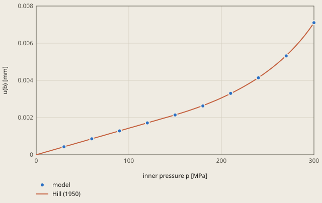

# plasticity-sphere derivation

## Conclusion

The model of the thick sphere follows the elastic-plastic solution of Hill (1950) within 0.70 % at each of its 10 load increments. At the full pressure of 300 MPa, the outer radial displacement is 0.0071039 mm, 0.08 % above the reference 0.00709845 mm. The tolerance is 1 %.

**Outer radial displacement against the inner pressure**

model: u1 of the node PX = (20, 0, 0) at each increment, ccx/job.dat of the run

Hill (1950) is the solution of derivation.md. Below the first yield at 145.8 MPa, the sphere is elastic: u(b) is linear in p, the formula with c = a. Above it, c is the root of the pressure equation.

The largest difference of the model is -0.70 %, at p = 180 MPa.

Up to 120 MPa, the sphere is elastic, and the model is 0.09 % below the reference. The first yield is at 145.8 MPa. Then the plastic zone grows from the inner face, and u(b) increases faster than the pressure. The largest difference is -0.70 %, at 180 MPa. At this pressure, the plastic zone goes to c = 10.83 mm. At 346.6 MPa, the full shell is plastic and the sphere collapses (derivation.md).

## Result

**Pass.** A check passes when |computed - reference| ≤ rel_tol · |reference| + abs_tol, with rel_tol = 0.01 and abs_tol = 0.0 (`check.toml`). `fh validate` gives the computed values.

| Check | Unit | Computed | Reference | Difference | Tolerance | Margin |
| --- | ---: | ---: | ---: | ---: | ---: | ---: |
| `u_outer` | Not specified | 0.00710392 | 0.00709845 | +5.466e-06 (+0.0770027 %) | 7.098e-05 | 6.552e-05 |

Made by `scripts/validation-reports.py` on 2026-10-28, femahoy 5ac0a46.

This case checks the outer radial displacement of a thick hollow sphere that is partly plastic (units SI-mm).

## Source

R. Hill, *The Mathematical Theory of Plasticity*, Clarendon Press, Oxford, 1950, Chapter V, the thick spherical shell under internal pressure (from p. 103).
The material is elastic-perfectly plastic. The plastic zone is a < r < c. The pressure is p = 2Y ln(c/a) + (2Y/3)(1 - c³/b³).
The shell c < r < b is elastic, with the pressure (2Y/3)(1 - c³/b³) at r = c. Its outer displacement is u(b) = (1 - nu) Y c³ / (E b²).

## Model

| Item | Value |
|---|---|
| Sphere | inner radius a = 10 mm, outer radius b = 20 mm, 1/8 of the sphere, centre at the origin |
| Steel | E = 210000 MPa, nu = 0.3, von Mises yield stress Y = 250 MPa, no hardening |
| Supports | `SX`, `SY`, `SZ`: the symmetry planes x = 0, y = 0, z = 0 |
| Load | `INNER`: pressure 300 MPa, linear in the step, 10 increments |
| Step | `*STATIC`, small strains |

The first yield is at p = (2Y/3)(1 - a³/b³) = 145.8 MPa. The collapse is at p = 2Y ln(b/a) = 346.6 MPa. 300 MPa is between them.
For p = 300 MPa, c = 15.0476 mm and u(b) = 0.7 · 250 · 15.0476³ / (210000 · 400) = 0.00709845 mm.
The check reads u1 at the node `PX` = (20, 0, 0).

## Tolerance

The tolerance is 1 % (`rel_tol = 0.01`).
The solid gives 0.0071039 mm (+0.08 %) with a mesh of size 3 mm. With size 2 mm it gives 0.0070892 mm (-0.13 %).
20 increments in place of 10 change the result by less than 0.01 %.

## Chat run

The request asked for the outer radial displacement of this sphere in plain words.
The chat used a mesh of size 2 mm. It gave 0.0070913 mm (-0.10 %). The run took 201 s and cost 1.05 USD.

The chat run found 1 gap. ccx refused the first mesh: `fh mesh` wrote the coordinate `-4.874999160318342E-15`, which has 22 characters, and ccx reads 20 characters of each number.
The chat moved the centre of the sphere to (100, 100, 100) to get a mesh with no such number. `fh mesh` now writes each coordinate in at most 20 characters, and this case has its centre at the origin.

## Files

The mesh in `job.inp` comes from `fh mesh part.step --size 3 --face SX=x:0 --face SY=y:0 --face SZ=z:0 --face INNER=box:-1,-1,-1,11,11,11 --nodes PX=point:20,0,0`.
`part.step` is 1/8 of the shell: the intersection of the shell with the box from (0, 0, 0) to (30, 30, 30).
