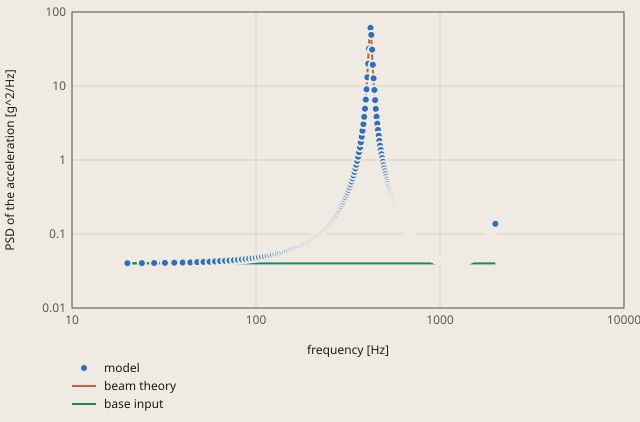

# random-vibration-cantilever derivation

## Conclusion

The solid model gives the RMS acceleration of the tip of the cantilever within 0.06 % of the beam theory. The model gives 401161.7 mm/s2 (40.91 g), and the modal sum of the beam theory gives 400925.4 mm/s2 (40.883 g). The difference is 12 % of the tolerance of 0.5 %. Miles' equation for mode 1 alone gives 40.115 g, 1.9 % lower.

**The PSD of the tip acceleration in z**



model: this run, the steady state step in ccx/job.dat

The model is the mean over the 37 nodes of the tip face, at the 301 frequencies of the steady state step. The model shows as points, because it lies on the line of the beam theory. The beam theory is the modal sum of 40 modes in derivation.md. The RMS of the check is the square root of the area under the curve.

<details><summary>Values of the plot</summary>

Original values. — means no sample.

| frequency [Hz] | model (PSD of the acceleration [g^2/Hz]) | beam theory (PSD of the acceleration [g^2/Hz]) | base input (PSD of the acceleration [g^2/Hz]) |
| ---: | ---: | ---: | ---: |
| 20 | — | 0.0402845 | 0.04 |
| 20 | 0.0402821 | — | — |
| 20.0923 | — | 0.0402871 | 0.04 |
| 20.1851 | — | 0.0402898 | 0.04 |
| 20.2782 | — | 0.0402925 | 0.04 |
| 20.3718 | — | 0.0402952 | 0.04 |
| 20.4659 | — | 0.040298 | 0.04 |
| 20.5603 | — | 0.0403007 | 0.04 |
| 20.6552 | — | 0.0403035 | 0.04 |
| 20.7506 | — | 0.0403064 | 0.04 |
| 20.8463 | — | 0.0403092 | 0.04 |
| 20.9426 | — | 0.0403121 | 0.04 |
| 21.0392 | — | 0.040315 | 0.04 |
| 21.1364 | — | 0.0403179 | 0.04 |
| 21.2339 | — | 0.0403209 | 0.04 |
| 21.3319 | — | 0.0403238 | 0.04 |
| 21.4304 | — | 0.0403269 | 0.04 |
| 21.5293 | — | 0.0403299 | 0.04 |
| 21.6287 | — | 0.040333 | 0.04 |
| 21.7285 | — | 0.0403361 | 0.04 |
| 21.8288 | — | 0.0403392 | 0.04 |
| 21.9296 | — | 0.0403423 | 0.04 |
| 22.0308 | — | 0.0403455 | 0.04 |
| 22.1325 | — | 0.0403487 | 0.04 |
| 22.2346 | — | 0.040352 | 0.04 |
| 22.3373 | — | 0.0403552 | 0.04 |
| 22.4404 | — | 0.0403586 | 0.04 |
| 22.5439 | — | 0.0403619 | 0.04 |
| 22.648 | — | 0.0403653 | 0.04 |
| 22.7525 | — | 0.0403686 | 0.04 |
| 22.8576 | — | 0.0403721 | 0.04 |
| 22.9631 | — | 0.0403755 | 0.04 |
| 23.0691 | — | 0.040379 | 0.04 |
| 23.1755 | — | 0.0403826 | 0.04 |
| 23.2825 | — | 0.0403861 | 0.04 |
| 23.39 | — | 0.0403897 | 0.04 |
| 23.498 | — | 0.0403933 | 0.04 |
| 23.6064 | — | 0.040397 | 0.04 |
| 23.7154 | — | 0.0404007 | 0.04 |
| 23.8248 | — | 0.0404044 | 0.04 |
| 23.9348 | — | 0.0404082 | 0.04 |
| 23.9912 | 0.0404066 | — | — |
| 24.0453 | — | 0.040412 | 0.04 |
| 24.1563 | — | 0.0404158 | 0.04 |
| 24.2678 | — | 0.0404197 | 0.04 |
| 24.3798 | — | 0.0404236 | 0.04 |
| 24.4923 | — | 0.0404275 | 0.04 |
| 24.6054 | — | 0.0404315 | 0.04 |
| 24.7189 | — | 0.0404355 | 0.04 |
| 24.833 | — | 0.0404396 | 0.04 |
| 24.9477 | — | 0.0404437 | 0.04 |
| 25.0628 | — | 0.0404478 | 0.04 |
| 25.1785 | — | 0.040452 | 0.04 |
| 25.2947 | — | 0.0404562 | 0.04 |
| 25.4115 | — | 0.0404605 | 0.04 |
| 25.5288 | — | 0.0404647 | 0.04 |
| 25.6466 | — | 0.0404691 | 0.04 |
| 25.765 | — | 0.0404734 | 0.04 |
| 25.8839 | — | 0.0404779 | 0.04 |
| 26.0034 | — | 0.0404823 | 0.04 |
| 26.1234 | — | 0.0404868 | 0.04 |
| 26.244 | — | 0.0404913 | 0.04 |
| 26.3651 | — | 0.0404959 | 0.04 |
| 26.4868 | — | 0.0405005 | 0.04 |
| 26.6091 | — | 0.0405052 | 0.04 |
| 26.7319 | — | 0.0405099 | 0.04 |
| 26.8553 | — | 0.0405147 | 0.04 |
| 26.9793 | — | 0.0405195 | 0.04 |
| 27.1038 | — | 0.0405243 | 0.04 |
| 27.2289 | — | 0.0405292 | 0.04 |
| 27.3546 | — | 0.0405341 | 0.04 |
| 27.4808 | — | 0.0405391 | 0.04 |
| 27.6077 | — | 0.0405441 | 0.04 |
| 27.7351 | — | 0.0405492 | 0.04 |
| 27.8631 | — | 0.0405543 | 0.04 |
| 27.9825 | 0.0405544 | — | — |
| 27.9917 | — | 0.0405595 | 0.04 |
| 28.121 | — | 0.0405647 | 0.04 |
| 28.2508 | — | 0.04057 | 0.04 |
| 28.3812 | — | 0.0405753 | 0.04 |
| 28.5122 | — | 0.0405807 | 0.04 |
| 28.6438 | — | 0.0405861 | 0.04 |
| 28.776 | — | 0.0405916 | 0.04 |
| 28.9088 | — | 0.0405971 | 0.04 |
| 29.0422 | — | 0.0406027 | 0.04 |
| 29.1763 | — | 0.0406083 | 0.04 |
| 29.311 | — | 0.040614 | 0.04 |
| 29.4463 | — | 0.0406197 | 0.04 |
| 29.5822 | — | 0.0406255 | 0.04 |
| 29.7187 | — | 0.0406313 | 0.04 |
| 29.8559 | — | 0.0406372 | 0.04 |
| 29.9937 | — | 0.0406432 | 0.04 |
| 30.1321 | — | 0.0406492 | 0.04 |
| 30.2712 | — | 0.0406552 | 0.04 |
| 30.411 | — | 0.0406613 | 0.04 |
| 30.5513 | — | 0.0406675 | 0.04 |
| 30.6923 | — | 0.0406738 | 0.04 |
| 30.834 | — | 0.0406801 | 0.04 |
| 30.9763 | — | 0.0406864 | 0.04 |
| 31.1193 | — | 0.0406928 | 0.04 |
| 31.263 | — | 0.0406993 | 0.04 |
| 31.4073 | — | 0.0407058 | 0.04 |
| 31.5522 | — | 0.0407124 | 0.04 |
| 31.6979 | — | 0.0407191 | 0.04 |
| 31.8442 | — | 0.0407258 | 0.04 |
| 31.9737 | 0.0407256 | — | — |
| 31.9912 | — | 0.0407326 | 0.04 |
| 32.1388 | — | 0.0407395 | 0.04 |
| 32.2872 | — | 0.0407464 | 0.04 |
| 32.4362 | — | 0.0407534 | 0.04 |
| 32.5859 | — | 0.0407604 | 0.04 |
| 32.7363 | — | 0.0407675 | 0.04 |
| 32.8874 | — | 0.0407747 | 0.04 |
| 33.0392 | — | 0.0407819 | 0.04 |
| 33.1917 | — | 0.0407893 | 0.04 |
| 33.3449 | — | 0.0407966 | 0.04 |
| 33.4989 | — | 0.0408041 | 0.04 |
| 33.6535 | — | 0.0408116 | 0.04 |
| 33.8088 | — | 0.0408192 | 0.04 |
| 33.9649 | — | 0.0408269 | 0.04 |
| 34.1216 | — | 0.0408346 | 0.04 |
| 34.2791 | — | 0.0408425 | 0.04 |
| 34.4374 | — | 0.0408503 | 0.04 |
| 34.5963 | — | 0.0408583 | 0.04 |
| 34.756 | — | 0.0408664 | 0.04 |
| 34.9164 | — | 0.0408745 | 0.04 |
| 35.0776 | — | 0.0408827 | 0.04 |
| 35.2395 | — | 0.0408909 | 0.04 |
| 35.4022 | — | 0.0408993 | 0.04 |
| 35.5656 | — | 0.0409077 | 0.04 |
| 35.7298 | — | 0.0409162 | 0.04 |
| 35.8947 | — | 0.0409248 | 0.04 |
| 35.9649 | 0.0409206 | — | — |
| 36.0604 | — | 0.0409335 | 0.04 |
| 36.2268 | — | 0.0409422 | 0.04 |
| 36.394 | — | 0.0409511 | 0.04 |
| 36.562 | — | 0.04096 | 0.04 |
| 36.7308 | — | 0.040969 | 0.04 |
| 36.9003 | — | 0.0409781 | 0.04 |
| 37.0706 | — | 0.0409873 | 0.04 |
| 37.2417 | — | 0.0409965 | 0.04 |
| 37.4136 | — | 0.0410059 | 0.04 |
| 37.5863 | — | 0.0410153 | 0.04 |
| 37.7598 | — | 0.0410249 | 0.04 |
| 37.9341 | — | 0.0410345 | 0.04 |
| 38.1092 | — | 0.0410442 | 0.04 |
| 38.2851 | — | 0.041054 | 0.04 |
| 38.4618 | — | 0.0410639 | 0.04 |
| 38.6394 | — | 0.0410739 | 0.04 |
| 38.8177 | — | 0.041084 | 0.04 |
| 38.9969 | — | 0.0410942 | 0.04 |
| 39.1769 | — | 0.0411045 | 0.04 |
| 39.3577 | — | 0.0411149 | 0.04 |
| 39.5394 | — | 0.0411253 | 0.04 |
| 39.7219 | — | 0.0411359 | 0.04 |
| 39.9052 | — | 0.0411466 | 0.04 |
| 39.9562 | 0.0411398 | — | — |
| 40.0894 | — | 0.0411574 | 0.04 |
| 40.2745 | — | 0.0411683 | 0.04 |
| 40.4604 | — | 0.0411793 | 0.04 |
| 40.6471 | — | 0.0411904 | 0.04 |
| 40.8348 | — | 0.0412016 | 0.04 |
| 41.0232 | — | 0.0412129 | 0.04 |
| 41.2126 | — | 0.0412243 | 0.04 |
| 41.4028 | — | 0.0412358 | 0.04 |
| 41.5939 | — | 0.0412475 | 0.04 |
| 41.7859 | — | 0.0412592 | 0.04 |
| 41.9788 | — | 0.0412711 | 0.04 |
| 42.1726 | — | 0.0412831 | 0.04 |
| 42.3672 | — | 0.0412952 | 0.04 |
| 42.5628 | — | 0.0413074 | 0.04 |
| 42.7592 | — | 0.0413197 | 0.04 |
| 42.9566 | — | 0.0413321 | 0.04 |
| 43.1549 | — | 0.0413447 | 0.04 |
| 43.3541 | — | 0.0413574 | 0.04 |
| 43.5542 | — | 0.0413702 | 0.04 |
| 43.7552 | — | 0.0413831 | 0.04 |
| 43.9474 | 0.0413837 | — | — |
| 43.9572 | — | 0.0413962 | 0.04 |
| 44.1601 | — | 0.0414094 | 0.04 |
| 44.3639 | — | 0.0414227 | 0.04 |
| 44.5687 | — | 0.0414361 | 0.04 |
| 44.7744 | — | 0.0414497 | 0.04 |
| 44.9811 | — | 0.0414634 | 0.04 |
| 45.1887 | — | 0.0414772 | 0.04 |
| 45.3973 | — | 0.0414911 | 0.04 |
| 45.6068 | — | 0.0415052 | 0.04 |
| 45.8174 | — | 0.0415195 | 0.04 |
| 46.0288 | — | 0.0415338 | 0.04 |
| 46.2413 | — | 0.0415483 | 0.04 |
| 46.4547 | — | 0.041563 | 0.04 |
| 46.6692 | — | 0.0415778 | 0.04 |
| 46.8846 | — | 0.0415927 | 0.04 |
| 47.101 | — | 0.0416078 | 0.04 |
| 47.3184 | — | 0.041623 | 0.04 |
| 47.5368 | — | 0.0416384 | 0.04 |
| 47.7562 | — | 0.0416539 | 0.04 |
| 47.9386 | 0.0416526 | — | — |
| 47.9767 | — | 0.0416696 | 0.04 |
| 48.1981 | — | 0.0416854 | 0.04 |
| 48.4206 | — | 0.0417014 | 0.04 |
| 48.6441 | — | 0.0417175 | 0.04 |
| 48.8686 | — | 0.0417338 | 0.04 |
| 49.0942 | — | 0.0417502 | 0.04 |
| 49.3208 | — | 0.0417668 | 0.04 |
| 49.5484 | — | 0.0417836 | 0.04 |
| 49.7771 | — | 0.0418005 | 0.04 |
| 50.0069 | — | 0.0418176 | 0.04 |
| 50.2377 | — | 0.0418349 | 0.04 |
| 50.4696 | — | 0.0418523 | 0.04 |
| 50.7026 | — | 0.0418699 | 0.04 |
| 50.9366 | — | 0.0418877 | 0.04 |
| 51.1717 | — | 0.0419056 | 0.04 |
| 51.4079 | — | 0.0419237 | 0.04 |
| 51.6452 | — | 0.041942 | 0.04 |
| 51.8836 | — | 0.0419605 | 0.04 |
| 51.9299 | 0.0419473 | — | — |
| 52.1231 | — | 0.0419791 | 0.04 |
| 52.3637 | — | 0.041998 | 0.04 |
| 52.6054 | — | 0.042017 | 0.04 |
| 52.8482 | — | 0.0420362 | 0.04 |
| 53.0921 | — | 0.0420556 | 0.04 |
| 53.3372 | — | 0.0420752 | 0.04 |
| 53.5834 | — | 0.042095 | 0.04 |
| 53.8307 | — | 0.0421149 | 0.04 |
| 54.0792 | — | 0.0421351 | 0.04 |
| 54.3288 | — | 0.0421555 | 0.04 |
| 54.5796 | — | 0.042176 | 0.04 |
| 54.8315 | — | 0.0421968 | 0.04 |
| 55.0846 | — | 0.0422178 | 0.04 |
| 55.3388 | — | 0.0422389 | 0.04 |
| 55.5943 | — | 0.0422603 | 0.04 |
| 55.8509 | — | 0.0422819 | 0.04 |
| 55.9211 | 0.0422682 | — | — |
| 56.1087 | — | 0.0423037 | 0.04 |
| 56.3677 | — | 0.0423257 | 0.04 |
| 56.6278 | — | 0.042348 | 0.04 |
| 56.8892 | — | 0.0423704 | 0.04 |
| 57.1518 | — | 0.0423931 | 0.04 |
| 57.4156 | — | 0.042416 | 0.04 |
| 57.6806 | — | 0.0424392 | 0.04 |
| 57.9469 | — | 0.0424625 | 0.04 |
| 58.2143 | — | 0.0424861 | 0.04 |
| 58.483 | — | 0.0425099 | 0.04 |
| 58.753 | — | 0.042534 | 0.04 |
| 59.0242 | — | 0.0425583 | 0.04 |
| 59.2966 | — | 0.0425828 | 0.04 |
| 59.5703 | — | 0.0426076 | 0.04 |
| 59.8453 | — | 0.0426327 | 0.04 |
| 59.9123 | 0.042616 | — | — |
| 60.1215 | — | 0.0426579 | 0.04 |
| 60.399 | — | 0.0426835 | 0.04 |
| 60.6778 | — | 0.0427093 | 0.04 |
| 60.9579 | — | 0.0427353 | 0.04 |
| 61.2393 | — | 0.0427616 | 0.04 |
| 61.5219 | — | 0.0427882 | 0.04 |
| 61.8059 | — | 0.042815 | 0.04 |
| 62.0912 | — | 0.0428421 | 0.04 |
| 62.3778 | — | 0.0428695 | 0.04 |
| 62.6657 | — | 0.0428971 | 0.04 |
| 62.955 | — | 0.042925 | 0.04 |
| 63.2456 | — | 0.0429532 | 0.04 |
| 63.5375 | — | 0.0429817 | 0.04 |
| 63.8308 | — | 0.0430105 | 0.04 |
| 63.9036 | 0.0429915 | — | — |
| 64.1254 | — | 0.0430395 | 0.04 |
| 64.4214 | — | 0.0430689 | 0.04 |
| 64.7187 | — | 0.0430985 | 0.04 |
| 65.0175 | — | 0.0431285 | 0.04 |
| 65.3176 | — | 0.0431587 | 0.04 |
| 65.6191 | — | 0.0431893 | 0.04 |
| 65.9219 | — | 0.0432201 | 0.04 |
| 66.2262 | — | 0.0432513 | 0.04 |
| 66.5319 | — | 0.0432828 | 0.04 |
| 66.839 | — | 0.0433146 | 0.04 |
| 67.1475 | — | 0.0433467 | 0.04 |
| 67.4575 | — | 0.0433792 | 0.04 |
| 67.7688 | — | 0.0434119 | 0.04 |
| 67.8948 | 0.0433954 | — | — |
| 68.0816 | — | 0.043445 | 0.04 |
| 68.3959 | — | 0.0434785 | 0.04 |
| 68.7116 | — | 0.0435123 | 0.04 |
| 69.0287 | — | 0.0435464 | 0.04 |
| 69.3474 | — | 0.0435809 | 0.04 |
| 69.6675 | — | 0.0436157 | 0.04 |
| 69.989 | — | 0.0436509 | 0.04 |
| 70.3121 | — | 0.0436864 | 0.04 |
| 70.6366 | — | 0.0437224 | 0.04 |
| 70.9627 | — | 0.0437586 | 0.04 |
| 71.2902 | — | 0.0437953 | 0.04 |
| 71.6193 | — | 0.0438323 | 0.04 |
| 71.886 | 0.0438287 | — | — |
| 71.9499 | — | 0.0438697 | 0.04 |
| 72.282 | — | 0.0439075 | 0.04 |
| 72.6156 | — | 0.0439456 | 0.04 |
| 72.9508 | — | 0.0439842 | 0.04 |
| 73.2875 | — | 0.0440232 | 0.04 |
| 73.6258 | — | 0.0440625 | 0.04 |
| 73.9656 | — | 0.0441023 | 0.04 |
| 74.307 | — | 0.0441425 | 0.04 |
| 74.65 | — | 0.0441831 | 0.04 |
| 74.9946 | — | 0.0442241 | 0.04 |
| 75.3408 | — | 0.0442655 | 0.04 |
| 75.6885 | — | 0.0443074 | 0.04 |
| 75.8773 | 0.0442922 | — | — |
| 76.0379 | — | 0.0443497 | 0.04 |
| 76.3889 | — | 0.0443924 | 0.04 |
| 76.7414 | — | 0.0444356 | 0.04 |
| 77.0957 | — | 0.0444792 | 0.04 |
| 77.4515 | — | 0.0445233 | 0.04 |
| 77.809 | — | 0.0445679 | 0.04 |
| 78.1682 | — | 0.0446129 | 0.04 |
| 78.529 | — | 0.0446584 | 0.04 |
| 78.8915 | — | 0.0447043 | 0.04 |
| 79.2556 | — | 0.0447508 | 0.04 |
| 79.6214 | — | 0.0447977 | 0.04 |
| 79.8685 | 0.0447869 | — | — |
| 79.9889 | — | 0.0448451 | 0.04 |
| 80.3582 | — | 0.044893 | 0.04 |
| 80.7291 | — | 0.0449415 | 0.04 |
| 81.1017 | — | 0.0449904 | 0.04 |
| 81.4761 | — | 0.0450398 | 0.04 |
| 81.8521 | — | 0.0450898 | 0.04 |
| 82.2299 | — | 0.0451403 | 0.04 |
| 82.6095 | — | 0.0451913 | 0.04 |
| 82.9908 | — | 0.0452429 | 0.04 |
| 83.3739 | — | 0.045295 | 0.04 |
| 83.7587 | — | 0.0453477 | 0.04 |
| 83.8598 | 0.0453139 | — | — |
| 84.1453 | — | 0.0454009 | 0.04 |
| 84.5337 | — | 0.0454547 | 0.04 |
| 84.9239 | — | 0.0455091 | 0.04 |
| 85.3159 | — | 0.045564 | 0.04 |
| 85.7097 | — | 0.0456196 | 0.04 |
| 86.1053 | — | 0.0456757 | 0.04 |
| 86.5028 | — | 0.0457324 | 0.04 |
| 86.902 | — | 0.0457898 | 0.04 |
| 87.3032 | — | 0.0458477 | 0.04 |
| 87.7061 | — | 0.0459063 | 0.04 |
| 87.851 | 0.0458744 | — | — |
| 88.111 | — | 0.0459655 | 0.04 |
| 88.5177 | — | 0.0460254 | 0.04 |
| 88.9263 | — | 0.0460859 | 0.04 |
| 89.3367 | — | 0.046147 | 0.04 |
| 89.7491 | — | 0.0462088 | 0.04 |
| 90.1633 | — | 0.0462713 | 0.04 |
| 90.5795 | — | 0.0463345 | 0.04 |
| 90.9976 | — | 0.0463983 | 0.04 |
| 91.4176 | — | 0.0464628 | 0.04 |
| 91.8396 | — | 0.0465281 | 0.04 |
| 91.8422 | 0.0464698 | — | — |
| 92.2635 | — | 0.046594 | 0.04 |
| 92.6894 | — | 0.0466607 | 0.04 |
| 93.1172 | — | 0.0467281 | 0.04 |
| 93.547 | — | 0.0467963 | 0.04 |
| 93.9788 | — | 0.0468652 | 0.04 |
| 94.4126 | — | 0.0469348 | 0.04 |
| 94.8484 | — | 0.0470053 | 0.04 |
| 95.2862 | — | 0.0470765 | 0.04 |
| 95.726 | — | 0.0471484 | 0.04 |
| 95.8334 | 0.0471012 | — | — |
| 96.1679 | — | 0.0472212 | 0.04 |
| 96.6118 | — | 0.0472948 | 0.04 |
| 97.0577 | — | 0.0473692 | 0.04 |
| 97.5057 | — | 0.0474445 | 0.04 |
| 97.9558 | — | 0.0475205 | 0.04 |
| 98.4079 | — | 0.0475975 | 0.04 |
| 98.8621 | — | 0.0476752 | 0.04 |
| 99.3185 | — | 0.0477539 | 0.04 |
| 99.7769 | — | 0.0478334 | 0.04 |
| 99.8247 | 0.0477703 | — | — |
| 100.237 | — | 0.0479139 | 0.04 |
| 100.7 | — | 0.0479952 | 0.04 |
| 101.165 | — | 0.0480774 | 0.04 |
| 101.632 | — | 0.0481606 | 0.04 |
| 102.101 | — | 0.0482447 | 0.04 |
| 102.572 | — | 0.0483298 | 0.04 |
| 103.046 | — | 0.0484158 | 0.04 |
| 103.521 | — | 0.0485029 | 0.04 |
| 103.816 | 0.0484784 | — | — |
| 103.999 | — | 0.0485909 | 0.04 |
| 104.479 | — | 0.0486799 | 0.04 |
| 104.961 | — | 0.0487699 | 0.04 |
| 105.446 | — | 0.048861 | 0.04 |
| 105.933 | — | 0.0489531 | 0.04 |
| 106.422 | — | 0.0490463 | 0.04 |
| 106.913 | — | 0.0491405 | 0.04 |
| 107.406 | — | 0.0492358 | 0.04 |
| 107.807 | 0.0492277 | — | — |
| 107.902 | — | 0.0493323 | 0.04 |
| 108.4 | — | 0.0494298 | 0.04 |
| 108.901 | — | 0.0495285 | 0.04 |
| 109.403 | — | 0.0496283 | 0.04 |
| 109.908 | — | 0.0497293 | 0.04 |
| 110.415 | — | 0.0498315 | 0.04 |
| 110.925 | — | 0.0499349 | 0.04 |
| 111.437 | — | 0.0500395 | 0.04 |
| 111.798 | 0.0500194 | — | — |
| 111.952 | — | 0.0501453 | 0.04 |
| 112.468 | — | 0.0502523 | 0.04 |
| 112.987 | — | 0.0503606 | 0.04 |
| 113.509 | — | 0.0504702 | 0.04 |
| 114.033 | — | 0.0505812 | 0.04 |
| 114.559 | — | 0.0506934 | 0.04 |
| 115.088 | — | 0.0508069 | 0.04 |
| 115.619 | — | 0.0509218 | 0.04 |
| 115.79 | 0.0508558 | — | — |
| 116.153 | — | 0.0510381 | 0.04 |
| 116.689 | — | 0.0511558 | 0.04 |
| 117.228 | — | 0.0512749 | 0.04 |
| 117.769 | — | 0.0513954 | 0.04 |
| 118.312 | — | 0.0515174 | 0.04 |
| 118.858 | — | 0.0516409 | 0.04 |
| 119.407 | — | 0.0517658 | 0.04 |
| 119.781 | 0.0517392 | — | — |
| 119.958 | — | 0.0518923 | 0.04 |
| 120.512 | — | 0.0520203 | 0.04 |
| 121.068 | — | 0.0521499 | 0.04 |
| 121.627 | — | 0.052281 | 0.04 |
| 122.188 | — | 0.0524138 | 0.04 |
| 122.752 | — | 0.0525482 | 0.04 |
| 123.319 | — | 0.0526843 | 0.04 |
| 123.772 | 0.0526715 | — | — |
| 123.888 | — | 0.052822 | 0.04 |
| 124.46 | — | 0.0529615 | 0.04 |
| 125.035 | — | 0.0531026 | 0.04 |
| 125.612 | — | 0.0532456 | 0.04 |
| 126.191 | — | 0.0533903 | 0.04 |
| 126.774 | — | 0.0535368 | 0.04 |
| 127.359 | — | 0.0536852 | 0.04 |
| 127.763 | 0.0536553 | — | — |
| 127.947 | — | 0.0538355 | 0.04 |
| 128.538 | — | 0.0539876 | 0.04 |
| 129.131 | — | 0.0541417 | 0.04 |
| 129.727 | — | 0.0542977 | 0.04 |
| 130.326 | — | 0.0544557 | 0.04 |
| 130.927 | — | 0.0546157 | 0.04 |
| 131.532 | — | 0.0547778 | 0.04 |
| 131.755 | 0.0546935 | — | — |
| 132.139 | — | 0.0549419 | 0.04 |
| 132.749 | — | 0.0551081 | 0.04 |
| 133.361 | — | 0.0552765 | 0.04 |
| 133.977 | — | 0.0554471 | 0.04 |
| 134.595 | — | 0.0556199 | 0.04 |
| 135.217 | — | 0.0557949 | 0.04 |
| 135.746 | 0.0557884 | — | — |
| 135.841 | — | 0.0559723 | 0.04 |
| 136.468 | — | 0.0561519 | 0.04 |
| 137.098 | — | 0.0563339 | 0.04 |
| 137.73 | — | 0.0565183 | 0.04 |
| 138.366 | — | 0.0567051 | 0.04 |
| 139.005 | — | 0.0568944 | 0.04 |
| 139.646 | — | 0.0570862 | 0.04 |
| 139.737 | 0.0569435 | — | — |
| 140.291 | — | 0.0572806 | 0.04 |
| 140.939 | — | 0.0574776 | 0.04 |
| 141.589 | — | 0.0576772 | 0.04 |
| 142.243 | — | 0.0578795 | 0.04 |
| 142.899 | — | 0.0580845 | 0.04 |
| 143.559 | — | 0.0582923 | 0.04 |
| 143.728 | 0.058162 | — | — |
| 144.221 | — | 0.0585029 | 0.04 |
| 144.887 | — | 0.0587164 | 0.04 |
| 145.556 | — | 0.0589328 | 0.04 |
| 146.228 | — | 0.0591522 | 0.04 |
| 146.903 | — | 0.0593746 | 0.04 |
| 147.581 | — | 0.0596001 | 0.04 |
| 147.72 | 0.0594473 | — | — |
| 148.262 | — | 0.0598287 | 0.04 |
| 148.946 | — | 0.0600605 | 0.04 |
| 149.634 | — | 0.0602955 | 0.04 |
| 150.325 | — | 0.0605338 | 0.04 |
| 151.018 | — | 0.0607755 | 0.04 |
| 151.711 | 0.0608033 | — | — |
| 151.716 | — | 0.0610205 | 0.04 |
| 152.416 | — | 0.061269 | 0.04 |
| 153.119 | — | 0.0615211 | 0.04 |
| 153.826 | — | 0.0617768 | 0.04 |
| 154.536 | — | 0.0620361 | 0.04 |
| 155.249 | — | 0.0622991 | 0.04 |
| 155.702 | 0.0622344 | — | — |
| 155.966 | — | 0.0625659 | 0.04 |
| 156.686 | — | 0.0628366 | 0.04 |
| 157.409 | — | 0.0631112 | 0.04 |
| 158.136 | — | 0.0633898 | 0.04 |
| 158.866 | — | 0.0636725 | 0.04 |
| 159.599 | — | 0.0639594 | 0.04 |
| 159.693 | 0.0637447 | — | — |
| 160.336 | — | 0.0642505 | 0.04 |
| 161.076 | — | 0.0645459 | 0.04 |
| 161.819 | — | 0.0648456 | 0.04 |
| 162.566 | — | 0.0651499 | 0.04 |
| 163.316 | — | 0.0654587 | 0.04 |
| 163.684 | 0.0653393 | — | — |
| 164.07 | — | 0.0657722 | 0.04 |
| 164.828 | — | 0.0660904 | 0.04 |
| 165.588 | — | 0.0664134 | 0.04 |
| 166.353 | — | 0.0667413 | 0.04 |
| 167.121 | — | 0.0670743 | 0.04 |
| 167.676 | 0.0670236 | — | — |
| 167.892 | — | 0.0674124 | 0.04 |
| 168.667 | — | 0.0677556 | 0.04 |
| 169.445 | — | 0.0681043 | 0.04 |
| 170.228 | — | 0.0684583 | 0.04 |
| 171.013 | — | 0.0688179 | 0.04 |
| 171.667 | 0.0688029 | — | — |
| 171.803 | — | 0.0691831 | 0.04 |
| 172.596 | — | 0.069554 | 0.04 |
| 173.392 | — | 0.0699309 | 0.04 |
| 174.193 | — | 0.0703137 | 0.04 |
| 174.997 | — | 0.0707027 | 0.04 |
| 175.658 | 0.0706836 | — | — |
| 175.805 | — | 0.0710979 | 0.04 |
| 176.616 | — | 0.0714995 | 0.04 |
| 177.431 | — | 0.0719076 | 0.04 |
| 178.25 | — | 0.0723223 | 0.04 |
| 179.073 | — | 0.0727438 | 0.04 |
| 179.649 | 0.0726726 | — | — |
| 179.9 | — | 0.0731723 | 0.04 |
| 180.73 | — | 0.0736078 | 0.04 |
| 181.564 | — | 0.0740506 | 0.04 |
| 182.402 | — | 0.0745007 | 0.04 |
| 183.244 | — | 0.0749584 | 0.04 |
| 183.641 | 0.0747769 | — | — |
| 184.09 | — | 0.0754238 | 0.04 |
| 184.94 | — | 0.0758971 | 0.04 |
| 185.793 | — | 0.0763784 | 0.04 |
| 186.651 | — | 0.076868 | 0.04 |
| 187.512 | — | 0.0773659 | 0.04 |
| 187.632 | 0.0770047 | — | — |
| 188.378 | — | 0.0778725 | 0.04 |
| 189.247 | — | 0.0783879 | 0.04 |
| 190.121 | — | 0.0789123 | 0.04 |
| 190.999 | — | 0.0794458 | 0.04 |
| 191.623 | 0.0793647 | — | — |
| 191.88 | — | 0.0799888 | 0.04 |
| 192.766 | — | 0.0805415 | 0.04 |
| 193.656 | — | 0.081104 | 0.04 |
| 194.549 | — | 0.0816765 | 0.04 |
| 195.447 | — | 0.0822595 | 0.04 |
| 195.614 | 0.0818663 | — | — |
| 196.35 | — | 0.0828529 | 0.04 |
| 197.256 | — | 0.0834572 | 0.04 |
| 198.166 | — | 0.0840726 | 0.04 |
| 199.081 | — | 0.0846994 | 0.04 |
| 199.606 | 0.0845199 | — | — |
| 200 | — | 0.0853377 | 0.04 |
| 200.923 | — | 0.085988 | 0.04 |
| 201.851 | — | 0.0866505 | 0.04 |
| 202.782 | — | 0.0873255 | 0.04 |
| 203.597 | 0.087337 | — | — |
| 203.718 | — | 0.0880133 | 0.04 |
| 204.659 | — | 0.0887143 | 0.04 |
| 205.603 | — | 0.0894288 | 0.04 |
| 206.552 | — | 0.090157 | 0.04 |
| 207.506 | — | 0.0908995 | 0.04 |
| 207.588 | 0.09033 | — | — |
| 208.463 | — | 0.0916565 | 0.04 |
| 209.426 | — | 0.0924284 | 0.04 |
| 210.392 | — | 0.0932156 | 0.04 |
| 211.364 | — | 0.0940185 | 0.04 |
| 211.579 | 0.0935126 | — | — |
| 212.339 | — | 0.0948375 | 0.04 |
| 213.319 | — | 0.0956731 | 0.04 |
| 214.304 | — | 0.0965258 | 0.04 |
| 215.293 | — | 0.0973958 | 0.04 |
| 215.571 | 0.0969001 | — | — |
| 216.287 | — | 0.0982839 | 0.04 |
| 217.285 | — | 0.0991903 | 0.04 |
| 218.288 | — | 0.100116 | 0.04 |
| 219.296 | — | 0.101061 | 0.04 |
| 219.562 | 0.100509 | — | — |
| 220.308 | — | 0.102026 | 0.04 |
| 221.325 | — | 0.103011 | 0.04 |
| 222.346 | — | 0.104018 | 0.04 |
| 223.373 | — | 0.105046 | 0.04 |
| 223.553 | 0.104357 | — | — |
| 224.404 | — | 0.106097 | 0.04 |
| 225.439 | — | 0.107171 | 0.04 |
| 226.48 | — | 0.108269 | 0.04 |
| 227.525 | — | 0.109391 | 0.04 |
| 227.544 | 0.108466 | — | — |
| 228.576 | — | 0.110538 | 0.04 |
| 229.631 | — | 0.111711 | 0.04 |
| 230.691 | — | 0.112911 | 0.04 |
| 231.535 | 0.112858 | — | — |
| 231.755 | — | 0.114139 | 0.04 |
| 232.825 | — | 0.115395 | 0.04 |
| 233.9 | — | 0.11668 | 0.04 |
| 234.98 | — | 0.117995 | 0.04 |
| 235.527 | 0.117557 | — | — |
| 236.064 | — | 0.119341 | 0.04 |
| 237.154 | — | 0.12072 | 0.04 |
| 238.248 | — | 0.122132 | 0.04 |
| 239.348 | — | 0.123578 | 0.04 |
| 239.518 | 0.122592 | — | — |
| 240.453 | — | 0.125059 | 0.04 |
| 241.563 | — | 0.126577 | 0.04 |
| 242.678 | — | 0.128133 | 0.04 |
| 243.509 | 0.127994 | — | — |
| 243.798 | — | 0.129727 | 0.04 |
| 244.923 | — | 0.131362 | 0.04 |
| 246.054 | — | 0.133039 | 0.04 |
| 247.189 | — | 0.134758 | 0.04 |
| 247.5 | 0.133798 | — | — |
| 248.33 | — | 0.136523 | 0.04 |
| 249.477 | — | 0.138333 | 0.04 |
| 250.628 | — | 0.140191 | 0.04 |
| 251.492 | 0.140043 | — | — |
| 251.785 | — | 0.142099 | 0.04 |
| 252.947 | — | 0.144058 | 0.04 |
| 254.115 | — | 0.146071 | 0.04 |
| 255.288 | — | 0.148138 | 0.04 |
| 255.483 | 0.146772 | — | — |
| 256.466 | — | 0.150262 | 0.04 |
| 257.65 | — | 0.152446 | 0.04 |
| 258.839 | — | 0.154692 | 0.04 |
| 259.474 | 0.154037 | — | — |
| 260.034 | — | 0.157001 | 0.04 |
| 261.234 | — | 0.159377 | 0.04 |
| 262.44 | — | 0.161821 | 0.04 |
| 263.465 | 0.161892 | — | — |
| 263.651 | — | 0.164337 | 0.04 |
| 264.868 | — | 0.166928 | 0.04 |
| 266.091 | — | 0.169596 | 0.04 |
| 267.319 | — | 0.172345 | 0.04 |
| 267.457 | 0.170401 | — | — |
| 268.553 | — | 0.175177 | 0.04 |
| 269.793 | — | 0.178097 | 0.04 |
| 271.038 | — | 0.181109 | 0.04 |
| 271.448 | 0.179637 | — | — |
| 272.289 | — | 0.184215 | 0.04 |
| 273.546 | — | 0.18742 | 0.04 |
| 274.808 | — | 0.190728 | 0.04 |
| 275.439 | 0.189681 | — | — |
| 276.077 | — | 0.194144 | 0.04 |
| 277.351 | — | 0.197672 | 0.04 |
| 278.631 | — | 0.201318 | 0.04 |
| 279.43 | 0.20063 | — | — |
| 279.917 | — | 0.205088 | 0.04 |
| 281.21 | — | 0.208985 | 0.04 |
| 282.508 | — | 0.213017 | 0.04 |
| 283.421 | 0.212591 | — | — |
| 283.812 | — | 0.21719 | 0.04 |
| 285.122 | — | 0.22151 | 0.04 |
| 286.438 | — | 0.225985 | 0.04 |
| 287.413 | 0.225691 | — | — |
| 287.76 | — | 0.230623 | 0.04 |
| 289.088 | — | 0.23543 | 0.04 |
| 290.422 | — | 0.240416 | 0.04 |
| 291.404 | 0.240074 | — | — |
| 291.763 | — | 0.245589 | 0.04 |
| 293.11 | — | 0.25096 | 0.04 |
| 294.463 | — | 0.256538 | 0.04 |
| 295.395 | 0.25591 | — | — |
| 295.822 | — | 0.262335 | 0.04 |
| 297.187 | — | 0.268362 | 0.04 |
| 298.559 | — | 0.274631 | 0.04 |
| 299.386 | 0.273398 | — | — |
| 299.937 | — | 0.281156 | 0.04 |
| 301.321 | — | 0.287952 | 0.04 |
| 302.712 | — | 0.295032 | 0.04 |
| 303.378 | 0.292769 | — | — |
| 304.11 | — | 0.302415 | 0.04 |
| 305.513 | — | 0.310116 | 0.04 |
| 306.923 | — | 0.318156 | 0.04 |
| 307.369 | 0.314299 | — | — |
| 308.34 | — | 0.326554 | 0.04 |
| 309.763 | — | 0.335331 | 0.04 |
| 311.193 | — | 0.344513 | 0.04 |
| 311.36 | 0.338315 | — | — |
| 312.63 | — | 0.354123 | 0.04 |
| 314.073 | — | 0.364189 | 0.04 |
| 315.351 | 0.365207 | — | — |
| 315.522 | — | 0.374741 | 0.04 |
| 316.979 | — | 0.385811 | 0.04 |
| 318.442 | — | 0.397433 | 0.04 |
| 319.343 | 0.395446 | — | — |
| 319.912 | — | 0.409646 | 0.04 |
| 321.388 | — | 0.422489 | 0.04 |
| 322.872 | — | 0.436008 | 0.04 |
| 323.334 | 0.429599 | — | — |
| 324.362 | — | 0.450251 | 0.04 |
| 325.859 | — | 0.465272 | 0.04 |
| 327.325 | 0.468361 | — | — |
| 327.363 | — | 0.481128 | 0.04 |
| 328.874 | — | 0.497882 | 0.04 |
| 330.392 | — | 0.515605 | 0.04 |
| 331.316 | 0.512588 | — | — |
| 331.917 | — | 0.534372 | 0.04 |
| 333.449 | — | 0.554269 | 0.04 |
| 334.989 | — | 0.575388 | 0.04 |
| 335.308 | 0.563338 | — | — |
| 336.535 | — | 0.597832 | 0.04 |
| 338.088 | — | 0.621715 | 0.04 |
| 339.299 | 0.621939 | — | — |
| 339.649 | — | 0.647163 | 0.04 |
| 341.216 | — | 0.674316 | 0.04 |
| 342.791 | — | 0.703332 | 0.04 |
| 343.29 | 0.690073 | — | — |
| 344.374 | — | 0.734385 | 0.04 |
| 345.963 | — | 0.767671 | 0.04 |
| 347.281 | 0.769891 | — | — |
| 347.56 | — | 0.80341 | 0.04 |
| 349.164 | — | 0.841851 | 0.04 |
| 350.776 | — | 0.883273 | 0.04 |
| 351.272 | 0.864181 | — | — |
| 352.395 | — | 0.927994 | 0.04 |
| 354.022 | — | 0.976374 | 0.04 |
| 355.264 | 0.97661 | — | — |
| 355.656 | — | 1.02882 | 0.04 |
| 357.298 | — | 1.08582 | 0.04 |
| 358.947 | — | 1.14789 | 0.04 |
| 359.255 | 1.11206 | — | — |
| 360.604 | — | 1.21566 | 0.04 |
| 362.268 | — | 1.28986 | 0.04 |
| 363.246 | 1.27718 | — | — |
| 363.94 | — | 1.37132 | 0.04 |
| 365.62 | — | 1.46102 | 0.04 |
| 367.237 | 1.48113 | — | — |
| 367.308 | — | 1.56011 | 0.04 |
| 369.003 | — | 1.66993 | 0.04 |
| 370.706 | — | 1.79209 | 0.04 |
| 371.229 | 1.73686 | — | — |
| 372.417 | — | 1.9285 | 0.04 |
| 374.136 | — | 2.08146 | 0.04 |
| 375.22 | 2.06315 | — | — |
| 375.863 | — | 2.25372 | 0.04 |
| 377.598 | — | 2.44866 | 0.04 |
| 379.211 | 2.48788 | — | — |
| 379.341 | — | 2.67038 | 0.04 |
| 381.092 | — | 2.92396 | 0.04 |
| 382.851 | — | 3.21572 | 0.04 |
| 383.202 | 3.05387 | — | — |
| 384.618 | — | 3.5536 | 0.04 |
| 386.394 | — | 3.94765 | 0.04 |
| 387.194 | 3.82925 | — | — |
| 388.177 | — | 4.41073 | 0.04 |
| 389.969 | — | 4.9595 | 0.04 |
| 391.185 | 4.92697 | — | — |
| 391.769 | — | 5.61574 | 0.04 |
| 393.577 | — | 6.40829 | 0.04 |
| 395.176 | 6.54322 | — | — |
| 395.394 | — | 7.37578 | 0.04 |
| 397.219 | — | 8.57055 | 0.04 |
| 399.052 | — | 10.0643 | 0.04 |
| 399.167 | 9.0362 | — | — |
| 400.894 | — | 11.9557 | 0.04 |
| 402.745 | — | 14.3815 | 0.04 |
| 403.159 | 13.0907 | — | — |
| 404.604 | — | 17.5282 | 0.04 |
| 406.471 | — | 21.6416 | 0.04 |
| 407.15 | 20.0344 | — | — |
| 408.348 | — | 27.0151 | 0.04 |
| 410.232 | — | 33.9084 | 0.04 |
| 411.141 | 32.1065 | — | — |
| 412.126 | — | 42.2925 | 0.04 |
| 414.028 | — | 51.3081 | 0.04 |
| 415.132 | 50.0232 | — | — |
| 415.939 | — | 58.687 | 0.04 |
| 417.859 | — | 61.3291 | 0.04 |
| 419.123 | 61.173 | — | — |
| 419.788 | — | 57.8039 | 0.04 |
| 421.726 | — | 49.9137 | 0.04 |
| 423.252 | 49.0893 | — | — |
| 423.672 | — | 40.7813 | 0.04 |
| 425.628 | — | 32.4985 | 0.04 |
| 427.38 | 31.0543 | — | — |
| 427.592 | — | 25.7771 | 0.04 |
| 429.566 | — | 20.5751 | 0.04 |
| 431.508 | 19.3361 | — | — |
| 431.549 | — | 16.6097 | 0.04 |
| 433.541 | — | 13.5843 | 0.04 |
| 435.542 | — | 11.2565 | 0.04 |
| 435.636 | 12.6919 | — | — |
| 437.552 | — | 9.44417 | 0.04 |
| 439.572 | — | 8.01495 | 0.04 |
| 439.764 | 8.82663 | — | — |
| 441.601 | — | 6.8733 | 0.04 |
| 443.639 | — | 5.95007 | 0.04 |
| 443.892 | 6.44768 | — | — |
| 445.687 | — | 5.19483 | 0.04 |
| 447.744 | — | 4.57039 | 0.04 |
| 448.021 | 4.90054 | — | — |
| 449.811 | — | 4.04899 | 0.04 |
| 451.887 | — | 3.6097 | 0.04 |
| 452.149 | 3.84542 | — | — |
| 453.973 | — | 3.23649 | 0.04 |
| 456.068 | — | 2.91702 | 0.04 |
| 456.277 | 3.09667 | — | — |
| 458.174 | — | 2.64162 | 0.04 |
| 460.288 | — | 2.40268 | 0.04 |
| 460.405 | 2.54744 | — | — |
| 462.413 | — | 2.19413 | 0.04 |
| 464.533 | 2.13321 | — | — |
| 464.547 | — | 2.01112 | 0.04 |
| 466.692 | — | 1.84969 | 0.04 |
| 468.661 | 1.81336 | — | — |
| 468.846 | — | 1.70662 | 0.04 |
| 471.01 | — | 1.57927 | 0.04 |
| 472.789 | 1.56138 | — | — |
| 473.184 | — | 1.46545 | 0.04 |
| 475.368 | — | 1.36333 | 0.04 |
| 476.918 | 1.3594 | — | — |
| 477.562 | — | 1.27137 | 0.04 |
| 479.767 | — | 1.18829 | 0.04 |
| 481.046 | 1.19503 | — | — |
| 481.981 | — | 1.11299 | 0.04 |
| 484.206 | — | 1.04454 | 0.04 |
| 485.174 | 1.0595 | — | — |
| 486.441 | — | 0.982145 | 0.04 |
| 488.686 | — | 0.925119 | 0.04 |
| 489.302 | 0.946425 | — | — |
| 490.942 | — | 0.872868 | 0.04 |
| 493.208 | — | 0.82488 | 0.04 |
| 493.43 | 0.851108 | — | — |
| 495.484 | — | 0.780709 | 0.04 |
| 497.558 | 0.770009 | — | — |
| 497.771 | — | 0.739964 | 0.04 |
| 500.069 | — | 0.702304 | 0.04 |
| 501.686 | 0.700426 | — | — |
| 502.377 | — | 0.667429 | 0.04 |
| 504.696 | — | 0.635073 | 0.04 |
| 505.815 | 0.640274 | — | — |
| 507.026 | — | 0.605002 | 0.04 |
| 509.366 | — | 0.577008 | 0.04 |
| 509.943 | 0.587915 | — | — |
| 511.717 | — | 0.550907 | 0.04 |
| 514.071 | 0.542053 | — | — |
| 514.079 | — | 0.526533 | 0.04 |
| 516.452 | — | 0.503739 | 0.04 |
| 518.199 | 0.501653 | — | — |
| 518.836 | — | 0.482393 | 0.04 |
| 521.231 | — | 0.462376 | 0.04 |
| 522.327 | 0.465875 | — | — |
| 523.637 | — | 0.443582 | 0.04 |
| 526.054 | — | 0.425914 | 0.04 |
| 526.455 | 0.434036 | — | — |
| 528.482 | — | 0.409284 | 0.04 |
| 530.583 | 0.405576 | — | — |
| 530.921 | — | 0.393615 | 0.04 |
| 533.372 | — | 0.378834 | 0.04 |
| 534.712 | 0.380029 | — | — |
| 535.834 | — | 0.364876 | 0.04 |
| 538.307 | — | 0.351683 | 0.04 |
| 538.84 | 0.35701 | — | — |
| 540.792 | — | 0.339199 | 0.04 |
| 542.968 | 0.336192 | — | — |
| 543.288 | — | 0.327377 | 0.04 |
| 545.796 | — | 0.316169 | 0.04 |
| 547.096 | 0.317302 | — | — |
| 548.315 | — | 0.305536 | 0.04 |
| 550.846 | — | 0.295439 | 0.04 |
| 551.224 | 0.300107 | — | — |
| 553.388 | — | 0.285843 | 0.04 |
| 555.352 | 0.284408 | — | — |
| 555.943 | — | 0.276716 | 0.04 |
| 558.509 | — | 0.268029 | 0.04 |
| 559.481 | 0.270036 | — | — |
| 561.087 | — | 0.259753 | 0.04 |
| 563.609 | 0.256844 | — | — |
| 563.677 | — | 0.251865 | 0.04 |
| 566.278 | — | 0.24434 | 0.04 |
| 567.737 | 0.244705 | — | — |
| 568.892 | — | 0.237156 | 0.04 |
| 571.518 | — | 0.230295 | 0.04 |
| 571.865 | 0.233509 | — | — |
| 574.156 | — | 0.223736 | 0.04 |
| 575.993 | 0.22316 | — | — |
| 576.806 | — | 0.217464 | 0.04 |
| 579.469 | — | 0.211461 | 0.04 |
| 580.121 | 0.213574 | — | — |
| 582.143 | — | 0.205714 | 0.04 |
| 584.249 | 0.204677 | — | — |
| 584.83 | — | 0.200207 | 0.04 |
| 587.53 | — | 0.194928 | 0.04 |
| 588.378 | 0.196404 | — | — |
| 590.242 | — | 0.189864 | 0.04 |
| 592.506 | 0.188698 | — | — |
| 592.966 | — | 0.185005 | 0.04 |
| 595.703 | — | 0.18034 | 0.04 |
| 596.634 | 0.181507 | — | — |
| 598.453 | — | 0.175859 | 0.04 |
| 600.762 | 0.174786 | — | — |
| 601.215 | — | 0.171552 | 0.04 |
| 603.99 | — | 0.16741 | 0.04 |
| 604.89 | 0.168494 | — | — |
| 606.778 | — | 0.163427 | 0.04 |
| 609.018 | 0.162596 | — | — |
| 609.579 | — | 0.159593 | 0.04 |
| 612.393 | — | 0.155901 | 0.04 |
| 613.146 | 0.15706 | — | — |
| 615.219 | — | 0.152346 | 0.04 |
| 617.275 | 0.151855 | — | — |
| 618.059 | — | 0.14892 | 0.04 |
| 620.912 | — | 0.145617 | 0.04 |
| 621.403 | 0.146956 | — | — |
| 623.778 | — | 0.142432 | 0.04 |
| 625.531 | 0.142339 | — | — |
| 626.657 | — | 0.139359 | 0.04 |
| 629.55 | — | 0.136393 | 0.04 |
| 629.659 | 0.137982 | — | — |
| 632.456 | — | 0.13353 | 0.04 |
| 633.787 | 0.133867 | — | — |
| 635.375 | — | 0.130765 | 0.04 |
| 637.915 | 0.129976 | — | — |
| 638.308 | — | 0.128093 | 0.04 |
| 641.254 | — | 0.125511 | 0.04 |
| 642.043 | 0.126292 | — | — |
| 644.214 | — | 0.123015 | 0.04 |
| 646.172 | 0.122801 | — | — |
| 647.187 | — | 0.120601 | 0.04 |
| 650.175 | — | 0.118266 | 0.04 |
| 650.3 | 0.11949 | — | — |
| 653.176 | — | 0.116006 | 0.04 |
| 654.428 | 0.116347 | — | — |
| 656.191 | — | 0.113818 | 0.04 |
| 658.556 | 0.11336 | — | — |
| 659.219 | — | 0.1117 | 0.04 |
| 662.262 | — | 0.109648 | 0.04 |
| 662.684 | 0.110519 | — | — |
| 665.319 | — | 0.107661 | 0.04 |
| 666.812 | 0.107815 | — | — |
| 668.39 | — | 0.105735 | 0.04 |
| 670.941 | 0.105239 | — | — |
| 671.475 | — | 0.103868 | 0.04 |
| 674.575 | — | 0.102058 | 0.04 |
| 675.069 | 0.102783 | — | — |
| 677.688 | — | 0.100302 | 0.04 |
| 679.197 | 0.10044 | — | — |
| 680.816 | — | 0.0985991 | 0.04 |
| 683.325 | 0.098203 | — | — |
| 683.959 | — | 0.0969466 | 0.04 |
| 687.116 | — | 0.0953429 | 0.04 |
| 687.453 | 0.0960657 | — | — |
| 690.287 | — | 0.0937861 | 0.04 |
| 691.581 | 0.0940223 | — | — |
| 693.474 | — | 0.0922745 | 0.04 |
| 695.71 | 0.0920675 | — | — |
| 696.675 | — | 0.0908064 | 0.04 |
| 699.838 | 0.0901961 | — | — |
| 699.89 | — | 0.0893804 | 0.04 |
| 703.121 | — | 0.0879948 | 0.04 |
| 703.966 | 0.0884036 | — | — |
| 706.366 | — | 0.0866484 | 0.04 |
| 708.094 | 0.0866856 | — | — |
| 709.627 | — | 0.0853397 | 0.04 |
| 712.222 | 0.0850382 | — | — |
| 712.902 | — | 0.0840675 | 0.04 |
| 716.193 | — | 0.0828304 | 0.04 |
| 716.35 | 0.0834575 | — | — |
| 719.499 | — | 0.0816274 | 0.04 |
| 720.478 | 0.0819401 | — | — |
| 722.82 | — | 0.0804572 | 0.04 |
| 724.606 | 0.0804826 | — | — |
| 726.156 | — | 0.0793188 | 0.04 |
| 728.735 | 0.0790821 | — | — |
| 729.508 | — | 0.0782111 | 0.04 |
| 732.863 | 0.0777355 | — | — |
| 732.875 | — | 0.0771331 | 0.04 |
| 736.258 | — | 0.0760839 | 0.04 |
| 736.991 | 0.0764404 | — | — |
| 739.656 | — | 0.0750625 | 0.04 |
| 741.119 | 0.0751942 | — | — |
| 743.07 | — | 0.0740681 | 0.04 |
| 745.247 | 0.0739944 | — | — |
| 746.5 | — | 0.0730997 | 0.04 |
| 749.375 | 0.0728389 | — | — |
| 749.946 | — | 0.0721567 | 0.04 |
| 753.408 | — | 0.0712381 | 0.04 |
| 753.504 | 0.0717257 | — | — |
| 756.885 | — | 0.0703434 | 0.04 |
| 757.632 | 0.0706526 | — | — |
| 760.379 | — | 0.0694716 | 0.04 |
| 761.76 | 0.069618 | — | — |
| 763.889 | — | 0.0686222 | 0.04 |
| 765.888 | 0.06862 | — | — |
| 767.414 | — | 0.0677945 | 0.04 |
| 770.016 | 0.0676571 | — | — |
| 770.957 | — | 0.0669878 | 0.04 |
| 774.144 | 0.0667276 | — | — |
| 774.515 | — | 0.0662015 | 0.04 |
| 778.09 | — | 0.065435 | 0.04 |
| 778.273 | 0.0658302 | — | — |
| 781.682 | — | 0.0646878 | 0.04 |
| 782.401 | 0.0649634 | — | — |
| 785.29 | — | 0.0639593 | 0.04 |
| 786.529 | 0.0641261 | — | — |
| 788.915 | — | 0.0632489 | 0.04 |
| 790.657 | 0.0633168 | — | — |
| 792.556 | — | 0.0625563 | 0.04 |
| 794.785 | 0.0625345 | — | — |
| 796.214 | — | 0.0618808 | 0.04 |
| 798.913 | 0.061778 | — | — |
| 799.889 | — | 0.061222 | 0.04 |
| 803.041 | 0.0610464 | — | — |
| 803.582 | — | 0.0605794 | 0.04 |
| 807.169 | 0.0603386 | — | — |
| 807.291 | — | 0.0599527 | 0.04 |
| 811.017 | — | 0.0593413 | 0.04 |
| 811.298 | 0.0596537 | — | — |
| 814.761 | — | 0.058745 | 0.04 |
| 815.426 | 0.0589908 | — | — |
| 818.521 | — | 0.0581632 | 0.04 |
| 819.554 | 0.058349 | — | — |
| 822.299 | — | 0.0575956 | 0.04 |
| 823.682 | 0.0577276 | — | — |
| 826.095 | — | 0.0570419 | 0.04 |
| 827.81 | 0.0571258 | — | — |
| 829.908 | — | 0.0565017 | 0.04 |
| 831.938 | 0.0565428 | — | — |
| 833.739 | — | 0.0559746 | 0.04 |
| 837.587 | — | 0.0554604 | 0.04 |
| 841.453 | — | 0.0549587 | 0.04 |
| 843.619 | 0.0549896 | — | — |
| 845.337 | — | 0.0544692 | 0.04 |
| 849.239 | — | 0.0539915 | 0.04 |
| 853.159 | — | 0.0535256 | 0.04 |
| 855.3 | 0.0535676 | — | — |
| 857.097 | — | 0.0530709 | 0.04 |
| 861.053 | — | 0.0526274 | 0.04 |
| 865.028 | — | 0.0521947 | 0.04 |
| 866.98 | 0.0522646 | — | — |
| 869.02 | — | 0.0517725 | 0.04 |
| 873.032 | — | 0.0513607 | 0.04 |
| 877.061 | — | 0.0509591 | 0.04 |
| 878.661 | 0.0510694 | — | — |
| 881.11 | — | 0.0505673 | 0.04 |
| 885.177 | — | 0.0501852 | 0.04 |
| 889.263 | — | 0.0498125 | 0.04 |
| 890.341 | 0.0499724 | — | — |
| 893.367 | — | 0.0494492 | 0.04 |
| 897.491 | — | 0.0490949 | 0.04 |
| 901.633 | — | 0.0487494 | 0.04 |
| 902.022 | 0.0489653 | — | — |
| 905.795 | — | 0.0484127 | 0.04 |
| 909.976 | — | 0.0480846 | 0.04 |
| 913.703 | 0.0480405 | — | — |
| 914.176 | — | 0.0477648 | 0.04 |
| 918.396 | — | 0.0474531 | 0.04 |
| 922.635 | — | 0.0471496 | 0.04 |
| 925.383 | 0.0471913 | — | — |
| 926.894 | — | 0.0468539 | 0.04 |
| 931.172 | — | 0.046566 | 0.04 |
| 935.47 | — | 0.0462856 | 0.04 |
| 937.064 | 0.0464119 | — | — |
| 939.788 | — | 0.0460128 | 0.04 |
| 944.126 | — | 0.0457472 | 0.04 |
| 948.484 | — | 0.0454889 | 0.04 |
| 948.745 | 0.0456971 | — | — |
| 952.862 | — | 0.0452377 | 0.04 |
| 957.26 | — | 0.0449934 | 0.04 |
| 960.425 | 0.0450419 | — | — |
| 961.679 | — | 0.044756 | 0.04 |
| 966.118 | — | 0.0445253 | 0.04 |
| 970.577 | — | 0.0443012 | 0.04 |
| 972.106 | 0.0444424 | — | — |
| 975.057 | — | 0.0440837 | 0.04 |
| 979.558 | — | 0.0438726 | 0.04 |
| 983.786 | 0.0438948 | — | — |
| 984.079 | — | 0.0436679 | 0.04 |
| 988.621 | — | 0.0434694 | 0.04 |
| 993.185 | — | 0.0432771 | 0.04 |
| 995.467 | 0.0433955 | — | — |
| 997.769 | — | 0.0430909 | 0.04 |
| 1002.37 | — | 0.0429106 | 0.04 |
| 1007 | — | 0.0427363 | 0.04 |
| 1007.15 | 0.0429418 | — | — |
| 1011.65 | — | 0.0425679 | 0.04 |
| 1016.32 | — | 0.0424052 | 0.04 |
| 1018.83 | 0.0425306 | — | — |
| 1021.01 | — | 0.0422482 | 0.04 |
| 1025.72 | — | 0.0420969 | 0.04 |
| 1030.46 | — | 0.0419512 | 0.04 |
| 1030.51 | 0.0421598 | — | — |
| 1035.21 | — | 0.041811 | 0.04 |
| 1039.99 | — | 0.0416763 | 0.04 |
| 1042.19 | 0.0418269 | — | — |
| 1044.79 | — | 0.041547 | 0.04 |
| 1049.61 | — | 0.041423 | 0.04 |
| 1053.87 | 0.0415301 | — | — |
| 1054.46 | — | 0.0413044 | 0.04 |
| 1059.33 | — | 0.0411911 | 0.04 |
| 1064.22 | — | 0.041083 | 0.04 |
| 1065.55 | 0.0412676 | — | — |
| 1069.13 | — | 0.0409801 | 0.04 |
| 1074.06 | — | 0.0408824 | 0.04 |
| 1077.23 | 0.0410375 | — | — |
| 1079.02 | — | 0.0407898 | 0.04 |
| 1084 | — | 0.0407023 | 0.04 |
| 1088.91 | 0.0408388 | — | — |
| 1089.01 | — | 0.0406199 | 0.04 |
| 1094.03 | — | 0.0405425 | 0.04 |
| 1099.08 | — | 0.0404702 | 0.04 |
| 1100.59 | 0.0406699 | — | — |
| 1104.15 | — | 0.0404028 | 0.04 |
| 1109.25 | — | 0.0403404 | 0.04 |
| 1112.27 | 0.0405294 | — | — |
| 1114.37 | — | 0.040283 | 0.04 |
| 1119.52 | — | 0.0402306 | 0.04 |
| 1123.95 | 0.0404168 | — | — |
| 1124.68 | — | 0.040183 | 0.04 |
| 1129.87 | — | 0.0401404 | 0.04 |
| 1135.09 | — | 0.0401028 | 0.04 |
| 1135.63 | 0.0403306 | — | — |
| 1140.33 | — | 0.04007 | 0.04 |
| 1145.59 | — | 0.0400422 | 0.04 |
| 1147.32 | 0.0402703 | — | — |
| 1150.88 | — | 0.0400193 | 0.04 |
| 1156.19 | — | 0.0400014 | 0.04 |
| 1159 | 0.0402351 | — | — |
| 1161.53 | — | 0.0399883 | 0.04 |
| 1166.89 | — | 0.0399802 | 0.04 |
| 1170.68 | 0.0402242 | — | — |
| 1172.28 | — | 0.0399771 | 0.04 |
| 1177.69 | — | 0.0399789 | 0.04 |
| 1182.36 | 0.0402372 | — | — |
| 1183.12 | — | 0.0399857 | 0.04 |
| 1188.58 | — | 0.0399975 | 0.04 |
| 1194.04 | 0.0402733 | — | — |
| 1194.07 | — | 0.0400143 | 0.04 |
| 1199.58 | — | 0.0400362 | 0.04 |
| 1205.12 | — | 0.0400632 | 0.04 |
| 1205.72 | 0.0403324 | — | — |
| 1210.68 | — | 0.0400952 | 0.04 |
| 1216.27 | — | 0.0401324 | 0.04 |
| 1217.4 | 0.040414 | — | — |
| 1221.88 | — | 0.0401748 | 0.04 |
| 1227.52 | — | 0.0402224 | 0.04 |
| 1229.08 | 0.0405176 | — | — |
| 1233.19 | — | 0.0402753 | 0.04 |
| 1238.88 | — | 0.0403334 | 0.04 |
| 1240.76 | 0.0406433 | — | — |
| 1244.6 | — | 0.0403969 | 0.04 |
| 1250.35 | — | 0.0404658 | 0.04 |
| 1252.44 | 0.0407907 | — | — |
| 1256.12 | — | 0.0405402 | 0.04 |
| 1261.91 | — | 0.04062 | 0.04 |
| 1264.12 | 0.0409596 | — | — |
| 1267.74 | — | 0.0407055 | 0.04 |
| 1273.59 | — | 0.0407965 | 0.04 |
| 1275.8 | 0.0411501 | — | — |
| 1279.47 | — | 0.0408933 | 0.04 |
| 1285.38 | — | 0.0409959 | 0.04 |
| 1287.48 | 0.0413619 | — | — |
| 1291.31 | — | 0.0411043 | 0.04 |
| 1297.27 | — | 0.0412186 | 0.04 |
| 1299.16 | 0.0415954 | — | — |
| 1303.26 | — | 0.041339 | 0.04 |
| 1309.27 | — | 0.0414655 | 0.04 |
| 1310.84 | 0.0418504 | — | — |
| 1315.32 | — | 0.0415982 | 0.04 |
| 1321.39 | — | 0.0417371 | 0.04 |
| 1322.52 | 0.042127 | — | — |
| 1327.49 | — | 0.0418825 | 0.04 |
| 1333.61 | — | 0.0420344 | 0.04 |
| 1334.2 | 0.0424256 | — | — |
| 1339.77 | — | 0.0421929 | 0.04 |
| 1345.89 | 0.0427461 | — | — |
| 1345.95 | — | 0.0423581 | 0.04 |
| 1352.17 | — | 0.0425302 | 0.04 |
| 1357.57 | 0.0430889 | — | — |
| 1358.41 | — | 0.0427092 | 0.04 |
| 1364.68 | — | 0.0428954 | 0.04 |
| 1369.25 | 0.0434543 | — | — |
| 1370.98 | — | 0.0430888 | 0.04 |
| 1377.3 | — | 0.0432896 | 0.04 |
| 1380.93 | 0.0438426 | — | — |
| 1383.66 | — | 0.0434979 | 0.04 |
| 1390.05 | — | 0.043714 | 0.04 |
| 1392.61 | 0.0442543 | — | — |
| 1396.46 | — | 0.0439379 | 0.04 |
| 1402.91 | — | 0.0441698 | 0.04 |
| 1404.29 | 0.0446897 | — | — |
| 1409.39 | — | 0.04441 | 0.04 |
| 1415.89 | — | 0.0446585 | 0.04 |
| 1415.97 | 0.0451493 | — | — |
| 1422.43 | — | 0.0449157 | 0.04 |
| 1427.65 | 0.0456338 | — | — |
| 1428.99 | — | 0.0451816 | 0.04 |
| 1435.59 | — | 0.0454566 | 0.04 |
| 1439.33 | 0.0461435 | — | — |
| 1442.21 | — | 0.0457408 | 0.04 |
| 1448.87 | — | 0.0460344 | 0.04 |
| 1451.01 | 0.0466794 | — | — |
| 1455.56 | — | 0.0463377 | 0.04 |
| 1462.28 | — | 0.046651 | 0.04 |
| 1462.69 | 0.047242 | — | — |
| 1469.03 | — | 0.0469745 | 0.04 |
| 1474.37 | 0.047832 | — | — |
| 1475.81 | — | 0.0473084 | 0.04 |
| 1482.62 | — | 0.0476531 | 0.04 |
| 1486.05 | 0.0484504 | — | — |
| 1489.46 | — | 0.0480089 | 0.04 |
| 1496.34 | — | 0.048376 | 0.04 |
| 1497.73 | 0.0490979 | — | — |
| 1503.25 | — | 0.0487548 | 0.04 |
| 1509.41 | 0.0497755 | — | — |
| 1510.18 | — | 0.0491456 | 0.04 |
| 1517.16 | — | 0.0495488 | 0.04 |
| 1521.1 | 0.0504843 | — | — |
| 1524.16 | — | 0.0499648 | 0.04 |
| 1531.19 | — | 0.0503938 | 0.04 |
| 1532.78 | 0.0512251 | — | — |
| 1538.26 | — | 0.0508364 | 0.04 |
| 1544.46 | 0.0519994 | — | — |
| 1545.36 | — | 0.0512929 | 0.04 |
| 1552.49 | — | 0.0517637 | 0.04 |
| 1556.14 | 0.0528084 | — | — |
| 1559.66 | — | 0.0522494 | 0.04 |
| 1566.86 | — | 0.0527504 | 0.04 |
| 1567.82 | 0.0536531 | — | — |
| 1574.09 | — | 0.0532673 | 0.04 |
| 1579.5 | 0.0545352 | — | — |
| 1581.36 | — | 0.0538004 | 0.04 |
| 1588.66 | — | 0.0543504 | 0.04 |
| 1591.18 | 0.0554561 | — | — |
| 1595.99 | — | 0.0549179 | 0.04 |
| 1602.86 | 0.0564175 | — | — |
| 1603.36 | — | 0.0555034 | 0.04 |
| 1610.76 | — | 0.0561076 | 0.04 |
| 1614.54 | 0.0574211 | — | — |
| 1618.19 | — | 0.0567312 | 0.04 |
| 1625.66 | — | 0.0573748 | 0.04 |
| 1626.22 | 0.0584685 | — | — |
| 1633.16 | — | 0.0580391 | 0.04 |
| 1637.9 | 0.059562 | — | — |
| 1640.7 | — | 0.058725 | 0.04 |
| 1648.28 | — | 0.0594332 | 0.04 |
| 1649.58 | 0.0607035 | — | — |
| 1655.88 | — | 0.0601645 | 0.04 |
| 1661.26 | 0.0618951 | — | — |
| 1663.53 | — | 0.06092 | 0.04 |
| 1671.21 | — | 0.0617004 | 0.04 |
| 1672.94 | 0.0631395 | — | — |
| 1678.92 | — | 0.0625067 | 0.04 |
| 1684.62 | 0.0644389 | — | — |
| 1686.67 | — | 0.0633401 | 0.04 |
| 1694.45 | — | 0.0642015 | 0.04 |
| 1696.3 | 0.0657963 | — | — |
| 1702.28 | — | 0.0650921 | 0.04 |
| 1707.98 | 0.0672144 | — | — |
| 1710.13 | — | 0.0660132 | 0.04 |
| 1718.03 | — | 0.066966 | 0.04 |
| 1719.66 | 0.0686963 | — | — |
| 1725.96 | — | 0.0679517 | 0.04 |
| 1731.35 | 0.0702455 | — | — |
| 1733.92 | — | 0.068972 | 0.04 |
| 1741.93 | — | 0.0700281 | 0.04 |
| 1743.03 | 0.0718654 | — | — |
| 1749.97 | — | 0.0711218 | 0.04 |
| 1754.71 | 0.0735599 | — | — |
| 1758.05 | — | 0.0722547 | 0.04 |
| 1766.16 | — | 0.0734285 | 0.04 |
| 1766.39 | 0.0753331 | — | — |
| 1774.31 | — | 0.0746452 | 0.04 |
| 1778.07 | 0.0771892 | — | — |
| 1782.5 | — | 0.0759067 | 0.04 |
| 1789.75 | 0.0791332 | — | — |
| 1790.73 | — | 0.0772151 | 0.04 |
| 1799 | — | 0.0785726 | 0.04 |
| 1801.43 | 0.0811701 | — | — |
| 1807.3 | — | 0.0799817 | 0.04 |
| 1813.11 | 0.0833051 | — | — |
| 1815.64 | — | 0.0814448 | 0.04 |
| 1824.02 | — | 0.0829646 | 0.04 |
| 1824.79 | 0.0855444 | — | — |
| 1832.44 | — | 0.084544 | 0.04 |
| 1836.47 | 0.0878941 | — | — |
| 1840.9 | — | 0.0861859 | 0.04 |
| 1848.15 | 0.0903613 | — | — |
| 1849.4 | — | 0.0878937 | 0.04 |
| 1857.93 | — | 0.0896708 | 0.04 |
| 1859.83 | 0.0929534 | — | — |
| 1866.51 | — | 0.0915209 | 0.04 |
| 1871.51 | 0.095678 | — | — |
| 1875.12 | — | 0.0934478 | 0.04 |
| 1883.19 | 0.0985442 | — | — |
| 1883.78 | — | 0.0954559 | 0.04 |
| 1892.47 | — | 0.0975495 | 0.04 |
| 1894.87 | 0.101561 | — | — |
| 1901.21 | — | 0.0997336 | 0.04 |
| 1906.56 | 0.104739 | — | — |
| 1909.99 | — | 0.102013 | 0.04 |
| 1918.24 | 0.108089 | — | — |
| 1918.8 | — | 0.104394 | 0.04 |
| 1927.66 | — | 0.106882 | 0.04 |
| 1929.92 | 0.111623 | — | — |
| 1936.56 | — | 0.109484 | 0.04 |
| 1941.6 | 0.115355 | — | — |
| 1945.49 | — | 0.112206 | 0.04 |
| 1953.28 | 0.119298 | — | — |
| 1954.47 | — | 0.115056 | 0.04 |
| 1963.5 | — | 0.118042 | 0.04 |
| 1964.96 | 0.123469 | — | — |
| 1972.56 | — | 0.121172 | 0.04 |
| 1976.64 | 0.127884 | — | — |
| 1981.66 | — | 0.124457 | 0.04 |
| 1988.32 | 0.132563 | — | — |
| 1990.81 | — | 0.127906 | 0.04 |
| 2000 | — | 0.131531 | 0.04 |
| 2000 | 0.137525 | — | — |

</details>

The base input is flat at 0.04 g^2/Hz, 8.90 g RMS. At mode 1, the PSD of the tip in the model has its peak of 61.2 g^2/Hz, about 1500 times the input. Mode 1 of the solid is at 419.12 Hz, and mode 1 of the beam theory is at 417.76 Hz. Above mode 1, the PSD falls to about the input near 1170 Hz. Then it goes up toward mode 3 at 2596.8 Hz, above the band.

The band from 20 to 2000 Hz holds 2 modes of the solid, but the plot has only 1 peak. Mode 2 bends the beam in y, and the base motion in z does not move it. Mode 1 moves 61 % of the mass in z, mode 2 moves no mass in z, and mode 3 moves 19 %. The 3 modes are:

| Mode | Frequency [Hz] | Shape |
|---|---|---|
| 1 | 419.12 | first bend in z |
| 2 | 831.94 | first bend in y |
| 3 | 2596.8 | second bend in z |

## Result

**Pass.** A check passes when |computed - reference| ≤ rel_tol · |reference| + abs_tol, with rel_tol = 0.005 and abs_tol = 0.0 (`check.toml`). `fh validate` gives the computed values.

| Check | Unit | Computed | Reference | Difference | Tolerance | Margin |
| --- | ---: | ---: | ---: | ---: | ---: | ---: |
| `a_tip_rms` | Not specified | 401162 | 400925 | +236.31 (+0.0589412 %) | 2005 | 1768 |

Made by `scripts/validation-reports.py` on 2026-10-28, femahoy 9c54611.

This case checks the random vibration path: a steel cantilever on a shaker with a flat base acceleration PSD.
The check is the RMS acceleration of the tip.
The reference is the modal sum of the beam theory, and Miles' equation is the hand check.

## Why this case

No other case of the suite has any of these items:

- A random response: a PSD of the base acceleration, and the RMS of the response.
- `*STEADY STATE DYNAMICS`: the frequency response from the modes, with `*MODAL DAMPING`.
- `*BASE MOTION`: the support moves, and the response is the absolute motion.
- The RMS step of `fh` (`crates/fh/src/ccx/rms.rs`): `ccx/rms.txt` and the check field `A_RMS`.

## Sources

- J. W. Miles, "On structural fatigue under random loading", Journal of the Aeronautical Sciences, vol. 21, no. 11, 1954, pp. 753-762.
  It gives the RMS response of 1 mode to a flat PSD: Miles' equation.
- R. D. Blevins, *Formulas for Natural Frequency and Mode Shape*, Van Nostrand Reinhold, New York, 1979, Table 8-1, the clamped-free beam.
  It gives λ_r and σ_r of the mode shapes.

The derivation below gives the reference from these 2 sources, so that a reader can check it without a book.

The beam has the length L, the bending stiffness EI and the mass per length m.
The base moves with the acceleration a_b(t). The deflection w(x, t) relative to the base obeys:

```
EI w'''' + m w_tt = -m a_b
phi_r(x) = cosh(lam_r x / L) - cos(lam_r x / L) - sig_r (sinh(lam_r x / L) - sin(lam_r x / L))
omega_r = lam_r^2 / L^2 sqrt(EI / m)
```

With this scale of phi_r: the integral of phi_r^2 over the beam is L, the integral of phi_r is 2 sig_r L / lam_r, and phi_r(L) = 2 (-1)^(r+1).
Each mode r with the damping ratio zeta obeys q_tt + 2 zeta omega_r q_t + omega_r^2 q = -G_r a_b, with G_r = 2 sig_r / lam_r.
G_r^2 is the fraction of the mass that mode r moves (the effective modal mass).

The acceleration of the tip is the base acceleration plus the acceleration of w at x = L. For a base acceleration exp(j omega t), it is:

```
T(f) = 1 + omega^2 sum_r c_r / (omega_r^2 - omega^2 + 2 j zeta omega_r omega)
c_r = G_r phi_r(L) = 4 sig_r (-1)^(r+1) / lam_r,  omega = 2 pi f
A_rms^2 = integral from f1 to f2 of |T(f)|^2 W df
```

| Item | Value |
|---|---|
| Beam | L = 100 mm, 10 mm in y, 5 mm in z. I = 10 x 5^3 / 12 = 104.17 mm4 |
| Steel | E = 210000 MPa, rho = 7.85e-9 t/mm3: m = 3.925e-7 t/mm |
| Base acceleration | in z. PSD W = 0.04 g^2/Hz, flat from 20 to 2000 Hz. The input is 8.90 g RMS. g = 9806.65 mm/s2 |
| Damping | zeta = 0.02 in each mode (Q = 1 / (2 zeta) = 25) |

The modes that bend the beam in z:

| r | λ_r | σ_r | f_r (Hz) | c_r | G_r^2 |
|---:|---:|---:|---:|---:|---:|
| 1 | 1.87510407 | 0.734095514 | 417.76 | 1.56598 | 0.6131 |
| 2 | 4.69409113 | 1.018467319 | 2618.0 | -0.86787 | 0.1883 |
| 3 | 7.85475744 | 0.999224497 | 7330.6 | 0.50885 | 0.0647 |
| 4 | 10.99554073 | 1.000033553 | 14365 | -0.36380 | 0.0331 |
| 5 | 14.13716839 | 0.999998550 | 23746 | 0.28294 | 0.0200 |

For r above 5, λ_r = (2r - 1) π / 2 and σ_r = 1 to 7 digits.
The sum of c_r is 1: the rigid motion of the beam.
This Python code integrates |T|^2 with 40 modes and Simpson's rule on 400000 intervals of log f:

```python
import math
E, rho, b, h, L = 210000.0, 7.85e-9, 10.0, 5.0, 100.0  # SI-mm
zeta, g, W = 0.02, 9806.65, 0.04          # damping ratio, g in mm/s2, PSD in g^2/Hz
I, m = b * h**3 / 12, rho * b * h
lam = [1.87510407, 4.69409113, 7.85475744, 10.99554073, 14.13716839]
sig = [0.734095514, 1.018467319, 0.999224497, 1.000033553, 0.999998550]
lam += [(2 * r - 1) * math.pi / 2 for r in range(6, 41)]
sig += [1.0] * 35
modes = [(l * l / L**2 * math.sqrt(E * I / m), 4 * s / l * (-1) ** r)
         for r, (l, s) in enumerate(zip(lam, sig))]  # (omega_r, c_r)
def T(f):  # tip acceleration / base acceleration
    w = 2 * math.pi * f
    return 1 + w * w * sum(c / (wr * wr - w * w + 2j * zeta * wr * w) for wr, c in modes)
N, a, z = 400000, math.log(20), math.log(2000)  # Simpson's rule in log f
s = sum((1 if k in (0, N) else 4 if k % 2 else 2) * f * abs(T(f)) ** 2
        for k in range(N + 1) for f in [math.exp(a + (z - a) * k / N)])
A = math.sqrt(W * s * (z - a) / N / 3) * g
print(f"A_rms = {A:.1f} mm/s2 = {A / g:.4f} g")
```

It prints `A_rms = 400925.4 mm/s2 = 40.8830 g`: the value of the check `a_tip_rms`.
With 5 modes the value is 0.001 % lower, and with 800000 intervals it does not change.

Miles' equation for mode 1 alone is the hand check: A_rms = c_1 sqrt(π/2 f_1 Q W) = 1.56598 x sqrt(π/2 x 417.76 x 25 x 0.04) = 40.115 g.
It is 1.9 % lower than the modal sum. The modal sum also has the base acceleration below the resonance and the static part of the higher modes.

## Model

| Item | Value |
|---|---|
| Mesh | `mesh.inp`: mapped C3D20R, 40 x 4 x 2 elements, 2117 nodes. The same mesh as `frequency-cantilever` |
| Support | `FIXED`, the face x = 0: `*BOUNDARY` in x, y and z |
| Step 1 | `*FREQUENCY, STORAGE=YES`, 10 modes, up to 18.2 kHz. `STORAGE=YES` keeps the modes for step 2. `*NODE FILE` writes the modes for the page |
| PSD | `*AMPLITUDE, NAME=PSD`: sqrt(W) = 0.2 g = 1961.33 mm/s2 at all frequencies |
| Step 2 | `*STEADY STATE DYNAMICS`: 20 to 2000 Hz, 101 points in each interval, bias 1 |
| Damping | `*MODAL DAMPING`: modes 1 to 10, zeta = 0.02 |
| Base motion | `*BASE MOTION, DOF=3, TYPE=ACCELERATION, AMPLITUDE=PSD` on `FIXED` |
| Output | `*NODE PRINT` of `U` for `TIP`, the 37 nodes of the face x = 100 mm. `*NODE FILE, FREQUENCY=0` stops the field output of step 1 in step 2 |

`ccx` puts the frequency points in the intervals between 20 Hz, each natural frequency in the band (419.1 Hz and 831.9 Hz) and 2000 Hz: 301 points.
At each point it prints the real part and the imaginary part of `U`. With the amplitude sqrt(W), |U(f)|^2 is the PSD of the displacement.
`fh` integrates (2 π f)^4 |U|^2 over the points with the trapezoid rule and writes the RMS acceleration of each node to `ccx/rms.txt`.
The check `a_tip_rms` is the mean of `A3` over the nodes of `TIP`. The former 57 values differ by less than 0.002 %.

The step-1 output has the effective modal mass of each mode in z. It agrees with G_r^2 of the beam theory:

| Mode of the solid | f (Hz) | Beam f (Hz) | Fraction of the mass in z | Beam G_r^2 |
|---:|---:|---:|---:|---:|
| 1 | 419.12 | 417.76 | 0.6150 | 0.6131 |
| 3 | 2596.8 | 2618.0 | 0.1902 | 0.1883 |
| 6 | 7145.6 | 7330.6 | 0.0659 | 0.0647 |

Mode 2 (831.9 Hz) bends the beam in y. The base motion in z does not move it.

## Frequency points

The trapezoid rule needs points that are close at each resonance. The half-power width of mode 1 is 2 zeta f_1 = 16.8 Hz.
The values below use the former C3D10 check mesh, 10 modes and bias 1. h is the spacing of the points near mode 1.

| Points in each interval | h (Hz) | h / (zeta f_1) | A_rms (mm/s2) | Change to 201 points |
|---:|---:|---:|---:|---:|
| 21 | 20.0 | 2.38 | 431274.5 | +7.49 % |
| 41 | 10.0 | 1.19 | 403402.8 | +0.540 % |
| 61 | 6.7 | 0.79 | 401400.2 | +0.041 % |
| 101, the check | 4.0 | 0.48 | 401236.1 | +0.0006 % |
| 201 | 2.0 | 0.24 | 401233.8 | 0 |

With 21 points and bias 3, the points near mode 1 are 7.3 Hz apart, but the value is +0.68 % (403939.8).
A spacing h of zeta f_1 / 2 or less, with bias 1, makes this error negligible.

## Former C3D10 mesh study

The meshes come from `fh mesh part.step --size H -o mesh.inp --face FIXED=x:0 --nodes TIP=x:100`, with 101 points and 10 modes.

| H (mm) | Nodes | f_1 (Hz) | A_rms (mm/s2) | Difference to the reference | Time |
|---:|---:|---:|---:|---:|---:|
| 5 | 939 | 419.73 | 401397.3 | +0.118 % | 1.5 s |
| 3.3, the former check | 2263 | 419.32 | 401236.1 | +0.078 % | 3.5 s |
| 2.5 | 3969 | 419.20 | 401195.0 | +0.067 % | 9.0 s |
| 1.67 | 11154 | 418.99 | 401110.7 | +0.046 % | 26 s |
| 1.25 | 22303 | 418.90 | 401075.7 | +0.037 % | 58 s |

The times are the times of `ccx` 2.23 on a shared Mac with 10 cores.
The value goes down as the mesh becomes finer, to about +0.02 %. That is the difference between the solid and the beam theory: shear, rotary inertia and the Poisson effect.

With the former C3D10 check mesh and 101 points, 5 modes give +0.146 % and 20 modes give +0.074 %.

## Tolerance

The tolerance is `rel_tol = 0.005` and `abs_tol = 0`.

| Cause | Basis | Effect |
|---|---|---:|
| The reference | the integral and the sum of 40 modes converge to 1e-6 | 0 |
| Solid and beam theory | the trend of the mesh study | +0.02 % |
| Mesh error | The former C3D10 check mesh, 3.3 mm against 1.25 mm. The mapped mesh is closer to the 1.25 mm value, so this budget stays conservative | +0.04 % |
| Frequency points | 101 against 201 points | +0.001 % |
| Modes | 10 against 20 modes | +0.003 % |
| Another mesh of the same size | The former free mesh varies with the gmsh version. The mapped mesh fixes the grid. The original budget stays conservative. | +0.12 % or less |

`rel_tol` = 0.5 % is 4 times the largest of these. The check value is far from 0, thus `abs_tol` is 0.

| Check | Model | Reference | Difference | Tolerance | Part of the tolerance |
|---|---:|---:|---:|---:|---:|
| `a_tip_rms` | 401161.7 | 400925.4 | +236.3 | 2004.6 | 12 % |

The tolerance stops these errors. Each line is a change of `job.inp`, solved with `fh validate`, or a hand calculation:

| Wrong model | A_rms (mm/s2) | Error |
|---|---:|---:|
| Miles' equation, mode 1 only (hand calculation) | 393396.4 | -1.88 % |
| 41 points in each interval, h = 1.19 zeta f_1 | 403402.8 | +0.62 % |
| 21 points in each interval with bias 3 | 403939.8 | +0.75 % |
| An inertia load `*DLOAD` `GRAV` in place of `*BASE MOTION`: the relative acceleration | 424588.9 | +5.90 % |
| zeta = 0.025 | 360508.7 | -10.1 % |
| The PSD as the amplitude, not its square root | 7.871e8 | 1963 times |

## Not in the check

- The deflection relative to the base: with `*BASE MOTION`, `U` is the absolute displacement, and its RMS (0.335 mm at the tip) is mostly the motion of the base. The beam theory gives 0.0571 mm RMS for the deflection of the tip.
- The stress: `ccx` prints no stress to `job.dat` in a steady state step.
- A PSD that is not flat: `ccx` interpolates the amplitude linearly between its points. The flat PSD of the check has no interpolation error.

On a Mac with 10 cores, `fh run` of the case with the former C3D10 mesh took 3.5 s.

## Mapped mesh

Run `python3 mesh.py` to write `mesh.inp` from `mesh.geo` with gmsh.
The box uses the same mapped mesh as `frequency-cantilever`: 320 C3D20R elements and 2117 nodes.
The transfinite faces and the extrusion use `Recombine`, `Mesh.ElementOrder=2` and `Mesh.SecondOrderIncomplete=1`.
The mesh retains `FIXED` at x = 0 and `TIP` at x = 100 mm.

Reason: The audit shows fewer nodes for the same accuracy. The mapped grid also removes the free mesh choice.
`fh validate` on the Mac gives 401161.7 mm/s2, a difference of +0.059 % from the reference.
The frequency steps, PSD, damping, base motion, check and 0.5 % tolerance stay the same.
The earlier frequency-point and mode studies above use the former C3D10 mesh.
