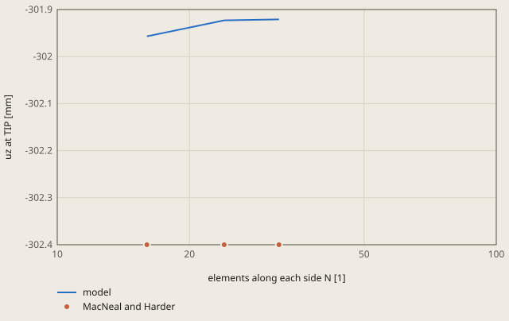

# Scordelis-Lo roof with S8R shells: derivation

## Conclusion

The S8R shell model gives the deflection of the middle of the free edge within 0.16 % of the published value. The model gives uz = -301.92 mm at TIP, and MacNeal and Harder (1985) give -302.4 mm. The difference is 0.48 mm, 16 % of the tolerance of 1 %.

**The deflection of the middle of the free edge against the mesh**



MacNeal and Harder: MacNeal and Harder (1985), the Scordelis-Lo roof, 0.3024 in the units of the paper

S8R shells. The value at N = 24, the mesh of the case, comes from this run. The other meshes come from the table of derivation.md, "Mesh convergence".

The run also solves a second roof, the former S6 mesh of `fh mesh --shell`, 40000 mm away in y. It gives uz = -301.54 mm at TIP_S6, 0.3 % from the published value. This checks the S6 shell path (see "S6 check of the shell path").

The mapped mesh is converged. The 16 x 16 mesh gives -0.15 %, and the 32 x 32 mesh gives -0.16 % (see "Mesh convergence"). The case mesh of 24 x 24 is 0.001 % from the 32 x 32 mesh.

## Result

**Pass.** A check passes when |computed - reference| ≤ rel_tol · |reference| + abs_tol, with rel_tol = 0.01 and abs_tol = 0.0 (`check.toml`). `fh validate` gives the computed values.

| Check | Unit | Computed | Reference | Difference | Tolerance | Margin |
| --- | ---: | ---: | ---: | ---: | ---: | ---: |
| `tip_deflection_z` | Not specified | -301.923 | -302.4 | +0.4765 (+0.157573 %) | 3.024 | 2.548 |
| `tip_deflection_z_s6` | Not specified | -301.535 | -302.4 | +0.8649 (+0.286012 %) | 3.024 | 2.159 |

Made by `scripts/validation-reports.py` on 2026-10-28, femahoy 5ac0a46.

This case checks the mapped `S8R` shell, the `S6` shell of `fh mesh --shell`, `*SHELL SECTION` and `ccx`.
The roof is a cylinder shell with a published deflection.

## Source

MacNeal, R.H. and Harder, R.L., "A proposed standard set of problems to test finite element
accuracy", Finite Elements in Analysis and Design 1 (1985), pages 3 to 20. The problem is the
Scordelis-Lo roof. The published target is a vertical deflection of 0.3024 at the middle of the
free edge. (The first solution of Scordelis and Lo gave 0.3086.)

## Data

The published problem has the units of its paper. This case uses mm and MPa. Every length is 1000
times larger, and the stress is the same ratio to the load. Thus the deflection is 1000 times
larger too: 0.3024 becomes 302.4 mm.

| Item | Published | This case |
|---|---|---|
| Radius R | 25 | 25000 mm |
| Length L | 50 | 50000 mm |
| Half angle | 40 degrees | 40 degrees |
| Thickness t | 0.25 | 250 mm |
| Young modulus E | 4.32E8 | 432 MPa |
| Poisson ratio | 0 | 0 |
| Self weight, per area of shell | 90 | 9.0E-5 MPa |

The weight ratio to E is the same in both columns: 90 / 4.32E8 = 9.0E-5 / 432 = 2.083E-7.
In the job, the weight is the density 3.6E-7 t/mm3 with gravity 1 mm/s2 in -z.
This gives 3.6E-7 x 1 x 250 = 9.0E-5 MPa.

## Model

Axes: x along the roof, z up, the axis of the cylinder is the x axis. The crown is at y = 0.
The model is the full roof. It has no symmetry plane, because a rotation constraint on
the mid-length plane made the roof 9 times too stiff in `ccx` (S6, uz = -34 mm).

- Each end (x = 0 and x = 50000) is a rigid diaphragm in its plane: uy = uz = 0, ux free.
- The 2 curved edges at y = +/-16069.7 mm are free.
- ux = 0 at the node TIP blocks the rigid motion along x. By symmetry, ux is 0 at TIP.
- TIP is the node at x = 25000, y = 16069.69 mm, z = 19151.11 mm, on the free edge at mid-length.

## Mesh of the case

Run `python3 mesh.py` to write `part.inp` from `mesh.geo` with gmsh.
The mesh has 24 elements along x and 24 elements across the circular section.
Two circular arcs share the crown. `Extrude`, `Layers` and `Recombine` form the shell faces.
`Mesh.ElementOrder=2` and `Mesh.SecondOrderIncomplete=1` produce 8-node quadrilaterals.
The middle nodes stay on the cylinder.
The mesh has 1825 nodes and 576 S8R elements.
`job.inp` includes `part.inp` and keeps the original material, constraints and gravity load.

Reason: The mapped audit mesh converges with 1825 nodes. The former S6 mesh needs 6033 nodes and gives -301.535 mm.

## S6 check of the shell path

`fh mesh --shell` writes `S6` elements, and the chat uses this path for a curved surface.
Reason: no other case solves an `S6` mesh with `ccx` against a reference.

`s6.inp` is the former mesh of the case. These commands made it from `part.py` and `part.step`:
```
fh-python part.py
fh mesh part.step --shell --size 1250 -o part.inp \
  --nodes END0=x:0 --nodes END1=x:50000 \
  --nodes TIP=point:25000,16069.69024216,19151.11107797
```
The former `part.py`, `part.step` and `part.inp` are in the git history before this change.
In `s6.inp`, each node and element number is 100000 higher, each set name has the suffix `_S6`, and y is 40000 mm higher.
Thus the 2 roofs share no node, and the 3D view shows them apart. The move in y does not change the load or the constraints.
`job.inp` gives `ALL_S6` the same section, constraints and gravity load as the S8R roof.

The mesh has 6033 nodes and 2948 S6 elements. The check `tip_deflection_z_s6` reads uz at `TIP_S6`.
`ccx` gives -301.535 mm, -0.28 % from the reference. The former S6 study gave -6.4 % at 5000 mm, -1.1 % at 2500 mm and -0.2 % at 625 mm.

## Mesh convergence

Run `python3 mesh.py N` for each even count N, then run `fh validate` on a copy of this case.
These results use gmsh 4.15.2 and CalculiX 2.23 on the Mac.

| N x N | Elements | Nodes | uz at TIP (mm) |
|---|---:|---:|---:|
| 16 x 16 | 256 | 833 | -301.9568 |
| 24 x 24, this case | 576 | 1825 | -301.9235 |
| 32 x 32 | 1024 | 3201 | -301.9209 |

The 24 x 24 result differs from the 32 x 32 result by 0.001 %.
The reference in `check.toml` is -302.4 mm. The case differs from the reference by -0.158 %.

## Tolerance

The tolerance stays at 1 percent for both checks. The published value has 4 digits.
The mapped mesh study gives a smaller error than the former S6 study.
The S6 check keeps its former tolerance: its mesh error is 0.3 percent, and the margin is for a change of mesh or solver version.
