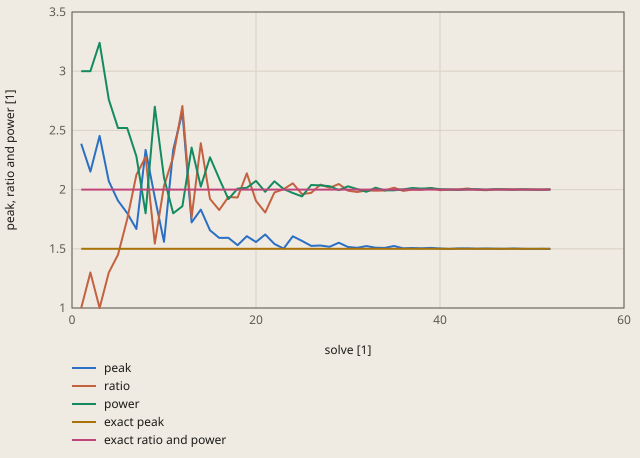
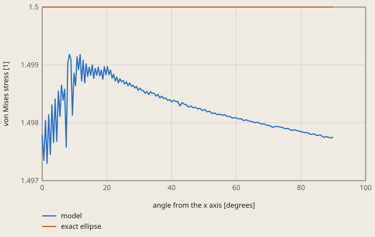

# shape-hole-biaxial derivation

## Conclusion

The shape loop of `fh run` finds the exact optimum hole, the ellipse with the axis ratio a/b = 2. The loop makes the peak stress a minimum. The peak stress is the largest von Mises stress on the hole edge. After 52 solves, the ratio is 2.00229 (+0.11 %), the power of the superellipse is 2.00061 (+0.03 %), and the peak stress is 1.49918 (-0.05 %). The tolerance is 0.5 %.

The loop starts at the rounded square with ratio 1 and power 3, with a peak of 2.39. The ratio and the power go to 2, and the peak goes to 1.5, the lowest peak of all hole shapes:

**The loop: each solve of the hole shape**

peak is the largest von Mises stress on the hole edge. The exact optimum is the ellipse with ratio 2 and power 2, and its peak 1.5 is the lowest peak of all hole shapes (derivation.md).

Values of the plot

Original values. — means no sample.

| solve [1] | peak (peak, ratio and power [1]) | ratio (peak, ratio and power [1]) | power (peak, ratio and power [1]) | exact peak (peak, ratio and power [1]) | exact ratio and power (peak, ratio and power [1]) |
| ---: | ---: | ---: | ---: | ---: | ---: |
| 1 | 2.38775 | 1 | 3 | 1.5 | 2 |
| 2 | 2.15224 | 1.3 | 3 | 1.5 | 2 |
| 3 | 2.45395 | 1 | 3.24 | 1.5 | 2 |
| 4 | 2.07098 | 1.3 | 2.76 | 1.5 | 2 |
| 5 | 1.90632 | 1.45 | 2.52 | 1.5 | 2 |
| 6 | 1.80163 | 1.75 | 2.52 | 1.5 | 2 |
| 7 | 1.6672 | 2.125 | 2.28 | 1.5 | 2 |
| 8 | 2.33547 | 2.275 | 1.8 | 1.5 | 2 |
| 9 | 1.9342 | 1.54375 | 2.7 | 1.5 | 2 |
| 10 | 1.5589 | 2.03125 | 2.1 | 1.5 | 2 |
| 11 | 2.33547 | 2.275 | 1.8 | 1.5 | 2 |
| 12 | 2.65217 | 2.70625 | 1.86 | 1.5 | 2 |
| 13 | 1.7232 | 1.76406 | 2.355 | 1.5 | 2 |
| 14 | 1.83137 | 2.39219 | 2.025 | 1.5 | 2 |
| 15 | 1.65589 | 1.92109 | 2.2725 | 1.5 | 2 |
| 16 | 1.59218 | 1.82734 | 2.0925 | 1.5 | 2 |
| 17 | 1.5929 | 1.9375 | 1.92 | 1.5 | 2 |
| 18 | 1.53026 | 1.9334 | 2.00813 | 1.5 | 2 |
| 19 | 1.60625 | 2.1373 | 2.01562 | 1.5 | 2 |
| 20 | 1.55765 | 1.90483 | 2.07328 | 1.5 | 2 |
| 21 | 1.62047 | 1.80698 | 1.98141 | 1.5 | 2 |
| 22 | 1.54138 | 1.97518 | 2.07035 | 1.5 | 2 |
| 23 | 1.50181 | 2.00375 | 2.0052 | 1.5 | 2 |
| 24 | 1.6058 | 2.0532 | 1.97115 | 1.5 | 2 |
| 25 | 1.56712 | 1.96196 | 1.94297 | 1.5 | 2 |
| 26 | 1.52435 | 1.97188 | 2.03851 | 1.5 | 2 |
| 27 | 1.52762 | 2.04223 | 2.03558 | 1.5 | 2 |
| 28 | 1.51672 | 2.01502 | 2.02871 | 1.5 | 2 |
| 29 | 1.55174 | 2.04689 | 1.9954 | 1.5 | 2 |
| 30 | 1.51562 | 1.99063 | 2.02773 | 1.5 | 2 |
| 31 | 1.50848 | 1.97936 | 2.00421 | 1.5 | 2 |
| 32 | 1.52297 | 1.99248 | 1.98168 | 1.5 | 2 |
| 33 | 1.50908 | 1.99109 | 2.01622 | 1.5 | 2 |
| 34 | 1.5079 | 1.99201 | 1.99319 | 1.5 | 2 |
| 35 | 1.52367 | 2.0164 | 1.99417 | 1.5 | 2 |
| 36 | 1.50436 | 1.98862 | 2.0017 | 1.5 | 2 |
| 37 | 1.50671 | 2.00035 | 2.01371 | 1.5 | 2 |
| 38 | 1.50391 | 1.99827 | 2.00858 | 1.5 | 2 |
| 39 | 1.50769 | 2.0134 | 2.01207 | 1.5 | 2 |
| 40 | 1.50227 | 1.99481 | 2.00429 | 1.5 | 2 |
| 41 | 1.49928 | 2.00029 | 2.00091 | 1.5 | 2 |
| 42 | 1.50325 | 2.00131 | 1.99708 | 1.5 | 2 |
| 43 | 1.50369 | 2.00923 | 2.00181 | 1.5 | 2 |
| 44 | 1.50107 | 1.99842 | 2.00367 | 1.5 | 2 |
| 45 | 1.50222 | 1.99496 | 1.99939 | 1.5 | 2 |
| 46 | 1.50087 | 2.00155 | 2.00374 | 1.5 | 2 |
| 47 | 1.49989 | 2.00343 | 2.00098 | 1.5 | 2 |
| 48 | 1.50215 | 2.00217 | 1.99815 | 1.5 | 2 |
| 49 | 1.50003 | 2.00171 | 2.00235 | 1.5 | 2 |
| 50 | 1.49949 | 2.00201 | 1.99955 | 1.5 | 2 |
| 51 | 1.5002 | 1.99888 | 1.99948 | 1.5 | 2 |
| 52 | 1.49918 | 2.00229 | 2.00061 | 1.5 | 2 |

The best hole has almost the same stress at each point of its edge. This agrees with Cherepanov (1974), who shows that the optimum hole has a constant hoop stress on its edge. At the nodes of the edge, the von Mises stress is between 1.4973 and 1.4992. The plate of half side 40 and the mesh make it a little lower than 1.5 (see "Tolerance").

**The stress on the edge of the best hole**

On the free edge, the von Mises stress is equal to the absolute value of the hoop stress. The model is between 1.4973 and 1.4992 at the nodes of the edge. The exact ellipse has the hoop stress sx + sy = 1.5 at each point of its edge (derivation.md).

Values of the plot

Original values. — means no sample.

| angle from the x axis [degrees] | model (von Mises stress [1]) | exact ellipse (von Mises stress [1]) |
| ---: | ---: | ---: |
| 0 | 1.49779 | 1.5 |
| 0.503 | 1.49735 | 1.5 |
| 1.006 | 1.49804 | 1.5 |
| 1.508 | 1.4973 | 1.5 |
| 2.009 | 1.49814 | 1.5 |
| 2.51 | 1.49745 | 1.5 |
| 3.009 | 1.49831 | 1.5 |
| 3.507 | 1.49766 | 1.5 |
| 4.004 | 1.49841 | 1.5 |
| 4.499 | 1.49768 | 1.5 |
| 4.992 | 1.49855 | 1.5 |
| 5.484 | 1.49811 | 1.5 |
| 5.974 | 1.49865 | 1.5 |
| 6.462 | 1.49839 | 1.5 |
| 6.949 | 1.49858 | 1.5 |
| 7.433 | 1.49758 | 1.5 |
| 7.916 | 1.49903 | 1.5 |
| 8.397 | 1.49918 | 1.5 |
| 8.876 | 1.4991 | 1.5 |
| 9.354 | 1.49813 | 1.5 |
| 9.83 | 1.49886 | 1.5 |
| 10.304 | 1.49864 | 1.5 |
| 10.778 | 1.49914 | 1.5 |
| 11.25 | 1.49892 | 1.5 |
| 11.721 | 1.49918 | 1.5 |
| 12.191 | 1.49872 | 1.5 |
| 12.66 | 1.49908 | 1.5 |
| 13.128 | 1.49869 | 1.5 |
| 13.596 | 1.49902 | 1.5 |
| 14.064 | 1.4988 | 1.5 |
| 14.531 | 1.49896 | 1.5 |
| 14.998 | 1.49882 | 1.5 |
| 15.465 | 1.499 | 1.5 |
| 15.932 | 1.49877 | 1.5 |
| 16.4 | 1.49894 | 1.5 |
| 16.868 | 1.49882 | 1.5 |
| 17.336 | 1.49896 | 1.5 |
| 17.806 | 1.49881 | 1.5 |
| 18.276 | 1.49891 | 1.5 |
| 18.747 | 1.49875 | 1.5 |
| 19.22 | 1.49897 | 1.5 |
| 19.693 | 1.49883 | 1.5 |
| 20.168 | 1.49897 | 1.5 |
| 20.645 | 1.49883 | 1.5 |
| 21.123 | 1.49891 | 1.5 |
| 21.604 | 1.49877 | 1.5 |
| 22.086 | 1.49884 | 1.5 |
| 22.571 | 1.49872 | 1.5 |
| 23.058 | 1.49879 | 1.5 |
| 23.547 | 1.49869 | 1.5 |
| 24.039 | 1.49876 | 1.5 |
| 24.533 | 1.49871 | 1.5 |
| 25.03 | 1.49873 | 1.5 |
| 25.531 | 1.49867 | 1.5 |
| 26.034 | 1.49871 | 1.5 |
| 26.541 | 1.49864 | 1.5 |
| 27.051 | 1.49869 | 1.5 |
| 27.565 | 1.49863 | 1.5 |
| 28.082 | 1.49865 | 1.5 |
| 28.603 | 1.4986 | 1.5 |
| 29.128 | 1.49863 | 1.5 |
| 29.657 | 1.49856 | 1.5 |
| 30.191 | 1.4986 | 1.5 |
| 30.728 | 1.49856 | 1.5 |
| 31.27 | 1.49856 | 1.5 |
| 31.817 | 1.49851 | 1.5 |
| 32.369 | 1.49854 | 1.5 |
| 32.925 | 1.49849 | 1.5 |
| 33.486 | 1.49854 | 1.5 |
| 34.053 | 1.49851 | 1.5 |
| 34.624 | 1.49851 | 1.5 |
| 35.201 | 1.49846 | 1.5 |
| 35.784 | 1.49849 | 1.5 |
| 36.373 | 1.49843 | 1.5 |
| 36.967 | 1.49846 | 1.5 |
| 37.567 | 1.49842 | 1.5 |
| 38.173 | 1.49843 | 1.5 |
| 38.786 | 1.49839 | 1.5 |
| 39.404 | 1.4984 | 1.5 |
| 40.029 | 1.49836 | 1.5 |
| 40.661 | 1.49839 | 1.5 |
| 41.299 | 1.49837 | 1.5 |
| 41.945 | 1.49837 | 1.5 |
| 42.597 | 1.49829 | 1.5 |
| 43.257 | 1.49835 | 1.5 |
| 43.923 | 1.49832 | 1.5 |
| 44.597 | 1.49831 | 1.5 |
| 45.278 | 1.49827 | 1.5 |
| 45.966 | 1.49829 | 1.5 |
| 46.663 | 1.49826 | 1.5 |
| 47.366 | 1.49827 | 1.5 |
| 48.078 | 1.49824 | 1.5 |
| 48.798 | 1.49825 | 1.5 |
| 49.526 | 1.49821 | 1.5 |
| 50.261 | 1.49823 | 1.5 |
| 51.005 | 1.49819 | 1.5 |
| 51.757 | 1.4982 | 1.5 |
| 52.517 | 1.49816 | 1.5 |
| 53.285 | 1.49817 | 1.5 |
| 54.062 | 1.49814 | 1.5 |
| 54.847 | 1.49815 | 1.5 |
| 55.641 | 1.49813 | 1.5 |
| 56.443 | 1.49814 | 1.5 |
| 57.253 | 1.49811 | 1.5 |
| 58.072 | 1.49811 | 1.5 |
| 58.899 | 1.49808 | 1.5 |
| 59.734 | 1.49809 | 1.5 |
| 60.578 | 1.49807 | 1.5 |
| 61.43 | 1.49807 | 1.5 |
| 62.29 | 1.49804 | 1.5 |
| 63.158 | 1.49805 | 1.5 |
| 64.035 | 1.49803 | 1.5 |
| 64.919 | 1.49802 | 1.5 |
| 65.811 | 1.498 | 1.5 |
| 66.711 | 1.49801 | 1.5 |
| 67.618 | 1.49798 | 1.5 |
| 68.532 | 1.49798 | 1.5 |
| 69.454 | 1.49796 | 1.5 |
| 70.382 | 1.49795 | 1.5 |
| 71.318 | 1.49792 | 1.5 |
| 72.26 | 1.49794 | 1.5 |
| 73.209 | 1.49793 | 1.5 |
| 74.163 | 1.49792 | 1.5 |
| 75.123 | 1.4979 | 1.5 |
| 76.089 | 1.4979 | 1.5 |
| 77.059 | 1.49787 | 1.5 |
| 78.035 | 1.49788 | 1.5 |
| 79.015 | 1.49786 | 1.5 |
| 80 | 1.49785 | 1.5 |
| 80.988 | 1.49783 | 1.5 |
| 81.981 | 1.49783 | 1.5 |
| 82.976 | 1.4978 | 1.5 |
| 83.974 | 1.49781 | 1.5 |
| 84.974 | 1.49778 | 1.5 |
| 85.976 | 1.49779 | 1.5 |
| 86.98 | 1.49775 | 1.5 |
| 87.985 | 1.49776 | 1.5 |
| 88.992 | 1.49774 | 1.5 |
| 90 | 1.49775 | 1.5 |

The von Mises stress on the edge of the best hole is almost the same from the x axis to the y axis. The peak is 1.4992 at 8.4 degrees from the x axis, and the value at the end of the y axis is 1.4977.

## Result

**Pass.** A check passes when |computed - reference| ≤ rel_tol · |reference| + abs_tol, with rel_tol = 0.005 and abs_tol = 0.0 (`check.toml`). `fh validate` gives the computed values.

| Check | Unit | Computed | Reference | Difference | Tolerance | Margin |
| --- | ---: | ---: | ---: | ---: | ---: | ---: |
| `ratio` | Not specified | 2.00229 | 2 | +0.0022905 (+0.114525 %) | 0.01 | 0.007709 |
| `power` | Not specified | 2.00061 | 2 | +0.000605917 (+0.0302959 %) | 0.01 | 0.009394 |
| `objective` | Not specified | 1.49918 | 1.5 | -0.000816864 (-0.0544576 %) | 0.0075 | 0.006683 |

Made by `scripts/validation-reports.py` on 2026-10-28, femahoy 9c54611.

This case checks the shape optimization loop of `fh run`: the hole of minimum stress concentration in a large plate under the biaxial remote stress sx = 1, sy = 0.5.
The exact optimum is known: the ellipse with the axis ratio a/b = sx/sy = 2. Its hoop stress is sx + sy = 1.5 at each point of the edge.
The loop changes 2 variables of a superellipse hole and finds the optimum in 52 solves.

## Source

- G. P. Cherepanov, "Inverse problems of the plane theory of elasticity", Journal of Applied Mathematics and Mechanics 38 (1974) 915-931. When the 2 remote stresses have the same sign, the hole of minimum stress concentration has a constant hoop stress on its edge (the equal-strength hole). For 1 hole, this hole is an ellipse with a/b = sx/sy.
- C. E. Inglis, "Stresses in a plate due to the presence of cracks and sharp corners", Transactions of the Institution of Naval Architects 55 (1913) 219-241. The hoop stress on the edge of an elliptical hole. At the end of the x axis (a, 0), it is sy (1 + 2 a/b) - sx. At the end of the y axis (0, b), it is sx (1 + 2 b/a) - sy.
- K. Bandara, T. Rüberg and F. Cirak, "Shape optimisation with multiresolution subdivision surfaces and immersed finite elements", Computer Methods in Applied Mechanics and Engineering 300 (2016) 510-539, https://doi.org/10.1016/j.cma.2015.11.015, section 5.1.2. The same problem is a benchmark of shape optimization. For the stress ratio 0.5, the aspect ratio of the result goes to the exact value when the plate becomes large.

No hole shape gives a peak below sx + sy. The sum sx + sy of the 2 normal stresses is a harmonic function in the plate. It goes to the remote value 1.5 far from the hole. On the free edge, it is equal to the hoop stress. Thus the hoop stress cannot be below 1.5 at all points of the edge, and its largest value is at least 1.5.

With sx = 1 and sy = 0.5:

| Hole | Peak of the hoop stress | Point |
|---|---:|---|
| Circle | 3 sx - sy = 2.5 | (0, R) |
| Ellipse with a/b = k, k < 2 | 0.5 + 2/k | (0, b) |
| Ellipse with a/b = k, k > 2 | k - 0.5 | (a, 0) |
| Ellipse with a/b = 2 | 1.5 | each point |

## Model

The case `L40` is a quarter of the plate. `mesh.geo` makes the mesh with gmsh, and `job.inp` is the CalculiX model.

| Item | Value |
|---|---|
| Hole | the superellipse \|x/a\|^power + \|y/b\|^power = 1 with a/b = ratio and a b = 1, a spline through 61 points |
| Plate | the square 0 <= x, y <= 40 (half side 40 = 40 times the radius of the circle with the same a b) |
| Mesh | 6-node plane stress triangles (`CPS6`), element size 0.025 + 0.15 d at the distance d from the hole, 2056 elements for the exact ellipse |
| Material | E = 1000, nu = 0.3, thickness 0.01 |
| Supports | ux = 0 on x = 0, uy = 0 on y = 0 (symmetry) |
| Load | the remote strain on the far edges: ux = 40 (sx - nu sy) / E = 0.034 on x = 40, uy = 40 (sy - nu sx) / E = 0.008 on y = 40 |
| Objective | the largest von Mises stress `MISES` at a node of the hole edge (node set `HOLE`) |

On the free edge, the von Mises stress is equal to the absolute value of the hoop stress.
`ccx` expands each plane stress element to a layer with the section thickness. A thick layer gets a stress SZZ that is not 0, and the circle then gives a peak 1.2 % too low. Thus the thickness is 0.01.
The far edges move. They do not get a pressure, because the gmsh `.inp` file has no element faces for `*DLOAD`. The 2 boundary conditions give the same stress far from the hole. The study of the plate size below shows that the difference near the hole decreases as 1/L^2, with L the half side of the plate.

## The loop

The loop of `fh` (`crates/fh/src/optimize.rs`) is the Nelder-Mead method on the variables `ratio` (1 to 4) and `power` (1.6 to 4), each scaled to 0 to 1. For each design:

1. gmsh meshes `mesh.geo` with `-setnumber ratio ... -setnumber power ...`.
2. `ccx` solves `job.inp`.
3. The objective is the largest `MISES` of the last frame of `job.frd` at the nodes of the set `HOLE`.

The first simplex has steps of 0.1 of each range. The loop stops when each point of the simplex is in 0.001 of the range from the best point. The start is the rounded square with ratio 1 and power 3 (peak 2.39).

## Check of the model

The circle and the exact ellipse (ratio 2, power 2), each in 1 solve:

| Half side of the plate | Elements of the ellipse | Circle | Ellipse | Error of the ellipse |
|---:|---:|---:|---:|---:|
| 10 | 1764 | 2.45005 | 1.48895 | -0.74 % |
| 20 | 1922 | 2.48672 | 1.49724 | -0.18 % |
| 40 (the case) | 2056 | 2.49607 | 1.49929 | -0.05 % |
| 80 | 2197 | 2.49846 | 1.49981 | -0.01 % |

Each time the plate size doubles, the error decreases by a factor of about 4. The circle and the ellipse go to the exact values 2.5 and 1.5.

The mesh at the half side 40:

| Element size at the edge | Elements of the ellipse | Circle | Ellipse |
|---:|---:|---:|---:|
| 0.05 | 1341 | 2.49450 | 1.49929 |
| 0.025 (the case) | 2056 | 2.49607 | 1.49929 |
| 0.0125 | 3292 | 2.49652 | 1.49930 |
| 0.00625 | 5731 | 2.49658 | 1.49931 |

At the optimum, the mesh changes the peak by less than 0.01 %.

Near the optimum, the peak is the larger value of the 2 axis ends. Thus the objective is not smooth at the optimum:

| Ratio | Power | Peak | Inglis |
|---:|---:|---:|---:|
| 1.98 | 2 | 1.50937 | 1.51010 |
| 2 | 2 | 1.49929 | 1.5 |
| 2.02 | 2 | 1.51646 | 1.52 |
| 2 | 1.95 | 1.59378 | |
| 2 | 2.05 | 1.52832 | |

The peak increases by 0.5 to 0.86 per unit of ratio and by 0.58 to 1.9 per unit of power.

## Check of the loop

| Start (ratio, power) | Solves | Ratio | Power | Peak |
|---|---:|---:|---:|---:|
| 1, 3 (the case) | 52 | 2.00229 | 2.00061 | 1.49918 |
| 3, 2.5 | 52 | 2.00024 | 2.00000 | 1.49917 |

A Python copy of the loop with the same steps gave the same values to all digits.
The 2 starts have a ratio below and above the optimum. Both find the ellipse with a/b = 2.

## Tolerance

The tolerance is `rel_tol = 0.005` and `abs_tol = 0`.

| Error | Ratio | Power | Peak |
|---|---:|---:|---:|
| Stop rule: 0.001 of the range 3 of ratio and 2.4 of power | 0.15 % | 0.12 % | at most +0.5 % |
| Plate of half side 40 | about 0.1 % | about 0.1 % | -0.05 % |
| Mesh | below 0.01 % | below 0.01 % | below 0.01 % |
| Sum | at most 0.25 % | at most 0.25 % | -0.06 % to +0.5 % |

- The stop rule: at the stop, the best point is about 0.003 in ratio and 0.0024 in power from the optimum. With the slopes of the table above (at most 1 and 1.9), the peak is at most 0.0076 above the minimum, 0.5 %.
- The plate: the finite plate changes the 2 axis ends by different values. At the half side 40, the end (a, 0) is about 0.2 % low and the end (0, b) is about 0.05 % low. The 2 ends are equal at a ratio about 0.1 % above 2.
- The check value of the peak is the exact 1.5. The model gives 1.49929 for the exact ellipse, 0.05 % below. A peak below 1.5 comes from the plate and the mesh only.

The case gives ratio 2.00229 (0.11 %), power 2.00061 (0.03 %) and peak 1.49918 (-0.05 %).
A wrong method gives a larger difference: the circle gives 2.5, 67 % above the check value, and the start design gives 2.39.

## Run time

The loop solves the model 53 times: 52 designs and 1 more solve of the best design with the 3D output for the page. Each solve takes about 1.5 s. On a Mac with 10 cores and a high load from other programs, `fh validate` took 79 s for this case.
