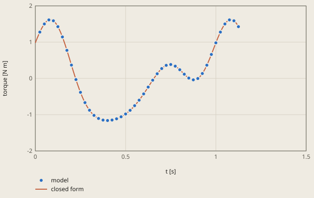
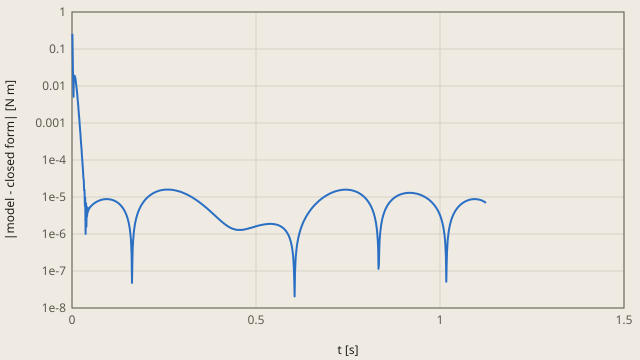

# slider-crank derivation

## Conclusion

The Chrono model gives the closed-form motor torque and slider position of the slider-crank. At the check time t = 1.125 s, the torque of the model is 1.4269621 N m and the closed form is 1.42695517 N m. The difference is 6.9e-6 N m, 5 % of the tolerance. The slider position of the model is 0.362258273 m, equal to the closed form to the 9 decimals of the output.

**The motor torque against the time**



model: Chrono, each 25th time step of 1 ms

The crank turns at 60 rpm from the dead centre. The checks read the values at t = 1.125 s, when the crank is at 45 degrees after 2.25 turns.

<details><summary>Values of the plot</summary>

Original values. — means no sample.

| t [s] | model (torque [N m]) | closed form (torque [N m]) |
| ---: | ---: | ---: |
| 0 | — | 0.981 |
| 0.001 | — | 0.993658216 |
| 0.002 | — | 1.00627446 |
| 0.003 | — | 1.01884547 |
| 0.004 | — | 1.03136802 |
| 0.005 | — | 1.04383887 |
| 0.006 | — | 1.05625477 |
| 0.007 | — | 1.06861251 |
| 0.008 | — | 1.08090886 |
| 0.009 | — | 1.09314062 |
| 0.01 | — | 1.10530456 |
| 0.011 | — | 1.11739751 |
| 0.012 | — | 1.12941627 |
| 0.013 | — | 1.14135767 |
| 0.014 | — | 1.15321854 |
| 0.015 | — | 1.16499575 |
| 0.016 | — | 1.17668616 |
| 0.017 | — | 1.18828664 |
| 0.018 | — | 1.19979409 |
| 0.019 | — | 1.21120543 |
| 0.02 | — | 1.22251758 |
| 0.021 | — | 1.23372749 |
| 0.022 | — | 1.24483212 |
| 0.023 | — | 1.25582846 |
| 0.024 | — | 1.26671353 |
| 0.025 | 1.27723065 | 1.27748434 |
| 0.026 | — | 1.28813794 |
| 0.027 | — | 1.29867142 |
| 0.028 | — | 1.30908187 |
| 0.029 | — | 1.3193664 |
| 0.03 | — | 1.32952217 |
| 0.031 | — | 1.33954636 |
| 0.032 | — | 1.34943616 |
| 0.033 | — | 1.3591888 |
| 0.034 | — | 1.36880154 |
| 0.035 | — | 1.37827167 |
| 0.036 | — | 1.38759651 |
| 0.037 | — | 1.3967734 |
| 0.038 | — | 1.40579973 |
| 0.039 | — | 1.4146729 |
| 0.04 | — | 1.42339038 |
| 0.041 | — | 1.43194963 |
| 0.042 | — | 1.44034817 |
| 0.043 | — | 1.44858356 |
| 0.044 | — | 1.45665338 |
| 0.045 | — | 1.46455525 |
| 0.046 | — | 1.47228684 |
| 0.047 | — | 1.47984585 |
| 0.048 | — | 1.48723001 |
| 0.049 | — | 1.49443711 |
| 0.05 | 1.50147043 | 1.50146496 |
| 0.051 | — | 1.50831142 |
| 0.052 | — | 1.5149744 |
| 0.053 | — | 1.52145184 |
| 0.054 | — | 1.52774173 |
| 0.055 | — | 1.53384209 |
| 0.056 | — | 1.53975101 |
| 0.057 | — | 1.54546659 |
| 0.058 | — | 1.550987 |
| 0.059 | — | 1.55631046 |
| 0.06 | — | 1.56143522 |
| 0.061 | — | 1.56635958 |
| 0.062 | — | 1.57108189 |
| 0.063 | — | 1.57560056 |
| 0.064 | — | 1.57991402 |
| 0.065 | — | 1.58402077 |
| 0.066 | — | 1.58791937 |
| 0.067 | — | 1.5916084 |
| 0.068 | — | 1.5950865 |
| 0.069 | — | 1.59835238 |
| 0.07 | — | 1.60140479 |
| 0.071 | — | 1.60424251 |
| 0.072 | — | 1.60686441 |
| 0.073 | — | 1.60926938 |
| 0.074 | — | 1.61145638 |
| 0.075 | 1.6134325 | 1.61342442 |
| 0.076 | — | 1.61517256 |
| 0.077 | — | 1.61669992 |
| 0.078 | — | 1.61800566 |
| 0.079 | — | 1.61908902 |
| 0.08 | — | 1.61994927 |
| 0.081 | — | 1.62058575 |
| 0.082 | — | 1.62099784 |
| 0.083 | — | 1.62118499 |
| 0.084 | — | 1.6211467 |
| 0.085 | — | 1.62088253 |
| 0.086 | — | 1.62039209 |
| 0.087 | — | 1.61967504 |
| 0.088 | — | 1.61873111 |
| 0.089 | — | 1.61756008 |
| 0.09 | — | 1.61616179 |
| 0.091 | — | 1.61453614 |
| 0.092 | — | 1.61268307 |
| 0.093 | — | 1.61060259 |
| 0.094 | — | 1.60829476 |
| 0.095 | — | 1.60575971 |
| 0.096 | — | 1.60299762 |
| 0.097 | — | 1.60000871 |
| 0.098 | — | 1.59679329 |
| 0.099 | — | 1.5933517 |
| 0.1 | 1.58969305 | 1.58968435 |
| 0.101 | — | 1.58579169 |
| 0.102 | — | 1.58167425 |
| 0.103 | — | 1.57733259 |
| 0.104 | — | 1.57276737 |
| 0.105 | — | 1.56797925 |
| 0.106 | — | 1.56296898 |
| 0.107 | — | 1.55773736 |
| 0.108 | — | 1.55228526 |
| 0.109 | — | 1.54661356 |
| 0.11 | — | 1.54072325 |
| 0.111 | — | 1.53461534 |
| 0.112 | — | 1.5282909 |
| 0.113 | — | 1.52175107 |
| 0.114 | — | 1.51499702 |
| 0.115 | — | 1.50802999 |
| 0.116 | — | 1.50085128 |
| 0.117 | — | 1.49346221 |
| 0.118 | — | 1.48586419 |
| 0.119 | — | 1.47805866 |
| 0.12 | — | 1.47004712 |
| 0.121 | — | 1.46183111 |
| 0.122 | — | 1.45341224 |
| 0.123 | — | 1.44479215 |
| 0.124 | — | 1.43597255 |
| 0.125 | 1.4269621 | 1.42695517 |
| 0.126 | — | 1.41774182 |
| 0.127 | — | 1.40833434 |
| 0.128 | — | 1.39873461 |
| 0.129 | — | 1.38894459 |
| 0.13 | — | 1.37896624 |
| 0.131 | — | 1.3688016 |
| 0.132 | — | 1.35845274 |
| 0.133 | — | 1.34792179 |
| 0.134 | — | 1.33721089 |
| 0.135 | — | 1.32632225 |
| 0.136 | — | 1.31525812 |
| 0.137 | — | 1.30402079 |
| 0.138 | — | 1.29261257 |
| 0.139 | — | 1.28103584 |
| 0.14 | — | 1.269293 |
| 0.141 | — | 1.25738649 |
| 0.142 | — | 1.2453188 |
| 0.143 | — | 1.23309243 |
| 0.144 | — | 1.22070994 |
| 0.145 | — | 1.20817392 |
| 0.146 | — | 1.19548698 |
| 0.147 | — | 1.18265177 |
| 0.148 | — | 1.16967098 |
| 0.149 | — | 1.15654733 |
| 0.15 | 1.1432864 | 1.14328355 |
| 0.151 | — | 1.12988242 |
| 0.152 | — | 1.11634674 |
| 0.153 | — | 1.10267934 |
| 0.154 | — | 1.08888307 |
| 0.155 | — | 1.07496081 |
| 0.156 | — | 1.06091547 |
| 0.157 | — | 1.04674997 |
| 0.158 | — | 1.03246725 |
| 0.159 | — | 1.01807029 |
| 0.16 | — | 1.00356207 |
| 0.161 | — | 0.988945595 |
| 0.162 | — | 0.974223898 |
| 0.163 | — | 0.959400016 |
| 0.164 | — | 0.944477005 |
| 0.165 | — | 0.929457935 |
| 0.166 | — | 0.91434589 |
| 0.167 | — | 0.899143967 |
| 0.168 | — | 0.883855272 |
| 0.169 | — | 0.868482922 |
| 0.17 | — | 0.853030044 |
| 0.171 | — | 0.83749977 |
| 0.172 | — | 0.821895242 |
| 0.173 | — | 0.806219605 |
| 0.174 | — | 0.790476008 |
| 0.175 | 0.774664832 | 0.774667605 |
| 0.176 | — | 0.758797552 |
| 0.177 | — | 0.742869004 |
| 0.178 | — | 0.726885118 |
| 0.179 | — | 0.710849049 |
| 0.18 | — | 0.694763949 |
| 0.181 | — | 0.678632968 |
| 0.182 | — | 0.662459249 |
| 0.183 | — | 0.646245931 |
| 0.184 | — | 0.629996148 |
| 0.185 | — | 0.613713021 |
| 0.186 | — | 0.597399667 |
| 0.187 | — | 0.581059191 |
| 0.188 | — | 0.564694685 |
| 0.189 | — | 0.548309233 |
| 0.19 | — | 0.531905901 |
| 0.191 | — | 0.515487745 |
| 0.192 | — | 0.499057802 |
| 0.193 | — | 0.482619095 |
| 0.194 | — | 0.466174628 |
| 0.195 | — | 0.449727388 |
| 0.196 | — | 0.433280341 |
| 0.197 | — | 0.416836435 |
| 0.198 | — | 0.400398593 |
| 0.199 | — | 0.38396972 |
| 0.2 | 0.367544042 | 0.367552693 |
| 0.201 | — | 0.351150369 |
| 0.202 | — | 0.334765577 |
| 0.203 | — | 0.318401122 |
| 0.204 | — | 0.302059781 |
| 0.205 | — | 0.285744303 |
| 0.206 | — | 0.269457408 |
| 0.207 | — | 0.253201789 |
| 0.208 | — | 0.236980106 |
| 0.209 | — | 0.220794989 |
| 0.21 | — | 0.204649036 |
| 0.211 | — | 0.188544814 |
| 0.212 | — | 0.172484854 |
| 0.213 | — | 0.156471654 |
| 0.214 | — | 0.140507679 |
| 0.215 | — | 0.124595357 |
| 0.216 | — | 0.108737079 |
| 0.217 | — | 0.092935201 |
| 0.218 | — | 0.0771920419 |
| 0.219 | — | 0.0615098818 |
| 0.22 | — | 0.0458909628 |
| 0.221 | — | 0.0303374879 |
| 0.222 | — | 0.0148516209 |
| 0.223 | — | -0.000564514545 |
| 0.224 | — | -0.0159088351 |
| 0.225 | -0.0311926167 | -0.0311792984 |
| 0.226 | — | -0.0463739031 |
| 0.227 | — | -0.0614906897 |
| 0.228 | — | -0.0765277407 |
| 0.229 | — | -0.0914831811 |
| 0.23 | — | -0.106355178 |
| 0.231 | — | -0.121141943 |
| 0.232 | — | -0.135841729 |
| 0.233 | — | -0.150452833 |
| 0.234 | — | -0.164973597 |
| 0.235 | — | -0.179402406 |
| 0.236 | — | -0.193737689 |
| 0.237 | — | -0.207977919 |
| 0.238 | — | -0.222121614 |
| 0.239 | — | -0.236167337 |
| 0.24 | — | -0.250113693 |
| 0.241 | — | -0.263959335 |
| 0.242 | — | -0.277702959 |
| 0.243 | — | -0.291343305 |
| 0.244 | — | -0.304879159 |
| 0.245 | — | -0.318309351 |
| 0.246 | — | -0.331632754 |
| 0.247 | — | -0.344848289 |
| 0.248 | — | -0.357954918 |
| 0.249 | — | -0.370951648 |
| 0.25 | -0.383853211 | -0.383837531 |
| 0.251 | — | -0.396611662 |
| 0.252 | — | -0.40927318 |
| 0.253 | — | -0.421821267 |
| 0.254 | — | -0.434255149 |
| 0.255 | — | -0.446574094 |
| 0.256 | — | -0.458777413 |
| 0.257 | — | -0.470864459 |
| 0.258 | — | -0.482834627 |
| 0.259 | — | -0.494687355 |
| 0.26 | — | -0.506422121 |
| 0.261 | — | -0.518038444 |
| 0.262 | — | -0.529535883 |
| 0.263 | — | -0.540914039 |
| 0.264 | — | -0.552172551 |
| 0.265 | — | -0.563311097 |
| 0.266 | — | -0.574329396 |
| 0.267 | — | -0.585227203 |
| 0.268 | — | -0.596004311 |
| 0.269 | — | -0.606660551 |
| 0.27 | — | -0.617195792 |
| 0.271 | — | -0.627609937 |
| 0.272 | — | -0.637902925 |
| 0.273 | — | -0.648074732 |
| 0.274 | — | -0.658125366 |
| 0.275 | -0.668070328 | -0.668054872 |
| 0.276 | — | -0.677863325 |
| 0.277 | — | -0.687550836 |
| 0.278 | — | -0.697117546 |
| 0.279 | — | -0.706563627 |
| 0.28 | — | -0.715889286 |
| 0.281 | — | -0.725094755 |
| 0.282 | — | -0.734180299 |
| 0.283 | — | -0.743146212 |
| 0.284 | — | -0.751992815 |
| 0.285 | — | -0.760720457 |
| 0.286 | — | -0.769329514 |
| 0.287 | — | -0.77782039 |
| 0.288 | — | -0.786193512 |
| 0.289 | — | -0.794449334 |
| 0.29 | — | -0.802588333 |
| 0.291 | — | -0.810611011 |
| 0.292 | — | -0.818517893 |
| 0.293 | — | -0.826309524 |
| 0.294 | — | -0.833986473 |
| 0.295 | — | -0.84154933 |
| 0.296 | — | -0.848998702 |
| 0.297 | — | -0.85633522 |
| 0.298 | — | -0.86355953 |
| 0.299 | — | -0.8706723 |
| 0.3 | -0.877687425 | -0.877674211 |
| 0.301 | — | -0.884565964 |
| 0.302 | — | -0.891348275 |
| 0.303 | — | -0.898021876 |
| 0.304 | — | -0.904587514 |
| 0.305 | — | -0.911045948 |
| 0.306 | — | -0.917397953 |
| 0.307 | — | -0.923644316 |
| 0.308 | — | -0.929785835 |
| 0.309 | — | -0.935823322 |
| 0.31 | — | -0.941757596 |
| 0.311 | — | -0.947589491 |
| 0.312 | — | -0.953319846 |
| 0.313 | — | -0.958949511 |
| 0.314 | — | -0.964479346 |
| 0.315 | — | -0.969910217 |
| 0.316 | — | -0.975242995 |
| 0.317 | — | -0.980478562 |
| 0.318 | — | -0.985617803 |
| 0.319 | — | -0.99066161 |
| 0.32 | — | -0.995610878 |
| 0.321 | — | -1.00046651 |
| 0.322 | — | -1.0052294 |
| 0.323 | — | -1.00990047 |
| 0.324 | — | -1.01448062 |
| 0.325 | -1.01898075 | -1.01897077 |
| 0.326 | — | -1.02337182 |
| 0.327 | — | -1.0276847 |
| 0.328 | — | -1.03191031 |
| 0.329 | — | -1.03604958 |
| 0.33 | — | -1.04010342 |
| 0.331 | — | -1.04407275 |
| 0.332 | — | -1.04795847 |
| 0.333 | — | -1.0517615 |
| 0.334 | — | -1.05548274 |
| 0.335 | — | -1.05912312 |
| 0.336 | — | -1.06268352 |
| 0.337 | — | -1.06616485 |
| 0.338 | — | -1.06956801 |
| 0.339 | — | -1.07289389 |
| 0.34 | — | -1.07614337 |
| 0.341 | — | -1.07931735 |
| 0.342 | — | -1.0824167 |
| 0.343 | — | -1.0854423 |
| 0.344 | — | -1.088395 |
| 0.345 | — | -1.09127568 |
| 0.346 | — | -1.09408519 |
| 0.347 | — | -1.09682437 |
| 0.348 | — | -1.09949407 |
| 0.349 | — | -1.10209512 |
| 0.35 | -1.1046351 | -1.10462835 |
| 0.351 | — | -1.10709457 |
| 0.352 | — | -1.1094946 |
| 0.353 | — | -1.11182925 |
| 0.354 | — | -1.11409929 |
| 0.355 | — | -1.11630553 |
| 0.356 | — | -1.11844873 |
| 0.357 | — | -1.12052966 |
| 0.358 | — | -1.12254909 |
| 0.359 | — | -1.12450775 |
| 0.36 | — | -1.1264064 |
| 0.361 | — | -1.12824576 |
| 0.362 | — | -1.13002655 |
| 0.363 | — | -1.13174947 |
| 0.364 | — | -1.13341524 |
| 0.365 | — | -1.13502454 |
| 0.366 | — | -1.13657805 |
| 0.367 | — | -1.13807644 |
| 0.368 | — | -1.13952036 |
| 0.369 | — | -1.14091047 |
| 0.37 | — | -1.14224741 |
| 0.371 | — | -1.14353179 |
| 0.372 | — | -1.14476423 |
| 0.373 | — | -1.14594535 |
| 0.374 | — | -1.14707573 |
| 0.375 | -1.14816013 | -1.14815595 |
| 0.376 | — | -1.14918659 |
| 0.377 | — | -1.15016822 |
| 0.378 | — | -1.15110137 |
| 0.379 | — | -1.15198659 |
| 0.38 | — | -1.15282441 |
| 0.381 | — | -1.15361535 |
| 0.382 | — | -1.1543599 |
| 0.383 | — | -1.15505857 |
| 0.384 | — | -1.15571184 |
| 0.385 | — | -1.15632018 |
| 0.386 | — | -1.15688405 |
| 0.387 | — | -1.15740391 |
| 0.388 | — | -1.1578802 |
| 0.389 | — | -1.15831334 |
| 0.39 | — | -1.15870376 |
| 0.391 | — | -1.15905186 |
| 0.392 | — | -1.15935803 |
| 0.393 | — | -1.15962268 |
| 0.394 | — | -1.15984617 |
| 0.395 | — | -1.16002886 |
| 0.396 | — | -1.16017112 |
| 0.397 | — | -1.16027329 |
| 0.398 | — | -1.1603357 |
| 0.399 | — | -1.16035868 |
| 0.4 | -1.16034502 | -1.16034254 |
| 0.401 | — | -1.16028759 |
| 0.402 | — | -1.16019412 |
| 0.403 | — | -1.16006242 |
| 0.404 | — | -1.15989275 |
| 0.405 | — | -1.1596854 |
| 0.406 | — | -1.1594406 |
| 0.407 | — | -1.15915862 |
| 0.408 | — | -1.15883968 |
| 0.409 | — | -1.15848402 |
| 0.41 | — | -1.15809185 |
| 0.411 | — | -1.15766338 |
| 0.412 | — | -1.15719882 |
| 0.413 | — | -1.15669835 |
| 0.414 | — | -1.15616217 |
| 0.415 | — | -1.15559044 |
| 0.416 | — | -1.15498333 |
| 0.417 | — | -1.154341 |
| 0.418 | — | -1.15366361 |
| 0.419 | — | -1.15295128 |
| 0.42 | — | -1.15220417 |
| 0.421 | — | -1.15142239 |
| 0.422 | — | -1.15060607 |
| 0.423 | — | -1.14975531 |
| 0.424 | — | -1.14887022 |
| 0.425 | -1.14795248 | -1.1479509 |
| 0.426 | — | -1.14699743 |
| 0.427 | — | -1.1460099 |
| 0.428 | — | -1.14498839 |
| 0.429 | — | -1.14393296 |
| 0.43 | — | -1.14284367 |
| 0.431 | — | -1.14172059 |
| 0.432 | — | -1.14056376 |
| 0.433 | — | -1.13937323 |
| 0.434 | — | -1.13814902 |
| 0.435 | — | -1.13689118 |
| 0.436 | — | -1.13559973 |
| 0.437 | — | -1.13427469 |
| 0.438 | — | -1.13291607 |
| 0.439 | — | -1.13152388 |
| 0.44 | — | -1.13009812 |
| 0.441 | — | -1.12863879 |
| 0.442 | — | -1.12714589 |
| 0.443 | — | -1.12561941 |
| 0.444 | — | -1.12405931 |
| 0.445 | — | -1.1224656 |
| 0.446 | — | -1.12083823 |
| 0.447 | — | -1.11917718 |
| 0.448 | — | -1.11748241 |
| 0.449 | — | -1.11575388 |
| 0.45 | -1.11399284 | -1.11399155 |
| 0.451 | — | -1.11219538 |
| 0.452 | — | -1.11036531 |
| 0.453 | — | -1.10850128 |
| 0.454 | — | -1.10660324 |
| 0.455 | — | -1.10467113 |
| 0.456 | — | -1.10270488 |
| 0.457 | — | -1.10070442 |
| 0.458 | — | -1.09866969 |
| 0.459 | — | -1.0966006 |
| 0.46 | — | -1.09449708 |
| 0.461 | — | -1.09235905 |
| 0.462 | — | -1.09018642 |
| 0.463 | — | -1.08797912 |
| 0.464 | — | -1.08573705 |
| 0.465 | — | -1.08346012 |
| 0.466 | — | -1.08114824 |
| 0.467 | — | -1.07880132 |
| 0.468 | — | -1.07641926 |
| 0.469 | — | -1.07400196 |
| 0.47 | — | -1.07154932 |
| 0.471 | — | -1.06906124 |
| 0.472 | — | -1.06653761 |
| 0.473 | — | -1.06397834 |
| 0.474 | — | -1.06138332 |
| 0.475 | -1.0587538 | -1.05875243 |
| 0.476 | — | -1.05608557 |
| 0.477 | — | -1.05338264 |
| 0.478 | — | -1.05064352 |
| 0.479 | — | -1.0478681 |
| 0.48 | — | -1.04505626 |
| 0.481 | — | -1.04220791 |
| 0.482 | — | -1.03932292 |
| 0.483 | — | -1.03640118 |
| 0.484 | — | -1.03344258 |
| 0.485 | — | -1.030447 |
| 0.486 | — | -1.02741434 |
| 0.487 | — | -1.02434448 |
| 0.488 | — | -1.0212373 |
| 0.489 | — | -1.01809269 |
| 0.49 | — | -1.01491054 |
| 0.491 | — | -1.01169074 |
| 0.492 | — | -1.00843317 |
| 0.493 | — | -1.00513773 |
| 0.494 | — | -1.00180431 |
| 0.495 | — | -0.998432787 |
| 0.496 | — | -0.995023062 |
| 0.497 | — | -0.991575027 |
| 0.498 | — | -0.988088575 |
| 0.499 | — | -0.9845636 |
| 0.5 | -0.981001612 | -0.981 |
| 0.501 | — | -0.977397671 |
| 0.502 | — | -0.973756514 |
| 0.503 | — | -0.970076428 |
| 0.504 | — | -0.966357317 |
| 0.505 | — | -0.962599085 |
| 0.506 | — | -0.958801638 |
| 0.507 | — | -0.954964884 |
| 0.508 | — | -0.951088735 |
| 0.509 | — | -0.947173102 |
| 0.51 | — | -0.943217901 |
| 0.511 | — | -0.939223049 |
| 0.512 | — | -0.935188466 |
| 0.513 | — | -0.931114075 |
| 0.514 | — | -0.9269998 |
| 0.515 | — | -0.92284557 |
| 0.516 | — | -0.918651316 |
| 0.517 | — | -0.914416971 |
| 0.518 | — | -0.910142472 |
| 0.519 | — | -0.905827761 |
| 0.52 | — | -0.90147278 |
| 0.521 | — | -0.897077476 |
| 0.522 | — | -0.892641799 |
| 0.523 | — | -0.888165704 |
| 0.524 | — | -0.883649149 |
| 0.525 | -0.879093927 | -0.879092095 |
| 0.526 | — | -0.874494507 |
| 0.527 | — | -0.869856354 |
| 0.528 | — | -0.865177612 |
| 0.529 | — | -0.860458256 |
| 0.53 | — | -0.85569827 |
| 0.531 | — | -0.850897639 |
| 0.532 | — | -0.846056355 |
| 0.533 | — | -0.841174414 |
| 0.534 | — | -0.836251816 |
| 0.535 | — | -0.831288567 |
| 0.536 | — | -0.826284676 |
| 0.537 | — | -0.821240159 |
| 0.538 | — | -0.816155036 |
| 0.539 | — | -0.811029334 |
| 0.54 | — | -0.805863083 |
| 0.541 | — | -0.80065632 |
| 0.542 | — | -0.795409087 |
| 0.543 | — | -0.790121433 |
| 0.544 | — | -0.78479341 |
| 0.545 | — | -0.77942508 |
| 0.546 | — | -0.774016508 |
| 0.547 | — | -0.768567766 |
| 0.548 | — | -0.763078931 |
| 0.549 | — | -0.75755009 |
| 0.55 | -0.751983172 | -0.751981333 |
| 0.551 | — | -0.746372757 |
| 0.552 | — | -0.740724468 |
| 0.553 | — | -0.735036578 |
| 0.554 | — | -0.729309203 |
| 0.555 | — | -0.723542471 |
| 0.556 | — | -0.717736514 |
| 0.557 | — | -0.711891471 |
| 0.558 | — | -0.706007491 |
| 0.559 | — | -0.700084729 |
| 0.56 | — | -0.694123346 |
| 0.561 | — | -0.688123515 |
| 0.562 | — | -0.682085414 |
| 0.563 | — | -0.676009228 |
| 0.564 | — | -0.669895154 |
| 0.565 | — | -0.663743393 |
| 0.566 | — | -0.657554158 |
| 0.567 | — | -0.651327669 |
| 0.568 | — | -0.645064153 |
| 0.569 | — | -0.63876385 |
| 0.57 | — | -0.632427004 |
| 0.571 | — | -0.626053872 |
| 0.572 | — | -0.619644717 |
| 0.573 | — | -0.613199814 |
| 0.574 | — | -0.606719446 |
| 0.575 | -0.600205319 | -0.600203905 |
| 0.576 | — | -0.593653494 |
| 0.577 | — | -0.587068525 |
| 0.578 | — | -0.580449319 |
| 0.579 | — | -0.573796209 |
| 0.58 | — | -0.567109536 |
| 0.581 | — | -0.560389652 |
| 0.582 | — | -0.553636921 |
| 0.583 | — | -0.546851714 |
| 0.584 | — | -0.540034416 |
| 0.585 | — | -0.533185421 |
| 0.586 | — | -0.526305133 |
| 0.587 | — | -0.519393969 |
| 0.588 | — | -0.512452355 |
| 0.589 | — | -0.505480729 |
| 0.59 | — | -0.498479541 |
| 0.591 | — | -0.491449251 |
| 0.592 | — | -0.484390332 |
| 0.593 | — | -0.477303266 |
| 0.594 | — | -0.470188549 |
| 0.595 | — | -0.463046688 |
| 0.596 | — | -0.455878202 |
| 0.597 | — | -0.448683622 |
| 0.598 | — | -0.441463489 |
| 0.599 | — | -0.43421836 |
| 0.6 | -0.426949106 | -0.426948801 |
| 0.601 | — | -0.419655391 |
| 0.602 | — | -0.412338723 |
| 0.603 | — | -0.4049994 |
| 0.604 | — | -0.39763804 |
| 0.605 | — | -0.390255272 |
| 0.606 | — | -0.382851737 |
| 0.607 | — | -0.375428091 |
| 0.608 | — | -0.367985001 |
| 0.609 | — | -0.360523148 |
| 0.61 | — | -0.353043225 |
| 0.611 | — | -0.345545938 |
| 0.612 | — | -0.338032008 |
| 0.613 | — | -0.330502165 |
| 0.614 | — | -0.322957157 |
| 0.615 | — | -0.315397742 |
| 0.616 | — | -0.307824691 |
| 0.617 | — | -0.30023879 |
| 0.618 | — | -0.292640837 |
| 0.619 | — | -0.285031643 |
| 0.62 | — | -0.277412035 |
| 0.621 | — | -0.269782848 |
| 0.622 | — | -0.262144936 |
| 0.623 | — | -0.254499162 |
| 0.624 | — | -0.246846404 |
| 0.625 | -0.239185844 | -0.239187554 |
| 0.626 | — | -0.231523515 |
| 0.627 | — | -0.223855205 |
| 0.628 | — | -0.216183553 |
| 0.629 | — | -0.208509505 |
| 0.63 | — | -0.200834015 |
| 0.631 | — | -0.193158055 |
| 0.632 | — | -0.185482605 |
| 0.633 | — | -0.177808661 |
| 0.634 | — | -0.170137231 |
| 0.635 | — | -0.162469336 |
| 0.636 | — | -0.154806009 |
| 0.637 | — | -0.147148294 |
| 0.638 | — | -0.13949725 |
| 0.639 | — | -0.131853948 |
| 0.64 | — | -0.124219468 |
| 0.641 | — | -0.116594905 |
| 0.642 | — | -0.108981366 |
| 0.643 | — | -0.101379966 |
| 0.644 | — | -0.0937918354 |
| 0.645 | — | -0.0862181142 |
| 0.646 | — | -0.0786599533 |
| 0.647 | — | -0.0711185151 |
| 0.648 | — | -0.0635949724 |
| 0.649 | — | -0.0560905084 |
| 0.65 | -0.0486016066 | -0.0486063167 |
| 0.651 | — | -0.041143601 |
| 0.652 | — | -0.0337035746 |
| 0.653 | — | -0.0262874603 |
| 0.654 | — | -0.0188964905 |
| 0.655 | — | -0.0115319061 |
| 0.656 | — | -0.00419495711 |
| 0.657 | — | 0.00311309827 |
| 0.658 | — | 0.0103909937 |
| 0.659 | — | 0.017637455 |
| 0.66 | — | 0.0248512005 |
| 0.661 | — | 0.0320309417 |
| 0.662 | — | 0.0391753828 |
| 0.663 | — | 0.0462832222 |
| 0.664 | — | 0.0533531518 |
| 0.665 | — | 0.0603838579 |
| 0.666 | — | 0.0673740218 |
| 0.667 | — | 0.0743223197 |
| 0.668 | — | 0.0812274234 |
| 0.669 | — | 0.0880880006 |
| 0.67 | — | 0.0949027155 |
| 0.671 | — | 0.101670229 |
| 0.672 | — | 0.1083892 |
| 0.673 | — | 0.115058284 |
| 0.674 | — | 0.121676135 |
| 0.675 | 0.128249864 | 0.128241407 |
| 0.676 | — | 0.134752752 |
| 0.677 | — | 0.141208822 |
| 0.678 | — | 0.147608269 |
| 0.679 | — | 0.153949746 |
| 0.68 | — | 0.160231908 |
| 0.681 | — | 0.166453411 |
| 0.682 | — | 0.172612914 |
| 0.683 | — | 0.178709078 |
| 0.684 | — | 0.184740568 |
| 0.685 | — | 0.190706055 |
| 0.686 | — | 0.196604212 |
| 0.687 | — | 0.202433719 |
| 0.688 | — | 0.20819326 |
| 0.689 | — | 0.213881529 |
| 0.69 | — | 0.219497224 |
| 0.691 | — | 0.225039052 |
| 0.692 | — | 0.230505729 |
| 0.693 | — | 0.23589598 |
| 0.694 | — | 0.241208538 |
| 0.695 | — | 0.246442148 |
| 0.696 | — | 0.251595567 |
| 0.697 | — | 0.256667562 |
| 0.698 | — | 0.261656912 |
| 0.699 | — | 0.266562412 |
| 0.7 | 0.271395135 | 0.271382868 |
| 0.701 | — | 0.2761171 |
| 0.702 | — | 0.280763947 |
| 0.703 | — | 0.285322261 |
| 0.704 | — | 0.289790909 |
| 0.705 | — | 0.29416878 |
| 0.706 | — | 0.298454776 |
| 0.707 | — | 0.302647821 |
| 0.708 | — | 0.306746858 |
| 0.709 | — | 0.310750848 |
| 0.71 | — | 0.314658774 |
| 0.711 | — | 0.318469643 |
| 0.712 | — | 0.32218248 |
| 0.713 | — | 0.325796335 |
| 0.714 | — | 0.329310281 |
| 0.715 | — | 0.332723417 |
| 0.716 | — | 0.336034865 |
| 0.717 | — | 0.339243774 |
| 0.718 | — | 0.342349318 |
| 0.719 | — | 0.345350699 |
| 0.72 | — | 0.348247146 |
| 0.721 | — | 0.351037919 |
| 0.722 | — | 0.353722304 |
| 0.723 | — | 0.356299617 |
| 0.724 | — | 0.358769207 |
| 0.725 | 0.361145514 | 0.361130452 |
| 0.726 | — | 0.363382761 |
| 0.727 | — | 0.365525577 |
| 0.728 | — | 0.367558375 |
| 0.729 | — | 0.369480664 |
| 0.73 | — | 0.371291988 |
| 0.731 | — | 0.372991923 |
| 0.732 | — | 0.374580084 |
| 0.733 | — | 0.376056118 |
| 0.734 | — | 0.377419711 |
| 0.735 | — | 0.378670587 |
| 0.736 | — | 0.379808503 |
| 0.737 | — | 0.380833259 |
| 0.738 | — | 0.381744691 |
| 0.739 | — | 0.382542673 |
| 0.74 | — | 0.383227122 |
| 0.741 | — | 0.383797991 |
| 0.742 | — | 0.384255275 |
| 0.743 | — | 0.384599011 |
| 0.744 | — | 0.384829274 |
| 0.745 | — | 0.384946185 |
| 0.746 | — | 0.384949902 |
| 0.747 | — | 0.384840629 |
| 0.748 | — | 0.38461861 |
| 0.749 | — | 0.384284134 |
| 0.75 | 0.383853231 | 0.383837531 |
| 0.751 | — | 0.383279176 |
| 0.752 | — | 0.382609488 |
| 0.753 | — | 0.381828928 |
| 0.754 | — | 0.380938002 |
| 0.755 | — | 0.37993726 |
| 0.756 | — | 0.378827297 |
| 0.757 | — | 0.377608753 |
| 0.758 | — | 0.376282311 |
| 0.759 | — | 0.3748487 |
| 0.76 | — | 0.373308692 |
| 0.761 | — | 0.371663107 |
| 0.762 | — | 0.369912807 |
| 0.763 | — | 0.368058699 |
| 0.764 | — | 0.366101737 |
| 0.765 | — | 0.364042917 |
| 0.766 | — | 0.361883282 |
| 0.767 | — | 0.359623918 |
| 0.768 | — | 0.357265956 |
| 0.769 | — | 0.354810571 |
| 0.77 | — | 0.352258982 |
| 0.771 | — | 0.349612454 |
| 0.772 | — | 0.346872291 |
| 0.773 | — | 0.344039845 |
| 0.774 | — | 0.341116509 |
| 0.775 | 0.338117226 | 0.338103719 |
| 0.776 | — | 0.335002953 |
| 0.777 | — | 0.331815733 |
| 0.778 | — | 0.328543621 |
| 0.779 | — | 0.32518822 |
| 0.78 | — | 0.321751176 |
| 0.781 | — | 0.318234174 |
| 0.782 | — | 0.31463894 |
| 0.783 | — | 0.310967237 |
| 0.784 | — | 0.307220871 |
| 0.785 | — | 0.303401683 |
| 0.786 | — | 0.299511554 |
| 0.787 | — | 0.295552401 |
| 0.788 | — | 0.291526178 |
| 0.789 | — | 0.287434877 |
| 0.79 | — | 0.283280522 |
| 0.791 | — | 0.279065175 |
| 0.792 | — | 0.27479093 |
| 0.793 | — | 0.270459914 |
| 0.794 | — | 0.266074289 |
| 0.795 | — | 0.261636247 |
| 0.796 | — | 0.257148012 |
| 0.797 | — | 0.252611837 |
| 0.798 | — | 0.248030006 |
| 0.799 | — | 0.24340483 |
| 0.8 | 0.238747325 | 0.23873865 |
| 0.801 | — | 0.234033832 |
| 0.802 | — | 0.229292769 |
| 0.803 | — | 0.22451788 |
| 0.804 | — | 0.219711605 |
| 0.805 | — | 0.214876412 |
| 0.806 | — | 0.210014787 |
| 0.807 | — | 0.205129242 |
| 0.808 | — | 0.200222304 |
| 0.809 | — | 0.195296525 |
| 0.81 | — | 0.190354471 |
| 0.811 | — | 0.185398729 |
| 0.812 | — | 0.1804319 |
| 0.813 | — | 0.175456602 |
| 0.814 | — | 0.170475467 |
| 0.815 | — | 0.16549114 |
| 0.816 | — | 0.160506279 |
| 0.817 | — | 0.155523553 |
| 0.818 | — | 0.150545641 |
| 0.819 | — | 0.145575232 |
| 0.82 | — | 0.140615021 |
| 0.821 | — | 0.135667713 |
| 0.822 | — | 0.130736016 |
| 0.823 | — | 0.125822645 |
| 0.824 | — | 0.120930318 |
| 0.825 | 0.116064016 | 0.116061755 |
| 0.826 | — | 0.111219678 |
| 0.827 | — | 0.10640681 |
| 0.828 | — | 0.101625873 |
| 0.829 | — | 0.0968795851 |
| 0.83 | — | 0.0921706648 |
| 0.831 | — | 0.0875018246 |
| 0.832 | — | 0.0828757725 |
| 0.833 | — | 0.07829521 |
| 0.834 | — | 0.0737628315 |
| 0.835 | — | 0.0692813228 |
| 0.836 | — | 0.0648533604 |
| 0.837 | — | 0.06048161 |
| 0.838 | — | 0.0561687256 |
| 0.839 | — | 0.0519173486 |
| 0.84 | — | 0.0477301063 |
| 0.841 | — | 0.0436096114 |
| 0.842 | — | 0.0395584604 |
| 0.843 | — | 0.0355792329 |
| 0.844 | — | 0.0316744902 |
| 0.845 | — | 0.0278467746 |
| 0.846 | — | 0.0240986085 |
| 0.847 | — | 0.0204324927 |
| 0.848 | — | 0.0168509061 |
| 0.849 | — | 0.0133563043 |
| 0.85 | 0.00994688643 | 0.00995111873 |
| 0.851 | — | 0.00663775577 |
| 0.852 | — | 0.00341859557 |
| 0.853 | — | 0.000295991203 |
| 0.854 | — | -0.00272773225 |
| 0.855 | — | -0.0056502787 |
| 0.856 | — | -0.0084693819 |
| 0.857 | — | -0.0111828064 |
| 0.858 | — | -0.0137883485 |
| 0.859 | — | -0.016283837 |
| 0.86 | — | -0.0186671341 |
| 0.861 | — | -0.0209361362 |
| 0.862 | — | -0.023088775 |
| 0.863 | — | -0.025123018 |
| 0.864 | — | -0.0270368695 |
| 0.865 | — | -0.0288283713 |
| 0.866 | — | -0.0304956033 |
| 0.867 | — | -0.0320366848 |
| 0.868 | — | -0.0334497746 |
| 0.869 | — | -0.0347330722 |
| 0.87 | — | -0.0358848181 |
| 0.871 | — | -0.0369032949 |
| 0.872 | — | -0.0377868278 |
| 0.873 | — | -0.0385337849 |
| 0.874 | — | -0.0391425786 |
| 0.875 | -0.0396210617 | -0.0396116655 |
| 0.876 | — | -0.0399395473 |
| 0.877 | — | -0.0401247715 |
| 0.878 | — | -0.0401659316 |
| 0.879 | — | -0.0400616682 |
| 0.88 | — | -0.0398106688 |
| 0.881 | — | -0.0394116691 |
| 0.882 | — | -0.0388634527 |
| 0.883 | — | -0.0381648523 |
| 0.884 | — | -0.0373147496 |
| 0.885 | — | -0.036312076 |
| 0.886 | — | -0.0351558129 |
| 0.887 | — | -0.0338449923 |
| 0.888 | — | -0.0323786969 |
| 0.889 | — | -0.0307560606 |
| 0.89 | — | -0.0289762689 |
| 0.891 | — | -0.0270385589 |
| 0.892 | — | -0.0249422201 |
| 0.893 | — | -0.0226865942 |
| 0.894 | — | -0.0202710757 |
| 0.895 | — | -0.017695112 |
| 0.896 | — | -0.0149582035 |
| 0.897 | — | -0.0120599042 |
| 0.898 | — | -0.00899982133 |
| 0.899 | — | -0.00577761592 |
| 0.9 | -0.00240536033 | -0.00239300285 |
| 0.901 | — | 0.00115424908 |
| 0.902 | — | 0.00486431699 |
| 0.903 | — | 0.00873732386 |
| 0.904 | — | 0.0127733384 |
| 0.905 | — | 0.0169723752 |
| 0.906 | — | 0.0213343943 |
| 0.907 | — | 0.0258593016 |
| 0.908 | — | 0.0305469487 |
| 0.909 | — | 0.0353971326 |
| 0.91 | — | 0.0404095963 |
| 0.911 | — | 0.0455840286 |
| 0.912 | — | 0.0509200641 |
| 0.913 | — | 0.0564172832 |
| 0.914 | — | 0.0620752126 |
| 0.915 | — | 0.067893325 |
| 0.916 | — | 0.0738710396 |
| 0.917 | — | 0.080007722 |
| 0.918 | — | 0.0863026843 |
| 0.919 | — | 0.0927551857 |
| 0.92 | — | 0.0993644323 |
| 0.921 | — | 0.106129578 |
| 0.922 | — | 0.113049723 |
| 0.923 | — | 0.120123916 |
| 0.924 | — | 0.127351155 |
| 0.925 | 0.134717539 | 0.134730384 |
| 0.926 | — | 0.142260497 |
| 0.927 | — | 0.149940337 |
| 0.928 | — | 0.157768697 |
| 0.929 | — | 0.165744317 |
| 0.93 | — | 0.173865889 |
| 0.931 | — | 0.182132057 |
| 0.932 | — | 0.190541412 |
| 0.933 | — | 0.199092498 |
| 0.934 | — | 0.207783812 |
| 0.935 | — | 0.216613801 |
| 0.936 | — | 0.225580866 |
| 0.937 | — | 0.234683359 |
| 0.938 | — | 0.243919587 |
| 0.939 | — | 0.253287811 |
| 0.94 | — | 0.262786246 |
| 0.941 | — | 0.272413061 |
| 0.942 | — | 0.282166382 |
| 0.943 | — | 0.29204429 |
| 0.944 | — | 0.302044823 |
| 0.945 | — | 0.312165976 |
| 0.946 | — | 0.322405701 |
| 0.947 | — | 0.332761909 |
| 0.948 | — | 0.34323247 |
| 0.949 | — | 0.353815213 |
| 0.95 | 0.364496835 | 0.364507927 |
| 0.951 | — | 0.375308361 |
| 0.952 | — | 0.386214227 |
| 0.953 | — | 0.397223198 |
| 0.954 | — | 0.40833291 |
| 0.955 | — | 0.419540961 |
| 0.956 | — | 0.430844914 |
| 0.957 | — | 0.442242297 |
| 0.958 | — | 0.453730603 |
| 0.959 | — | 0.46530729 |
| 0.96 | — | 0.476969784 |
| 0.961 | — | 0.488715478 |
| 0.962 | — | 0.500541734 |
| 0.963 | — | 0.51244588 |
| 0.964 | — | 0.524425218 |
| 0.965 | — | 0.536477018 |
| 0.966 | — | 0.54859852 |
| 0.967 | — | 0.560786937 |
| 0.968 | — | 0.573039457 |
| 0.969 | — | 0.585353238 |
| 0.97 | — | 0.597725413 |
| 0.971 | — | 0.610153092 |
| 0.972 | — | 0.622633359 |
| 0.973 | — | 0.635163275 |
| 0.974 | — | 0.647739879 |
| 0.975 | 0.660352538 | 0.660360187 |
| 0.976 | — | 0.673021196 |
| 0.977 | — | 0.685719881 |
| 0.978 | — | 0.698453198 |
| 0.979 | — | 0.711218086 |
| 0.98 | — | 0.724011466 |
| 0.981 | — | 0.73683024 |
| 0.982 | — | 0.749671297 |
| 0.983 | — | 0.762531509 |
| 0.984 | — | 0.775407735 |
| 0.985 | — | 0.78829682 |
| 0.986 | — | 0.801195597 |
| 0.987 | — | 0.814100886 |
| 0.988 | — | 0.827009497 |
| 0.989 | — | 0.839918232 |
| 0.99 | — | 0.85282388 |
| 0.991 | — | 0.865723226 |
| 0.992 | — | 0.878613045 |
| 0.993 | — | 0.891490105 |
| 0.994 | — | 0.904351172 |
| 0.995 | — | 0.917193005 |
| 0.996 | — | 0.930012358 |
| 0.997 | — | 0.942805983 |
| 0.998 | — | 0.955570633 |
| 0.999 | — | 0.968303055 |
| 1 | 0.980996774 | 0.981 |
| 1.001 | — | 0.993658216 |
| 1.002 | — | 1.00627446 |
| 1.003 | — | 1.01884547 |
| 1.004 | — | 1.03136802 |
| 1.005 | — | 1.04383887 |
| 1.006 | — | 1.05625477 |
| 1.007 | — | 1.06861251 |
| 1.008 | — | 1.08090886 |
| 1.009 | — | 1.09314062 |
| 1.01 | — | 1.10530456 |
| 1.011 | — | 1.11739751 |
| 1.012 | — | 1.12941627 |
| 1.013 | — | 1.14135767 |
| 1.014 | — | 1.15321854 |
| 1.015 | — | 1.16499575 |
| 1.016 | — | 1.17668616 |
| 1.017 | — | 1.18828664 |
| 1.018 | — | 1.19979409 |
| 1.019 | — | 1.21120543 |
| 1.02 | — | 1.22251758 |
| 1.021 | — | 1.23372749 |
| 1.022 | — | 1.24483212 |
| 1.023 | — | 1.25582846 |
| 1.024 | — | 1.26671353 |
| 1.025 | 1.27748574 | 1.27748434 |
| 1.026 | — | 1.28813794 |
| 1.027 | — | 1.29867142 |
| 1.028 | — | 1.30908187 |
| 1.029 | — | 1.3193664 |
| 1.03 | — | 1.32952217 |
| 1.031 | — | 1.33954636 |
| 1.032 | — | 1.34943616 |
| 1.033 | — | 1.3591888 |
| 1.034 | — | 1.36880154 |
| 1.035 | — | 1.37827167 |
| 1.036 | — | 1.38759651 |
| 1.037 | — | 1.3967734 |
| 1.038 | — | 1.40579973 |
| 1.039 | — | 1.4146729 |
| 1.04 | — | 1.42339038 |
| 1.041 | — | 1.43194963 |
| 1.042 | — | 1.44034817 |
| 1.043 | — | 1.44858356 |
| 1.044 | — | 1.45665338 |
| 1.045 | — | 1.46455525 |
| 1.046 | — | 1.47228684 |
| 1.047 | — | 1.47984585 |
| 1.048 | — | 1.48723001 |
| 1.049 | — | 1.49443711 |
| 1.05 | 1.50147039 | 1.50146496 |
| 1.051 | — | 1.50831142 |
| 1.052 | — | 1.5149744 |
| 1.053 | — | 1.52145184 |
| 1.054 | — | 1.52774173 |
| 1.055 | — | 1.53384209 |
| 1.056 | — | 1.53975101 |
| 1.057 | — | 1.54546659 |
| 1.058 | — | 1.550987 |
| 1.059 | — | 1.55631046 |
| 1.06 | — | 1.56143522 |
| 1.061 | — | 1.56635958 |
| 1.062 | — | 1.57108189 |
| 1.063 | — | 1.57560056 |
| 1.064 | — | 1.57991402 |
| 1.065 | — | 1.58402077 |
| 1.066 | — | 1.58791937 |
| 1.067 | — | 1.5916084 |
| 1.068 | — | 1.5950865 |
| 1.069 | — | 1.59835238 |
| 1.07 | — | 1.60140479 |
| 1.071 | — | 1.60424251 |
| 1.072 | — | 1.60686441 |
| 1.073 | — | 1.60926938 |
| 1.074 | — | 1.61145638 |
| 1.075 | 1.6134325 | 1.61342442 |
| 1.076 | — | 1.61517256 |
| 1.077 | — | 1.61669992 |
| 1.078 | — | 1.61800566 |
| 1.079 | — | 1.61908902 |
| 1.08 | — | 1.61994927 |
| 1.081 | — | 1.62058575 |
| 1.082 | — | 1.62099784 |
| 1.083 | — | 1.62118499 |
| 1.084 | — | 1.6211467 |
| 1.085 | — | 1.62088253 |
| 1.086 | — | 1.62039209 |
| 1.087 | — | 1.61967504 |
| 1.088 | — | 1.61873111 |
| 1.089 | — | 1.61756008 |
| 1.09 | — | 1.61616179 |
| 1.091 | — | 1.61453614 |
| 1.092 | — | 1.61268307 |
| 1.093 | — | 1.61060259 |
| 1.094 | — | 1.60829476 |
| 1.095 | — | 1.60575971 |
| 1.096 | — | 1.60299762 |
| 1.097 | — | 1.60000871 |
| 1.098 | — | 1.59679329 |
| 1.099 | — | 1.5933517 |
| 1.1 | 1.58969305 | 1.58968435 |
| 1.101 | — | 1.58579169 |
| 1.102 | — | 1.58167425 |
| 1.103 | — | 1.57733259 |
| 1.104 | — | 1.57276737 |
| 1.105 | — | 1.56797925 |
| 1.106 | — | 1.56296898 |
| 1.107 | — | 1.55773736 |
| 1.108 | — | 1.55228526 |
| 1.109 | — | 1.54661356 |
| 1.11 | — | 1.54072325 |
| 1.111 | — | 1.53461534 |
| 1.112 | — | 1.5282909 |
| 1.113 | — | 1.52175107 |
| 1.114 | — | 1.51499702 |
| 1.115 | — | 1.50802999 |
| 1.116 | — | 1.50085128 |
| 1.117 | — | 1.49346221 |
| 1.118 | — | 1.48586419 |
| 1.119 | — | 1.47805866 |
| 1.12 | — | 1.47004712 |
| 1.121 | — | 1.46183111 |
| 1.122 | — | 1.45341224 |
| 1.123 | — | 1.44479215 |
| 1.124 | — | 1.43597255 |
| 1.125 | 1.4269621 | 1.42695517 |

</details>

The model agrees with the closed form at each time step, not only at the check time. The torque error is 0.26 N m after the first step, because the start accelerations of the time stepper do not agree with 60 rpm. From t = 0.05 s to the end, the error stays below 1.6e-5 N m. This is the time-step error of HHT (section "Time-step study" below).

**The torque error of the model against the time**



The start accelerations of the time stepper do not agree with 60 rpm, thus the torque has a start transient. The tolerance of the check at t = 1.125 s is 1.4e-4 N m.

<details><summary>Values of the plot</summary>

Original values. — means no sample.

| t [s] | torque error (\|model - closed form\| [N m]) |
| ---: | ---: |
| 0.001 | 0.2563 |
| 0.002 | 0.07001 |
| 0.003 | 0.01516 |
| 0.004 | 0.005102 |
| 0.005 | 0.0141 |
| 0.006 | 0.01798 |
| 0.007 | 0.01894 |
| 0.008 | 0.01814 |
| 0.009 | 0.01638 |
| 0.01 | 0.01418 |
| 0.011 | 0.0119 |
| 0.012 | 0.009745 |
| 0.013 | 0.007826 |
| 0.014 | 0.006182 |
| 0.015 | 0.00482 |
| 0.016 | 0.003713 |
| 0.017 | 0.002833 |
| 0.018 | 0.002143 |
| 0.019 | 0.001608 |
| 0.02 | 0.001199 |
| 0.021 | 0.0008878 |
| 0.022 | 0.0006557 |
| 0.023 | 0.0004793 |
| 0.024 | 0.000352 |
| 0.025 | 0.0002537 |
| 0.026 | 0.0001864 |
| 0.027 | 0.0001317 |
| 0.028 | 0.00009801 |
| 0.029 | 0.00006686 |
| 0.03 | 0.00005165 |
| 0.031 | 0.0000328 |
| 0.032 | 0.00002773 |
| 0.033 | 0.00001506 |
| 0.034 | 0.00001562 |
| 0.035 | 0.000005829 |
| 0.036 | 0.000009634 |
| 0.037 | 0.000001008 |
| 0.038 | 0.000006774 |
| 0.039 | 0.000001566 |
| 0.04 | 0.000005492 |
| 0.041 | 0.000003011 |
| 0.042 | 0.000005017 |
| 0.043 | 0.00000387 |
| 0.044 | 0.000004932 |
| 0.045 | 0.00000445 |
| 0.046 | 0.00000504 |
| 0.047 | 0.000004883 |
| 0.048 | 0.000005241 |
| 0.049 | 0.000005233 |
| 0.05 | 0.000005472 |
| 0.051 | 0.000005536 |
| 0.052 | 0.000005726 |
| 0.053 | 0.000005826 |
| 0.054 | 0.000005979 |
| 0.055 | 0.000006087 |
| 0.056 | 0.000006224 |
| 0.057 | 0.000006342 |
| 0.058 | 0.000006467 |
| 0.059 | 0.000006578 |
| 0.06 | 0.0000067 |
| 0.061 | 0.00000681 |
| 0.062 | 0.000006927 |
| 0.063 | 0.000007033 |
| 0.064 | 0.000007131 |
| 0.065 | 0.000007236 |
| 0.066 | 0.000007331 |
| 0.067 | 0.000007434 |
| 0.068 | 0.000007527 |
| 0.069 | 0.000007616 |
| 0.07 | 0.000007702 |
| 0.071 | 0.000007788 |
| 0.072 | 0.000007863 |
| 0.073 | 0.000007943 |
| 0.074 | 0.000008013 |
| 0.075 | 0.000008083 |
| 0.076 | 0.000008152 |
| 0.077 | 0.000008223 |
| 0.078 | 0.000008276 |
| 0.079 | 0.000008337 |
| 0.08 | 0.000008396 |
| 0.081 | 0.000008439 |
| 0.082 | 0.000008488 |
| 0.083 | 0.000008526 |
| 0.084 | 0.000008575 |
| 0.085 | 0.000008608 |
| 0.086 | 0.000008643 |
| 0.087 | 0.000008672 |
| 0.088 | 0.000008701 |
| 0.089 | 0.000008718 |
| 0.09 | 0.000008736 |
| 0.091 | 0.000008752 |
| 0.092 | 0.000008764 |
| 0.093 | 0.000008765 |
| 0.094 | 0.00000877 |
| 0.095 | 0.000008768 |
| 0.096 | 0.000008762 |
| 0.097 | 0.000008755 |
| 0.098 | 0.000008747 |
| 0.099 | 0.000008728 |
| 0.1 | 0.000008704 |
| 0.101 | 0.000008682 |
| 0.102 | 0.000008654 |
| 0.103 | 0.000008625 |
| 0.104 | 0.000008584 |
| 0.105 | 0.000008554 |
| 0.106 | 0.00000851 |
| 0.107 | 0.000008455 |
| 0.108 | 0.000008404 |
| 0.109 | 0.000008347 |
| 0.11 | 0.000008289 |
| 0.111 | 0.00000823 |
| 0.112 | 0.000008156 |
| 0.113 | 0.00000809 |
| 0.114 | 0.000008008 |
| 0.115 | 0.000007935 |
| 0.116 | 0.000007853 |
| 0.117 | 0.00000776 |
| 0.118 | 0.000007671 |
| 0.119 | 0.000007582 |
| 0.12 | 0.000007474 |
| 0.121 | 0.00000738 |
| 0.122 | 0.000007272 |
| 0.123 | 0.000007159 |
| 0.124 | 0.000007044 |
| 0.125 | 0.00000693 |
| 0.126 | 0.000006801 |
| 0.127 | 0.000006683 |
| 0.128 | 0.000006546 |
| 0.129 | 0.000006413 |
| 0.13 | 0.00000628 |
| 0.131 | 0.000006139 |
| 0.132 | 0.000005996 |
| 0.133 | 0.000005854 |
| 0.134 | 0.000005693 |
| 0.135 | 0.000005549 |
| 0.136 | 0.000005388 |
| 0.137 | 0.000005223 |
| 0.138 | 0.000005058 |
| 0.139 | 0.000004898 |
| 0.14 | 0.000004718 |
| 0.141 | 0.000004545 |
| 0.142 | 0.000004371 |
| 0.143 | 0.000004188 |
| 0.144 | 0.000004007 |
| 0.145 | 0.000003822 |
| 0.146 | 0.000003634 |
| 0.147 | 0.00000344 |
| 0.148 | 0.000003249 |
| 0.149 | 0.000003055 |
| 0.15 | 0.000002854 |
| 0.151 | 0.000002653 |
| 0.152 | 0.000002442 |
| 0.153 | 0.000002232 |
| 0.154 | 0.00000202 |
| 0.155 | 0.000001817 |
| 0.156 | 0.000001601 |
| 0.157 | 0.000001385 |
| 0.158 | 0.000001162 |
| 0.159 | 0.0000009448 |
| 0.16 | 0.0000007246 |
| 0.161 | 0.0000004999 |
| 0.162 | 0.0000002726 |
| 0.163 | 0.00000004775 |
| 0.164 | 0.0000001829 |
| 0.165 | 0.0000004119 |
| 0.166 | 0.0000006431 |
| 0.167 | 0.0000008777 |
| 0.168 | 0.00000111 |
| 0.169 | 0.000001346 |
| 0.17 | 0.000001582 |
| 0.171 | 0.000001818 |
| 0.172 | 0.000002057 |
| 0.173 | 0.000002295 |
| 0.174 | 0.000002535 |
| 0.175 | 0.000002773 |
| 0.176 | 0.000003015 |
| 0.177 | 0.000003254 |
| 0.178 | 0.000003496 |
| 0.179 | 0.000003736 |
| 0.18 | 0.000003977 |
| 0.181 | 0.00000422 |
| 0.182 | 0.000004458 |
| 0.183 | 0.000004701 |
| 0.184 | 0.000004938 |
| 0.185 | 0.000005182 |
| 0.186 | 0.000005416 |
| 0.187 | 0.00000566 |
| 0.188 | 0.000005893 |
| 0.189 | 0.000006133 |
| 0.19 | 0.000006366 |
| 0.191 | 0.000006604 |
| 0.192 | 0.000006835 |
| 0.193 | 0.000007071 |
| 0.194 | 0.000007299 |
| 0.195 | 0.000007532 |
| 0.196 | 0.000007756 |
| 0.197 | 0.000007987 |
| 0.198 | 0.000008208 |
| 0.199 | 0.000008435 |
| 0.2 | 0.000008651 |
| 0.201 | 0.000008876 |
| 0.202 | 0.000009087 |
| 0.203 | 0.000009308 |
| 0.204 | 0.000009515 |
| 0.205 | 0.000009731 |
| 0.206 | 0.000009934 |
| 0.207 | 0.00001014 |
| 0.208 | 0.00001034 |
| 0.209 | 0.00001054 |
| 0.21 | 0.00001074 |
| 0.211 | 0.00001093 |
| 0.212 | 0.00001113 |
| 0.213 | 0.00001132 |
| 0.214 | 0.0000115 |
| 0.215 | 0.00001168 |
| 0.216 | 0.00001186 |
| 0.217 | 0.00001204 |
| 0.218 | 0.00001221 |
| 0.219 | 0.00001238 |
| 0.22 | 0.00001255 |
| 0.221 | 0.00001271 |
| 0.222 | 0.00001287 |
| 0.223 | 0.00001302 |
| 0.224 | 0.00001317 |
| 0.225 | 0.00001332 |
| 0.226 | 0.00001346 |
| 0.227 | 0.0000136 |
| 0.228 | 0.00001374 |
| 0.229 | 0.00001387 |
| 0.23 | 0.000014 |
| 0.231 | 0.00001412 |
| 0.232 | 0.00001424 |
| 0.233 | 0.00001436 |
| 0.234 | 0.00001447 |
| 0.235 | 0.00001458 |
| 0.236 | 0.00001468 |
| 0.237 | 0.00001478 |
| 0.238 | 0.00001487 |
| 0.239 | 0.00001496 |
| 0.24 | 0.00001505 |
| 0.241 | 0.00001513 |
| 0.242 | 0.00001521 |
| 0.243 | 0.00001528 |
| 0.244 | 0.00001535 |
| 0.245 | 0.00001542 |
| 0.246 | 0.00001548 |
| 0.247 | 0.00001553 |
| 0.248 | 0.00001559 |
| 0.249 | 0.00001563 |
| 0.25 | 0.00001568 |
| 0.251 | 0.00001572 |
| 0.252 | 0.00001575 |
| 0.253 | 0.00001578 |
| 0.254 | 0.00001581 |
| 0.255 | 0.00001583 |
| 0.256 | 0.00001585 |
| 0.257 | 0.00001587 |
| 0.258 | 0.00001588 |
| 0.259 | 0.00001588 |
| 0.26 | 0.00001588 |
| 0.261 | 0.00001588 |
| 0.262 | 0.00001588 |
| 0.263 | 0.00001587 |
| 0.264 | 0.00001585 |
| 0.265 | 0.00001584 |
| 0.266 | 0.00001581 |
| 0.267 | 0.00001579 |
| 0.268 | 0.00001576 |
| 0.269 | 0.00001573 |
| 0.27 | 0.00001569 |
| 0.271 | 0.00001565 |
| 0.272 | 0.00001561 |
| 0.273 | 0.00001556 |
| 0.274 | 0.00001551 |
| 0.275 | 0.00001546 |
| 0.276 | 0.0000154 |
| 0.277 | 0.00001534 |
| 0.278 | 0.00001528 |
| 0.279 | 0.00001521 |
| 0.28 | 0.00001514 |
| 0.281 | 0.00001507 |
| 0.282 | 0.00001499 |
| 0.283 | 0.00001491 |
| 0.284 | 0.00001483 |
| 0.285 | 0.00001475 |
| 0.286 | 0.00001466 |
| 0.287 | 0.00001457 |
| 0.288 | 0.00001448 |
| 0.289 | 0.00001439 |
| 0.29 | 0.00001429 |
| 0.291 | 0.00001419 |
| 0.292 | 0.00001409 |
| 0.293 | 0.00001399 |
| 0.294 | 0.00001388 |
| 0.295 | 0.00001378 |
| 0.296 | 0.00001367 |
| 0.297 | 0.00001356 |
| 0.298 | 0.00001344 |
| 0.299 | 0.00001333 |
| 0.3 | 0.00001321 |
| 0.301 | 0.00001309 |
| 0.302 | 0.00001298 |
| 0.303 | 0.00001286 |
| 0.304 | 0.00001273 |
| 0.305 | 0.00001261 |
| 0.306 | 0.00001249 |
| 0.307 | 0.00001236 |
| 0.308 | 0.00001223 |
| 0.309 | 0.00001211 |
| 0.31 | 0.00001198 |
| 0.311 | 0.00001185 |
| 0.312 | 0.00001172 |
| 0.313 | 0.00001159 |
| 0.314 | 0.00001145 |
| 0.315 | 0.00001132 |
| 0.316 | 0.00001119 |
| 0.317 | 0.00001106 |
| 0.318 | 0.00001092 |
| 0.319 | 0.00001079 |
| 0.32 | 0.00001065 |
| 0.321 | 0.00001052 |
| 0.322 | 0.00001039 |
| 0.323 | 0.00001025 |
| 0.324 | 0.00001012 |
| 0.325 | 0.000009982 |
| 0.326 | 0.000009848 |
| 0.327 | 0.000009711 |
| 0.328 | 0.000009575 |
| 0.329 | 0.000009445 |
| 0.33 | 0.000009306 |
| 0.331 | 0.000009173 |
| 0.332 | 0.000009043 |
| 0.333 | 0.000008904 |
| 0.334 | 0.000008777 |
| 0.335 | 0.000008644 |
| 0.336 | 0.000008513 |
| 0.337 | 0.000008382 |
| 0.338 | 0.000008253 |
| 0.339 | 0.000008125 |
| 0.34 | 0.000007988 |
| 0.341 | 0.000007868 |
| 0.342 | 0.000007738 |
| 0.343 | 0.000007614 |
| 0.344 | 0.000007488 |
| 0.345 | 0.000007359 |
| 0.346 | 0.000007242 |
| 0.347 | 0.00000712 |
| 0.348 | 0.00000699 |
| 0.349 | 0.00000687 |
| 0.35 | 0.000006752 |
| 0.351 | 0.000006637 |
| 0.352 | 0.000006516 |
| 0.353 | 0.000006404 |
| 0.354 | 0.000006289 |
| 0.355 | 0.000006175 |
| 0.356 | 0.000006065 |
| 0.357 | 0.000005951 |
| 0.358 | 0.000005845 |
| 0.359 | 0.000005738 |
| 0.36 | 0.00000563 |
| 0.361 | 0.000005522 |
| 0.362 | 0.000005414 |
| 0.363 | 0.000005315 |
| 0.364 | 0.000005206 |
| 0.365 | 0.000005106 |
| 0.366 | 0.000005007 |
| 0.367 | 0.00000491 |
| 0.368 | 0.000004815 |
| 0.369 | 0.000004716 |
| 0.37 | 0.000004624 |
| 0.371 | 0.000004533 |
| 0.372 | 0.000004447 |
| 0.373 | 0.000004353 |
| 0.374 | 0.000004264 |
| 0.375 | 0.000004179 |
| 0.376 | 0.000004096 |
| 0.377 | 0.000004012 |
| 0.378 | 0.000003929 |
| 0.379 | 0.000003847 |
| 0.38 | 0.000003768 |
| 0.381 | 0.000003694 |
| 0.382 | 0.00000361 |
| 0.383 | 0.000003541 |
| 0.384 | 0.000003463 |
| 0.385 | 0.000003393 |
| 0.386 | 0.000003318 |
| 0.387 | 0.000003258 |
| 0.388 | 0.000003181 |
| 0.389 | 0.000003119 |
| 0.39 | 0.000003052 |
| 0.391 | 0.000002994 |
| 0.392 | 0.000002925 |
| 0.393 | 0.000002871 |
| 0.394 | 0.000002803 |
| 0.395 | 0.000002747 |
| 0.396 | 0.000002688 |
| 0.397 | 0.00000264 |
| 0.398 | 0.000002579 |
| 0.399 | 0.000002529 |
| 0.4 | 0.000002478 |
| 0.401 | 0.000002429 |
| 0.402 | 0.000002379 |
| 0.403 | 0.000002333 |
| 0.404 | 0.000002286 |
| 0.405 | 0.000002242 |
| 0.406 | 0.000002195 |
| 0.407 | 0.000002159 |
| 0.408 | 0.000002117 |
| 0.409 | 0.000002071 |
| 0.41 | 0.000002031 |
| 0.411 | 0.000001999 |
| 0.412 | 0.000001961 |
| 0.413 | 0.000001928 |
| 0.414 | 0.000001894 |
| 0.415 | 0.000001854 |
| 0.416 | 0.000001822 |
| 0.417 | 0.000001799 |
| 0.418 | 0.000001764 |
| 0.419 | 0.000001736 |
| 0.42 | 0.00000171 |
| 0.421 | 0.000001678 |
| 0.422 | 0.000001653 |
| 0.423 | 0.000001632 |
| 0.424 | 0.000001612 |
| 0.425 | 0.000001585 |
| 0.426 | 0.000001562 |
| 0.427 | 0.00000154 |
| 0.428 | 0.000001524 |
| 0.429 | 0.000001503 |
| 0.43 | 0.000001487 |
| 0.431 | 0.000001469 |
| 0.432 | 0.000001449 |
| 0.433 | 0.000001434 |
| 0.434 | 0.000001427 |
| 0.435 | 0.000001408 |
| 0.436 | 0.000001399 |
| 0.437 | 0.000001383 |
| 0.438 | 0.000001374 |
| 0.439 | 0.000001364 |
| 0.44 | 0.000001351 |
| 0.441 | 0.000001346 |
| 0.442 | 0.000001336 |
| 0.443 | 0.000001323 |
| 0.444 | 0.000001315 |
| 0.445 | 0.000001312 |
| 0.446 | 0.000001312 |
| 0.447 | 0.000001304 |
| 0.448 | 0.000001294 |
| 0.449 | 0.000001291 |
| 0.45 | 0.000001288 |
| 0.451 | 0.000001292 |
| 0.452 | 0.000001285 |
| 0.453 | 0.00000129 |
| 0.454 | 0.000001288 |
| 0.455 | 0.000001289 |
| 0.456 | 0.000001289 |
| 0.457 | 0.000001286 |
| 0.458 | 0.000001292 |
| 0.459 | 0.000001291 |
| 0.46 | 0.00000129 |
| 0.461 | 0.000001291 |
| 0.462 | 0.000001296 |
| 0.463 | 0.0000013 |
| 0.464 | 0.000001301 |
| 0.465 | 0.00000131 |
| 0.466 | 0.000001308 |
| 0.467 | 0.00000132 |
| 0.468 | 0.000001323 |
| 0.469 | 0.000001324 |
| 0.47 | 0.000001334 |
| 0.471 | 0.000001344 |
| 0.472 | 0.000001347 |
| 0.473 | 0.000001359 |
| 0.474 | 0.000001364 |
| 0.475 | 0.00000137 |
| 0.476 | 0.000001376 |
| 0.477 | 0.00000139 |
| 0.478 | 0.000001392 |
| 0.479 | 0.000001403 |
| 0.48 | 0.000001416 |
| 0.481 | 0.000001421 |
| 0.482 | 0.000001431 |
| 0.483 | 0.00000144 |
| 0.484 | 0.00000145 |
| 0.485 | 0.000001455 |
| 0.486 | 0.000001469 |
| 0.487 | 0.000001474 |
| 0.488 | 0.000001484 |
| 0.489 | 0.000001502 |
| 0.49 | 0.00000151 |
| 0.491 | 0.000001521 |
| 0.492 | 0.000001526 |
| 0.493 | 0.000001537 |
| 0.494 | 0.000001553 |
| 0.495 | 0.000001559 |
| 0.496 | 0.00000157 |
| 0.497 | 0.000001581 |
| 0.498 | 0.000001591 |
| 0.499 | 0.000001602 |
| 0.5 | 0.000001612 |
| 0.501 | 0.000001623 |
| 0.502 | 0.000001633 |
| 0.503 | 0.000001644 |
| 0.504 | 0.000001654 |
| 0.505 | 0.000001664 |
| 0.506 | 0.000001674 |
| 0.507 | 0.000001684 |
| 0.508 | 0.000001694 |
| 0.509 | 0.000001704 |
| 0.51 | 0.000001714 |
| 0.511 | 0.000001723 |
| 0.512 | 0.000001732 |
| 0.513 | 0.000001741 |
| 0.514 | 0.00000175 |
| 0.515 | 0.000001759 |
| 0.516 | 0.000001767 |
| 0.517 | 0.000001775 |
| 0.518 | 0.000001784 |
| 0.519 | 0.000001791 |
| 0.52 | 0.000001799 |
| 0.521 | 0.000001806 |
| 0.522 | 0.000001814 |
| 0.523 | 0.00000182 |
| 0.524 | 0.000001827 |
| 0.525 | 0.000001832 |
| 0.526 | 0.000001838 |
| 0.527 | 0.000001844 |
| 0.528 | 0.000001848 |
| 0.529 | 0.000001853 |
| 0.53 | 0.000001857 |
| 0.531 | 0.000001861 |
| 0.532 | 0.000001865 |
| 0.533 | 0.000001868 |
| 0.534 | 0.000001871 |
| 0.535 | 0.000001873 |
| 0.536 | 0.000001874 |
| 0.537 | 0.000001875 |
| 0.538 | 0.000001876 |
| 0.539 | 0.000001876 |
| 0.54 | 0.000001875 |
| 0.541 | 0.000001875 |
| 0.542 | 0.000001873 |
| 0.543 | 0.000001871 |
| 0.544 | 0.000001869 |
| 0.545 | 0.000001866 |
| 0.546 | 0.000001861 |
| 0.547 | 0.000001857 |
| 0.548 | 0.000001852 |
| 0.549 | 0.000001847 |
| 0.55 | 0.000001839 |
| 0.551 | 0.000001833 |
| 0.552 | 0.000001825 |
| 0.553 | 0.000001816 |
| 0.554 | 0.000001807 |
| 0.555 | 0.000001797 |
| 0.556 | 0.000001786 |
| 0.557 | 0.000001775 |
| 0.558 | 0.000001762 |
| 0.559 | 0.000001749 |
| 0.56 | 0.000001735 |
| 0.561 | 0.00000172 |
| 0.562 | 0.000001704 |
| 0.563 | 0.000001688 |
| 0.564 | 0.00000167 |
| 0.565 | 0.000001652 |
| 0.566 | 0.000001633 |
| 0.567 | 0.000001611 |
| 0.568 | 0.000001591 |
| 0.569 | 0.000001568 |
| 0.57 | 0.000001545 |
| 0.571 | 0.00000152 |
| 0.572 | 0.000001496 |
| 0.573 | 0.000001469 |
| 0.574 | 0.000001442 |
| 0.575 | 0.000001414 |
| 0.576 | 0.000001384 |
| 0.577 | 0.000001353 |
| 0.578 | 0.000001321 |
| 0.579 | 0.000001288 |
| 0.58 | 0.000001254 |
| 0.581 | 0.000001219 |
| 0.582 | 0.000001183 |
| 0.583 | 0.000001145 |
| 0.584 | 0.000001107 |
| 0.585 | 0.000001066 |
| 0.586 | 0.000001024 |
| 0.587 | 0.0000009824 |
| 0.588 | 0.0000009383 |
| 0.589 | 0.0000008929 |
| 0.59 | 0.0000008458 |
| 0.591 | 0.0000007976 |
| 0.592 | 0.0000007491 |
| 0.593 | 0.0000006979 |
| 0.594 | 0.0000006467 |
| 0.595 | 0.0000005926 |
| 0.596 | 0.0000005387 |
| 0.597 | 0.0000004814 |
| 0.598 | 0.0000004249 |
| 0.599 | 0.0000003643 |
| 0.6 | 0.0000003054 |
| 0.601 | 0.000000243 |
| 0.602 | 0.0000001791 |
| 0.603 | 0.0000001147 |
| 0.604 | 0.00000004791 |
| 0.605 | 0.00000002062 |
| 0.606 | 0.00000008895 |
| 0.607 | 0.0000001609 |
| 0.608 | 0.000000233 |
| 0.609 | 0.0000003069 |
| 0.61 | 0.0000003828 |
| 0.611 | 0.0000004602 |
| 0.612 | 0.0000005386 |
| 0.613 | 0.0000006193 |
| 0.614 | 0.0000007011 |
| 0.615 | 0.0000007856 |
| 0.616 | 0.0000008697 |
| 0.617 | 0.0000009576 |
| 0.618 | 0.000001046 |
| 0.619 | 0.000001136 |
| 0.62 | 0.000001228 |
| 0.621 | 0.00000132 |
| 0.622 | 0.000001416 |
| 0.623 | 0.000001512 |
| 0.624 | 0.00000161 |
| 0.625 | 0.00000171 |
| 0.626 | 0.000001811 |
| 0.627 | 0.000001915 |
| 0.628 | 0.000002019 |
| 0.629 | 0.000002125 |
| 0.63 | 0.000002233 |
| 0.631 | 0.000002342 |
| 0.632 | 0.000002454 |
| 0.633 | 0.000002565 |
| 0.634 | 0.000002681 |
| 0.635 | 0.000002795 |
| 0.636 | 0.000002915 |
| 0.637 | 0.000003031 |
| 0.638 | 0.000003153 |
| 0.639 | 0.000003273 |
| 0.64 | 0.000003399 |
| 0.641 | 0.000003521 |
| 0.642 | 0.00000365 |
| 0.643 | 0.000003776 |
| 0.644 | 0.000003906 |
| 0.645 | 0.000004036 |
| 0.646 | 0.000004169 |
| 0.647 | 0.000004301 |
| 0.648 | 0.000004437 |
| 0.649 | 0.000004572 |
| 0.65 | 0.00000471 |
| 0.651 | 0.000004848 |
| 0.652 | 0.000004988 |
| 0.653 | 0.000005129 |
| 0.654 | 0.000005271 |
| 0.655 | 0.000005415 |
| 0.656 | 0.000005558 |
| 0.657 | 0.000005706 |
| 0.658 | 0.000005849 |
| 0.659 | 0.000005999 |
| 0.66 | 0.000006146 |
| 0.661 | 0.000006296 |
| 0.662 | 0.000006447 |
| 0.663 | 0.000006596 |
| 0.664 | 0.00000675 |
| 0.665 | 0.0000069 |
| 0.666 | 0.000007056 |
| 0.667 | 0.000007208 |
| 0.668 | 0.000007363 |
| 0.669 | 0.000007518 |
| 0.67 | 0.000007673 |
| 0.671 | 0.000007831 |
| 0.672 | 0.000007985 |
| 0.673 | 0.000008143 |
| 0.674 | 0.000008299 |
| 0.675 | 0.000008457 |
| 0.676 | 0.000008614 |
| 0.677 | 0.000008771 |
| 0.678 | 0.000008929 |
| 0.679 | 0.000009086 |
| 0.68 | 0.000009244 |
| 0.681 | 0.000009401 |
| 0.682 | 0.000009557 |
| 0.683 | 0.000009716 |
| 0.684 | 0.00000987 |
| 0.685 | 0.00001003 |
| 0.686 | 0.00001018 |
| 0.687 | 0.00001034 |
| 0.688 | 0.00001049 |
| 0.689 | 0.00001065 |
| 0.69 | 0.00001079 |
| 0.691 | 0.00001095 |
| 0.692 | 0.0000111 |
| 0.693 | 0.00001125 |
| 0.694 | 0.0000114 |
| 0.695 | 0.00001155 |
| 0.696 | 0.00001169 |
| 0.697 | 0.00001184 |
| 0.698 | 0.00001198 |
| 0.699 | 0.00001213 |
| 0.7 | 0.00001227 |
| 0.701 | 0.00001241 |
| 0.702 | 0.00001254 |
| 0.703 | 0.00001268 |
| 0.704 | 0.00001281 |
| 0.705 | 0.00001295 |
| 0.706 | 0.00001308 |
| 0.707 | 0.0000132 |
| 0.708 | 0.00001333 |
| 0.709 | 0.00001345 |
| 0.71 | 0.00001357 |
| 0.711 | 0.00001369 |
| 0.712 | 0.00001381 |
| 0.713 | 0.00001392 |
| 0.714 | 0.00001403 |
| 0.715 | 0.00001414 |
| 0.716 | 0.00001425 |
| 0.717 | 0.00001435 |
| 0.718 | 0.00001445 |
| 0.719 | 0.00001455 |
| 0.72 | 0.00001464 |
| 0.721 | 0.00001473 |
| 0.722 | 0.00001482 |
| 0.723 | 0.0000149 |
| 0.724 | 0.00001498 |
| 0.725 | 0.00001506 |
| 0.726 | 0.00001514 |
| 0.727 | 0.00001521 |
| 0.728 | 0.00001527 |
| 0.729 | 0.00001533 |
| 0.73 | 0.00001539 |
| 0.731 | 0.00001545 |
| 0.732 | 0.0000155 |
| 0.733 | 0.00001555 |
| 0.734 | 0.00001559 |
| 0.735 | 0.00001563 |
| 0.736 | 0.00001567 |
| 0.737 | 0.00001569 |
| 0.738 | 0.00001573 |
| 0.739 | 0.00001574 |
| 0.74 | 0.00001577 |
| 0.741 | 0.00001578 |
| 0.742 | 0.00001579 |
| 0.743 | 0.00001579 |
| 0.744 | 0.00001579 |
| 0.745 | 0.00001579 |
| 0.746 | 0.00001578 |
| 0.747 | 0.00001577 |
| 0.748 | 0.00001575 |
| 0.749 | 0.00001573 |
| 0.75 | 0.0000157 |
| 0.751 | 0.00001567 |
| 0.752 | 0.00001563 |
| 0.753 | 0.0000156 |
| 0.754 | 0.00001555 |
| 0.755 | 0.0000155 |
| 0.756 | 0.00001544 |
| 0.757 | 0.00001538 |
| 0.758 | 0.00001532 |
| 0.759 | 0.00001525 |
| 0.76 | 0.00001517 |
| 0.761 | 0.0000151 |
| 0.762 | 0.00001501 |
| 0.763 | 0.00001493 |
| 0.764 | 0.00001483 |
| 0.765 | 0.00001474 |
| 0.766 | 0.00001463 |
| 0.767 | 0.00001453 |
| 0.768 | 0.00001442 |
| 0.769 | 0.0000143 |
| 0.77 | 0.00001418 |
| 0.771 | 0.00001405 |
| 0.772 | 0.00001392 |
| 0.773 | 0.00001379 |
| 0.774 | 0.00001365 |
| 0.775 | 0.00001351 |
| 0.776 | 0.00001336 |
| 0.777 | 0.00001321 |
| 0.778 | 0.00001306 |
| 0.779 | 0.00001289 |
| 0.78 | 0.00001273 |
| 0.781 | 0.00001256 |
| 0.782 | 0.00001239 |
| 0.783 | 0.00001221 |
| 0.784 | 0.00001203 |
| 0.785 | 0.00001185 |
| 0.786 | 0.00001166 |
| 0.787 | 0.00001147 |
| 0.788 | 0.00001127 |
| 0.789 | 0.00001108 |
| 0.79 | 0.00001087 |
| 0.791 | 0.00001067 |
| 0.792 | 0.00001046 |
| 0.793 | 0.00001024 |
| 0.794 | 0.00001003 |
| 0.795 | 0.000009809 |
| 0.796 | 0.000009594 |
| 0.797 | 0.000009363 |
| 0.798 | 0.00000914 |
| 0.799 | 0.000008907 |
| 0.8 | 0.000008675 |
| 0.801 | 0.00000844 |
| 0.802 | 0.0000082 |
| 0.803 | 0.000007963 |
| 0.804 | 0.000007715 |
| 0.805 | 0.000007475 |
| 0.806 | 0.000007223 |
| 0.807 | 0.000006977 |
| 0.808 | 0.000006724 |
| 0.809 | 0.000006472 |
| 0.81 | 0.000006217 |
| 0.811 | 0.00000596 |
| 0.812 | 0.000005704 |
| 0.813 | 0.000005442 |
| 0.814 | 0.000005185 |
| 0.815 | 0.000004921 |
| 0.816 | 0.000004659 |
| 0.817 | 0.000004395 |
| 0.818 | 0.000004128 |
| 0.819 | 0.000003865 |
| 0.82 | 0.000003596 |
| 0.821 | 0.000003331 |
| 0.822 | 0.000003061 |
| 0.823 | 0.000002797 |
| 0.824 | 0.000002524 |
| 0.825 | 0.000002261 |
| 0.826 | 0.000001988 |
| 0.827 | 0.000001724 |
| 0.828 | 0.00000145 |
| 0.829 | 0.000001185 |
| 0.83 | 0.0000009162 |
| 0.831 | 0.0000006485 |
| 0.832 | 0.0000003824 |
| 0.833 | 0.0000001147 |
| 0.834 | 0.0000001494 |
| 0.835 | 0.0000004155 |
| 0.836 | 0.0000006796 |
| 0.837 | 0.000000941 |
| 0.838 | 0.000001206 |
| 0.839 | 0.000001463 |
| 0.84 | 0.000001726 |
| 0.841 | 0.000001981 |
| 0.842 | 0.000002241 |
| 0.843 | 0.000002492 |
| 0.844 | 0.000002751 |
| 0.845 | 0.000002997 |
| 0.846 | 0.000003253 |
| 0.847 | 0.000003496 |
| 0.848 | 0.000003747 |
| 0.849 | 0.000003987 |
| 0.85 | 0.000004232 |
| 0.851 | 0.00000447 |
| 0.852 | 0.00000471 |
| 0.853 | 0.000004943 |
| 0.854 | 0.000005178 |
| 0.855 | 0.000005406 |
| 0.856 | 0.000005636 |
| 0.857 | 0.00000586 |
| 0.858 | 0.000006083 |
| 0.859 | 0.000006302 |
| 0.86 | 0.00000652 |
| 0.861 | 0.000006733 |
| 0.862 | 0.000006946 |
| 0.863 | 0.000007152 |
| 0.864 | 0.000007358 |
| 0.865 | 0.00000756 |
| 0.866 | 0.000007759 |
| 0.867 | 0.000007953 |
| 0.868 | 0.000008148 |
| 0.869 | 0.000008334 |
| 0.87 | 0.000008522 |
| 0.871 | 0.000008703 |
| 0.872 | 0.000008882 |
| 0.873 | 0.000009057 |
| 0.874 | 0.00000923 |
| 0.875 | 0.000009396 |
| 0.876 | 0.000009562 |
| 0.877 | 0.000009722 |
| 0.878 | 0.00000988 |
| 0.879 | 0.00001003 |
| 0.88 | 0.00001018 |
| 0.881 | 0.00001033 |
| 0.882 | 0.00001047 |
| 0.883 | 0.00001061 |
| 0.884 | 0.00001074 |
| 0.885 | 0.00001087 |
| 0.886 | 0.000011 |
| 0.887 | 0.00001112 |
| 0.888 | 0.00001124 |
| 0.889 | 0.00001136 |
| 0.89 | 0.00001147 |
| 0.891 | 0.00001157 |
| 0.892 | 0.00001168 |
| 0.893 | 0.00001178 |
| 0.894 | 0.00001187 |
| 0.895 | 0.00001196 |
| 0.896 | 0.00001205 |
| 0.897 | 0.00001213 |
| 0.898 | 0.00001221 |
| 0.899 | 0.00001229 |
| 0.9 | 0.00001236 |
| 0.901 | 0.00001242 |
| 0.902 | 0.00001249 |
| 0.903 | 0.00001255 |
| 0.904 | 0.0000126 |
| 0.905 | 0.00001265 |
| 0.906 | 0.0000127 |
| 0.907 | 0.00001274 |
| 0.908 | 0.00001278 |
| 0.909 | 0.00001282 |
| 0.91 | 0.00001284 |
| 0.911 | 0.00001287 |
| 0.912 | 0.00001289 |
| 0.913 | 0.00001291 |
| 0.914 | 0.00001293 |
| 0.915 | 0.00001294 |
| 0.916 | 0.00001295 |
| 0.917 | 0.00001295 |
| 0.918 | 0.00001295 |
| 0.919 | 0.00001295 |
| 0.92 | 0.00001294 |
| 0.921 | 0.00001293 |
| 0.922 | 0.00001291 |
| 0.923 | 0.00001289 |
| 0.924 | 0.00001287 |
| 0.925 | 0.00001284 |
| 0.926 | 0.00001281 |
| 0.927 | 0.00001278 |
| 0.928 | 0.00001274 |
| 0.929 | 0.0000127 |
| 0.93 | 0.00001266 |
| 0.931 | 0.00001261 |
| 0.932 | 0.00001256 |
| 0.933 | 0.0000125 |
| 0.934 | 0.00001245 |
| 0.935 | 0.00001239 |
| 0.936 | 0.00001232 |
| 0.937 | 0.00001225 |
| 0.938 | 0.00001218 |
| 0.939 | 0.00001211 |
| 0.94 | 0.00001203 |
| 0.941 | 0.00001195 |
| 0.942 | 0.00001187 |
| 0.943 | 0.00001178 |
| 0.944 | 0.00001169 |
| 0.945 | 0.0000116 |
| 0.946 | 0.0000115 |
| 0.947 | 0.00001141 |
| 0.948 | 0.0000113 |
| 0.949 | 0.0000112 |
| 0.95 | 0.00001109 |
| 0.951 | 0.00001098 |
| 0.952 | 0.00001087 |
| 0.953 | 0.00001075 |
| 0.954 | 0.00001064 |
| 0.955 | 0.00001052 |
| 0.956 | 0.0000104 |
| 0.957 | 0.00001027 |
| 0.958 | 0.00001014 |
| 0.959 | 0.00001001 |
| 0.96 | 0.00000988 |
| 0.961 | 0.000009746 |
| 0.962 | 0.000009609 |
| 0.963 | 0.00000947 |
| 0.964 | 0.000009329 |
| 0.965 | 0.000009186 |
| 0.966 | 0.000009041 |
| 0.967 | 0.000008893 |
| 0.968 | 0.000008745 |
| 0.969 | 0.000008593 |
| 0.97 | 0.000008441 |
| 0.971 | 0.000008285 |
| 0.972 | 0.000008129 |
| 0.973 | 0.00000797 |
| 0.974 | 0.000007811 |
| 0.975 | 0.000007649 |
| 0.976 | 0.000007487 |
| 0.977 | 0.000007322 |
| 0.978 | 0.000007155 |
| 0.979 | 0.000006988 |
| 0.98 | 0.000006819 |
| 0.981 | 0.000006649 |
| 0.982 | 0.000006477 |
| 0.983 | 0.000006304 |
| 0.984 | 0.00000613 |
| 0.985 | 0.000005955 |
| 0.986 | 0.000005779 |
| 0.987 | 0.000005602 |
| 0.988 | 0.000005423 |
| 0.989 | 0.000005244 |
| 0.99 | 0.000005064 |
| 0.991 | 0.000004883 |
| 0.992 | 0.000004702 |
| 0.993 | 0.000004518 |
| 0.994 | 0.000004336 |
| 0.995 | 0.000004153 |
| 0.996 | 0.000003968 |
| 0.997 | 0.000003783 |
| 0.998 | 0.000003598 |
| 0.999 | 0.000003412 |
| 1 | 0.000003226 |
| 1.001 | 0.000003039 |
| 1.002 | 0.000002856 |
| 1.003 | 0.000002662 |
| 1.004 | 0.000002482 |
| 1.005 | 0.000002287 |
| 1.006 | 0.000002103 |
| 1.007 | 0.000001912 |
| 1.008 | 0.000001724 |
| 1.009 | 0.000001545 |
| 1.01 | 0.000001351 |
| 1.011 | 0.000001166 |
| 1.012 | 0.000000985 |
| 1.013 | 0.0000007951 |
| 1.014 | 0.0000006043 |
| 1.015 | 0.0000004242 |
| 1.016 | 0.00000024 |
| 1.017 | 0.00000005149 |
| 1.018 | 0.0000001357 |
| 1.019 | 0.0000003199 |
| 1.02 | 0.0000005018 |
| 1.021 | 0.0000006842 |
| 1.022 | 0.0000008609 |
| 1.023 | 0.000001046 |
| 1.024 | 0.000001223 |
| 1.025 | 0.000001403 |
| 1.026 | 0.000001577 |
| 1.027 | 0.00000176 |
| 1.028 | 0.000001935 |
| 1.029 | 0.00000211 |
| 1.03 | 0.000002277 |
| 1.031 | 0.000002453 |
| 1.032 | 0.000002624 |
| 1.033 | 0.000002793 |
| 1.034 | 0.000002961 |
| 1.035 | 0.000003131 |
| 1.036 | 0.000003294 |
| 1.037 | 0.000003462 |
| 1.038 | 0.000003624 |
| 1.039 | 0.000003786 |
| 1.04 | 0.000003942 |
| 1.041 | 0.000004101 |
| 1.042 | 0.000004257 |
| 1.043 | 0.00000441 |
| 1.044 | 0.000004562 |
| 1.045 | 0.00000471 |
| 1.046 | 0.00000486 |
| 1.047 | 0.000005003 |
| 1.048 | 0.000005151 |
| 1.049 | 0.000005293 |
| 1.05 | 0.000005432 |
| 1.051 | 0.000005566 |
| 1.052 | 0.000005706 |
| 1.053 | 0.000005836 |
| 1.054 | 0.000005969 |
| 1.055 | 0.000006097 |
| 1.056 | 0.000006224 |
| 1.057 | 0.000006342 |
| 1.058 | 0.000006467 |
| 1.059 | 0.000006588 |
| 1.06 | 0.0000067 |
| 1.061 | 0.00000681 |
| 1.062 | 0.000006917 |
| 1.063 | 0.000007033 |
| 1.064 | 0.000007131 |
| 1.065 | 0.000007236 |
| 1.066 | 0.000007331 |
| 1.067 | 0.000007434 |
| 1.068 | 0.000007527 |
| 1.069 | 0.000007616 |
| 1.07 | 0.000007702 |
| 1.071 | 0.000007778 |
| 1.072 | 0.000007863 |
| 1.073 | 0.000007943 |
| 1.074 | 0.000008013 |
| 1.075 | 0.000008083 |
| 1.076 | 0.000008152 |
| 1.077 | 0.000008213 |
| 1.078 | 0.000008276 |
| 1.079 | 0.000008337 |
| 1.08 | 0.000008396 |
| 1.081 | 0.000008439 |
| 1.082 | 0.000008488 |
| 1.083 | 0.000008526 |
| 1.084 | 0.000008575 |
| 1.085 | 0.000008608 |
| 1.086 | 0.000008643 |
| 1.087 | 0.000008672 |
| 1.088 | 0.000008701 |
| 1.089 | 0.000008718 |
| 1.09 | 0.000008736 |
| 1.091 | 0.000008752 |
| 1.092 | 0.000008764 |
| 1.093 | 0.000008765 |
| 1.094 | 0.00000877 |
| 1.095 | 0.000008768 |
| 1.096 | 0.000008762 |
| 1.097 | 0.000008755 |
| 1.098 | 0.000008747 |
| 1.099 | 0.000008728 |
| 1.1 | 0.000008704 |
| 1.101 | 0.000008682 |
| 1.102 | 0.000008654 |
| 1.103 | 0.000008625 |
| 1.104 | 0.000008584 |
| 1.105 | 0.000008554 |
| 1.106 | 0.00000851 |
| 1.107 | 0.000008455 |
| 1.108 | 0.000008404 |
| 1.109 | 0.000008347 |
| 1.11 | 0.000008289 |
| 1.111 | 0.00000823 |
| 1.112 | 0.000008156 |
| 1.113 | 0.00000809 |
| 1.114 | 0.000008018 |
| 1.115 | 0.000007935 |
| 1.116 | 0.000007853 |
| 1.117 | 0.00000776 |
| 1.118 | 0.000007671 |
| 1.119 | 0.000007582 |
| 1.12 | 0.000007474 |
| 1.121 | 0.00000737 |
| 1.122 | 0.000007272 |
| 1.123 | 0.000007159 |
| 1.124 | 0.000007044 |
| 1.125 | 0.00000693 |

</details>

The crank turns 2.25 times, 1 turn in each second: theta = 360° × t / 1 s from the dead centre at t = 0. At t = 1.125 s, theta = 405°, so the crank is at 45 degrees, and the checked slider position is x = 0.362258 m. U1 is the move along x from the start. Thus the slider has U1 = x_slider - 0.4 m.

## Result

**Pass.** A check passes when |computed - reference| ≤ rel_tol · |reference| + abs_tol, with rel_tol = 0.0001 and abs_tol = 0 (`check.toml`). `fh validate` gives the computed values.

| Check | Unit | Computed | Reference | Difference | Tolerance | Margin |
| --- | ---: | ---: | ---: | ---: | ---: | ---: |
| `x_slider` | Not specified | 0.362258 | 0.362258 | +1e-10 (+2.76046e-08 %) | 3.623e-05 | 3.623e-05 |
| `torque` | Not specified | 1.42696 | 1.42696 | +6.93e-06 (+0.000485649 %) | 0.0001427 | 0.0001358 |

Made by `scripts/validation-reports.py` on 2026-10-28, femahoy 9c54611.

This case checks the multibody path: a slider-crank with a motor, solved with Project Chrono through PyChrono.
The reference is a closed-form solution. Thus the tolerance comes from the time-step error of the model and from the smallest model error that the check must find.

## Why this case

No other case of the suite has any of these items:

- Multibody dynamics: the solver is Project Chrono, not CalculiX, OpenFOAM or GetDP.
- Rigid bodies with large motion: the crank turns 2.25 times.
- Joints in a closed loop: crank, rod and slider, with a revolute motor, 2 joints at the rod ends and a prismatic joint.
- A reaction of a constraint: the torque of the motor. It depends on all the masses, the inertia of the rod and the gravity.

The same linkage moves a control surface: an actuator (the slide) pushes a horn (the crank) about the hinge of a flap.

## Reference

The crank O-A turns about O at a constant speed w = 2 pi rad/s (60 rpm), with theta = w t. The rod A-B connects the crank pin A to the slider B on the x axis through O.

| Item | Value |
|---|---|
| Crank | length r = 0.1 m, mass m1 = 0.5 kg, a slender bar: the centre at r/2 |
| Rod | length l = 0.3 m, mass m2 = 1.5 kg, a slender bar: inertia m2 l^2 / 12 about its centre |
| Slider | mass m3 = 2.0 kg |
| Gravity | g = 9.81 m/s^2 along -y |
| Start | theta = 0 at t = 0: the dead centre, with B at x = r + l = 0.4 m |

The rod angle phi follows from r sin(theta) + l sin(phi) = 0. Then the slider position is

x_B = r cos(theta) + l cos(phi).

The time derivatives of these 2 equations give phi', phi'', x_B' and x_B''. The joints have no friction. Thus the power of the motor is the rate of change of the energy of the bodies:

torque w = d/dt (T + V),

where T = 1/2 m2 |v_G2|^2 + 1/2 (m2 l^2 / 12) phi'^2 + 1/2 m3 x_B'^2 + (a constant term of the crank) and V = g (m1 y_G1 + m2 y_G2). G1 and G2 are the centres of the crank and the rod.

`reference.py` computes these values. A second calculation agreed with it to 5e-7 N m: a central difference in theta of T + V, with the velocities from central differences of the positions.

The check reads the values at t = 1.125 s, thus theta = 2.25 turns, or 45 degrees:

| Check | Value | Unit |
|---|---:|---|
| `x_slider` | 0.3622582729 | m |
| `torque` | 1.42695517 | N m |

## Model

The Chrono case is the folder `60rpm`: `chrono.py` for PyChrono 10.0.0. The units are m, kg and s.

| Item | Value |
|---|---|
| System | `ChSystemNSC`, the direct solver `ChSolverSparseQR`, the HHT time stepper with step control off, time step 1 ms |
| Bodies | 3 `ChBody`, with the masses and the inertias of the reference. The bodies have the start velocities of a steady 60 rpm |
| Motor | `ChLinkMotorRotationAngle` between the crank and the ground, angle `ChFunctionRamp(0, w)`. `GetMotorTorque()` is the torque on the crank about z |
| Joints | a spherical joint at A, a universal joint at B with its z axis along the rod, a prismatic joint along x at B |
| Output | `slider-crank.txt`: t, x_slider and torque at each time step. `motion.pos`: the motion of a box for each body at 46 frames, for the viewer |

Problems that the model solves:

- A planar loop of revolute joints has 3 constraints too many in 3D. Then the direct solver fails at the first step. A spherical joint and a universal joint remove these 3 constraints and keep the motion.
- With step control, HHT stopped at its smallest time step on this model ("Reached minimum allowable step size"). A fixed time step converges.
- The start velocities agree with 60 rpm, but the start accelerations of the time stepper do not. Thus the torque has a start transient: 0.26 N m after the first step, less than 2e-5 N m after 0.05 s. The check reads the value at 1.125 s.

## Time-step study

These commands, in the repository root, solve the case with another time step in a scratch folder. Set `FH_PYCHRONO` to the Python of PyChrono first (README.md):

```
mkdir /tmp/slider-crank && cp validation/cases/slider-crank/60rpm/chrono.py /tmp/slider-crank && cd /tmp/slider-crank
sed -i.bak 's/^DT, END = 1e-3,/DT, END = 5e-4,/' chrono.py && "$FH_PYCHRONO" chrono.py && tail -1 slider-crank.txt
```

| Time step | x_slider error (m) | torque (N m) | torque error (N m) | Largest torque error after 0.1 s (N m) |
|---|---:|---:|---:|---:|
| 1.5 ms | 1.4e-10 | 1.42697077 | 1.56e-5 | 3.6e-5 |
| 1 ms (the case) | 1.4e-10 | 1.42696209 | 6.9e-6 | 1.6e-5 |
| 0.5 ms | 1.4e-10 | 1.42695689 | 1.7e-6 | 4.0e-6 |
| 0.25 ms | 1.4e-10 | 1.42695561 | 4.4e-7 | 1.0e-6 |

The torque error decreases 4 times when the time step decreases 2 times: HHT is second order. A Richardson extrapolation of the 1 ms and 0.5 ms values gives 1.426955157 N m, 1.3e-8 N m from the reference.

## Tolerance

The pass rule is |computed - reference| <= rel_tol |reference| + abs_tol.

- The time-step error of the torque at 1 ms is 6.9e-6 N m, 5e-6 of the value. The error of the position is 1.4e-10 m, the tolerance of the constraints.
- rel_tol = 1e-4 is 20 times the time-step error. Thus a small change of Chrono or of the platform passes.
- Each of these model errors fails: 1 % in the crank, rod or slider mass changes the torque by 1.2e-3, 5.3e-3 and 3.5e-3 of its value. g = 9.80665 in place of 9.81 changes it by 1.7e-4 (checked: the case fails with a margin of -8.7e-5 N m). No rod inertia changes it by 1.7e-2.
- abs_tol = 0, because no reference value is near 0.
