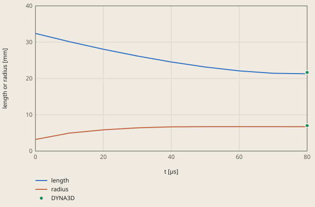

# taylor-bar-impact derivation

## Conclusion

The explicit model of CalculiX gives the final shape of the Taylor bar within the tolerance of 0.80 mm. At 80 µs, the final length of the model is 21.29 mm and the mushroom radius is 6.72 mm. DYNA3D gives 21.66 mm and 7.02 mm. The model values are 0.37 mm and 0.30 mm smaller, 46 % and 37 % of the tolerance.

**The length of the bar and the mushroom radius against the time**

DYNA3D: DYNA3D (Hallquist and Benson 1987), from the Ansys Technology Showcase, chapter 17

The length is 32.4 mm plus the mean u3 of the top face. The radius is 3.2 mm plus u1 of the rim node on the wall. ccx writes them each 10 µs.

Values of the plot

Original values. — means no sample.

| t [µs] | length (length or radius [mm]) | radius (length or radius [mm]) | DYNA3D (length or radius [mm]) |
| ---: | ---: | ---: | ---: |
| 0 | 32.4 | 3.2 | — |
| 10 | 30.1411 | 4.9623 | — |
| 20 | 28.0574 | 5.8551 | — |
| 30 | 26.1834 | 6.4037 | — |
| 40 | 24.542 | 6.6802 | — |
| 50 | 23.166 | 6.7233 | — |
| 60 | 22.1013 | 6.7253 | — |
| 70 | 21.428 | 6.723 | — |
| 80 | 21.294 | 6.7225 | — |
| 80 | — | — | 21.66 |
| 80 | — | — | 7.02 |

The radius increases fast in the first 30 µs and stops at about 50 µs. The length decreases to the end, but from 70 to 80 µs the top moves only 0.13 mm. Thus the bar is almost at rest at 80 µs, the time of the checks.

A finer mesh gives a longer bar and a larger mushroom. The mesh study of 3 meshes extrapolates the model to 21.58 mm and 7.27 mm (section "Mesh study" below), 0.08 mm and 0.25 mm from DYNA3D. The mesh error of the check mesh is 0.29 mm in the length and 0.55 mm in the radius. These errors are larger than the differences between the extrapolated model and DYNA3D.

The model is the quarter bar, with 1 step each 10 µs. The length and the mushroom radius at each time are:

| t [µs] | Length [mm] | Radius [mm] |
|---|---|---|
| 10 | 30.14 | 4.96 |
| 20 | 28.06 | 5.86 |
| 30 | 26.18 | 6.40 |
| 40 | 24.54 | 6.68 |
| 50 | 23.17 | 6.72 |
| 60 | 22.10 | 6.73 |
| 70 | 21.43 | 6.72 |
| 80, the time of the checks | 21.29 (DYNA3D 21.66) | 6.72 (DYNA3D 7.02) |

`PEEQ` is the equivalent plastic strain.

## Result

**Pass.** A check passes when |computed - reference| ≤ rel_tol · |reference| + abs_tol, with rel_tol = 0.0 and abs_tol = 0.8 (`check.toml`). `fh validate` gives the computed values.

| Check | Unit | Computed | Reference | Difference | Tolerance | Margin |
| --- | ---: | ---: | ---: | ---: | ---: | ---: |
| `length` | Not specified | -11.106 | -10.74 | -0.366036 (-3.40816 %) | 0.8 | 0.434 |
| `radius` | Not specified | 3.52254 | 3.82 | -0.297456 (-7.78681 %) | 0.8 | 0.5025 |

Made by `scripts/validation-reports.py` on 2026-10-28, femahoy 9c54611.

This case checks the final length and the mushroom radius of a copper bar after an impact on a rigid wall (units SI-mm). It is the explicit dynamics case: CalculiX `*DYNAMIC, EXPLICIT` with large strains and plasticity.

## Why CalculiX

OpenRadioss, now OpenCourant (AGPL-3.0), has builds for Linux x86-64, Linux ARM64 and Windows only (its `HOWTO.md` and the release files of 2026-10-11). It has no build for macOS, and nixpkgs has no package. `ccx` 2.23 runs on macOS and in CI, and `fh` already starts it. Thus this case needs no new program.

## Sources

- The benchmark: A. Kamoulakos, "A simple 'benchmark' for impact", Bench Mark, 1990, pp. 31-35. A copper bar with a radius of 3.2 mm and a length of 32.4 mm hits a rigid frictionless wall at 227 m/s. The material is elastic-plastic with E = 117 GPa, nu = 0.35, rho = 8930 kg/m3, a yield stress of 400 MPa and a linear hardening of 100 MPa. The results are at 80 µs.
- The reference values: the DYNA3D results (J. O. Hallquist and D. J. Benson, DYNA3D user's manual, revision 3, report UCID-19592, Lawrence Livermore National Laboratory, 1987). The Ansys Technology Showcase, chapter 17 "Impact of a Metal Bar on a Rigid Wall", gives them as its reference: a mushroom radius of 7.02 mm, a final length of 21.66 mm and a largest equivalent plastic strain of 3.24.
- The same setup, with the axial velocity 0 at the impact face: M. N. Rahimi and G. Moutsanidis, "SoliDualSPHysics", arXiv:2602.15149, section 4.3.2.

## Model

| Item | Value |
|---|---|
| Bar | radius 3.2 mm, length 32.4 mm, impact face z = 0. A quarter of the bar, with the symmetry planes `SYMX` (x = 0, u1 = 0) and `SYMY` (y = 0, u2 = 0) |
| Copper | E = 117000 MPa, nu = 0.35, rho = 8.93e-9 t/mm3. `*PLASTIC`: 400 MPa at the plastic strain 0, 900 MPa at 5 (hardening 100 MPa) |
| Wall | `WALL`, the nodes of the face z = 0: u3 = 0. They slide free in x and y |
| Start | v3 = -227000 mm/s on all nodes, 0 on `WALL` |
| Step | `*STEP, NLGEOM` with `*DYNAMIC, EXPLICIT` to 80 µs, with a fixed increment of 4e-9 s (20000 increments) |
| Mesh | `C3D8R` hexahedra from `mesh.py 6 6 40 5`: 108 in the section, 40 layers from 0.33 mm at the wall to 1.63 mm at the top. 4320 elements, 5207 nodes |

The kinetic energy at the start is 239.8 J for the full bar. The radius does not change after 50 µs (less than 0.1 %). From 70 to 80 µs the top moves 0.13 mm, a mean speed of 13 m/s: the bar is almost at rest.

The checks are displacements:

- `length`: the mean u3 of the top face `TOP`. The final length is 32.4 mm + u3, thus the reference is 21.66 - 32.4 = -10.74 mm.
- `radius`: u1 of the node `RIM` at (3.2, 0, 0) on the wall. The mushroom radius is 3.2 mm + u1, thus the reference is 7.02 - 3.2 = 3.82 mm. On the check mesh, the largest radius of the wall face is 0.3 % larger, at 30 degrees, because the section is not axisymmetric.

## Time increment

ccx calculates the stable increment 1 time, at the start, from the element volumes: 1.11e-8 s on the check mesh (`Volumetric COURANT initial stable time increment` in `job.log`).
The elements at the wall become flat, but their volume does not change. Thus they need a smaller increment than the one of the start.
With this increment, a mesh of 6 6 64 with no grading stopped with `*ERROR: no convergence in incplas` and NaN. The 4th value of the data line of `*DYNAMIC` is the largest increment: it sets the increment to 4e-9 s.
On the check mesh, 2.5e-9 s in place of 4e-9 s changes the length by 0.002 % and the radius by 0.03 %.

## Mesh study

`mesh.py N M NZ G` writes `mesh.inp`. Each mesh is 1.5 times finer than the one before it in each direction, with the same grading G = 5.

| Mesh | Elements | Increment (s) | Time | Final length (mm) | Mushroom radius (mm) |
|---|---:|---:|---:|---:|---:|
| 4 4 27 | 1296 | 3.75e-9 | 78 s, 1 thread | 21.208 | 6.356 |
| 6 6 40, the check | 4320 | 4e-9 | 279 s, 1 thread | 21.294 | 6.723 |
| 9 9 60 | 14580 | 1.67e-9 | 774 s, 3 threads | 21.360 | 6.942 |
| Extrapolated | | | | 21.58 | 7.27 |
| Reference (DYNA3D) | | | | 21.66 | 7.02 |

The times are the times of ccx on a Mac with 10 cores and other work.
Both values increase monotonically. The radius has an observed order of 1.26, and its extrapolated value is 7.27 mm. The length has an observed order of 0.65, and its extrapolated value is 21.58 mm. The order of the length is low, thus its extrapolation is less sure.
The mesh error of the check mesh is 0.29 mm in the length and 0.55 mm in the radius.

## Tolerance

The tolerance is `abs_tol = 0.80` (mm) and `rel_tol = 0`, the same for both checks. A tolerance in mm, not a relative tolerance, because the reference displacements are of very different sizes (10.74 mm and 3.82 mm).

| Cause | Basis | Length | Radius |
|---|---|---:|---:|
| Mesh error of the check mesh | The extrapolation from 3 meshes | 0.29 mm | 0.55 mm |
| The model and the reference | The extrapolated value against DYNA3D. DYNA3D used its own element and mesh. On the same page, the Ansys results differ from DYNA3D by up to 5 % in the radius and 7 % in the length | 0.08 mm | 0.25 mm |
| Sum | | 0.37 mm | 0.80 mm |

`abs_tol` is the larger sum, 0.80 mm.

| Check | Model (mm) | Reference (mm) | Difference (mm) | Part of the tolerance |
|---|---:|---:|---:|---:|
| `length` (u3) | -11.106 | -10.74 | -0.366 | 46 % |
| `radius` (u1) | 3.523 | 3.82 | -0.297 | 37 % |

The tolerance stops these errors:

- No `NLGEOM` (small strains): the length is 18.88 mm and the radius 6.05 mm. `length` is 2.78 mm away, and `radius` 0.97 mm.
- No hardening: ccx stops with `*ERROR: no convergence in incplas`, thus the case cannot run.
- `C3D8` in place of `C3D8R` (mesh 6 6 64 with no grading): the radius is 5.82 mm, 1.20 mm away. The length is 20.84 mm, 0.82 mm away: it also fails.
- The stable increment of the start (mesh 6 6 64 with no grading, 1.11e-8 s): ccx stops with `*ERROR: no convergence in incplas`.

The coarse mesh (4 4 27) passes. Its largest part of the tolerance is 83 % (`radius`).

## Not in the check

- The largest equivalent plastic strain (3.24 for DYNA3D): it is a value at 1 point at the centre of the impact face, and it changes much with the mesh.
- Friction on the wall and the bounce off the wall: the benchmark has no friction, and at 80 µs the bar is almost at rest.
