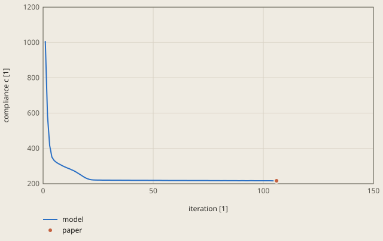
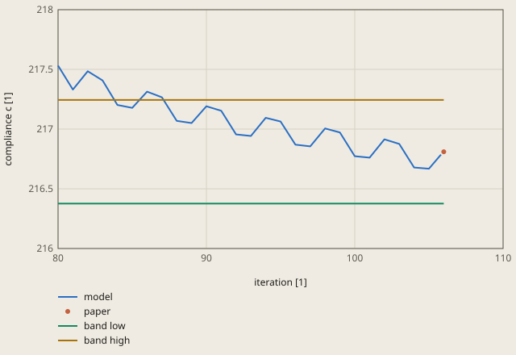

# topology-mbb-beam derivation

## Finding

The topology loop of fh gives the compliance of the published SIMP code for the half MBB beam. After 106 iterations, the loop gives c = 216.8137 with 50 % of the volume. Andreassen et al. (2011) give 216.81. The difference is 0.002 %, less than 1 % of the tolerance of 0.2 %.

The result is the density of each element: 1 is material and 0 is void. The load 1 is down at the top left corner, and the roller is at the bottom right corner. The left edge is the symmetry plane. The compliance c at some iterations is:

| Iteration | c |
|---|---|
| 1, the uniform start | 1007.0 |
| 2 | 583.6 |
| 4 | 351.0 |
| 8 | 307.1 |
| 16 | 258.6 |
| 32 | 220.0 |
| 64 | 218.1 |
| 106, the final design | 216.81 |

### The compliance of the design at each iteration

paper: Andreassen et al. (2011), figure 3, top left, the final design

Iteration 1 is the uniform design with the density 0.5. The paper gives only the final compliance: the plot shows it at the last iteration of the model.

Original values. n/a means no sample.

| iteration [1] | model (compliance c [1]) | paper (compliance c [1]) |
| ---: | ---: | ---: |
| 1 | 1007.0221 | n/a |
| 2 | 583.6279 | n/a |
| 3 | 417.0593 | n/a |
| 4 | 351.0267 | n/a |
| 5 | 331.9159 | n/a |
| 6 | 321.4309 | n/a |
| 7 | 313.5632 | n/a |
| 8 | 307.0902 | n/a |
| 9 | 300.4403 | n/a |
| 10 | 294.6178 | n/a |
| 11 | 289.0364 | n/a |
| 12 | 284.5011 | n/a |
| 13 | 278.8043 | n/a |
| 14 | 273.4503 | n/a |
| 15 | 266.1838 | n/a |
| 16 | 258.6013 | n/a |
| 17 | 250.5109 | n/a |
| 18 | 242.4407 | n/a |
| 19 | 234.8968 | n/a |
| 20 | 228.8853 | n/a |
| 21 | 224.5807 | n/a |
| 22 | 222.2565 | n/a |
| 23 | 221.35 | n/a |
| 24 | 220.9995 | n/a |
| 25 | 220.634 | n/a |
| 26 | 220.4617 | n/a |
| 27 | 220.3664 | n/a |
| 28 | 220.3631 | n/a |
| 29 | 220.2172 | n/a |
| 30 | 220.1361 | n/a |
| 31 | 220.0279 | n/a |
| 32 | 219.9569 | n/a |
| 33 | 219.8891 | n/a |
| 34 | 219.834 | n/a |
| 35 | 219.7767 | n/a |
| 36 | 219.5169 | n/a |
| 37 | 219.476 | n/a |
| 38 | 219.5529 | n/a |
| 39 | 219.4569 | n/a |
| 40 | 219.2845 | n/a |
| 41 | 219.3021 | n/a |
| 42 | 219.246 | n/a |
| 43 | 219.2214 | n/a |
| 44 | 219.1861 | n/a |
| 45 | 219.1602 | n/a |
| 46 | 219.1236 | n/a |
| 47 | 219.0909 | n/a |
| 48 | 219.0502 | n/a |
| 49 | 219.0135 | n/a |
| 50 | 218.9708 | n/a |
| 51 | 218.9275 | n/a |
| 52 | 218.8812 | n/a |
| 53 | 218.8295 | n/a |
| 54 | 218.5848 | n/a |
| 55 | 218.5454 | n/a |
| 56 | 218.6452 | n/a |
| 57 | 218.3962 | n/a |
| 58 | 218.3803 | n/a |
| 59 | 218.2944 | n/a |
| 60 | 218.2724 | n/a |
| 61 | 218.2192 | n/a |
| 62 | 218.185 | n/a |
| 63 | 218.1484 | n/a |
| 64 | 218.1152 | n/a |
| 65 | 218.0809 | n/a |
| 66 | 218.0513 | n/a |
| 67 | 218.0224 | n/a |
| 68 | 217.9918 | n/a |
| 69 | 217.9686 | n/a |
| 70 | 217.9399 | n/a |
| 71 | 217.9081 | n/a |
| 72 | 217.8723 | n/a |
| 73 | 217.8352 | n/a |
| 74 | 217.7986 | n/a |
| 75 | 217.7597 | n/a |
| 76 | 217.7246 | n/a |
| 77 | 217.6857 | n/a |
| 78 | 217.4485 | n/a |
| 79 | 217.6227 | n/a |
| 80 | 217.5315 | n/a |
| 81 | 217.3311 | n/a |
| 82 | 217.4846 | n/a |
| 83 | 217.4071 | n/a |
| 84 | 217.202 | n/a |
| 85 | 217.1776 | n/a |
| 86 | 217.3137 | n/a |
| 87 | 217.2664 | n/a |
| 88 | 217.069 | n/a |
| 89 | 217.0505 | n/a |
| 90 | 217.1914 | n/a |
| 91 | 217.1533 | n/a |
| 92 | 216.9557 | n/a |
| 93 | 216.9426 | n/a |
| 94 | 217.0946 | n/a |
| 95 | 217.0635 | n/a |
| 96 | 216.8693 | n/a |
| 97 | 216.8557 | n/a |
| 98 | 217.0057 | n/a |
| 99 | 216.9718 | n/a |
| 100 | 216.7731 | n/a |
| 101 | 216.7606 | n/a |
| 102 | 216.9142 | n/a |
| 103 | 216.8757 | n/a |
| 104 | 216.6781 | n/a |
| 105 | 216.668 | n/a |
| 106 | 216.8137 | n/a |
| 106 | n/a | 216.81 |

The compliance falls from 1007.0 for the uniform start design to 228.9 at iteration 20. From iteration 50, it is within 1 % of the final value. The design changes more than c. From iteration 64 to 106, c decreases by only 0.6 %, but 68 of the 1200 elements cross the density 0.5.

### The compliance of the last iterations, with the pass band of the check

paper: Andreassen et al. (2011), figure 3, top left, the final design

The pass band is 216.81 +/- 0.2 % (check.toml). The loop stops at the first iteration where no density changes by more than 0.01.

Original values. n/a means no sample.

| iteration [1] | model (compliance c [1]) | paper (compliance c [1]) | band low (compliance c [1]) | band high (compliance c [1]) |
| ---: | ---: | ---: | ---: | ---: |
| 80 | 217.5315 | n/a | 216.3764 | 217.2436 |
| 81 | 217.3311 | n/a | 216.3764 | 217.2436 |
| 82 | 217.4846 | n/a | 216.3764 | 217.2436 |
| 83 | 217.4071 | n/a | 216.3764 | 217.2436 |
| 84 | 217.202 | n/a | 216.3764 | 217.2436 |
| 85 | 217.1776 | n/a | 216.3764 | 217.2436 |
| 86 | 217.3137 | n/a | 216.3764 | 217.2436 |
| 87 | 217.2664 | n/a | 216.3764 | 217.2436 |
| 88 | 217.069 | n/a | 216.3764 | 217.2436 |
| 89 | 217.0505 | n/a | 216.3764 | 217.2436 |
| 90 | 217.1914 | n/a | 216.3764 | 217.2436 |
| 91 | 217.1533 | n/a | 216.3764 | 217.2436 |
| 92 | 216.9557 | n/a | 216.3764 | 217.2436 |
| 93 | 216.9426 | n/a | 216.3764 | 217.2436 |
| 94 | 217.0946 | n/a | 216.3764 | 217.2436 |
| 95 | 217.0635 | n/a | 216.3764 | 217.2436 |
| 96 | 216.8693 | n/a | 216.3764 | 217.2436 |
| 97 | 216.8557 | n/a | 216.3764 | 217.2436 |
| 98 | 217.0057 | n/a | 216.3764 | 217.2436 |
| 99 | 216.9718 | n/a | 216.3764 | 217.2436 |
| 100 | 216.7731 | n/a | 216.3764 | 217.2436 |
| 101 | 216.7606 | n/a | 216.3764 | 217.2436 |
| 102 | 216.9142 | n/a | 216.3764 | 217.2436 |
| 103 | 216.8757 | n/a | 216.3764 | 217.2436 |
| 104 | 216.6781 | n/a | 216.3764 | 217.2436 |
| 105 | 216.668 | n/a | 216.3764 | 217.2436 |
| 106 | 216.8137 | n/a | 216.3764 | 217.2436 |
| 106 | n/a | 216.81 | n/a | n/a |

The stop rule is at its limit in the last iterations. From iteration 95 to 106, the largest change of a density is 0.0098 to 0.0123, and c is 216.67 to 217.06. Iteration 106 is the first with no change above 0.01, thus the loop stops there. A change in the last digit of a solve can stop the loop at another iteration of this band (section "Tolerance" below). Each c of these iterations is in the pass band, at most 0.12 % from the reference.

## Result

**Pass.** A check passes when |computed - reference| ≤ rel_tol · |reference| + abs_tol, with rel_tol = 0.002 and abs_tol = 0.0 (`check.toml`). `fh validate` gives the computed values.

| Check | Unit | Computed | Reference | Difference | Tolerance | Margin |
| --- | ---: | ---: | ---: | ---: | ---: | ---: |
| `compliance` | Not specified | 216.814 | 216.81 | +0.00366295 (+0.00168947 %) | 0.4336 | 0.43 |

Made by `scripts/validation-reports.py` on 2026-10-28, femahoy 9c54611.

This case checks the topology loop of `fh run`: the minimum compliance of the half MBB beam with 50 % of the volume.
The reference is the result of a published SIMP code on the same mesh. The model uses the same method and an element with the same stiffness matrix. Thus the tolerance comes from the stop rule of the loop, not from a model error.

## Source

E. Andreassen, A. Clausen, M. Schevenels, B. S. Lazarov and O. Sigmund, "Efficient topology optimization in MATLAB using 88 lines of code", Structural and Multidisciplinary Optimization 43 (2011) 1-16, <https://doi.org/10.1007/s00158-010-0594-7>.

- The problem is the half MBB beam: a rectangle of 60 x 20 square elements of side 1. The left edge is a symmetry plane. A roller supports the bottom right corner. A load of 1 acts down at the top left corner.
- The material fills 50 % of the volume. The filter radius is 2.4. The penalty is 3.
- Figure 3, top left, gives c = 216.81 for the sensitivity filter. This is the check value.
- Figure 3 also gives c = 233.71 for the density filter, on the same problem. The case does not use this value.

## Model

The case `60x20` has the mesh and the loads of the paper. `mesh.py` writes its `job.inp`.

| Item | Value |
|---|---|
| Mesh | 60 x 20 elements `CPE4`, side 1, thickness 1 |
| Supports | ux = 0 on the left edge, uy = 0 at the bottom right corner |
| Load | `*CLOAD` of -1 in y at the top left corner |
| Loop | `volume = 0.5`, `radius = 2.4`, penalty 3, Emin = 1e-9 E0, move limit 0.2, stop when no density changes by more than 0.01 |

The paper uses the bilinear plane stress element with E0 = 1 and nu = 0.3. The `CPS4` element of `ccx` gives a stiffness that is 0.09 % higher. The compliance of the uniform design with x = 0.5 is 1006.132 with `CPS4` and 1007.022 with the element of the paper.
Take a plane strain element with E' = E0 (1 + 2 nu) / (1 + nu)^2 and nu' = nu / (1 + nu). It has the same stiffness matrix as the plane stress element with E0 and nu. Thus the case uses `CPE4` with `young = 1.6 / 1.69` and `poisson = 0.3 / 1.3`.

## The loop

The loop of `fh` (`crates/fh/src/topology.rs`) follows the 88 line code with the sensitivity filter. In each iteration:

1. `fh` writes 1 material and 1 section for each element, with the modulus Emin + x^3 (E0 - Emin).
2. `ccx` solves the model and writes the strain energy `ELSE` and the volume `EVOL` of each element to `job.dat`.
3. The compliance is c = 2 times the sum of `ELSE`. The sensitivity of an element is -3 x^2 (E0 - Emin) u^T k0 u. Here u^T k0 u = 2 `ELSE` / E of the element.
4. The sensitivity filter and the optimality criteria update give the new densities. The bisection finds the multiplier that keeps the volume at 50 %.

## Check of the loop

The case and 2 other loops ran on the same problem:

| Loop | Iterations | c |
|---|---:|---:|
| A Python copy of the 88 line method, with the element stiffness of the paper and a direct solver | 106 | 216.81366 |
| `fh run` with `CPE4` (the case) | 106 | 216.81366 |
| `fh run` with `CPS4`, E0 = 1 and nu = 0.3 | 103 | 216.5432 |

The case and the Python loop agree to all printed digits. Thus `ccx` and the reading of `job.dat` add no error.
`CPS4` gives a result 0.12 % below the reference, because its stiffness is 0.09 % higher.

## Tolerance

The tolerance is `rel_tol = 0.002` and `abs_tol = 0`.

The stop rule is at its limit in the last iterations. From iteration 95 to iteration 106, the largest change of a density is 0.0098 to 0.0123. The compliance oscillates in this band:

| Iterations | Smallest c | Largest c | Difference to 216.81 |
|---|---:|---:|---:|
| 95 to 106 | 216.668 | 217.064 | -0.07 % to +0.12 % |

A change in the last digit of a solve can stop the loop at a different iteration in this band. Thus the result can be 0.12 % from the reference with no error in the model.
`rel_tol` is 0.12 %, rounded up to 0.2 %. The case gives 216.8137, 0.002 % above the reference.
A change of the method gives a larger difference: with the density filter, the paper gives 233.71, 7.8 % above the check value.

## Run time

The loop solves the model 106 times. On a Mac with 10 cores, `fh validate` took 22 s for this case.
