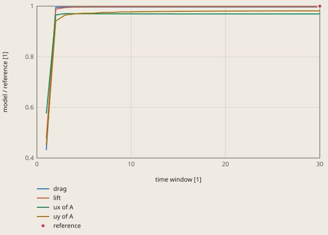

# turek-hron-fsi1 derivation

## Conclusion

The coupled model of OpenFOAM, CalculiX and preCICE passes FSI1 of Turek and Hron (2006). The drag and the lift are 0.33 % and 0.18 % below the reference. The displacement of point A is 3.1 % (ux) and 1.9 % (uy) below the reference. `ux_a` uses 77 % of the tolerance of 4 %.

The coarse mesh of the check causes most of the difference in the displacement. On the finer meshes of the mesh study, the drag and the displacements move to the reference. The lift stays within 0.18 % of it. At zero cell size, the drag and ux are within 0.13 % of the reference, and uy is 0.70 % below it. The coupling is necessary: a rigid flag gives a lift 46 % above the reference (see "Tolerance").

The flow around the cylinder bends the flag up to a steady shape. Point A, the middle of the free end of the flag, moves 0.81 mm up. Point A before the deformation is at x = 0.6 m, y = 0.2 m. The pressure `p` gives 92 % of the lift.

The coupling converges to a steady state. The inlet velocity increases in the first 2 time windows. From window 28 to window 30, uy changes by 0.011 %, and the other values by 0.0011 % or less. The section "Mesh study" estimates the rest of the change after window 30 as +0.05 % in uy.

**The checked values at the end of each time window, divided by the reference**



reference: Turek and Hron (2006), the results of FSI1

The inlet velocity increases from 0 to its full value in the first 2 windows. The check reads the values of window 30.

<details><summary>Values of the plot</summary>

Original values. — means no sample.

| time window [1] | drag (model / reference [1]) | lift (model / reference [1]) | ux of A (model / reference [1]) | uy of A (model / reference [1]) | reference (model / reference [1]) |
| ---: | ---: | ---: | ---: | ---: | ---: |
| 1 | 0.43145 | 0.47811 | 0.57579 | 0.4513 | — |
| 2 | 0.99527 | 0.98822 | 0.96524 | 0.9417 | — |
| 3 | 0.9967 | 0.99458 | 0.97062 | 0.96492 | — |
| 4 | 0.9967 | 0.99643 | 0.97026 | 0.96929 | — |
| 5 | 0.9967 | 0.99712 | 0.97001 | 0.97207 | — |
| 6 | 0.9967 | 0.99845 | 0.97001 | 0.97206 | — |
| 7 | 0.9967 | 0.99772 | 0.96971 | 0.97536 | — |
| 8 | 0.9967 | 0.99841 | 0.96971 | 0.97537 | — |
| 9 | 0.9967 | 0.99798 | 0.96953 | 0.97722 | — |
| 10 | 0.9967 | 0.99839 | 0.96953 | 0.97723 | — |
| 11 | 0.9967 | 0.99811 | 0.96942 | 0.9784 | — |
| 12 | 0.9967 | 0.99837 | 0.96942 | 0.9784 | — |
| 13 | 0.9967 | 0.99817 | 0.96935 | 0.97921 | — |
| 14 | 0.9967 | 0.99835 | 0.96935 | 0.97921 | — |
| 15 | 0.9967 | 0.9982 | 0.96929 | 0.97979 | — |
| 16 | 0.9967 | 0.99833 | 0.96929 | 0.97979 | — |
| 17 | 0.9967 | 0.99822 | 0.96925 | 0.98023 | — |
| 18 | 0.9967 | 0.99831 | 0.96925 | 0.98023 | — |
| 19 | 0.9967 | 0.99822 | 0.96922 | 0.98056 | — |
| 20 | 0.9967 | 0.99829 | 0.96922 | 0.98056 | — |
| 21 | 0.9967 | 0.99822 | 0.96919 | 0.98082 | — |
| 22 | 0.9967 | 0.99828 | 0.96919 | 0.98082 | — |
| 23 | 0.9967 | 0.99822 | 0.96917 | 0.98103 | — |
| 24 | 0.9967 | 0.99826 | 0.96918 | 0.98103 | — |
| 25 | 0.9967 | 0.99822 | 0.96916 | 0.9812 | — |
| 26 | 0.9967 | 0.99825 | 0.96916 | 0.9812 | — |
| 27 | 0.9967 | 0.99821 | 0.96915 | 0.98133 | — |
| 28 | 0.9967 | 0.99824 | 0.96915 | 0.98133 | — |
| 29 | 0.9967 | 0.99821 | 0.96914 | 0.98144 | — |
| 30 | 0.9967 | 0.99823 | 0.96914 | 0.98144 | — |
| 30 | — | — | — | — | 1 |

</details>

## Result

**Pass.** A check passes when |computed - reference| ≤ rel_tol · |reference| + abs_tol, with rel_tol = 0.04 and abs_tol = 0 (`check.toml`). `fh validate` gives the computed values.

| Check | Unit | Computed | Reference | Difference | Tolerance | Margin |
| --- | ---: | ---: | ---: | ---: | ---: | ---: |
| `drag` | Not specified | 14.2479 | 14.295 | -0.0471208 (-0.329631 %) | 0.5718 | 0.5247 |
| `lift` | Not specified | 0.762446 | 0.7638 | -0.00135401 (-0.177272 %) | 0.03055 | 0.0292 |
| `ux_a` | Not specified | 2.19994e-05 | 2.27e-05 | -7.00611e-07 (-3.08639 %) | 9.08e-07 | 2.074e-07 |
| `uy_a` | Not specified | 0.000805663 | 0.0008209 | -1.52369e-05 (-1.85612 %) | 3.284e-05 | 1.76e-05 |

Made by `scripts/validation-reports.py` on 2026-10-28, femahoy 9c54611.

This case checks the fluid-structure coupling: OpenFOAM for the fluid and CalculiX for the solid, coupled through preCICE.
The problem is FSI1 of the bench mark of Turek and Hron: a soft elastic flag behind a cylinder in a laminar channel flow. The flag bends to a steady shape.
The bench mark has 3 cases. FSI2 and FSI3 have a periodic motion. They need a dynamic solid and thousands of small time steps, so they are too slow for CI. FSI1 is steady, and it checks the same coupling.
The reference is a numerical bench mark. Thus the tolerance comes from the mesh study of the model and from the iteration error of the coupling, not from the difference between the model and the reference.

## Sources

- S. Turek and J. Hron, "Proposal for numerical benchmarking of fluid-structure interaction between an elastic object and laminar incompressible flow", in H.-J. Bungartz and M. Schäfer (eds.), Fluid-Structure Interaction, Lecture Notes in Computational Science and Engineering 53, Springer (2006) 371-385.
  It gives the geometry, the parameters and the results of FSI1. The check values come from these results.
- S. Turek, J. Hron, M. Razzaq and H. Wobker, the bench mark results of 2009, https://wwwold.mathematik.tu-dortmund.de/lsiii/cms/papers/TurekHronRazzaqWobker2009.pdf. It gives FSI1 with more digits from finer meshes: ux = 0.02270493e-3 m, uy = 0.8208773e-3 m, drag = 14.29426 N/m and lift = 0.763746 N/m. These values agree with the check values to 0.03 % or less. The case uses them only as a cross-check.

| Quantity | Check value | Check |
|---|---:|---|
| Displacement of point A in x | 0.0227e-3 m | `ux_a` |
| Displacement of point A in y | 0.8209e-3 m | `uy_a` |
| Drag on the cylinder and the flag | 14.295 N/m | `drag` |
| Lift on the cylinder and the flag | 0.7638 N/m | `lift` |

Point A is the middle of the free end of the flag, (0.6, 0.2) before the deformation. The forces are per m of depth. The model has a depth of 1 m, thus its forces have the same values.

## Model

The case folder `fsi1` has `precice-config.xml`, the OpenFOAM case `fluid` and the CalculiX input `solid/job.inp`. `mesh.py` writes the 2 meshes (`fluid/system/blockMeshDict` and `solid/mesh.inp`).

| Item | Value |
|---|---|
| Channel | 2.5 m x 0.41 m. A cylinder of radius 0.05 m at (0.2, 0.2). The flag goes from the cylinder to x = 0.6, with a thickness of 0.02 m about y = 0.2 |
| Fluid | rho = 1000 kg/m^3, nu = 1e-3 m^2/s. Re = 20 with the mean inlet velocity 0.2 m/s and the cylinder diameter |
| Inlet | a parabolic profile with the mean velocity 0.2 m/s. A factor (1 - cos(pi t / 2)) / 2 increases it from 0 in the first 2 s |
| Outlet | p = 0. No slip on the walls, the cylinder and the flag |
| Solid | St. Venant-Kirchhoff: `*ELASTIC` with `NLGEOM`, E = 1.4e6 Pa (mu = 0.5e6 Pa), nu = 0.4, rho = 1000 kg/m^3. The end at the cylinder is clamped |
| Solid elements | C3D8I bricks, 1 element in z, with z fixed: plane strain, as the 2D bench mark |
| Fluid solver | `pimpleFoam`, steady (`steadyState` for `ddtSchemes`), SIMPLEC (`consistent yes`) with the relaxation factors 0.9 for p and U, 30 outer correctors in each time step. A moving mesh (`displacementLaplacian`, diffusivity `quadratic inverseDistance` of the flag) |
| Solid step | `*STATIC`: the adapter solves each time window to equilibrium |
| Coupling | `parallel-implicit`, a time window of 1 s, 30 windows. At most 30 iterations in each window. The relative convergence limit is 1e-4 on the force and the displacement. IQN-ILS with the `residual-sum` preconditioner |
| Mapping | radial basis functions `rbf-compact-polynomial-c6` with a support radius of 0.05 m. Conservative for the force, consistent for the displacement |
| Output | the function object `forces` on the cylinder and the flag (`total_x` is the drag, `total_y` the lift), and the `watch-point` A of preCICE in the solid |

FSI1 is steady, thus its result does not depend on the time or on the mass of the flag. Thus the fluid and the solid are both steady. Each time window is a pseudo time: 30 iterations of the steady fluid, then the static equilibrium of the flag, and the coupling iterates the window. The inlet factor goes to 1 in the first 2 windows, then the fluid and the flag converge to the steady state.

A transient fluid with a soft flag makes the coupling unstable, because of the added mass of the fluid. The study tried this first, with `Euler` for `ddtSchemes`:

- Explicit coupling diverged in the first windows.
- Implicit coupling with windows of 0.2 s diverged on the mesh of level 2 in the first 2 s, in most of the variants of the relaxation, the preconditioner and the outer correctors that the study tried.
- With windows of 1 s, implicit coupling converged on the levels 1 and 2. On level 3, the fluid diverged in the second window. There the Courant number was up to 185.

A steady fluid has no time derivative, thus no added mass. With the steady fluid, the coupling converged on the 3 levels, in 8 or fewer iterations for each window. On the levels 1 and 2, the transient and the steady fluid gave the same drag within 0.05 %, and the same lift and ux within 0.3 %. uy differed by 0.9 % on level 1 and 0.3 % on level 2. The transient runs had a convergence limit of 1e-3, and their uy changed by up to 0.5 % from window to window.

The conservative mapping puts the force of each fluid face on the solid nodes near it. If the solid has more nodes on the interface than the fluid has faces, the mapped force changes sign from node to node. Thus the flag mesh is not finer than the fluid mesh on the interface. At level 1, each side of the flag has 24 elements and 24 fluid faces, and the free end has 4 elements and 4 fluid faces.

## Mesh study

`mesh.py LEVEL OUT` writes the meshes of a level into the case folder `OUT`. Each level doubles the cells of the fluid and the elements of the flag in each direction. These commands, in the repository root, solve level 2 in a scratch folder:

```
cp -R validation/cases/turek-hron-fsi1/fsi1 /tmp/fsi1-level2
python3 validation/cases/turek-hron-fsi1/mesh.py 2 /tmp/fsi1-level2
fh run /tmp/fsi1-level2
```

The values are in the last rows of `fluid/postProcessing/forces/0/force.dat` and `solid/precice-Solid-watchpoint-A.log` in the run folder. The values in the table are at the end of window 30, as the check reads them. The times are for a Mac with 10 cores, with other programs on 2 to 3 cores.

| Level | Fluid cells | Flag elements | Iterations | Time | Drag (N/m) | Lift (N/m) | ux (1e-3 m) | uy (1e-3 m) |
|---:|---:|---:|---:|---:|---:|---:|---:|---:|
| 1, the check | 3820 | 24 x 4 | 59 | 18 s | 14.24788 | 0.76245 | 0.0219994 | 0.805663 |
| 2 | 15280 | 48 x 8 | 69 | 77 s | 14.27334 | 0.76496 | 0.0223764 | 0.811289 |
| 3 | 61120 | 96 x 16 | 104 | 600 s | 14.28472 | 0.76345 | 0.0225415 | 0.813565 |
| Extrapolated | | | | | 14.2939 | | 0.0226701 | 0.815111 |
| Reference | | | | | 14.295 | 0.7638 | 0.0227 | 0.8209 |

The drag and the displacements converge monotonically. The extrapolation from the 3 levels uses the observed order p: 1.16 for the drag, 1.19 for ux and 1.31 for uy. The extrapolated drag agrees with the reference to 0.01 %, and ux to 0.13 %. The extrapolated uy is 0.70 % below the reference.
The lift does not converge monotonically. The 3 levels are in a range of 0.33 %, and level 3 is 0.05 % below the reference.
Thus the mesh error of level 1 against the extrapolated value is -0.32 % in the drag, -2.96 % in ux and -1.16 % in uy.

The drag is constant to 6 digits after window 10 on the levels 1 and 2, and after window 26 on level 3. The lift and uy change less from window to window, as a geometric series. Its sum estimates the rest of the change after window 30: +0.05 % in uy on level 1, and 0.01 % or less in the other values. On level 3, the rest is about +0.1 % in the lift and uy.

`fh validate` solves the check (level 1) in 16 s on the Mac.

## Tolerance

The tolerance is `rel_tol = 0.04` and `abs_tol = 0`.

| Cause | Drag | Lift | ux | uy |
|---|---:|---:|---:|---:|
| Mesh error of level 1, times 1.25 (the factor of safety of the grid convergence index). For the lift, the range of the 3 levels, times 1.25 | 0.40 % | 0.41 % | 3.70 % | 1.45 % |
| The extrapolated value against the reference. For the lift, level 3 | 0.01 % | 0.05 % | 0.13 % | 0.70 % |
| Iterations: the rest of the change after window 30 on level 1 | 0 % | 0 % | 0.01 % | 0.05 % |
| The reference of 2006 against the values of 2009 | 0.01 % | 0.01 % | 0.02 % | 0.01 % |
| Sum | 0.42 % | 0.47 % | 3.86 % | 2.21 % |

`rel_tol` is the largest sum, 3.86 % for `ux_a`, rounded up to 4 %. The file has 1 tolerance for all checks, thus the drag and the lift have a larger tolerance than their sums.
The model is 0.18 % to 3.09 % below the reference. The largest part of the tolerance that a check uses is 77 % (`ux_a`).
The tolerance does not let a run without the coupling pass: a rigid flag (CFD1 of the bench mark) has no displacement and a lift of 1.119, 46 % above the reference.
