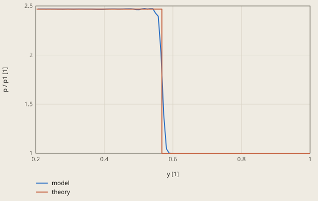
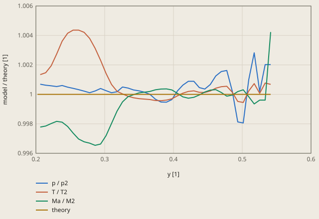

# wedge-oblique-shock derivation

## Conclusion

The model passes: its shock angle is 0.071 % and its pressure ratio 0.013 % from the exact oblique shock. Its Mach number, temperature and density behind the shock are 0.19 % to 0.20 % from the theory. These 3 checks use 74 % to 80 % of the tolerance of 0.25 %.

The pressure jump of the model is at the shock of the theory. Behind the shock, the pressure is within 0.3 % of the theory. The shock of the theory is at beta = 36.9449 degrees from the tip: y = 0.5678 at x = 0.755 and y = 0.7520 at x = 1.

**The pressure on the line x = 0.755, from the wedge to the far field**



The theory is the exact oblique shock of Table 2 of the NPARC case: the shock at y = 0.5678 (beta = 36.9449 degrees) and p2 / p1 = 2.4675.

<details><summary>Values of the plot</summary>

Original values. — means no sample.

| y [1] | model (p / p1 [1]) | theory (p / p1 [1]) |
| ---: | ---: | ---: |
| 0.20629 | 2.4692 | — |
| 0.21427 | 2.46902 | — |
| 0.22224 | 2.46894 | — |
| 0.23022 | 2.46881 | — |
| 0.2382 | 2.46899 | — |
| 0.24618 | 2.4687 | — |
| 0.25415 | 2.46852 | — |
| 0.26213 | 2.46829 | — |
| 0.27011 | 2.46805 | — |
| 0.27808 | 2.46778 | — |
| 0.28606 | 2.46806 | — |
| 0.29404 | 2.46848 | — |
| 0.30201 | 2.46812 | — |
| 0.30999 | 2.46777 | — |
| 0.31797 | 2.46795 | — |
| 0.32594 | 2.46873 | — |
| 0.33392 | 2.46857 | — |
| 0.3419 | 2.46824 | — |
| 0.34988 | 2.4681 | — |
| 0.35785 | 2.46786 | — |
| 0.36583 | 2.4675 | — |
| 0.37381 | 2.46669 | — |
| 0.38178 | 2.46621 | — |
| 0.38976 | 2.4662 | — |
| 0.39774 | 2.46664 | — |
| 0.40571 | 2.46807 | — |
| 0.41369 | 2.46905 | — |
| 0.42167 | 2.4697 | — |
| 0.42965 | 2.4697 | — |
| 0.43762 | 2.46864 | — |
| 0.4456 | 2.46839 | — |
| 0.45358 | 2.46915 | — |
| 0.46155 | 2.47058 | — |
| 0.46953 | 2.47132 | — |
| 0.47751 | 2.4715 | — |
| 0.48548 | 2.46804 | — |
| 0.49346 | 2.46289 | — |
| 0.50144 | 2.46271 | — |
| 0.50942 | 2.46994 | — |
| 0.51739 | 2.47446 | — |
| 0.52537 | 2.46796 | — |
| 0.53335 | 2.47248 | — |
| 0.54132 | 2.47249 | — |
| 0.5493 | 2.42713 | — |
| 0.55728 | 2.39474 | — |
| 0.56525 | 2.02198 | — |
| 0.57323 | 1.39354 | — |
| 0.58121 | 1.04479 | — |
| 0.58919 | 1.00107 | — |
| 0.59716 | 1 | — |
| 0.60514 | 1 | — |
| 0.61312 | 1 | — |
| 0.62109 | 1 | — |
| 0.62907 | 1 | — |
| 0.63705 | 1 | — |
| 0.64502 | 1 | — |
| 0.653 | 1 | — |
| 0.66098 | 1 | — |
| 0.66895 | 1 | — |
| 0.67693 | 1 | — |
| 0.68491 | 1 | — |
| 0.69289 | 1 | — |
| 0.70086 | 1 | — |
| 0.70884 | 1 | — |
| 0.71682 | 1 | — |
| 0.72479 | 1 | — |
| 0.73277 | 1 | — |
| 0.74075 | 1 | — |
| 0.74872 | 1 | — |
| 0.7567 | 1 | — |
| 0.76468 | 1 | — |
| 0.77266 | 1 | — |
| 0.78063 | 1 | — |
| 0.78861 | 1 | — |
| 0.79659 | 1 | — |
| 0.80456 | 1 | — |
| 0.81254 | 1 | — |
| 0.82052 | 1 | — |
| 0.82849 | 1 | — |
| 0.83647 | 1 | — |
| 0.84445 | 1 | — |
| 0.85243 | 1 | — |
| 0.8604 | 1 | — |
| 0.86838 | 1 | — |
| 0.87636 | 1 | — |
| 0.88433 | 1 | — |
| 0.89231 | 1 | — |
| 0.90029 | 1 | — |
| 0.90826 | 1 | — |
| 0.91624 | 1 | — |
| 0.92422 | 1 | — |
| 0.9322 | 1 | — |
| 0.94017 | 1 | — |
| 0.94815 | 1 | — |
| 0.95613 | 1 | — |
| 0.9641 | 1 | — |
| 0.97208 | 1 | — |
| 0.98006 | 1 | — |
| 0.98803 | 1 | — |
| 0.99601 | 1 | — |
| 0.2023 | — | 2.4675 |
| 0.5678 | — | 2.4675 |
| 0.5678 | — | 1 |
| 1 | — | 1 |

</details>

The tip of the wedge causes the 3 larger differences (see "Mesh study"). There the shock and the wall meet in 1 cell, and the scheme makes too much entropy. The hottest cell is at the wall near the tip, with T = 1.412, 6.8 % above the theory.

The flow carries this hot gas along the wall. On the line x = 0.755 near the wall, the temperature is up to 0.44 % above the theory. There the Mach number is up to 0.35 % below the theory, but the pressure is within 0.07 % of it. The averages of the 3 checks include this layer. The error decreases with the cell size. From the 2 finest meshes of the mesh study, the 5 values extrapolate to within 0.011 % of the theory.

**The state behind the shock on the line x = 0.755, divided by the theory**



The checks mach2, temperature_ratio and density2 average the cells with 0.25 < x and y < x / 2: here y < 0.3775.

The wedge is at y = 0.2023.

<details><summary>Values of the plot</summary>

Original values. — means no sample.

| y [1] | p / p2 (model / theory [1]) | T / T2 (model / theory [1]) | Ma / M2 (model / theory [1]) | theory (model / theory [1]) |
| ---: | ---: | ---: | ---: | ---: |
| 0.20629 | 1.00069 | 1.00134 | 0.99778 | — |
| 0.21427 | 1.00062 | 1.00147 | 0.99785 | — |
| 0.22224 | 1.00058 | 1.00194 | 0.99802 | — |
| 0.23022 | 1.00053 | 1.00274 | 0.99817 | — |
| 0.2382 | 1.0006 | 1.00361 | 0.99811 | — |
| 0.24618 | 1.00049 | 1.00415 | 0.99782 | — |
| 0.25415 | 1.00041 | 1.00436 | 0.99737 | — |
| 0.26213 | 1.00032 | 1.00436 | 0.99697 | — |
| 0.27011 | 1.00022 | 1.00421 | 0.99678 | — |
| 0.27808 | 1.00011 | 1.0038 | 0.99669 | — |
| 0.28606 | 1.00023 | 1.00313 | 0.99654 | — |
| 0.29404 | 1.0004 | 1.00231 | 0.99663 | — |
| 0.30201 | 1.00025 | 1.00142 | 0.9972 | — |
| 0.30999 | 1.00011 | 1.00067 | 0.99803 | — |
| 0.31797 | 1.00018 | 1.00021 | 0.99886 | — |
| 0.32594 | 1.0005 | 1.00003 | 0.99949 | — |
| 0.33392 | 1.00043 | 0.99987 | 0.99984 | — |
| 0.3419 | 1.0003 | 0.99977 | 0.99998 | — |
| 0.34988 | 1.00024 | 0.99971 | 1.0001 | — |
| 0.35785 | 1.00015 | 0.99968 | 1.00015 | — |
| 0.36583 | 1 | 0.99965 | 1.0002 | — |
| 0.37381 | 0.99967 | 0.99958 | 1.00031 | — |
| 0.38178 | 0.99948 | 0.99957 | 1.00036 | — |
| 0.38976 | 0.99947 | 0.99961 | 1.00037 | — |
| 0.39774 | 0.99965 | 0.9997 | 1.0003 | — |
| 0.40571 | 1.00023 | 0.9999 | 1.00007 | — |
| 0.41369 | 1.00063 | 1.00008 | 0.99983 | — |
| 0.42167 | 1.00089 | 1.0002 | 0.99974 | — |
| 0.42965 | 1.00089 | 1.00024 | 0.9998 | — |
| 0.43762 | 1.00046 | 1.00014 | 0.99996 | — |
| 0.4456 | 1.00036 | 1.00013 | 1.00016 | — |
| 0.45358 | 1.00067 | 1.00023 | 1.00029 | — |
| 0.46155 | 1.00125 | 1.00042 | 1.00032 | — |
| 0.46953 | 1.00155 | 1.00052 | 1.00013 | — |
| 0.47751 | 1.00162 | 1.00055 | 0.99988 | — |
| 0.48548 | 1.00022 | 1.00015 | 0.99995 | — |
| 0.49346 | 0.99813 | 0.99952 | 1.00019 | — |
| 0.50144 | 0.99806 | 0.99945 | 1.00031 | — |
| 0.50942 | 1.00099 | 1.00023 | 0.99984 | — |
| 0.51739 | 1.00282 | 1.00073 | 0.99935 | — |
| 0.52537 | 1.00019 | 1.00007 | 0.99961 | — |
| 0.53335 | 1.00202 | 1.00077 | 0.99961 | — |
| 0.54132 | 1.00202 | 1.00068 | 1.00423 | — |
| 0.2023 | — | — | — | 1 |
| 0.54132 | — | — | — | 1 |

</details>

## Result

**Pass.** A check passes when |computed - reference| ≤ rel_tol · |reference| + abs_tol, with rel_tol = 0.0025 and abs_tol = 0 (`check.toml`). `fh validate` gives the computed values.

| Check | Unit | Computed | Reference | Difference | Tolerance | Margin |
| --- | ---: | ---: | ---: | ---: | ---: | ---: |
| `shock_angle` | Not specified | 36.971 | 36.9449 | +0.0260661 (+0.0705539 %) | 0.09236 | 0.0663 |
| `mach2` | Not specified | 1.86979 | 1.87353 | -0.00373298 (-0.199249 %) | 0.004684 | 0.0009508 |
| `pressure_ratio` | Not specified | 2.46781 | 2.4675 | +0.000313483 (+0.0127045 %) | 0.006169 | 0.005855 |
| `temperature_ratio` | Not specified | 1.32458 | 1.32196 | +0.00262615 (+0.198656 %) | 0.003305 | 0.0006787 |
| `density2` | Not specified | 2.60833 | 2.61317 | -0.00483998 (-0.185215 %) | 0.006533 | 0.001693 |

Made by `scripts/validation-reports.py` on 2026-10-28, femahoy 9c54611.

This case checks the compressible flow path: a steady supersonic flow over a wedge, with an attached oblique shock.
The reference is the exact solution of the oblique shock relations. Thus the tolerance comes from the mesh study and the iteration error of the model.

## Sources

- NPARC Alliance Verification and Validation Archive, NASA Glenn Research Center, "Supersonic Wedge" (J. W. Slater), https://www.grc.nasa.gov/WWW/wind/valid/wedge/wedge.html.
  Inviscid flow at Mach 2.5 over a wedge with a half-angle of 15 degrees. The leading edge is at x = y = 0. The domain has the inflow at x = -0.5, the outflow at x = 1 and the far field at y = 1. Before the wedge, y = 0 is a symmetry plane.
- The check values come from Table 2 of that page, "the analytic inviscid solution", from the program `oblshk.f` with a tolerance of 1e-6.
- Study #2 of the same archive (https://www.grc.nasa.gov/WWW/wind/valid/wedge/wedge02/wedge02.html) is a mesh study of the WIND code on 4 grids with a spacing of 0.02, 0.01, 0.005 and 0.0031. Its error of the mean Mach number behind the shock is 0.39 %, 0.16 %, 0.066 % and 0.037 %. The case uses it only as a cross-check.
- The oblique shock relations are in J. D. Anderson, Modern Compressible Flow, McGraw-Hill, and in Ames Research Staff, "Equations, tables, and charts for compressible flow", NACA Report 1135 (1953). The shock angle beta comes from the theta-beta-M relation

  tan(theta) = 2 cot(beta) (M1^2 sin^2(beta) - 1) / (M1^2 (gamma + cos(2 beta)) + 2),

  with the weak solution. With Mn1 = M1 sin(beta), the normal shock relations give the ratios p2/p1 = 1 + 2 gamma/(gamma + 1) (Mn1^2 - 1) and rho2/rho1 = (gamma + 1) Mn1^2 / ((gamma - 1) Mn1^2 + 2), and T2/T1 = (p2/p1)/(rho2/rho1). M2 = Mn2 / sin(beta - theta), with Mn2^2 = (1 + (gamma - 1)/2 Mn1^2) / (gamma Mn1^2 - (gamma - 1)/2).
  A bisection of the theta-beta-M relation in double precision gives the same 5 values as Table 2 to the last digit of the table: beta = 36.944900 degrees, M2 = 1.8735260, p2/p1 = 2.4675001, rho2/rho1 = 1.8665486 and T2/T1 = 1.3219587.

| Quantity | Table 2 | Check | Value of the check |
|---|---:|---|---:|
| Shock angle beta (degrees) | 36.94490 | `shock_angle` | 36.94490 |
| Mach number behind the shock, M2 | 1.873526 | `mach2` | 1.873526 |
| p2/p1 | 2.467500 | `pressure_ratio` | 2.467500 |
| T2/T1 | 1.321958 | `temperature_ratio` | 1.321958 |
| rho2/rho1 | 1.866549 | `density2` | rho2 = 1.4 x 1.866549 = 2.613168 |

The free stream of the model has p1 = 1, T1 = 1 and rho1 = 1.4. Thus p2, T2 and rho2/1.4 are the ratios.

## Model

The OpenFOAM case is `mach2.5`. The model has no units, and its lengths are the lengths of the NPARC case.

| Item | Value |
|---|---|
| Domain | -0.5 <= x <= 1 and y <= 1. The wedge surface is y = x tan(15 degrees) for x > 0. 1 cell of depth 0.01 in z, with an `empty` patch on the front and the back |
| Mesh | 2 blocks of `blockMesh`. Before the wedge, square cells of h = 0.01. Above the wedge, columns of width h with 100 cells each, thus the cells there are h wide and h (1 - x tan(15 degrees)) high. 15000 cells: the grid B of the NPARC study |
| Gas | perfect gas, gamma = 1.4, mu = 0. R = 1/1.4 and Cp = gamma R/(gamma - 1) = 2.5. Thus p = 1 and T = 1 give rho = 1.4 and a speed of sound of 1. The mol weight is 1.4 times the gas constant of OpenFOAM v2512, 8314.47006650545 |
| Free stream | p = 1, T = 1, U = (2.5, 0, 0): Mach 2.5 |
| Boundaries | `inlet` (x = -0.5) and `top` (y = 1): the free stream, `fixedValue`. `outlet` (x = 1): `zeroGradient`, because the flow there is supersonic. `wedge`: `slip` for U and `zeroGradient` for p and T. `symmetry` (y = 0, x < 0): `symmetryPlane` |
| Solver | `rhoCentralFoam`, the central scheme of Kurganov and Tadmor (`fluxScheme Kurganov`) with the van Leer limiter for rho, U and T |
| Time | the free stream everywhere at t = 0, then to t = 2 with the Courant number 0.2. The free stream goes through the domain in 0.6 |

The shock leaves the domain through the outlet at y = 0.752, below the far field. Thus the far field sees only the free stream.

The function objects of `system/controlDict` write the 5 values at each time step. The checks read the last row, at t = 2.

- Shock angle: the area A between the wedge and the shock for 0 < x < 1 is (tan(beta) - tan(15 degrees))/2. The `exprField` `shockAngle` gets A as the integral of (p - 1)/(2.4675 - 1) over the cells with 0 < x: the area of a sharp shock with the same pressure rise. Then it gives beta = atan(tan(15 degrees) + 2 A). A mask of the cells with p above the middle of the jump changes in steps of 1 cell. At h = 0.01, beta from such a mask changed by up to 0.08 % in the steady flow. The integral of the pressure rise changed by 0.002 %.
- The state behind the shock: the volume average of `Ma`, `p`, `T` and `rho` over the cells with 0.25 < x and y < x/2. The shock is at y = 0.752 x, thus the region stays at least 0.0715 from it, 7 cells at h = 0.01. This is the mean behind the shock of the NPARC study, without the cells in the shock.

`exprField` of OpenFOAM v2512 cannot sum a field with units: `sum(vol() * ...)` stops with a dimension error. Thus the shock angle uses `weightAverage`, the volume average, and divides by the volume average of the mask 0 < x.

## Courant number

With `maxCo 0.5`, the case ran with no warning, but the flow behind the shock was not uniform and not steady. On the line x = 0.75, p was 2.34 to 2.63, up to 7 % from the theory.
With `maxCo 0.2`, p on the same line is 2.463 to 2.474 up to 2 cells from the shock, and the flow is steady.

## Mesh study

The scratch commands below, in the repository root, solve the case on a mesh with N cells from y = 0 to y = 1 (N = 100 is the check):

```
cp -R validation/cases/wedge-oblique-shock/mach2.5 /tmp/wedge-N
# In /tmp/wedge-N/system/blockMeshDict, change (50 100 1) to (N/2 N 1), (100 100 1) to (N N 1)
# and the depth 0.01 to 1/N.
openfoam blockMesh -case /tmp/wedge-N
openfoam rhoCentralFoam -case /tmp/wedge-N
```

The values are in the last rows of the tables in `/tmp/wedge-N/postProcessing`, at t = 2. The number in brackets is the difference from the theory.

| h (NPARC grid) | Cells | Time steps | CPU time | beta | M2 | p2 | T2 | rho2 |
|---|---:|---:|---:|---:|---:|---:|---:|---:|
| 0.02 (A) | 3750 | 1704 | 8 s | 36.98943 (+0.121 %) | 1.868786 (-0.253 %) | 2.466926 (-0.023 %) | 1.325568 (+0.273 %) | 2.605451 (-0.295 %) |
| 0.01 (B), the check | 15000 | 3404 | 51 s | 36.97097 (+0.071 %) | 1.869793 (-0.199 %) | 2.467813 (+0.013 %) | 1.324584 (+0.199 %) | 2.608328 (-0.185 %) |
| 0.005 (C) | 60000 | 6811 | 400 s | 36.95912 (+0.038 %) | 1.871578 (-0.104 %) | 2.467524 (+0.001 %) | 1.323274 (+0.100 %) | 2.610602 (-0.098 %) |
| Extrapolated from B and C, order 1 | | | | 36.94727 (+0.006 %) | 1.873363 (-0.009 %) | 2.467235 (-0.011 %) | 1.321964 (+0.000 %) | 2.612876 (-0.011 %) |
| Theory (Table 2) | | | | 36.94490 | 1.873526 | 2.467500 | 1.321958 | 2.613168 |

From B to C, the differences of beta, M2, T2 and rho2 from the theory become 1.8 to 2.0 times smaller: the observed order is 0.87 to 1.00. First order is the order of a captured shock and of the error at the tip of the wedge, see below. From A to B, M2 and T2 change less: grid A is not yet in the range where the error falls as h. p2 converges faster.
The extrapolation uses the order 1 and no reference: f = f_C - (f_B - f_C). The extrapolated values agree with the theory to 0.011 % or less.
The mean Mach number of the WIND code of the NPARC study is 0.39 %, 0.16 % and 0.066 % above the theory on the grids A, B and C. The model is 0.25 %, 0.20 % and 0.10 % below it: errors of the same size.

The error comes from the tip of the wedge. There the shock and the wall meet in 1 cell, and the scheme makes too much entropy. The flow carries this entropy along the wall, and the numerical diffusion spreads it. On the line x = 0.75 at h = 0.01, the cells up to 0.12 from the wall have T = 1.3216 to 1.3277, up to 0.4 % above the theory, with p within 0.05 % of the theory. Thus rho and Ma there are low. Farther from the wall, T and Ma are within 0.05 % of the theory.

The iteration error at t = 2 is 0.002 % or less: on grid B, the values at t = 1.5 and t = 2 differ by 0.002 % or less.

On a Mac with 10 cores, `fh validate` took 66 s for this case, while other programs used most of the cores.

## Tolerance

The tolerance is `rel_tol = 0.0025` and `abs_tol = 0`.

The reference is exact: `oblshk.f` solves the relations to 1e-6, and the bisection above gives the same values. Thus the tolerance is the mesh error of grid B, the iteration error and the error of the reference.
The mesh error of grid B is the Richardson estimate from B and C with the order 1, 2 |f_B - f_C|, times 1.25, the factor of safety of the grid convergence index.

| Cause | beta | M2 | p2 | T2 | rho2 |
|---|---:|---:|---:|---:|---:|
| Mesh error of grid B, 2 \|f_B - f_C\| | 0.064 % | 0.191 % | 0.023 % | 0.198 % | 0.174 % |
| The same, times 1.25 | 0.080 % | 0.238 % | 0.029 % | 0.248 % | 0.218 % |
| Iterations | 0.0003 % | 0.002 % | 0.002 % | 0.0002 % | 0.002 % |
| Reference | 0.0001 % | 0.0001 % | 0.0001 % | 0.0001 % | 0.0001 % |

The largest sum is 0.248 % for `temperature_ratio`. `rel_tol` is this sum, rounded up to 0.25 %.
The model is 0.013 % to 0.199 % from the theory. The largest part of the tolerance that a check uses is 80 % (`mach2` and `temperature_ratio`).
The tolerance does not let grid A pass: there `temperature_ratio` is 0.273 % and `density2` 0.295 % from the theory.
